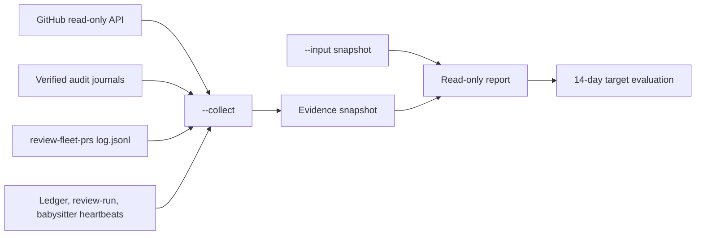

## Summary

Adds a read-only PR completion report, `deno task pr-completion-report`, with
two modes. `--input` reads a caller-supplied evidence snapshot. `--collect`
builds that snapshot itself from read-only GitHub reads, exported or local audit
journals, the review-fleet-prs `log.jsonl`, lifecycle ledgers, review-run
records and babysitter heartbeats. The audit hook now records trusted action
metadata, and the worker, reviewer and babysitter record a code revision plus a
policy fingerprint. The report keeps stalled PRs and unknown history in its
denominators and evaluates the provisional 90% target only after a verified
rollout plus 14 days. Several parts of the issue are still partial (see
Acceptance Criteria), so this is Part of #4658.

Version bump: `VERSION` is not touched by this change.

### Deno regression avoided

The report is a Deno command and Deno task. No Node tooling, `package.json` or
`deno.lock` change.

## Spec

### Intent and Rationale

- GitHub `merged_by` cannot show unattended completion: a bot merge can follow a
  human repair and automation can use a user login. The report therefore never
  reads a login. A PR is verified unattended only when every GitHub-observed
  mutating event matches a verified fleet record and the history is complete.
- It builds on the existing hash-chained audit journal, lifecycle ledger,
  review-run record and babysitter state. It adds no service, dashboard or merge
  gate.

### Essential Design Decisions

- Unmatched GitHub events become actor `unknown`, never `human` or `fleet`. So
  `--collect` reports unknown history rather than inventing a human
  intervention; `humanAssistedMerged` can only be non-zero from recorded human
  actions in an `--input` snapshot. Accepted trade-off: collected data cannot
  yet tell a human repair from an unrecorded one.
- Commits match the first verified push at or after their committer date;
  one push may deliver multiple commits. Branch linking begins at the first
  commit, covering WIP pushes before PR creation and delayed completion pushes.
  Time-based matching cannot distinguish an earlier unrecorded push.
- Matching window for reviews/dismissals: ±10 minutes; for `merge` the fleet action
  may be from PR creation up to `mergedAt` + 10 minutes, because the fleet arms
  auto-merge long before GitHub merges. Accepted trade-off: a fleet-armed merge
  completed by a person is attributed to the fleet.
- Audit `git push` entries carry no repo, so they link to PRs by head-branch
  name inside the PR's lifetime; `HEAD` targets and branch names shared across
  repos stay unlinked. The review skill posts through its own `gh`, so reviews
  come from its local `log.jsonl`, documented as lower trust (not hash-chained).
- The review log contract and JSONL parser live in
  `worker/deno/lib/fleet_review_log.ts`, shared by the review skill and the
  snapshot collector without importing the skill into the worker.
- Deviation from the issue text, recorded for review: the issue says to put the
  fingerprint "in existing health/round records". The worker uses the lifecycle
  assignment and the reviewer uses `review-run.json`, but the babysitter had no
  existing health record, so it writes a new `deployment-health.json` heartbeat.

### Undiscoverable Facts

- No `<fleet_data_source>` block was supplied and no cohort data was measured,
  so this PR reports no current baseline and no two-week result.
- `verifyAllChains` can settle an interrupted append (Issue #1074), so
  `--collect` is not strictly write-free on an audit directory left mid-append;
  this is documented.
- This checkout's review of the pre-existing failures:
  `completion_phase_repo_formatters_test.ts` (2 tests) and
  `pr_maintenance_command_test.ts` (merge-queue test) also fail on
  `origin/main`.

## Evidence

Backend and CLI only. `--collect` emits PR status, unattended outcomes, timing,
round counts, CI cost where available, blocker intervals, regressions,
deployment health, rollout counts and coverage notes; proportions are `null` for
zero denominators.

The trusted update route remains the existing `worker-checkout-update` launcher
step documented in `docs/INTERNALS.md`; nothing here updates or configures a
host.

Observed tool behaviour the code depends on: the audit mutation classifier
output for a worker dismissal
(`classifyGhMutation(["api","-X","PUT","repos/org/repo/pulls/42/reviews/777/dismissals",…])`
returns verb `api-put`, the full target and `scope: "explicit"`), and for
`git push` it returns `{verb:"git-push", target, scope:"cwd"}` with no repo. The
GitHub REST shapes in the fake are the documented `pulls`, `pulls/N/reviews`,
`issues/N/events`, `pulls/N/commits` and `commits/{sha}/check-runs` responses
(docs.github.com/rest); live GitHub was not called in this run.

Related issues read: #3404, "Per-tier PR outcomes and cost per merged PR in
fleet telemetry" (closed); #4595, "Orchestrated issue runs record only one
provider call's run stats, so the cost/model comment and fleet telemetry leave
out the plan and executor calls" (closed); #4613, "Branch updates: on a strict
base with no merge queue, update only the PR that is ready to merge, not every
PR that is behind" (open). The report does not consume `fleet_telemetry.ts`; it
does not claim those deliverables.

## Acceptance Criteria

<!-- vibe-spec-review inputs="diff+issue-body" -->

- **partial** — "Report a rolling, explicitly dated PR cohort with merged,
  open/ageing, closed-unmerged and genuinely owner-gated outcomes." — evidence:
  `worker/deno/lib/pr_completion_report.ts`,
  `worker/deno/tests/pr_completion_report_test.ts` — reviewer: partial — reason:
  owner gates are verified only from supplied evidence; `--collect` sets
  `ownerGateVerified` false because no recorded hold marker exists, so those PRs
  stay in the denominator.
- **met** — "Count each PR once across hosts." — evidence:
  `worker/deno/tests/pr_completion_snapshot_test.ts::collect - an action repeated across two audit directories is counted once`,
  `worker/deno/tests/pr_completion_report_test.ts::of two observations of one PR the later one wins, in either input order`,
  `worker/deno/tests/pr_completion_report_test.ts::excludedPrs counts the winning observation of each PR once`
  — reviewer: met
- **met** — "Separate default-branch delivery from milestone sync/fix traffic
  and follow rollups without counting each intermediate merge as another
  delivered feature." — evidence: `worker/deno/lib/pr_completion_snapshot.ts`
  `deriveRollupRoots`, `worker/deno/tests/pr_completion_snapshot_test.ts` rollup
  tests — reviewer: met
- **partial** — "Record trusted automation provenance for
  implementation/repair/review/dismissal/merge actions" — evidence:
  `worker/deno/lib/audit_hook.ts`, `worker/deno/tests/audit_hook_test.ts` —
  reviewer: partial — reason: worker implementation/repair, merge and dismissal
  pushes are journalled; milestone sync/rollback pushes stay `unknown`, and
  reviews come from the lower-trust review log because the skill does not
  journal. The host babysitter has no `WORK_DIR`, so its repair pushes and
  dismissals are never journalled; those PRs stay unknown under `--collect`.
- **partial** — "distinguish recorded human intervention, verified automated
  completion and unknown history." — evidence:
  `worker/deno/tests/pr_completion_report_test.ts` — reviewer: partial — reason:
  the report distinguishes all three when human actions are recorded, but
  nothing records human actions yet, so collected history is verified or
  unknown.
- **met** — "Do not label a historical PR zero-touch solely from login
  identity." — evidence:
  `worker/deno/tests/pr_completion_report_test.ts::a login-looking field cannot change an action's actor`
  — reviewer: met
- **partial** — "Report unattended completion proportion, time to merge (median
  and tail), review/fix rounds, CI runs/minutes per delivered change where
  available, and waiting time by concrete blocker." — evidence:
  `worker/deno/lib/pr_completion_report.ts` — reviewer: partial — reason: CI
  counts only the final head's check runs and blockers cover `needs-human` and
  `changes-requested` only; both are documented.
- **partial** — "Publish denominators and unknown/excluded counts; do not
  improve the figure by quietly dropping stalled PRs." — evidence:
  `worker/deno/lib/pr_completion_report.ts` `coverage` block
  (`openPrsBeforeCohort`, `excludedPrs`, `unknownPrHistory`),
  `worker/deno/tests/pr_completion_snapshot_test.ts::collect - open PRs from before the cohort are counted, whether on the first or a later page`,
  `worker/deno/tests/pr_completion_report_test.ts::open PRs from before the cohort are published, defaulting to none, and must be a count`
  — reviewer: partial — reason: PRs open from before `cohort.start` are now
  published as `coverage.openPrsBeforeCohort`, but as a count outside the rates:
  they are not classified (unknown, owner-gated) or added to the 24-hour
  denominator, and the count is of current open state, not state at
  `cohort.observedAt`.
- **partial** — "Preserve a separate post-merge failure/regression view." —
  evidence: `worker/deno/lib/pr_completion_snapshot.ts` revert detection —
  reviewer: partial — reason: only reverts of merged PRs inside the cohort are
  observed, not post-merge default-branch CI failures.
- **partial** — "Include each active worker/reviewer/babysitter's code revision
  and effective review-policy/configuration fingerprint in existing health/round
  records, without secrets." — evidence: `worker/deno/lib/lifecycle_ledger.ts`,
  `worker/deno/lib/review_round.ts`,
  `worker/deno/commands/fleet_pr_babysitter.ts` — reviewer: partial — reason:
  the babysitter writes a new heartbeat file, and the fingerprint covers the
  worker's resolved issue/executor policy, not the review skill's own settings.
- **partial** — "Report mixed/stale deployment or missing heartbeat as
  unknown/degraded, not proof that the fix is active." — evidence:
  `worker/deno/tests/pr_completion_report_test.ts` deployment tests — reviewer:
  partial — reason: rows are grouped per component, not per host, so one host's
  missing heartbeat is hidden while another host of the same component reports.
- **partial** — "Provide a read-only report plus a repeatable rollout check that
  the changed policy is active and previously stranded PRs re-enter ordinary
  discovery." — evidence: `worker/deno/lib/pr_completion_snapshot.ts`
  `strandedAt`, `worker/deno/tests/pr_completion_snapshot_test.ts` rollout test
  — reviewer: partial — reason: "rediscovered" means a verified fleet action
  after rollout, not proof of the discovery path; PRs created before
  `cohort.start` are counted in `coverage.openPrsBeforeCohort` but are outside
  the rollout check unless `--start` is widened.
- **met** — "Reuse trusted existing deployment/update mechanisms; no unapproved
  host configuration writes." — evidence: `docs/INTERNALS.md` section "PR
  completion evidence report" — reviewer: met
- **met** — "A synthetic cohort proves correct deduplication, manual repair
  followed by bot merge, automated action using a user identity, unknown
  history, milestone rollup, owner gate and zero denominator." — evidence:
  `worker/deno/tests/pr_completion_report_test.ts` — reviewer: partial — reason:
  the reviewer noted the manual-repair case uses a hand-recorded human action;
  the report logic is covered, which is what the criterion states.
- **partial** — "Existing telemetry readers remain compatible." — evidence:
  `worker/deno/tests/lifecycle_ledger_test.ts`,
  `worker/deno/tests/review_round_test.ts` — reviewer: partial — reason: new
  builds read old records, but a build older than this change cannot verify
  entries carrying the new audit fields or read ledger rows with
  `reviewPolicyFingerprint`; documented in `docs/AGENT-ACCOUNTABILITY.md`.
- **partial** — "Use a provisional target of >=90% of eligible fleet PRs merged
  within 24 hours with no human repair/approval/dismissal/merge, evaluated over
  two weeks after rollout. Report genuine owner-only exceptions and regressions
  alongside it." — evidence: `worker/deno/lib/pr_completion_report.ts`
  `targetEvaluation` — reviewer: partial — reason: evaluated as an operational
  report only, never a gate; no result exists yet because the rollout has not
  run.
- **unrequested** — `docs/audits/lib-sweep-coverage/top-up-4658.json` —
  reviewer: unrequested — reason: the repo's lib-sweep coverage test requires
  every new module to be claimed.
- **unrequested** — `callerFromStack` skips more plumbing modules and accepts
  `commands/` and `lib/` subdirectories — reviewer: unrequested — reason: needed
  to attribute actions to the requesting module; it changes the `caller` string
  on some audit entries.

## Standards Review

<!-- vibe-standards-review inputs="diff+CODING-STANDARDS.md" -->

- **violation** — worker pushes classified `unknown` because `git_push.ts` was
  not plumbing; fixtures never produced by production — evidence:
  `worker/deno/lib/audit_hook.ts` — reason: fixed in this diff (`git_push.ts`
  skipped, stacks in `worker/deno/tests/audit_hook_test.ts` mirror the real
  chain)
- **violation** — missing GitHub keys treated as empty state — evidence:
  `worker/deno/lib/pr_completion_snapshot.ts` — reason: fixed in this diff
  (`requiredKey`, omission rejected per field)
- **violation** — members only tests set (`AuditHookOptions.headSha`,
  `actorLogin`, `host`) — evidence: `worker/deno/lib/audit_hook.ts`,
  `worker/deno/lib/pr_completion_report.ts` — reason: fixed in this diff
  (removed)
- **violation** — unreached branch outcomes, changed call sites without a red
  test, spawned-process test, stale docs and doc comments, American spelling —
  evidence: `worker/deno/tests/review_round_command_4658_test.ts`,
  `docs/AGENT-ACCOUNTABILITY.md`, `docs/INTERNALS.md` — reason: fixed in this
  diff (in-process seam `runReviewRoundCommand`, tests added, docs rewritten)
- **violation** — `publishBabysitterDeployment` main-block wiring in
  `worker/deno/commands/fleet_pr_babysitter.ts` has no test through
  `import.meta.main` — evidence: `worker/deno/commands/fleet_pr_babysitter.ts` —
  reason: fixed in this diff by extracting the exported
  `publishBabysitterDeployment` and `loadConfigAndPublishDeployment` and testing
  both; `main` now holds only a call that assigns the loaded config
- **clean** — no hidden files staged; Australian English; named tests exist;
  regexes on untrusted text (`REVERT_TITLE`, `REVERT_REFERENCE`,
  `QUOTED_PR_REFERENCE`) each have a hostile case; legacy-shape tests exist for
  ledger, review-run and journal entries; `mod_test.ts` count change (160
  to 161) goes red without the registration; review-enforced "check where you
  insert" held.

## Test Plan

- Review fixes: `--disable-auto` is an unknown action, never evidence of a
  fleet merge. New audit-hook and collector regressions failed before the
  classifier fix. Checkpoint tests assert that `push-20` and `push-30` link to
  PR 1, and cover a PR opened more than ten minutes after every push. The
  operator manual and review-log comment now describe repository/number
  linking independent of head SHA. The accepted host-babysitter provenance
  limitation is recorded above and in INTERNALS; no assertion was removed.
  Both checkpoint tests went red with first-commit lifetime widening removed
  and green after restoration. The targeted audit-hook, snapshot, report and
  command suites pass (111 tests), as does `check:manifests` (847 tests).
  `quality.sh` passes formatter, linter, type check, markdownlint, Mermaid and
  release-ruleset checks. Its parallel suite aborts in Deno 2.9.5 on macOS
  (`pledge test permissions called before restoring previous pledge`), before
  the serial pass. CI test shards pass on this PR head and on #4718, which
  produced the current base. Semgrep and Checkov are absent on this host;
  configuration integration has no local config.
- CI-fix push `b8a4a161`: the production babysitter repair test warms the
  command's module graph before its `--cached-only` subprocess, so a shard's
  incomplete Deno cache does not prevent the repair from starting. The CI-fix
  run reported 17 tests passed in `fleet_babysitter_app_test.ts`, including a
  cold-cache run; the original missing-manifest failure was not reproduced
  locally.
- Quality-fix push `48efac0f`: extracted the shared review-log contract and
  parser and changed the collector to import it from the worker library.
  `deno test --allow-read --allow-env --allow-run --allow-write
  --allow-sys=hostname tests/pr_completion_snapshot_test.ts` passed (40 tests).
- Verifier and mutation round (this turn): `coverage.openPrsBeforeCohort` counts
  PRs still open that predate `cohort.start` (extra bounded `pulls?state=open`
  scan; a bound reached marks the repository truncated). `excludedPrs` now
  counts the winning duplicate observation. New tests: later observation wins in
  either order (open then merged, merged then closed); `excludedPrs` with
  differing eligibility; `openPrsBeforeCohort` in the report and in `--collect`
  (first page, capped); a matched PR whose PR, merge and commit carry
  human-looking `user`/`merged_by`/`author` logins stays unattended with 0 human
  and 0 unknown. Mutations: `asPositiveInteger` no longer carries the equivalent
  `text === undefined ||` operand (line 60 mutant was equivalent, as
  `/^\d+$/.test(undefined)` is false); an empty `config.repos` is tested to fail
  (line 83); the babysitter pass's load and publish moved into exported
  `loadConfigAndPublishDeployment`, tested with an injected loader, so deleting
  the publish call goes red (line 1103).
- Added: `worker/deno/tests/pr_completion_report_test.ts`,
  `worker/deno/tests/pr_completion_snapshot_test.ts`,
  `worker/deno/tests/pr_completion_report_command_test.ts`,
  `worker/deno/tests/review_round_command_4658_test.ts`. Edited:
  `worker/deno/tests/audit_hook_test.ts`,
  `worker/deno/tests/lifecycle_ledger_test.ts`,
  `worker/deno/tests/review_round_test.ts`,
  `worker/deno/tests/fleet_pr_babysitter_test.ts`,
  `worker/deno/tests/issue_assignment_test.ts`,
  `worker/deno/tests/execute_phase_assignment_3718_test.ts`,
  `worker/deno/tests/mod_test.ts`.
- Targeted run after the verifier round of `pr_completion_report_test.ts`,
  `pr_completion_snapshot_test.ts`, `pr_completion_report_command_test.ts`,
  `fleet_pr_babysitter_test.ts`, `mod_test.ts` and `lib_sweep_coverage_test.ts`:
  `ok | 160 passed | 0 failed`; `deno lint` clean. Earlier final run of those
  files plus `worker/deno/tests/audit_journal_test.ts` and
  `worker/deno/tests/lib_sweep_coverage_test.ts`: `ok | 283 passed | 0 failed`.
  `deno task check:manifests` passed. `deno fmt`, `deno lint` and `deno check`
  on the changed files passed.
- Red checks (each guard broken, test went red, guard restored): merge window
  start bound; ±10 minute window; verified-chain requirement;
  `rolloutVerifiedAt` comparison; stranded open-at-rollout rule; push ambiguity
  rule; rollup `headRef` match; policy fingerprint allowlist; login-never-human;
  review-log verified flag and window; `/dismissals` classification;
  `git_push.ts` plumbing entry; `Number.isSafeInteger` in `prNumberFor`;
  head-SHA unlink restored (human repair at older head); missing-key
  `requiredKey`; `unavailable` target status; `deployment` argument in
  `commands/review_round.ts`; fingerprint in `recordBabysitterDeployment`;
  `reviewPolicyFingerprint` spread in `lib/issue_assignment.ts`;
  `reviewPolicyFingerprint` in `execute_phase.ts`; lifecycle ledger fingerprint
  regex. Weak check: the `not_met` target-status break replaced the whole
  expression, so it did not isolate that branch; the branch is covered by its
  own test.
- Removed from `worker/deno/tests/mod_test.ts`:
  `assertEquals(commands.length, 160);`
  - Required by: "a repeatable rollout check that the changed policy is active"
  - Replaced by: `assertEquals(commands.length, 161);` and
    `assertEquals(commands.includes("pr-completion-report"), true);`
- No assertion was removed from `fleet_pr_babysitter_test.ts` or
  `audit_hook_test.ts` relative to the base: those files only gained tests (the
  `issueExecutorSplit`, `headSha` and `git_push.ts` unknown assertions were
  intermediate drafts that never existed at the base). The only base-relative
  change to an existing assertion is `mod_test.ts` above.
- Twinned rules: the actionKind classification in
  `worker/deno/lib/audit_hook.ts` and the snapshot matcher in
  `worker/deno/lib/pr_completion_snapshot.ts` must agree on kinds; both are
  covered by the `collect` tests that use hook-shaped entries.
- Quality gate: `timeout 900 ./quality.sh < /dev/null` on the final head failed
  only on "deno tests" (parallel pass: 31772 passed, 3 failed). The three
  failures also fail on `origin/main`:
  `completion_phase_repo_formatters_test.ts` (two Rust-formatter tests) and
  `pr_maintenance_command_test.ts` (merge-queue test). Because the parallel pass
  failed, the serial pass did not run. All other stages passed except config
  integration and Checkov, which the gate skipped.
- Docs read and updated: `docs/INTERNALS.md` ("PR completion evidence report"),
  `docs/AGENT-ACCOUNTABILITY.md` ("Per-entry fields"). Siblings grepped for the
  new audit fields: `verb`, `caller`, `outcome`.
- Not done: live GitHub was never called; no cross-host data was available; the
  review skill still does not journal to the audit chain.

### PR #4709 review repairs

Named checkpoint, WIP preservation, declared handoff and push recovery modules
as implementation push callers. The host babysitter resolves its checkout
revision when the container build stamp is unset. Corrected the shared review
log parser dependency and documented the assignment policy fingerprint. Added
production-shaped collector and default heartbeat regression tests; both failed
before their fixes. The former ten-minute commit-window fixture now uses a push before the commit,
preserving the unknown-delivery assertions while replacing the obsolete time
window contract. Review/dismissal window rejection remains covered separately.
The heartbeat test accepts the existing resolver's explicit dirty suffix.

Validation of the review repairs: 116 focused tests passed with the local gate
permissions; check:manifests passed (847 tests). The gate passed formatting,
lint, type checking, Markdown lint and Mermaid checks. Its full parallel test
pass hit a Deno 2.9.5 macOS runtime panic (pledge test permissions called before
restoring previous pledge). Release-ruleset checking could not read sandboxed
gh configuration; Semgrep and Checkov are unavailable on this host. The current
PR checks and the latest main merge (PR #4714) were green in GitHub CI.
