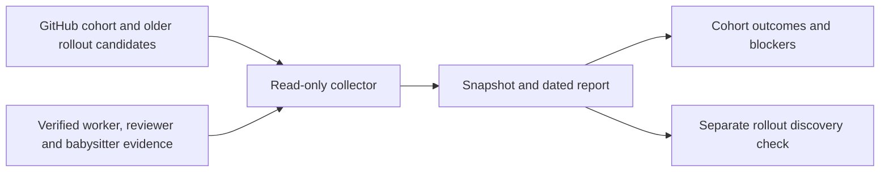

## Summary

Completed the remaining trusted completion reporting in the existing collector.
Check runs now cover every observed PR head, recovery and refresh waits use
verified action evidence, reviewer branch refreshes are journalled, and rollout
discovery includes stranded PRs older than the measurement cohort without
changing its denominator. The provisional 90% within-24-hours target remains
pending two-week operational evaluation; no achieved result or baseline is
claimed. Closes #4658.

## Spec

### Intent and Rationale

- Preserve stalled and older stranded PRs in the report and rollout check so
  missing history cannot improve completion rates or conceal rediscovery gaps.
- Attribute repair, review, dismissal, branch refresh and merge activity from
  verified action records; account identity alone does not prove unattended
  work.

### Essential Design Decisions

- Cohort PRs and older rollout candidates are collected separately. Older
  candidates affect rollout verification, not delivery denominators.
- Repair-recovery intervals end at the next confirmed repair. Branch-refresh
  intervals end when checks on the correlated updated commit complete, capped by
  the PR terminal state or observation time.
- Missing, truncated or unverified action evidence remains unknown or
  incomplete; it is never inferred from login or branch names.
- Reviewer `update-branch` actions use the existing hash-chained audit journal.
  The prior head is not represented as the resulting refreshed commit.

### Undiscoverable Facts

- No live fleet cohort or two-week post-rollout measurement was collected. The
  target is available for operational evaluation but is not reported as met.
- Expected host inventory and exported audit journals determine fleet coverage;
  absent evidence degrades or leaves metrics unknown.

## Evidence

This is a backend collector and CLI change; no visual evidence applies. The
repeatable collection and replay path is:

```sh
cd worker/deno
REPOS='owner/repo'
COHORT_START='2026-10-01T00:00:00Z'
COHORT_END='2026-10-15T00:00:00Z'
VERIFIED_AT='2026-10-15T00:00:00Z'
AUDIT_DIRS='/path/worker-audit,/path/reviewer-audit,/path/babysitter-audit'
EXPECTED_INVENTORY='worker-host/worker,review-host/reviewer,babysitter-host/babysitter'
EXPECTED_REVISION="$(git rev-parse HEAD)"
deno task pr-completion-report --collect --repos "$REPOS" --start "$COHORT_START" --end "$COHORT_END" --rollout-verified-at "$VERIFIED_AT" --write-snapshot /tmp/pr-completion.json --audit-dir "$AUDIT_DIRS" --expected-inventory "$EXPECTED_INVENTORY" --expected-revision "$EXPECTED_REVISION"
deno task pr-completion-report --input /tmp/pr-completion.json
```

The collector is read-only except for the explicitly requested snapshot file.
See the **PR completion evidence report** section of `docs/INTERNALS.md` for
evidence sources, coverage limits and deployment arguments.



## Test Plan

- `worker/deno/tests/pr_completion_snapshot_test.ts::collect - check runs are read for an observed head with no workflow runs`
  — failed against the prior collector, then passed after collection was
  extended. The snapshot suite passed with 102 tests.
- `worker/deno/tests/pr_completion_snapshot_test.ts::collect - recorded repair recovery and reviewer refresh waits are attributed`
  covers both blocker intervals;
  `worker/deno/tests/pr_completion_snapshot_test.ts::collect - the rollout check counts stranded, rediscovered and processed PRs by verified time`
  covers a stranded PR outside the cohort.
- `worker/deno/tests/pr_completion_snapshot_test.ts::collect - automated commits retaining an allowlisted human author stay unknown`,
  `worker/deno/tests/pr_completion_snapshot_test.ts::collect - milestone rollup actions link the delivered GitHub commit`,
  `worker/deno/tests/pr_completion_snapshot_test.ts::collect - unmatched GitHub merges and approvals are unknown, never human or fleet`,
  and
  `worker/deno/tests/pr_completion_snapshot_test.ts::collect - a zero-PR cohort yields an empty, valid report`
  cover the listed attribution and cohort cases.
- `worker/deno/tests/pr_completion_report_test.ts::a verified human repair at an earlier head still counts; the head SHA does not unlink it`
  covers human repair followed by a fleet merge.
  `worker/deno/tests/pr_completion_report_test.ts::PR completion report deduplicates repeated observations and separates trusted outcomes`
  covers repeated hosts, open and closed-unmerged PRs, milestone rollups, owner
  gates and unknown outcomes.
- `worker/deno/tests/review_fleet_prs_backlog_3225_test.ts` and
  `worker/deno/tests/review_fleet_prs_dependabot_test.ts` — passed in the full
  test run; branch-refresh journal success and refusal are covered through the
  reviewer production paths.
- `worker/deno/tests/pr_completion_report_test.ts` and
  `worker/deno/tests/pr_completion_report_command_test.ts` — passed, 47 tests.
- `deno lint`, full Deno type check and `deno fmt` — passed in `./quality.sh`.
- `./quality.sh < /dev/null` — failed its unit-test time budget. The parallel
  and serial Deno suites passed, but 84 tests exceeded the one-second unit-test
  budget; `worker/deno/tests/launcher_harness_reclaim_stub_test.ts` accounts for
  two (3.40 seconds total) and is unchanged from the base branch. Markdownlint,
  semgrep, Mermaid, completeness checks and other available checks passed.
  Config integration and Checkov were skipped because the local
  configuration/tool was unavailable.
- Regression visibility remains separate: post-merge failures do not change
  completion success.

## Deno regression avoided

- Kept collection, tests and commands Deno-native; no Node tooling or dependency
  was added.

## Merge verification

The repository quality gate is not fully green because of the unchanged
unit-test timing-budget failure described above. CI, live fleet coverage and the
two-week operational evaluation remain pending.

Version bump: none; `VERSION` is unchanged.
