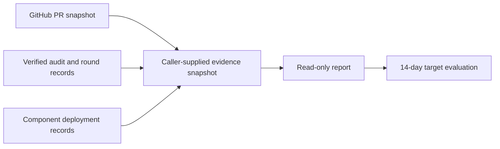

## Summary

Added a read-only, dated PR completion report command, trusted audit action metadata, and deployment policy fingerprints in worker, reviewer, and babysitter records. The report keeps stalled PRs and unknown history visible, separates delivered changes from milestone rollups, and evaluates the provisional 90% target only after its 14-day window. Cross-host snapshot production and live ordinary-discovery rollout verification remain incomplete. Part of #4658.

### Deno regression avoided

Added the report as a Deno command and Deno task; no Node tooling or lockfile changes.

## Spec

### Intent and Rationale

- GitHub `merged_by` cannot establish unattended completion when a human may have repaired a PR first or automation uses a user login.
- Existing hash-chained audit, lifecycle assignment, reviewer round, and babysitter state records provide the provenance and deployment record shapes; the report consumes a normalized snapshot without creating a service or merge gate.

### Essential Design Decisions

- Cohort and action times must be UTC. PRs deduplicate by repository and number; actor login is never used to establish automation.
- A verified unattended merge requires complete action history, verified successful implementation or repair and merge actions, and no recorded human action. Unlinked or unverified history stays unknown.
- The policy fingerprint covers the same allowlisted host settings and resolved per-repository issue policy for each component. It contains no credentials or raw configuration.
- The CLI reads a caller-supplied JSON snapshot. It neither authenticates that snapshot nor fetches GitHub or cross-host records; a snapshot producer must verify source journals.

### Undiscoverable Facts

- No fleet archive block or historical cohort data was supplied, so no current fleet baseline or two-week rollout result was measured.
- Older audit entries lack the new action fields; their provenance remains unknown.

## Evidence

The implementation is backend and CLI only. `pr-completion-report` emits PR status, unattended outcomes, timing, round counts, available CI cost, blocker intervals, regressions, deployment health, rollout counts, coverage, and unavailable proportions for zero denominators. The worker lifecycle ledger keeps accepting legacy assignments without the optional fingerprint.

The trusted update route remains the existing `worker-checkout-update` launcher step documented in `docs/INTERNALS.md`. The report does not modify host configuration or create a merge gate.

Related issues read: #3404, “Per-tier PR outcomes and cost per merged PR in fleet telemetry” (closed); #4595, “Orchestrated issue runs record only one provider call's run stats, so the cost/model comment and fleet telemetry leave out the plan and executor calls” (closed); and #4613, “Branch updates: on a strict base with no merge queue, update only the PR that is ready to merge, not every PR that is behind” (open). The report does not claim those deliverables as shipped here.

## Acceptance Criteria

- **missing** — "Record trusted automation provenance for implementation/repair/review/dismissal/merge actions; distinguish recorded human intervention, verified automated completion and unknown history. Do not label a historical PR zero-touch solely from login identity." — reason: audit hooks now identify merge, review, dismissal, and implementation/repair push categories, but pushed implementation and repair actions are not linked to a PR/head by the hook, and the report CLI has no trusted cross-host snapshot producer.
- **missing** — "Provide a read-only report plus a repeatable rollout check that the changed policy is active and previously stranded PRs re-enter ordinary discovery. Reuse trusted existing deployment/update mechanisms; no unapproved host configuration writes." — reason: the report evaluates caller-supplied rollout observations; it does not execute ordinary discovery for the stranded PR set or gather fresh component records itself.
- **missing** — "Report CI runs/minutes per delivered change where available, and waiting time by concrete blocker." — reason: calculations are implemented for supplied snapshot data, but no producer gathers GitHub CI durations or blocker intervals into that snapshot.

## Test Plan

- `worker/deno/tests/pr_completion_report_test.ts` — synthetic cross-host PR deduplication, manual repair then bot merge, automation under a user login, unknown history, milestone rollup, owner-gated denominator, zero denominators, blocker timing, CI coverage, regression attribution, rollout target timing, stale/mixed deployment, and policy fingerprint cases — passed as part of the 133-test targeted run.
- `worker/deno/tests/pr_completion_report_command_test.ts` — report command success and missing-input failure — passed as part of the 133-test targeted run.
- `worker/deno/tests/audit_hook_test.ts` and `worker/deno/tests/audit_journal_test.ts` — action metadata, merge/dismissal classification, and journal compatibility — passed as part of the 133-test targeted run.
- `worker/deno/tests/lifecycle_ledger_test.ts` — legacy assignment without a policy fingerprint remains readable — passed as part of the 133-test targeted run.
- `worker/deno/tests/execute_phase_assignment_3718_test.ts` — worker assignment supplies the policy fingerprint — passed as part of the 133-test targeted run.
- `worker/deno/tests/review_round_test.ts` — reviewer round records build and policy metadata — passed as part of the 133-test targeted run.
- `worker/deno/tests/fleet_pr_babysitter_test.ts` — babysitter deployment heartbeat records component, revision, and policy fingerprint — passed as part of the 133-test targeted run.
- `worker/deno/tests/mod_test.ts` — command registration. Reverted only `registry.register(prCompletionReportCommand)` and ran `deno task test:unit tests/mod_test.ts`: red (18 passed, 2 failed, including command count and unregistered-command checks); restored registration and the targeted suite passed.
- Removed from `worker/deno/tests/mod_test.ts`: `assertEquals(commands.length, 160);`
  - Required by: "A read-only report plus a repeatable rollout check"
  - Replaced by: `assertEquals(commands.length, 161);` and `assertEquals(commands.includes("pr-completion-report"), true);`
- `deno check --frozen --lock=deno.lock` on the changed Deno modules and tests — passed.
- `deno lint` on changed Deno modules and tests — passed.
- `deno fmt --check` on changed Deno modules and tests — passed after the final policy fingerprint helper edit.
- `git diff --check` — passed. `deno.lock` is unchanged.

### Documentation

Updated the `PR completion evidence report` section in `docs/INTERNALS.md`. Final grep covered `pr-completion-report`, `reviewPolicyFingerprint`, `actionKind`, and the unattended PR wording across `README.md`, `docs/`, and `worker/deno/`; no stale description of the new command or fields was found. The section documents the caller-supplied snapshot and its verification limits.
