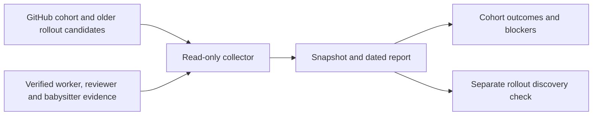

## Summary

Completed the remaining trusted completion reporting in the existing collector.
Check runs now cover every observed PR head, recovery and refresh waits use
verified action evidence, reviewer branch refreshes are journalled, and rollout
discovery includes stranded PRs older than the measurement cohort without
changing its denominator. The provisional 90% within-24-hours target remains
pending two-week operational evaluation; no achieved result or baseline is
claimed. Closes #4658.

## Spec

### Intent and Rationale

- Preserve stalled and older stranded PRs in the report and rollout check so
  missing history cannot improve completion rates or conceal rediscovery gaps.
- Attribute repair, review, dismissal, branch refresh and merge activity from
  verified action records; account identity alone does not prove unattended
  work.

### Essential Design Decisions

- Cohort PRs and older rollout candidates are collected separately. Older
  candidates affect rollout verification, not delivery denominators.
- Repeated failed repairs share one recovery interval until the next confirmed
  repair. Branch-refresh intervals end at a positively completed workflow or
  external check on the correlated commit, capped by the PR terminal state or
  observation time.
- Rollout scans continue through older pages to exhaustion or the collection
  bound. Bound exhaustion and candidate truncation leave coverage incomplete.
- CI cost ratios retain check-only heads alongside workflow heads. Workflow
  checks and jobs are not counted again in the primary cost totals.
- Missing, truncated or unverified action evidence remains unknown or
  incomplete; it is never inferred from login or branch names.
- Reviewer `update-branch` actions use the existing hash-chained audit journal.
  The prior head is not represented as the resulting refreshed commit.

### Undiscoverable Facts

- No live fleet cohort or two-week post-rollout measurement was collected. The
  target is available for operational evaluation but is not reported as met.
- Expected host inventory and exported audit journals determine fleet coverage;
  absent evidence degrades or leaves metrics unknown.

## Evidence

This is a backend collector and CLI change; no visual evidence applies. The
repeatable collection and replay path is:

```sh
cd worker/deno
REPOS='owner/repo'
COHORT_START='2026-10-01T00:00:00Z'
COHORT_END='2026-10-15T00:00:00Z'
VERIFIED_AT='2026-10-15T00:00:00Z'
AUDIT_DIRS='/path/worker-audit,/path/reviewer-audit,/path/babysitter-audit'
EXPECTED_INVENTORY='worker-host/worker,review-host/reviewer,babysitter-host/babysitter'
EXPECTED_REVISION="$(git rev-parse HEAD)"
deno task pr-completion-report --collect --repos "$REPOS" --start "$COHORT_START" --end "$COHORT_END" --rollout-verified-at "$VERIFIED_AT" --write-snapshot /tmp/pr-completion.json --audit-dir "$AUDIT_DIRS" --expected-inventory "$EXPECTED_INVENTORY" --expected-revision "$EXPECTED_REVISION"
deno task pr-completion-report --input /tmp/pr-completion.json
```

The collector is read-only except for the explicitly requested snapshot file.
See the **PR completion evidence report** section of `docs/INTERNALS.md` for
evidence sources, coverage limits and deployment arguments.



## Test Plan

- `worker/deno/tests/pr_completion_snapshot_test.ts::collect - check runs are read for an observed head with no workflow runs`
  — failed against the prior collector, then passed after collection was
  extended. The current snapshot suite passed with 110 tests.
- `worker/deno/tests/pr_completion_snapshot_test.ts::collect - recorded repair recovery and reviewer refresh waits are attributed`
  covers both blocker intervals;
  `worker/deno/tests/pr_completion_snapshot_test.ts::collect - the rollout check counts stranded, rediscovered and processed PRs by verified time`
  covers a stranded PR outside the cohort.
- `worker/deno/tests/pr_completion_snapshot_test.ts::collect - automated commits retaining an allowlisted human author stay unknown`,
  `worker/deno/tests/pr_completion_snapshot_test.ts::collect - milestone rollup actions link the delivered GitHub commit`,
  `worker/deno/tests/pr_completion_snapshot_test.ts::collect - unmatched GitHub merges and approvals are unknown, never human or fleet`,
  and
  `worker/deno/tests/pr_completion_snapshot_test.ts::collect - a zero-PR cohort yields an empty, valid report`
  cover the listed attribution and cohort cases.
- `worker/deno/tests/pr_completion_report_test.ts::a verified human repair at an earlier head still counts; the head SHA does not unlink it`
  covers human repair followed by a fleet merge.
  `worker/deno/tests/pr_completion_report_test.ts::PR completion report deduplicates repeated observations and separates trusted outcomes`
  covers repeated hosts, open and closed-unmerged PRs, milestone rollups, owner
  gates and unknown outcomes.
- `worker/deno/tests/review_fleet_prs_backlog_3225_test.ts` and
  `worker/deno/tests/review_fleet_prs_dependabot_test.ts` — passed in the focused
  test run; branch-refresh journal success and refusal are covered through the
  reviewer production paths.
- `worker/deno/tests/pr_completion_report_test.ts` and
  `worker/deno/tests/pr_completion_report_command_test.ts` — passed, 47 tests.
- Current validation: the five focused collector, report, CLI and reviewer
  suites passed with 190 tests; their Deno type checks passed. Changed TypeScript
  files passed `deno lint` and `deno fmt --check`. `deno task check:manifests`
  passed (847 passed, one ignored). Markdownlint and `git diff --check` passed.
- The earlier `./quality.sh < /dev/null` run failed its unit-test time budget. The parallel
  and serial Deno suites passed, but 84 tests exceeded the one-second unit-test
  budget; `worker/deno/tests/launcher_harness_reclaim_stub_test.ts` accounts for
  two (3.40 seconds total) and is unchanged from the base branch. Markdownlint,
  semgrep, Mermaid, completeness checks and other available checks passed.
  Config integration and Checkov were skipped because the local
  configuration/tool was unavailable.
- Regression visibility remains separate: post-merge failures do not change
  completion success.

## Completion-check fixes

### Required item 1 — mutation coverage

The new boundary tests call the same recovery and refresh functions used by the
collector and assert their returned intervals. Collector regressions assert
snapshot coverage and report results; the CLI regressions assert its returned
report. No source-text tests or untestable exemptions were added.

Original locations below refer to the gate's pre-retry head in
`worker/deno/lib/pr_completion_snapshot.ts`:

| Original location and mutation | Resolution and evidence in `pr_completion_snapshot_test.ts` |
| --- | --- |
| 416 — rollout enabled / older-than-cohort guards | `collect boundaries - ordinary cohort collection stops before unnecessary older pages` and `collect boundaries - older candidate cap and future PRs keep rollout coverage honest` fail when either surviving guard is removed. |
| 417 — stranded-age prefilter | Removed with the incorrect cutoff scan; `strandedAt` remains the age authority. The paginated rollout regression and existing age-threshold regression cover selection. |
| 424 — age-based page stop | Removed for rollout scans. `collect regression - rollout scans beyond the first pre-cohort page and reports scan bounds` covers older PRs on later pages and incomplete bounded scans. Ordinary collection retains its tested cohort stop. |
| 437, 438 — completeness and truncation flags | The candidate-cap boundary test supplies complete host discovery evidence, so each flipped flag independently fails an assertion. |
| 757 — nullable repair cap ternary | Removed the numeric-cap precomputation in the chronological recovery loop. `recovery boundaries - trust, kind, outcomes, ordering and terminal caps` covers absent, observation, close and merge caps. |
| 759 — verified / repair-kind guards | The recovery boundary test rejects unverified failures and successes and non-repair actions. Each dropped guard fails. |
| 768 — repair cap guard | The recovery boundary test covers no cap, recovery before the cap, recovery after the cap and failure after the cap. |
| 770 — confirmed recovery outcome | The recovery boundary test leaves an unknown outcome unresolved. Removing the confirmation requirement fails. |
| 771 — recovery timestamp comparison | Removed the redundant comparison after chronological sorting. The recovery boundary test passes actions out of order and confirms that a success before a failure cannot recover it. |
| 774 — cap / absent-recovery guards | Replaced the per-failure ternary with a pending interval closed by confirmation or its cap. Recovery boundary and repeated-failure regressions cover recovered and unrecovered waits. |
| 775 — repeated numeric-cap null guard | Removed with the old recovery ternary; it was redundant with the enclosing non-null cap check. |
| 798 — nullable refresh cap ternary | `refresh boundaries - trusted fleet updates require correlated completion and honour end caps` covers absent and present caps; negating this ternary fails. |
| 801 — verified / fleet-actor guards | The refresh boundary test rejects unverified, human and unknown actors. Each dropped guard fails. |
| 802, 803 — branch-update kind / confirmed outcome guards | The refresh boundary test rejects other action kinds and failed or unknown updates. Each dropped guard fails. |
| 806 — implementation-event correlation | The refresh boundary test accepts implementation and repair commit evidence separately; dropping implementation evidence fails. |

A local mutation pass applied 21 individual mutations to the repaired paths,
running the eight new regression and boundary tests with Deno after each change:
21 were killed, none survived. This includes the retained guards above, the new
recovery outcome/cap logic, workflow completion status, positive conclusion
requirements and external-check support. Removed defective or redundant
expressions above are no longer mutation targets.

### Required item 2 — verifier defects and callers

All four new `collect regression` tests failed against the pre-retry head before
the fixes and pass with the fixes:

- **Rollout pagination and `observeRepo` caller:** 99 cohort PRs followed by
  two older PRs now retain both older PRs across pages. A bounded scan remains
  incomplete. The same regression exercises `runPrCompletionCollect` and proves
  that the cohort denominator stays 99 while rollout eligibility is 101.
- **Overlapping recovery waits:** failures at 00:00 and 00:10 followed by a
  00:30 recovery yield one 1,800-second interval. Without recovery there is one
  interval capped at observation time.
- **Refresh completion:** an in-progress workflow updated at 01:03 keeps the
  wait open; a completed external check closes it at 01:20. Running workflow
  snapshot rows carry no completion timestamp.
- **Mixed-source delivery ratios and CLI caller:** a ten-minute check-only
  delivery plus a twenty-minute workflow delivery yield one CI run and fifteen
  minutes per change. The mixed-source regression also exercises the CLI with
  repeated repair failures and a check-only refresh, asserting the returned
  cost ratios and both waiting aggregates. Workflow checks/jobs are retained
  as evidence without duplicating primary cost totals.

`docs/INTERNALS.md` now describes exhaustive bounded rollout scanning, combined
repair waits, positive workflow/external-check completion and mixed-source cost
accounting. No second implementation of these rules was found; collector and
CLI use the same report consumer and blocker functions.

## Deno regression avoided

- Kept collection, tests and commands Deno-native; no Node tooling or dependency
  was added.

## Merge verification

The full quality gate has not been rerun during this completion-check retry;
its earlier timing-budget failure is recorded above. Current focused tests,
type checks, lint, formatting, manifests and Markdown checks passed. The worker
will rerun the full gate and verifier. CI, live fleet coverage and the two-week
operational evaluation remain pending.

Version bump: none; `VERSION` is unchanged.
