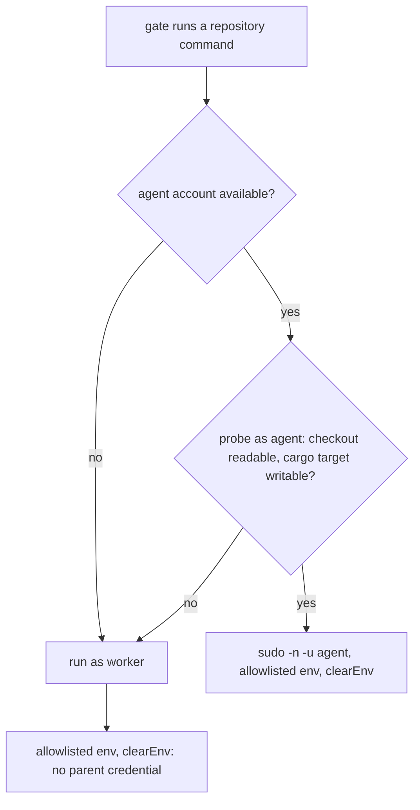

## Summary

The milestone merge and resolution gates ran the repository's own tasks
(`deno task`, `bash quality.sh`, `cargo check`, `cargo test`) with the worker's
whole inherited environment. `spawnTask` and `spawnTypeCheck` now go through a
new helper, `runRepositoryCommand` in `worker/deno/lib/untrusted_gate_spawn.ts`,
which builds the child environment with `untrustedQualityCommandEnv` (the
allowlist plus the Issue #2247 build-cache placement), passes `clearEnv: true`,
and runs as the `agent` account where the image has one and that account can use
the checkout. Part of #4659.

Version bump: no `VERSION` change in this diff; the merged commit records the
final version.

## Spec

### Intent and Rationale

- Code the worker did not write must not see the worker's credentials (Issues
  #572, #1214). The two milestone gates were the sweep's remaining gap.

### Essential Design Decisions

- The `agent` account is probed first and the command falls back to the worker
  account (same allowlisted environment) when the probe fails. The previous
  attempt (PR #4703) dropped to `agent` unconditionally; review showed that
  account cannot read the shared clone on some hosts (#4697) or write a
  worker-created `target` (#4113). Such a command exits 0 with "No matching
  files found" or fails for a reason unrelated to the tree. Falling back keeps
  the verdict a verdict on the tree, and no environment fault reaches the
  merge-refusal recovery ladder.
- Declared `quality_credentials` are resolved per checkout through
  `setGateCredentialSource` (registered in `run_core_production_deps.ts`, keyed
  by the checkout's directory name; two repositories sharing a name get none)
  and placed last in the child environment, as the quality gate does. A mint
  that fails stops the command with an error rather than running it without the
  credential.
- A property the merged tree controls never chooses the account. The probe
  exits 1 when `agent` cannot read the checkout or a manifest (a host fault: run
  as the worker) and 2 when only the cargo target is unwritable (a committed
  `target/` file can cause it): then `agent` runs with a private temporary
  `CARGO_TARGET_DIR`, removed afterwards. A manifest that is a symbolic link is
  refused before anything runs, because it could point at a file only the worker
  can read.

### Undiscoverable Facts

- The shared `${workDir}/<repo>` clone, not a lane worktree, is where these
  gates run; #4697 records `agent` failing to read it on two fleet hosts. The
  unit runner gives each test file an allowlisted environment, so a leak cannot
  be shown by reading the test process's own environment.

## Evidence

Backend-only change; no UI file is touched.

- `worker/deno/tests/untrusted_gate_spawn_test.ts` (new, 15 tests): the child
  gets no parent credential and `clearEnv`; a real `printenv` child sees only
  allowlisted names (positive control: the same command without `clearEnv` sees
  names outside the allowlist); a usable `agent` account runs under `sudo` after
  a probe, with `CARGO_TARGET_DIR` carried in argv; a failed, errored or timed
  out probe falls back to the worker with the credential-free environment; no
  account means no probe; the probe script embeds only plain manifest names and
  checks `target` writability for cargo only; `manifestsFor`; declared
  credentials reach the child and a failing source stops the command; probe exit
  2 gives a private `CARGO_TARGET_DIR` and no `[SECURITY]` fallback; a symlinked
  manifest is refused. The positive control in the real-`printenv` test now
  states its own non-allowlisted name, so it holds when the test process's
  environment is already allowlisted (the mutation baseline failed on that).
- `worker/deno/tests/milestone_merge_gate_test.ts` (`checkMergedTree` with the
  real runner) and `worker/deno/tests/milestone_resolution_gate_test.ts`
  (`verifyResolvedTree` with the real runner): each starts a child Deno via
  `worker/deno/tests/support/gate_child_env.ts` whose environment carries
  `VIBE_4659_PARENT_SECRET`, and asserts the repository task saw only
  allowlisted names.
- Docs: `docs/audits/security-sweep-1214-subprocess-argv.md` (follow-up section)
  and one parenthetical in
  `docs/audits/security-sweep-2755-lib-delta-12a-12c.md`; ledger
  `docs/audits/lib-sweep-coverage/top-up-4659.json`. README, `docs/` and
  `docs/INTERNALS.md` were searched for statements about these gates'
  environment; `docs/CONTAINER.md:1689` (cache placement) is still true.

## Acceptance Criteria

<!-- vibe-spec-review inputs="diff+issue-body" -->

- **partial** — "declared `quality_credentials`" in the child environment —
  evidence: `tests/untrusted_gate_spawn_test.ts::the repository's declared credentials reach the command and only it (Issue #4659)`,
  `tests/untrusted_gate_spawn_test.ts::a credential source that fails stops the command from running (Issue #4659)`
  — reviewer: partial — reason: the declared credentials are resolved and
  placed in the child environment exactly as `spawnRepositoryCommand` does, but
  when the command is dropped to `agent`, `sudo`'s `env_reset` strips every
  variable except the `CARGO_TARGET_DIR` carried in argv
  (`quality_gate_phase.ts:122-137`), so they arrive only on a worker-account
  run. The quality gate's own dropped runner has the same limit today. Carrying
  a credential in argv would expose it in `ps`, so it is not done here.

## Test Plan

- `deno task test:unit tests/untrusted_gate_spawn_test.ts tests/milestone_merge_gate_test.ts tests/milestone_resolution_gate_test.ts tests/lib_sweep_coverage_test.ts`
  (from `worker/deno`): 84 passed in the parallel pass and 40 in the serial
  pass, 0 failed. `deno task check:manifests`, `deno fmt --check` and
  `deno lint`: pass.
- Red checks (break applied, test run, restored):
  - final spawn `clearEnv: false` → the credential, real-process and probe tests
    red;
  - probe verdict ignored → the three fallback cases red;
  - `writesTarget` forced false → the probe-script test red;
  - private-target branch removed (exit 2 treated as a fault) → the
    private-target test red;
  - `spawnTypeCheck` reverted alone to `runWithTimeout` with no `clearEnv` → the
    `checkMergedTree` test red (`VIBE_4659_PARENT_SECRET` leaked);
  - `spawnTask` reverted alone → the `verifyResolvedTree` test red, same leak.
- Entry points checked: `spawnTypeCheck` (via `checkMergedTree`) and `spawnTask`
  (via `verifyResolvedTree`), the only two callers of `runRepositoryCommand`.
- Removed assertions from existing tests: none.
- `./quality.sh`: every stage up to `deno tests` passed; the `deno tests` stage
  hit the 590 s command cap, so the full gate did not complete.

<!-- vibe-quality-gate-skipped: full gate exceeded the 590 s command cap in `deno tests`; the touched suites, check:manifests, fmt and lint pass; CI runs the full gate -->

## Known gaps

- The probe fallback (exit 1: `agent` cannot read the checkout or a manifest)
  runs the repository's code as the worker account with the allowlisted
  environment, able to read the worker's credential files; a `[SECURITY]` line
  is logged. Only a host fault reaches it: the merged tree cannot force it
  through `target/` or a symlinked manifest. Fixing `agent`'s access (#4697)
  removes the fallback.
- Declared credentials do not cross `sudo` when the command is dropped to
  `agent` (see Acceptance Criteria); this matches the quality gate's runner.
- Credentials are matched to a checkout by the first path segment below the work
  directory, so two repositories with the same name under different owners get
  none.
