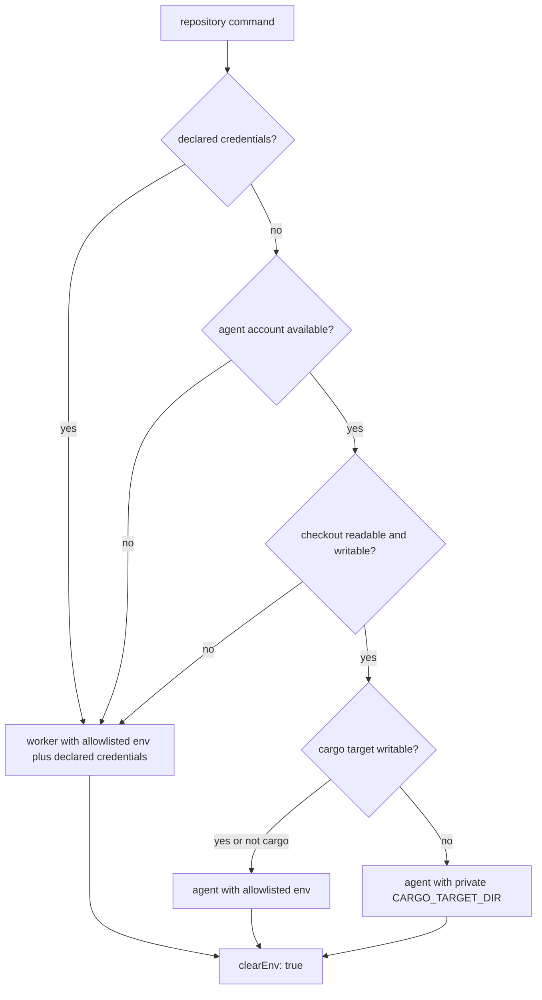

## Summary

The milestone merge and resolution gates ran the repository's own tasks
(`deno task`, `bash quality.sh`, `cargo check`, `cargo test`) with the worker's
whole inherited environment. `spawnTask` and `spawnTypeCheck` now go through a
new helper, `runRepositoryCommand` in `worker/deno/lib/untrusted_gate_spawn.ts`,
which builds the child environment with `untrustedQualityCommandEnv` (the
allowlist plus the Issue #2247 build-cache placement), passes `clearEnv: true`,
and runs as the `agent` account where the image has one and that account can use
the checkout. Closes #4659.

Version bump: no `VERSION` change in this diff; the merged commit records the
final version.

## Spec

### Intent and Rationale

- Code the worker did not write must not see the worker's credentials (Issues
  #572, #1214). The two milestone gates were the sweep's remaining gap.

### Essential Design Decisions

- The `agent` account is probed first and the command falls back to the worker
  account (same allowlisted environment) when the probe fails. The previous
  attempt (PR #4703) dropped to `agent` unconditionally; review showed that
  account cannot read the shared clone on some hosts (#4697) or write a
  worker-created `target` (#4113). Such a command exits 0 with "No matching
  files found" or fails for a reason unrelated to the tree. Falling back keeps
  the verdict a verdict on the tree, and no environment fault reaches the
  merge-refusal recovery ladder.
- Declared `quality_credentials` are resolved per checkout through
  `setGateCredentialSource` (registered in `run_core_production_deps.ts`, keyed
  by the checkout's directory name; two repositories sharing a name get none)
  and placed last in the child environment, as the quality gate does. A mint
  that fails stops the command with an error rather than running it without the
  credential. Commands with declared credentials use the logged worker fallback
  until #4705 provides a credential channel through sudo; values never enter argv.
- A property the merged tree controls never chooses the account. The probe exits
  1 when `agent` cannot read the checkout or a manifest (a host fault: run as
  the worker) and 2 when only the cargo target is unwritable (a committed
  `target/` file can cause it): then `agent` runs with a private temporary
  `CARGO_TARGET_DIR`, removed afterwards. A manifest that is a symbolic link is
  refused before anything runs, because it could point at a file only the worker
  can read. Probe exit 3 means the checkout directory is unwritable: the worker
  fallback handles Cargo.lock creation and Deno or shell task outputs. Git does
  not record checkout directory modes, so this is a host access fault, independent
  of whether the tree commits Cargo.lock.

### Undiscoverable Facts

- The shared `${workDir}/<repo>` clone, not a lane worktree, is where these
  gates run; #4697 records `agent` failing to read it on two fleet hosts. The
  unit runner gives each test file an allowlisted environment, so a leak cannot
  be shown by reading the test process's own environment.

## Evidence

Backend-only change; no UI file is touched.

- `worker/deno/tests/untrusted_gate_spawn_test.ts` (new, 22 tests at head): the
  child gets no parent credential and `clearEnv`; a real `printenv` child sees
  only allowlisted names (positive control: the same command without `clearEnv`
  sees names outside the allowlist); a usable `agent` account runs under `sudo`
  after a probe, with `CARGO_TARGET_DIR` carried in argv; a failed, errored or
  timed out probe falls back to the worker with the credential-free environment;
  no account means no probe; the probe script embeds only plain manifest names
  and checks `target` writability for cargo only; `manifestsFor`; declared
  credentials reach the child and a failing source stops the command; probe exit
  2 gives a private `CARGO_TARGET_DIR` and no `[SECURITY]` fallback; a symlinked
  manifest is refused. A bad manifest name is refused with no probe built; a
  manifest that cannot be inspected stops the command with the `lstat` cause;
  the probe is `sh -c <script> sh <cwd>` run in the checkout; a
  `CARGO_TARGET_DIR` the environment already names is not probed for
  writability. The refusals assert `ok === false` exactly. The positive control
  in the real-`printenv` test now states its own non-allowlisted name, so it
  holds when the test process's environment is already allowlisted (the mutation
  baseline failed on that).
- `worker/deno/tests/milestone_merge_gate_test.ts` (`checkMergedTree` with the
  real runner) and `worker/deno/tests/milestone_resolution_gate_test.ts`
  (`verifyResolvedTree` with the real runner): each starts a child Deno via
  `worker/deno/tests/support/gate_child_env.ts` whose environment carries
  `VIBE_4659_PARENT_SECRET`, and asserts the repository task saw only
  allowlisted names. Each file also has a test (in-process, default runner) that
  a symbolic-link `deno.json` is refused with the `is a symbolic link` message,
  so each gate hands its manifests to `runRepositoryCommand`.
- `worker/deno/tests/run_core_production_deps_test.ts` (one new test): after
  `createProductionRunCoreDeps`, a gate command in a nested project takes its
  own repository's minted credential; another repository's, a directory outside
  the work directory, an unnamed repository and two same-named repositories get
  none; a failing mint stops the command with the mint error.
- Docs: `docs/audits/security-sweep-1214-subprocess-argv.md` (follow-up section)
  and one parenthetical in
  `docs/audits/security-sweep-2755-lib-delta-12a-12c.md`; ledger
  `docs/audits/lib-sweep-coverage/top-up-4659.json`. README, `docs/` and
  `docs/INTERNALS.md` were searched for statements about these gates'
  environment; `docs/CONTAINER.md:1689` (cache placement) is still true.

## Acceptance Criteria

<!-- vibe-spec-review inputs="diff+issue-body" -->

- **met** — declared `quality_credentials` reach the command through the
  allowlisted worker environment when sudo would discard them — evidence:
  `tests/untrusted_gate_spawn_test.ts::declared credentials survive an available agent account`
  runs a real child shell and checks its credential output, restricted
  environment and credential-free argv. Credential mint failures still stop
  the command before it runs.

## Test Plan

- CI repair: `.github/gitleaks.toml` now exempts only the exact
  `PARENT_CREDENTIAL` declaration of the synthetic environment variable name
  used by the gate tests, including its historical copies before extraction into
  the shared harness. No file-wide exception or scanner rule was removed.
  Gitleaks 8.24.3 reproduced all three CI findings with
  `detect --redact -v --exit-code=2 --report-format=sarif --report-path=results.sarif --log-level=debug`
  and
  `--log-opts="--no-merges --first-parent 85e73ca2bc8a401344bc658673754b49e29e212f^..26682b2fe72de60f773735410cc1f099a6c5cf40"`.
  The identical scan with the updated config passes (seven commits, no leaks).
  Real-scanner stdin controls accept both exact declarations and still detect
  the same value assigned to `OTHER_CREDENTIAL`. The workflow and action share
  this config; no second config copy was found.
- `deno task test:unit` run from `worker/deno` over the four suites, 127 passed and 0
  failed: `tests/untrusted_gate_spawn_test.ts` (22 tests at head),
  `tests/milestone_merge_gate_test.ts` (41 tests at head),
  `tests/milestone_resolution_gate_test.ts` (31 tests at head) and
  `tests/run_core_production_deps_test.ts` (33 tests at head).
  `deno task check:manifests`, `deno fmt --check` and `deno lint`: pass.
- Red checks (break applied, test run, restored):
  - final spawn `clearEnv: false` → the credential, real-process and probe tests
    red;
  - probe verdict ignored → the three fallback cases red;
  - `writesTarget` forced false → the probe-script test red;
  - private-target branch removed (exit 2 treated as a fault) → the
    private-target test red;
  - `spawnTypeCheck` reverted alone to `runWithTimeout` with no `clearEnv` → the
    `checkMergedTree` test red (`VIBE_4659_PARENT_SECRET` leaked);
  - `spawnTask` reverted alone → the `verifyResolvedTree` test red, same leak.
- Mutation survivors from the first review (16 mutants on changed lines): each
  was applied alone and its new test went red (`untrusted_gate_spawn.ts` lines
  193, 199, 202, 209, 225, 250, 252, 258, 263; the `manifests` property deleted
  from `spawnTypeCheck` and from `spawnTask`; `run_core_production_deps.ts`
  lines 893, 899, 900, 905, 906). Re-run on the head: `deno task test:unit` over
  the four touched test files: 0 failed; `deno fmt` and `deno lint` on them:
  pass.
- Entry points checked: `spawnTypeCheck` (via `checkMergedTree`) and `spawnTask`
  (via `verifyResolvedTree`), the only two callers of `runRepositoryCommand`.
- Existing probe-text expectations now require checkout write access for every
  command, including when CARGO_TARGET_DIR is already named. The named-target
  test still asserts no target check (exit 2) or find call. This changes the
  reviewed contract: a private target cannot repair Cargo.lock or task-output
  writes into an inaccessible checkout.
- New real-shell probe tests cover readable, absent and unreadable manifests,
  read-only target files, and an unwritable checkout. UID 0 returns early
  because mode bits do not constrain root. Exit 3 distinguishes checkout access
  from exit 2 (private cargo target); the latter still cannot select the account.
- The real cargo merge-gate test starts without Cargo.lock, executes the actual
  probe with read-only agent access, restores worker access at the spawn seam,
  and compiles a dependency-free crate through checkMergedTree. It asserts the
  gate passes, cargo runs without sudo and Cargo.lock is created.
- Test-first red checks: the credential fallback and checkout permission verdict
  failed before the production changes. The new permission tests also required
  replacing GNU-only find -writable with portable find -exec test -w.
- Isolated copies under TMPDIR: the unchanged helper passes; changing manifest
  readability from AND to OR, reversing the target-empty test, reversing the
  target write predicate, removing the checkout write check, or disabling the
  declared-credential fallback each makes its new regression test fail. The
  working helper was never mutated during the full gate.
- `./quality.sh < /dev/null`: full-tree formatting, lint, type checking,
  completeness checks, Markdown, Mermaid and static chokepoints passed.
  The release-tag ruleset passed after using a temporary GH_CONFIG_DIR, since
  the host's default gh config is sandbox-denied. The parallel unit run aborts
  inside Deno with "pledge test permissions called before restoring previous
  pledge", on both host Deno 2.9.5 and checksum-verified pinned Deno 2.9.8.
  The affected suites pass on both runtimes. PowerShell is also absent on this
  host. Checkov and Semgrep are unavailable to the local gate; both current PR
  CI checks pass. No test was disabled or weakened to work around the host.
- `deno task check:manifests`: 847 passed, 0 failed, 1 existing ignored test.
  `deno task pr-summary-check --base main --labels work-on` with the issue body:
  no blocked or unchecked gates.

<!-- vibe-quality-gate-skipped: full parallel suite aborts inside Deno 2.9.5 and pinned 2.9.8 on this macOS host; affected suites and all runnable non-test checks pass; CI runs the full suite -->

## Known gaps

- The probe fallback (exit 1: unreadable checkout or manifest; exit 3:
  unwritable checkout)
  runs the repository's code as the worker account with the allowlisted
  environment, able to read the worker's credential files; a `[SECURITY]` line
  is logged. Only a host fault reaches it: the merged tree cannot force it
  through `target/` or a symlinked manifest. Fixing `agent`'s access (#4697)
  removes the fallback.
- Declared credentials require the logged worker fallback until #4705 supplies
  a credential channel to agent. This retains access to worker credential files.
- Credentials are matched to a checkout by the first path segment below the work
  directory, so two repositories with the same name under different owners get
  none.
