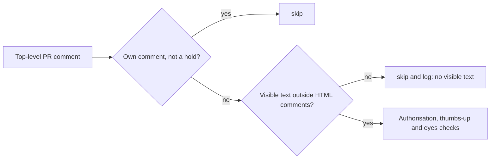

## Summary

The PR comment scan (`findActionableComment`, `worker/deno/lib/pr_maintenance.ts`)
no longer acts on a top-level PR comment that has no visible text once HTML
comments are removed. A review-fleet-prs round's `<!-- vibe-review-claim … -->`
claim, posted as an authorised App, was being claimed as feedback, given a full
`pr_feedback` model run and answered with "nothing to act on". The scan now skips
it before any reaction or authorisation lookup and logs the skip at INFO, the way
the CHANGES_REQUESTED path logs "it has no body to act on". Closes #4673.

Version bump: `VERSION` is not touched by this change.

## Spec

### Intent and Rationale

- A marker-only comment carries nothing to act on, so the scan should skip it
  rather than spend a model run and two PR comments on it.
- The skip sits in `findActionableComment` as the issue proposes, ahead of the
  trust checks, so no reactions API call is paid for it.

### Essential Design Decisions

- The check applies to `commentType === "issue"` only. The issue names the
  issue-comment path; line-level review comments are unchanged.
- An unclosed `<!--` is treated as visible text, so a malformed comment is acted
  on as before rather than silently dropped.
- `hasVisibleText` is a single `indexOf` pass, not a lazy regex, because it
  reads untrusted text and `<!--[\s\S]*?-->` is quadratic on many openers.
- The worker's verifier-hold and pre-PR review comments start with a marker but
  carry visible text, so their lanes are unaffected.

### Undiscoverable Facts

- The incident (2026-11-01 21:21 to 21:22 UTC, a private fleet repo) is taken
  from the issue; it was not re-observed.
- `docs/audits/lib-sweep-coverage/top-up-4673.json` records the new module as
  `claimed`, as `deno task check:manifests` requires; no sweep was done.

## Evidence

Backend only; no UI file is touched.

Tests (all under `worker/deno/tests/`):

- `visible_comment_text_test.ts`: marker-only, empty and whitespace, marker plus
  text in either order, two markers, text between markers, unclosed opener plus
  text, and two hostile bodies (30,000 unclosed openers, 30,000 complete
  markers) asserted on output.
- `pr_feedback_marker_only_comment_4673_test.ts`: through `findPrCommentsToFix`,
  a claim marker from an authorised commenter returns no comment; the same
  marker followed by visible text is still returned with its full body; a
  marker-only comment followed by a real one returns the real one; the skip is
  logged with "no visible text"; a fleet verifier-hold comment with visible text
  is still returned.

Docs: `docs/INTERNALS.md` "Feedback detection" table, row "Issue/discussion
comments" (the table's other rows were re-padded to keep its columns aligned).

Issues read: #4673, "Worker spends a PR feedback run on the review-fleet-prs
claim marker: the comment scan acts on an authorised comment with no visible
text".

## Acceptance Criteria

The issue states no criteria heading; nothing it asks is left undone.

## Test Plan

Run from `worker/deno`: `deno task test:unit tests/visible_comment_text_test.ts
tests/pr_feedback_marker_only_comment_4673_test.ts
tests/pr_feedback_trusted_bot_e2e_test.ts tests/pr_maintenance_test.ts
tests/pr_maintenance_bot_prs_test.ts tests/pr_feedback_superseded_comment_test.ts
tests/pr_feedback_staleness_test.ts` passed (137 tests), and
`deno task check:manifests` passed (847).

Gate: `./quality.sh < /dev/null` on the head passed every stage except
`deno tests`. Its only failures were two tests in
`worker/deno/tests/completion_phase_repo_formatters_test.ts` (lines 480 and 567,
"formatter should commit the Rust fix"), which this change does not touch; the
serial pass did not run because of them.

Red checks, each change broken alone and restored byte-identical:

- Guard removed from `findActionableComment`: the marker-only, continue-past and
  log tests went red; the visible-text and verifier-hold tests stayed green.
- `hasVisibleText` always true: the marker-only helper tests and the three scan
  tests that rely on the skip went red.
- Unclosed opener treated as hidden: the unclosed-opener-plus-text test and the
  30,000-unclosed-openers test went red.

Callers and siblings checked: `findActionableComment` is called for `review` and
`issue` types; only `issue` takes the new skip. The CHANGES_REQUESTED path
already has its own empty-body skip.
