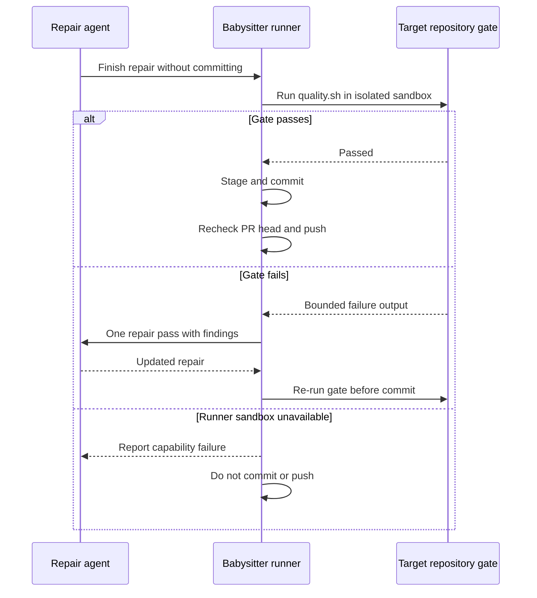

## Summary

Moved the babysitter's local `quality.sh` gate to a runner-owned macOS sandbox
so Chromium checks do not depend on Codex's Mach-port profile. Gate failures
return to one repair pass before commit or push; unavailable runner capability
is reported and prevents both. Part of #4674.

Version bump: No `VERSION` change was made for this change.

## Spec

### Intent and Rationale

- The agent's seatbelt profile cannot launch Chromium on macOS. The runner now
  owns the final local gate while the agent's credential-denying profile stays
  intact.

### Essential Design Decisions

- The runner invokes the target repository's `quality.sh` before staging. It
  uses a separate `sandbox-exec` profile, removes credential environment
  variables, gives `HOME`, `TMPDIR` and `DENO_DIR` scratch paths, and denies
  known worker, GitHub, SSH, cloud, container and package-manager credentials.
- A failed gate is returned to one repair-agent pass. An unavailable sandbox
  fails before commit or push. A repository without `quality.sh` is reported as
  having no local gate, leaving CI as the final check.
- The macOS sandbox permits Chromium Mach lookups, denies `securityd`, keeps the
  clone's `.git` read-only, and allows outbound network. Repository code can
  still read other host files; this boundary is not equivalent to the container
  boundary.

### Undiscoverable Facts

- At the base commit, #4625 was open and its shared runner-validation
  implementation was not present, so this change adds the babysitter-specific
  validation path.
- This run ran on Linux. The actual macOS Chromium launch and operating-system
  credential-read denial could not be exercised here.

## Evidence

Backend and runner workflow change; no visual surface changed. The workflow
manual and the security model document the host-read and network residuals.

## Acceptance Criteria

- **missing** — “Browser checks named by the target repository's gate run during
  a babysitter repair without weakening the credential boundary from #4593.” —
  reason: the runner path and Linux tests are implemented, but this Linux host
  cannot verify Chromium Mach-port launch or OS-level credential-file denial
  under macOS `sandbox-exec`.

## Test Plan

- `deno task test:unit tests/fleet_babysitter_validation_test.ts tests/fleet_pr_babysitter_test.ts tests/pr_branch_lock_test.ts tests/lib_sweep_coverage_test.ts`
  — passed, 120 passed, 0 failed, 1 ignored.
- `deno task check:manifests` — passed, 847 passed, 0 failed, 1 ignored.
- `deno lint`, `deno check --frozen --lock=deno.lock`, and `deno fmt --check` on
  the changed TypeScript files — passed.
- `deno run --frozen --lock=deno.lock --allow-read --allow-run --allow-env mod.ts check-markdownlint --script-dir ../..`
  — passed, 242 Markdown files checked.
- `timeout 900 ./quality.sh < /dev/null` — failed on the repository's unit-test
  time budget: 61 tests exceeded one second; the gate specifically reported
  `tests/launcher_harness_reclaim_stub_test.ts` (2 tests, 3.45s). The parallel
  and serial test passes themselves passed. That file is unchanged from
  `origin/main`. Config integration and Checkov were skipped by the gate because
  their required local configuration/tools were absent.
- Mutation checks: bypassing validation before staging made the
  successful-handoff and failure-before-commit tests fail; removing the
  `.config/gcloud` deny or using the host Deno cache made
  `successful runner check uses an isolated sandbox and environment` fail.
  Earlier branch mutations also made the unavailable-sandbox, failed-gate,
  bounded-output, missing-gate and credential-isolation tests fail; each
  mutation was restored.
- Existing guards: the branch-lock tests and
  `review dismissal waits for GitHub to report the pushed head` passed. The
  retry path still checks that the agent left `HEAD` unchanged and rereads the
  PR head, branch names and reason before the existing push. No new end-to-end
  test exercises a concurrent external PR-head change.
- `macOS sandbox denies a credential read during runner validation` is ignored
  on this Linux host. Actual Chromium launch and OS-level credential denial
  remain unverified.
