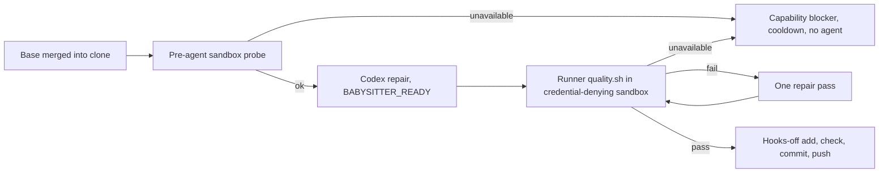

## Summary

On macOS the PR babysitter now runs the target repository's `quality.sh` itself,
outside the Codex seatbelt profile, in a separate credential-denying sandbox, so
browser checks that Chromium cannot run inside Codex's profile can run during a
repair. This continues the work of the closed PR #4716 (its branch was merged
into a fresh branch from the current default branch, conflicts resolved) and
does not add a second runner. Part of #4674. Version bump: `VERSION` is not
changed by this PR.

The live macOS proof (Chromium launching, the Mach allowlist, OS-level
credential denial) has not been observed: this worker host is Linux and has no
`sandbox-exec`. Issue #4674 therefore stays open.

## Spec

### Intent and Rationale

- Codex's macOS seatbelt allows only fixed Mach lookups, so Chromium cannot
  start and the tested fix was discarded (GRQ-AutoTrader#4949). The runner, not
  the agent, runs the gate under its own profile that opens only the browser
  Mach prefixes and keeps the #4593 credential denials.
- A missing browser capability is a recoverable outcome: it is recorded in the
  retry state (#4656's `capability` class) with a cooldown, consumes no repair
  attempt, starts no agent and never marks the check passed.

### Essential Design Decisions

- Linux keeps agent-side validation; the runner never runs repository code with
  the trusted runner's credentials (token-free environment, scratch HOME, denied
  config, Keychains, `securityd`, App key and read-only `.git`).
- Merge with main: the incoming runner validation wraps main's
  `finishBabysitterRepair` through `validateWithSingleRepair`; `validateAndCommit`
  runs the runner gate first, then the hooks-disabled add/check/commit with
  main's `checkBaseline` and `mergedBase`. `buildRepairPrompt` now takes
  `(…, rtkInstruction, mergedBase?, runnerFailure?, platform)`.
- Unavailable sandbox: the earlier "release the attempt" behaviour became a
  `capability` retry record, because main's retry state now owns that decision.

### Undiscoverable Facts

- The nested `sandbox-exec` is refused on the agent hosts (`sandbox_apply:
  Operation not permitted`), so `deno task test:browser` has to run on a Mac that
  permits it.
- Main's `takePrBodyProposal` no longer carries a closing reference over; the
  closing-reference guard lives in `guardPrBodyProposal`.

## Evidence

- `deno task check:manifests`: 847 passed, 0 failed, 1 ignored.
- Babysitter suites (`deno task test:unit`, one file at a time): see Test Plan.
- Not observed: Chromium launch, Mach allowlist and credential denial under a
  real macOS sandbox (`deno task test:browser`).

## Acceptance Criteria

- **partial** — "Browser checks named by the target repository's gate run during a babysitter repair without weakening the credential boundary from #4593." — evidence: `worker/deno/tests/fleet_babysitter_validation_test.ts`, `worker/deno/tests/fleet_babysitter_repair_test.ts` — reason: unit and CLI coverage pass; the live macOS run (`worker/deno/integration/fleet_babysitter_browser.ts`) has not executed on a Mac.
- **missing** — "automated evidence that the credential boundary remains intact" on macOS — reason: needs a macOS host that permits `sandbox-exec`; this Linux worker cannot run it.

## Test Plan

- `worker/deno/tests/fleet_babysitter_repair_test.ts` (18 tests): unavailable
  runner and sandbox-probe failure are `capability` retry records with no agent
  session and no substantive attempt. Red check: routing `unavailable` through
  `classifyBabysitterFailure` failed the three capability tests; restored.
- Edited `fleet_babysitter_repair_test.ts` expectations: the earlier
  `attempts == []` and the two-pass `success === false` assertions no longer
  hold because main's retry state records a held capability blocker; the
  single-pass test keeps the failure message and event assertions.
- `worker/deno/tests/fleet_babysitter_validation_test.ts` (37),
  `worker/deno/tests/fleet_pr_babysitter_test.ts` (120),
  `worker/deno/tests/fleet_pr_babysitter_single_push_test.ts` (9),
  `worker/deno/tests/babysitter_fix_orchestration_test.ts` (36): passed.
- Removed from `worker/deno/tests/fleet_pr_babysitter_test.ts`: the
  closing-reference carry-over assertion on `takeRepairPrBodyProposal`.
  - Obsolete: main moved closing-reference preservation to `guardPrBodyProposal`.
    Still covered by: `worker/deno/tests/babysitter_pr_body_guard_test.ts`.
- Twinned rules checked: no second production validation implementation; the
  platform prompt tests run for both platforms.
