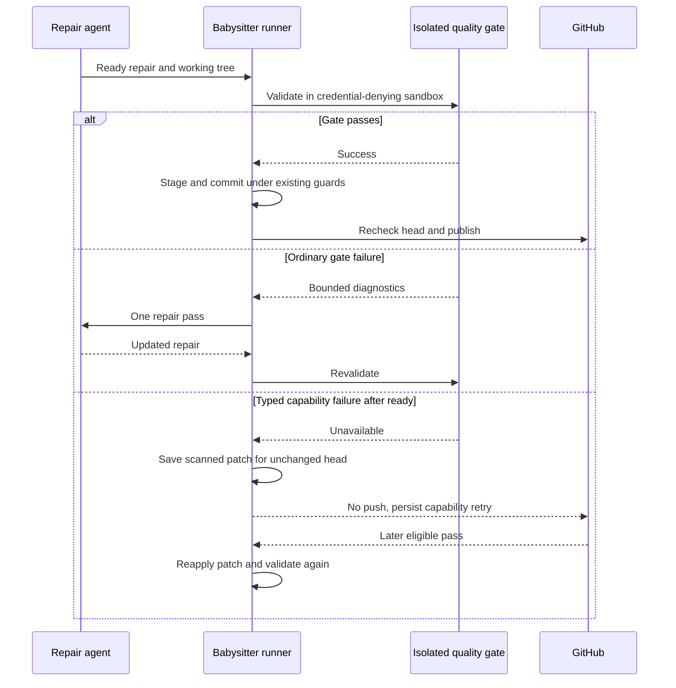

## Summary

The macOS babysitter now validates repairs in its credential-denying sandbox and CI runs the existing Chromium containment integration on a native macOS runner. If a typed runner-capability failure occurs after the agent reports ready, the runner saves a bounded, secret-scanned patch for the unchanged PR head; a later eligible pass reapplies it and must pass validation before commit or push. Ordinary gate failures remain repair failures. Linux keeps agent-side validation. Part of #4674 while the native macOS run is pending. Version bump: `VERSION` is unchanged by this PR.

## Spec

### Intent and Rationale

- Continue the platform-specific runner from #4716 so Chromium checks run outside Codex's browser-restricting profile without weakening the #4593 credential boundary.
- Preserve ready but unvalidated edits across a capability retry, while keeping #4625's validation result contract and #4656's retry state as the existing owners.

### Essential Design Decisions

- Checkpoints are versioned, keyed by repository, PR, failure identity and unchanged head; patches over 2 MiB or containing a detectable secret are refused. A checkpoint is progress only, never validated completion.
- A `BabysitterValidationError` of kind `unavailable` takes the capability retry path and consumes no substantive attempt. A failed gate remains a code failure even when its output mentions Chromium or sandboxing.
- Branch locks, head checks, secret scanning, commit validation and publication guards remain in the runner path.
- The workflow aggregate requires both repository validation and the macOS browser job to report success; skipped jobs fail closed.

### Undiscoverable Facts

- This worker host is Linux. The browser integration's only local attempt stopped at its explicit `Deno.build.os === "darwin"` guard; it did not exercise macOS sandbox behaviour.
- The repository's existing browser integration now supplies unsandboxed positive controls for the credential files, symlink targets, Keychains, `securityd`, unrelated Mach lookup, process environment, and `.git` write probes.

## Evidence

The macOS job runs `deno task test:browser` with the installed Chrome binary. The integration checks rendered DOM and generated screenshot output, plus credential, Mach service, process, IPC, terminal, signalling and `.git` write containment. Its successful native run remains required before this issue is complete.

### Deno regression avoided

- The browser integration is a Deno task using the repository's pinned Deno toolchain; no Node package manager or dependency was added.

## Acceptance Criteria

- **missing** — “This issue owns macOS browser execution and automated evidence that the credential boundary remains intact.” — reason: the automated native macOS job has not yet completed successfully.

## Test Plan

- `worker/deno/tests/fleet_babysitter_repair_test.ts` — 20 passed. Removing checkpoint persistence made the capability-loss resumption test fail; removing successful-revalidation cleanup left a checkpoint and made it fail. Reclassifying the ordinary gate output `Chromium sandbox denied by an ordinary test assertion` as capability made its code-failure assertion fail.
- `worker/deno/tests/babysitter_retry_state_test.ts` — 11 passed. Removing terminal retry-state cleanup made the merged-PR checkpoint-clear assertion fail. The checkpoint round-trip checks exact-head loading and wrong-head absence; detectable-secret input is refused.
- `worker/deno/tests/fleet_babysitter_validation_test.ts` — 37 passed.
- `worker/deno/tests/fleet_babysitter_browser_workflow_test.ts` — 3 passed. Positive workflow check plus negative cases for missing/skippable browser execution, skipped aggregate, tolerated failure, conditional gate skip and missing `needs` result wiring; the real `gate.sh` rejects skipped and failed jobs and accepts two successes.
- `worker/deno/tests/fleet_pr_babysitter_test.ts` — 120 passed. CI, review and conflict prompts are checked for Darwin and Linux; Linux names unavailable checks for CI and does not direct checks to a runner it does not use.
- Targeted Deno lint and frozen type checks passed for the changed runner, validation integration and tests.
- `deno task test:browser` — attempted locally; failed at the platform guard with actual `linux`, expected `darwin`, before any macOS containment assertions ran. The native macOS workflow result is pending and is not claimed as passed.
- No `deno.lock` change. Updated `SECURITY.md`, threat-model control C37 and the fleet babysitter manual to describe checkpoint recovery and the macOS CI evidence path.
