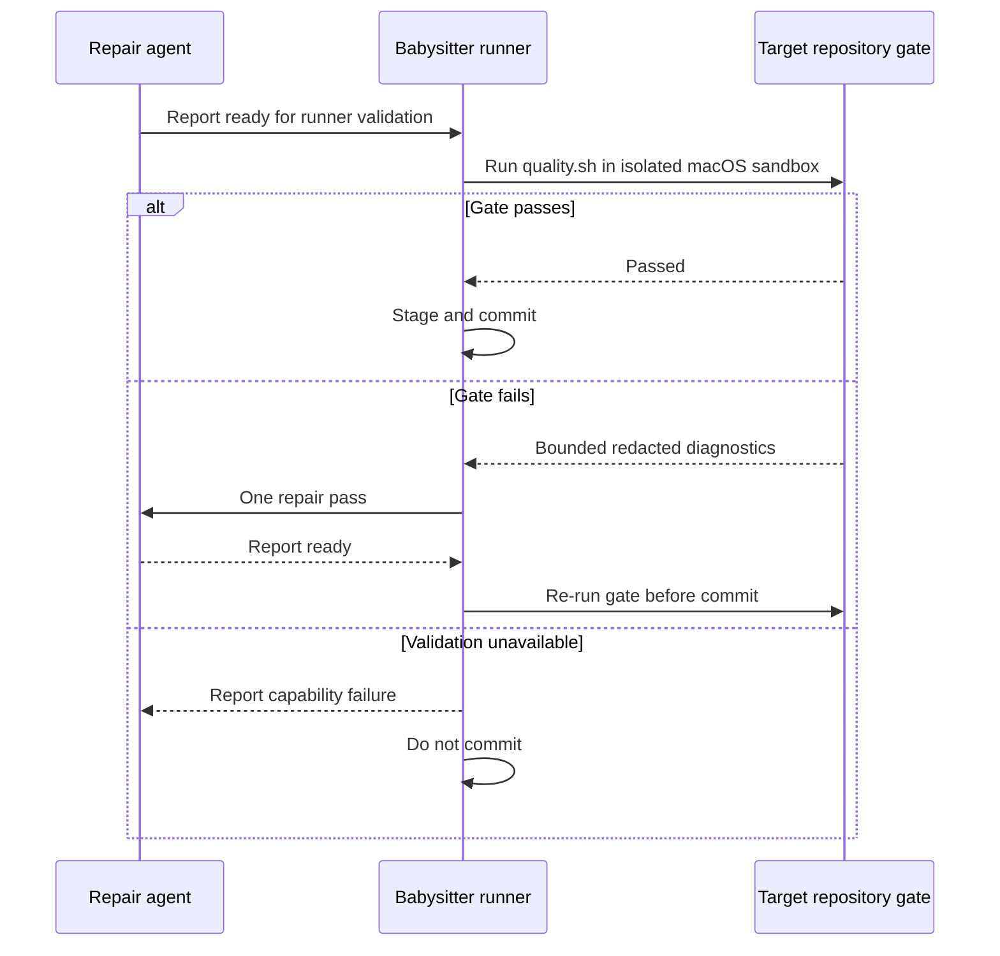

## Summary

The babysitter runner now owns local `quality.sh` validation on macOS before
staging. It allows the browser's Mach lookups in a separate runner sandbox,
removes credential environment variables, and denies configured credential
paths, Keychains and writes to `.git`. A failed gate gets one repair pass and
must pass revalidation before commit. The Codex agent profile remains unchanged.
Part of #4674.

Version bump: No `VERSION` change was made for this change.

## Spec

### Intent and Rationale

- The Codex seatbelt profile blocks Chromium's Mach-port registration. Runner-owned
  validation lets the repository gate decide readiness while preserving the
  agent's existing restrictions.

### Essential Design Decisions

- The runner executes the target repository's `quality.sh` before staging. It
  uses scratch `HOME`, `TMPDIR` and `DENO_DIR`, strips credential environment
  variables, and applies a separate macOS sandbox profile.
- One gate failure is returned to the agent for repair, then the runner
  revalidates. Missing runner capability prevents commit; a missing
  `quality.sh` is reported as no local gate, leaving CI as the final check.
- The sandbox allows outbound network and does not deny every host file read;
  these residuals are documented in the security model.

### Undiscoverable Facts

- This run used Linux, so the macOS-only Chromium and operating-system access
  check was not executed. The Linux Chromium binary was present but timed out
  once and exited 133 (Trace/breakpoint trap) on a bounded retry.

## Evidence

Backend and runner workflow change; no visual surface changed.

### Deno regression avoided

Runner validation uses Deno-native tooling and adds no Node tooling or dependencies.

The macOS integration test
`worker/deno/tests/fleet_babysitter_validation_test.ts::macOS runner sandbox launches Chromium without exposing credentials`
checks Chromium rendering and screenshot creation, a launch with Mach lookup
removed, and denial of configured credentials, a symlinked credential path,
Keychain access and `.git` writes. It is macOS-only and was not run on this
Linux host, so it is not evidence that those operating-system controls passed.

## Acceptance Criteria

- **missing** — “Browser checks named by the target repository's gate run during
  a babysitter repair without weakening the credential boundary from #4593.” —
  reason: the macOS-only Chromium and operating-system credential isolation
  integration test was not run on this Linux host.

## Test Plan

- `deno task test:unit tests/fleet_babysitter_validation_test.ts tests/fleet_pr_babysitter_test.ts`
  — passed, 47 passed, 0 failed, 1 ignored on the final code head.
- `deno task check:manifests` — passed, 847 passed, 0 failed, 1 ignored.
- Targeted `deno lint`, `deno check --frozen --lock=deno.lock`, and
  `deno fmt --check` for changed TypeScript files — passed.
- `deno run --frozen --lock=deno.lock --allow-read --allow-run --allow-env mod.ts check-markdownlint --script-dir ../..`
  — passed, 242 Markdown files checked. The final summary also passed
  `deno task pr-summary-check --base origin/main --issue-body-file
  /tmp/issue-4674-body.md --labels work-on ../../docs/archive/pr-summaries/pr-summary-4674.md`.
- Mutation checks were red when retry handling retried unavailable validation,
  skipped revalidation, discarded a retry-created PR-description proposal, or
  omitted the runner failure from the next prompt; each mutation was restored.
  The commit integration tests also verify validation precedes staging and a
  failed gate prevents commit.
- `timeout 900 ./quality.sh < /dev/null` — failed in the full Deno test step at
  unchanged `worker/deno/tests/pr_maintenance_command_test.ts`, test
  `pr-maintenance command - update-open-pr-branches takes no action on a behind-only PR behind a merge queue`:
  `expected a merge-queue rules read, got: ["api repos/org/repo --jq .default_branch"]`.
  The touched babysitter tests passed. Config integration and Checkov were
  skipped because local configuration and the Checkov tool/runtime were absent.
  The same maintenance test and production path are unchanged from
  `origin/main`; the base commit's GitHub check runs reported the test shards,
  gate and Semgrep successful.
- The targeted launcher harness test recorded in the checkpoint was also
  investigated: its two assertions pass, but the command exits non-zero because
  each subprocess case takes about 1.8 seconds against the repository's
  one-second unit-test budget. The test is unchanged from `origin/main`.
- Actual macOS Chromium launch, Mach-port registration and OS-level credential
  denial remain unverified.
