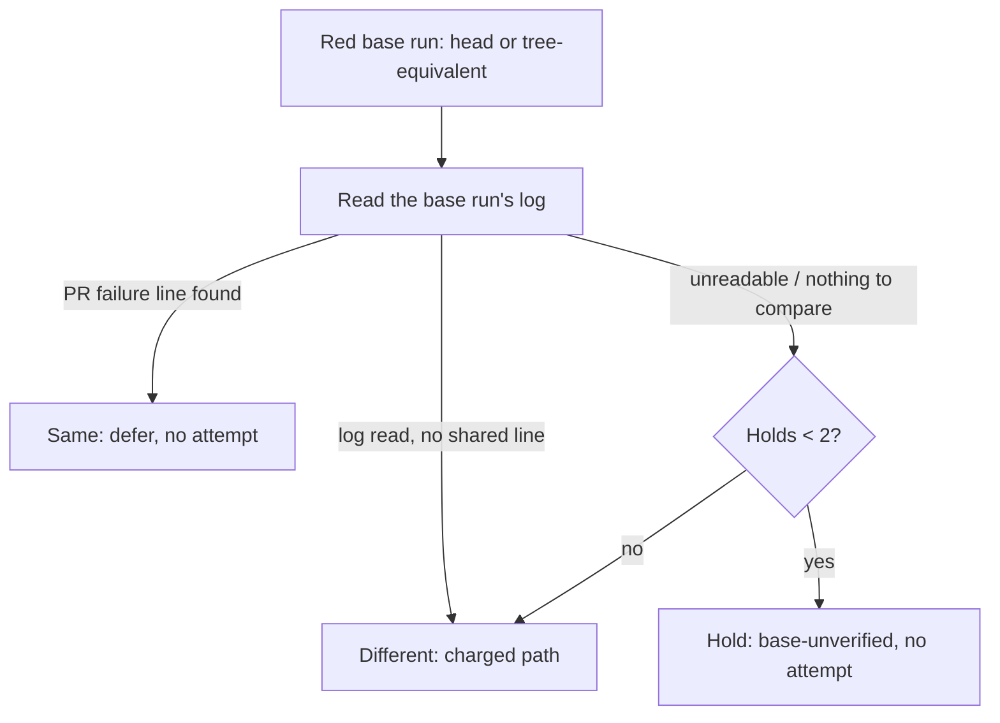

## Summary

The CI-fix base-branch deferral (#1880) used to defer on a red base
_conclusion_. Earlier work on #4680 (#4836) read the failing check by workflow
identity and held claims it could not verify. This change closes the remaining
gap: a red base run (on the base head, or the same workflow's run on a merged PR
head with the base head's tree) is only accepted when its log carries the pull
request's own failure. Two unrelated failures in the same job no longer look
like one base defect.

`_resolveBaseBranchDeferral` now calls `compareBaseFailure`
(`worker/deno/lib/ci_base_failure_signature.ts`) for a red base:

- **same failure** (a normalised PR failure line also appears in the base run's
  log) — the existing deferral: `Depends on` issue and `vibe-ci-fix-deferred`
  marker, resumed by the existing scanner when the blocker closes;
- **different failure** (the base log was read and shares none of the PR's
  failure lines) — the base is red for another reason, so the claim is not
  verified as this failure: the ordinary charged path, no deferral, no hold;
- **unreadable** (no comparable PR line, non-Actions check, log fetch error or
  an empty base log) — held as unverified (`base-unverified`, no attempt
  charged), sharing the existing bound of two holds.

The worker still does not re-run the check on the base tree. The CI-fix prompt,
`docs/workflows/ci-fix.md` and the three one-line restatements of the rule
(`docs/PROMPTS.md`, `CODING-STANDARDS.md`,
`prompts/coding_guidelines/prompt.md`) say the log must match. Closes #4680.

Version bump: `VERSION` is not changed by this PR.

## Spec

### Intent and Rationale

- #4836 verified _which_ check ran on the base, but a red conclusion could still
  come from an unrelated failure; the issue (item 2) asks for the same failure
  signature and cause in the base tree.
- Commit-bound evidence from the same workflow (the tree-equivalent merged-PR
  run, from #4836) was kept; only its failure text is now compared.

### Essential Design Decisions

- A line counts when it is an annotation, or carries a failure word outside a
  command-line flag, is at least 20 normalised characters, is not a command echo
  (`##[group]`, `##[endgroup]`, `##[command]`, `[command]` lines such as
  `Run cargo test --no-fail-fast`) and is not the runner's generic
  `Process completed with exit code N` line (every failed job has it). Flags
  such as `--no-fail-fast` or `curl --fail` are blanked before the failure-word
  test, so a shared command echo is never failure evidence. Any one shared line
  is "same". This favours deferral over a strict log diff because excerpts
  differ in noise; the cost is that a shared generic-looking error line can
  match.
- "Different" charges the attempt (no hold): a base that is red for another
  reason proves nothing about this failure, and holding would only delay it.
- The hold decision moved into `_holdOrChargeUnverified` so every unverified
  reading shares one bound.

### Undiscoverable Facts

- Observed only in the test fixtures: `fetchGithubActionsLogExcerpt` is called
  with the base _check-run id_ and reads `check-runs/{id}` then the job log; no
  live GitHub response for a PR-only check was observed.

## Evidence

Backend-only change.

- `deno task test:unit` on `worker/deno/tests/ci_base_failure_signature_test.ts`
  (18), `worker/deno/tests/pr_ci_processor_deferral_test.ts` (28),
  `worker/deno/tests/ci_base_branch_check_test.ts`,
  `worker/deno/tests/ci_fix_attempt_markers_test.ts`,
  `worker/deno/tests/ci_fix_audit_in_pr_3116_test.ts` and
  `worker/deno/tests/pr_maintenance_ci_deferral_test.ts`: 145 passed, 0 failed
  (the five-file run excluding the new signature test file).
- Production readers: `compareBaseFailure` is called from
  `_resolveBaseBranchDeferral` in `worker/deno/lib/pr_ci_processor.ts`;
  `actionsLogFn` is threaded from `processorDeps.actionsLogFn` there.
- Prose claims checked against: `worker/deno/lib/pr_ci_processor.ts`,
  `worker/deno/lib/ci_base_failure_signature.ts`,
  `worker/deno/lib/ci_base_branch_check.ts`.
- Related rules checked: `prompts/ci_fix/prompt.md` Base-branch failures
  section, the 3116 carve-out for dependency-audit checks (kept, pinned by
  `ci_fix_audit_in_pr_3116_test.ts`) and the twinned restatement in
  `CODING-STANDARDS.md` and `prompts/coding_guidelines/prompt.md`. The phrase
  "nothing on this branch can fix it" is absent.

## Test Plan

- `worker/deno/tests/ci_base_failure_signature_test.ts`: same failure across
  timestamps and ANSI; a different error; a shared generic exit line alone is
  `different`; two logs that share only a command-echo line
  (`##[group]Run cargo test --workspace --no-fail-fast`, `curl --fail`) but
  carry different errors are `different`; echoes and flag-only matches yield no
  signature line; a repeated line is listed once; annotation-only text; empty
  text, the real `formatCiAnnotations` fallback sentence and its header are
  `unreadable` and never fetch the log; error, not-applicable and throwing log
  providers (an `Error` or a non-`Error` rejection) are `unreadable` with the
  exact cause in the reason; the caller's `gh` runner reaches the log fetcher;
  an empty base log is `unreadable`; three hostile inputs return
  deterministically. Red checks: removing the generic exclusion, the boilerplate
  exclusion, the empty-log check and making `same` ignore the log each turned a
  test red.
- `worker/deno/tests/pr_ci_processor_deferral_test.ts`: red base with a
  different failure is charged (no deferral, no hold); red base whose log cannot
  be fetched is held; a tree-equivalent red with a differing log is charged; two
  prior holds make an unreadable red base charged. The stub now serves the base
  run's identity and job log, defaulting to the failing check's own annotation
  messages so the existing red-base tests are unchanged. The hold tests for a
  missing and a stale base run now assert the `Depends on` reference and the
  base state in the comment, and a new test asserts the base run's log is
  fetched with the failing check's name. Red checks: "different" falling through
  to defer turns the first and third red; "unreadable" falling through turns the
  second and fourth red; removing the hold bound for unreadable turns the fourth
  red.
- Call sites: the only caller of `compareBaseFailure` is
  `_resolveBaseBranchDeferral`; reverting its call is the red check above.
- Docs sweep: `docs/workflows/ci-fix.md` (base-branch section and both diagrams)
  and `prompts/ci_fix/prompt.md` re-read; sibling hits found with
  `git grep -n -i "base-unverified\|tree-equivalent\|Depends on"`.
- Added `docs/audits/lib-sweep-coverage/top-up-4680.json` for the new module;
  `deno task check:manifests` passes.
- Full gate `./quality.sh` (run before the sweep slice was added):
  `completeness
  checks` failed only on the missing sweep slice, now added.
  `deno tests` failed on that same ledger test and on two tests in
  `worker/deno/tests/completion_phase_repo_formatters_test.ts` (cargo fmt
  staging), which fail the same way on the base branch and are not touched by
  this change; its serial pass did not run after that. Markdownlint, semgrep,
  lint, type check and fmt passed.

Mutation survivors named by the completion check (`ci_base_failure_signature.ts`
seen-set add, `ghFn` argument, error-message ternary; `pr_ci_processor.ts` hold
`ref`, hold `state`, `checkName` to the comparison) are each pinned by a test
above; none is exempted.

Not done / risk: no live GitHub run of a PR-only check; the comparison matches
on any one shared line, so a coincidentally shared error line can read as the
same failure; the worker does not re-run the check on the base tree.
