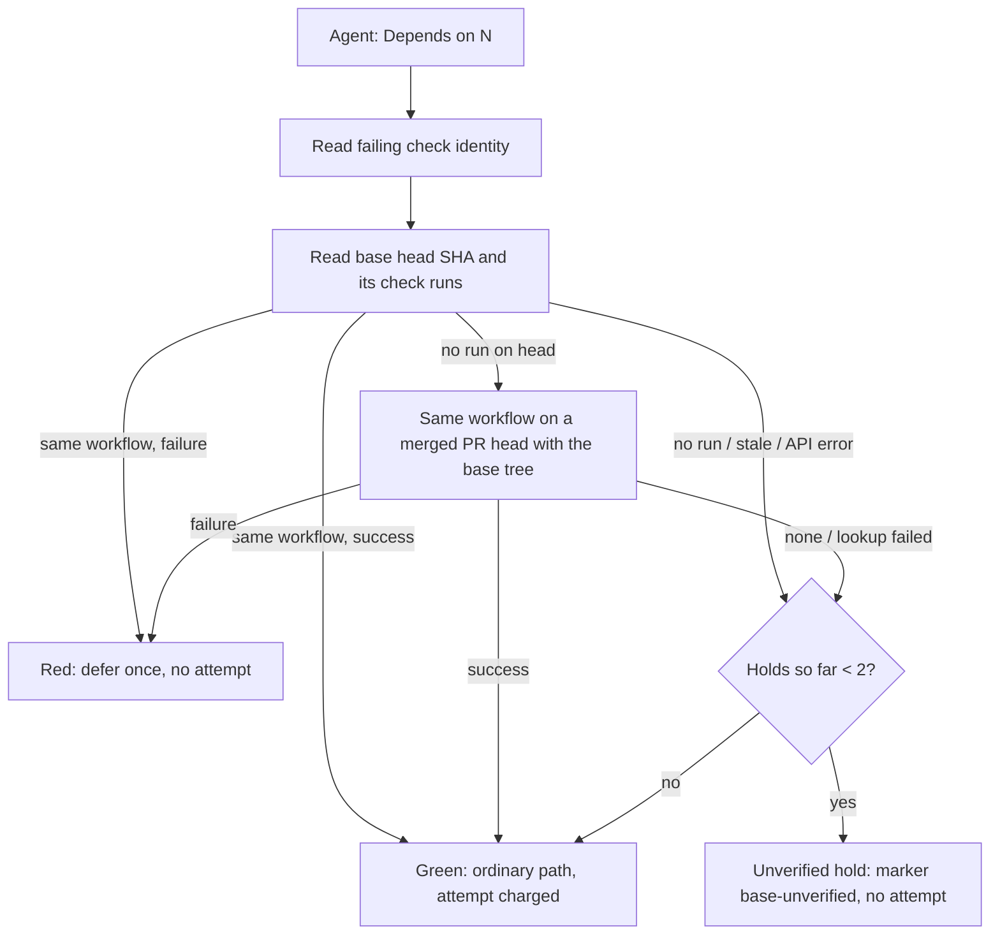

## Summary

The CI-fix base-branch deferral (#1880) no longer reads "the base branch has no
run of this check" as "the base is green". The worker now reads the failing
check's identity (name, producer app, workflow file) and the base head's SHA,
and sorts the agent's `Depends on` claim into verified red (deferral, as
before), verified green (claim refuted, ordinary charged path), or
**unverified** (no run from the same workflow, a run for another commit, or an
unreadable API). An unverified claim is held: the diagnosis is posted with a
`vibe-ci-fix-attempt` marker whose outcome is `base-unverified`, no fix attempt
is charged, nothing is marked passed, and no `needs-human` is applied. At most
two holds are allowed per failure signature, after which the ordinary charged
path runs so the fleet-wide cap still ends the loop. The CI-fix prompt and
`docs/workflows/ci-fix.md` describe these states and no longer say "nothing on
this branch can fix it".

A PR-only check never runs on the base head, so the worker also reads
commit-bound evidence from the same workflow: the runs of the same check (same
app and workflow file) on the head of a pull request merged as the base head,
but only when that commit's tree is identical to the base head's tree. A red
there is a verified base defect and takes the existing deferral (the
`Depends
on` issue and `vibe-ci-fix-deferred` marker, resumed by the existing
scanner when the blocker closes); a green refutes the claim. When no such commit
exists or any lookup fails, the claim stays unverified (held, not deferred). The
worker does not re-run the check on the base tree. Part of #4680.

Version bump: `VERSION` is not changed by this PR.

## Spec

### Intent and Rationale

- Most fleet checks run only on pull requests, so the base never has a run and
  the old reading made the deferral impossible; the agent then patched base
  defects inside unrelated PRs (VibeCoder#4675, TagsTS#88).
- Unknown evidence is its own state rather than a pass or a charged failure, as
  the issue asks (item 3). A bounded hold keeps it recoverable without a new
  scheduler (#4656 owns retry state).

### Essential Design Decisions

- Identity is name + producer app + workflow file path, so a same-named check
  from another workflow (TagsTS's default CodeQL setup) is not evidence. A
  GitHub Actions check whose workflow path cannot be resolved is `unavailable`,
  never matched by name alone.
- Only `success` is green; cancelled, skipped, neutral, timed-out and
  action-required runs are no evidence.
- Holds are recorded as attempt markers with outcome `base-unverified` but are
  kept out of `countAttempts` (a separate `unverifiedBaseHolds` map), so they do
  not consume the fleet-wide cap. A merge-queue check (non-numeric id) cannot
  have its identity read and is therefore held rather than read by name.
- Assumption: an unrelated open PR failing the same job is not read, since the
  issue says it is only a diagnostic lead. Only a PR merged as the base head,
  and only when its head commit has the base head's tree, is read. A merge
  queue's commit is not in `commits/{sha}/pulls`, so such a base stays held.

### Undiscoverable Facts

- `conflict_needs_human_gate.ts` treats any parsed `vibe-ci-fix-attempt` marker
  as "a CI fix was attempted", so a hold counts there too; left unchanged
  because a hold does mean an agent ran.

## Evidence

- `deno task test:unit` on `worker/deno/tests/ci_base_branch_check_test.ts`,
  `worker/deno/tests/ci_fix_attempt_markers_test.ts`,
  `worker/deno/tests/pr_ci_processor_deferral_test.ts` and
  `worker/deno/tests/ci_fix_audit_in_pr_3116_test.ts`: 100 passed, 0 failed.
- Production readers of the new members: `readBaseBranchCheck` and
  `readCheckIdentity` are called in `worker/deno/lib/pr_ci_processor.ts`;
  `countUnverifiedBaseHolds` is called there; `base-unverified` is built in the
  processor and parsed in `worker/deno/lib/ci_fix_attempt_markers.ts`.
- Files read to cite behaviour: `worker/deno/lib/pr_ci_processor.ts`,
  `worker/deno/lib/ci_fix_attempt_markers.ts`,
  `worker/deno/lib/conflict_needs_human_gate.ts`.
- Tree-equivalent evidence: `readTreeEquivalentVerdict` in
  `worker/deno/lib/ci_base_branch_check.ts` is called by `readBaseBranchCheck`
  when the base head has no verdict of its own.
- Not observed: a live GitHub response for a PR-only check; fixtures follow the
  documented REST shape of `check-runs` and `actions/runs`.

## Acceptance Criteria

<!-- vibe-spec-review inputs="diff+issue-body" -->

- **partial** — "Establish the same failure signature and its cause in the
  relevant base tree, using an isolated baseline reproduction or equivalent
  commit-bound evidence from the same workflow." — evidence:
  `worker/deno/lib/ci_base_branch_check.ts::readTreeEquivalentVerdict`,
  `worker/deno/tests/ci_base_branch_check_test.ts::a PR-only check red on the
  merged PR's identical tree is red, bound to that commit`
  — reviewer: partial — reason: the same check from the same workflow on a
  commit with the base head's tree is now read, but only the check's conclusion
  is compared; the failing step or log is not compared with the PR's failure
  signature, and the worker does not re-run the check on the base tree.
- **met** — "Once a base defect is verified, use the existing deduplicated
  base-repair/dependency mechanism and automatically resume the PR when that
  repair lands" for a PR-only workflow — evidence:
  `worker/deno/tests/pr_ci_processor_deferral_test.ts::a PR-only workflow red
  on the merged PR's identical tree defers, charging no attempt and paging no
  human`,
  `worker/deno/tests/pr_maintenance_ci_deferral_test.ts::once the named
  issue closes the check is returned again`
  — reviewer: met

## Test Plan

- `worker/deno/tests/ci_base_branch_check_test.ts` (42): tree-equivalent red,
  green, newest wins, differing tree, other workflow, cancelled, other commit,
  several heads, a cancelled head run, failed and malformed lookups, and the
  `--jq` request shapes of the check-runs and check-run calls (the surviving
  mutations at lines 140, 167, 245 and 246 each turn a test red: the non-Actions
  app with no workflow path, and the asserted `--jq` arguments). Earlier: (25):
  red, green, no-run, other-workflow, other-app, stale, unresolved identity,
  non-success conclusions, errors. Red checks: removing the workflow-path
  comparison, the head-SHA filter, the GitHub Actions no-workflow-path guard and
  the missing app-slug error each turned one test red.
- `worker/deno/tests/pr_ci_processor_deferral_test.ts`: PR-only no-run hold,
  same-named other-workflow check, other PR's red run, stale run, unreadable
  identity, hold bound of two, resumption to deferral once the base is red,
  known-good base. Red checks: forcing no-run to the ordinary path, raising the
  hold cap and counting holds as attempts each turned tests red.
- Tree-equivalent cases in `pr_ci_processor_deferral_test.ts`: red defers with
  no attempt, green takes the charged path, a differing tree is held.
- Coverage carry-over: `ci_base_branch_check.ts` line 503 (a JSON body that is
  not an object) is reached by the "JSON but not an object" test;
  `github_actions_log_fetcher.ts` lines 284-291 (a run-only and a job-less
  details URL) by two `resolveActionsJobId` tests in
  `github_actions_log_fetcher_test.ts`.
- `worker/deno/tests/ci_fix_attempt_markers_test.ts`: round-trip and unknown
  outcome rejection for `base-unverified`; holds excluded from `countAttempts`.
- Edited expectation in `pr_ci_processor_deferral_test.ts`: a base lookup error
  now holds (one comment, no attempt) instead of charging an attempt; the
  required behaviour is the issue's item 3. It still goes red if the hold is
  forced to the ordinary path (red check above).
- Removed from `worker/deno/tests/ci_base_branch_check_test.ts`: the
  `isCheckRedOnBranch` tests.
  - Replaced by: `readBaseBranchCheck` tests of the same scenarios (latest run
    wins, in-progress re-run, malformed body, API failure).
  - Obsolete: `isCheckRedOnBranch` read a base with no run as `false`.
- Twinned rules: the pinned prompt phrases in
  `worker/deno/tests/ci_fix_audit_in_pr_3116_test.ts` still pass.
