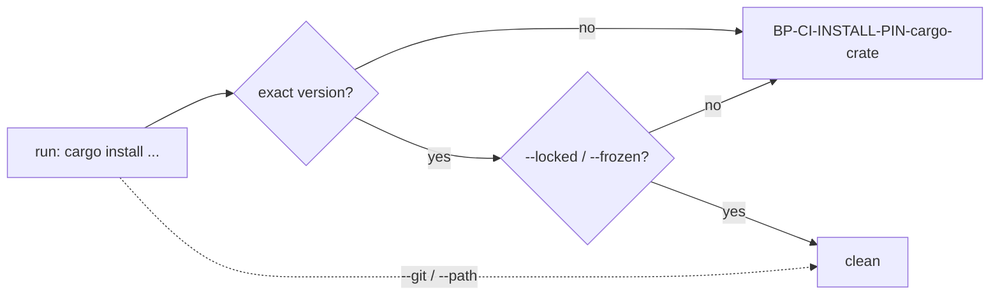

## Summary

The fleet `cargo-audit` and `cargo-upgrade` templates (and this repository's own copies) now install their crate with `cargo install --locked <crate> --version x.y.z`, and the `ci-install-pins` scanner now polices `cargo install`: an install must carry an exact version **and** `--locked` (or `--frozen`). Version bump: `VERSION` is not touched by this change. Closes #4683.

## Spec

### Intent and Rationale

- An unpinned, unlocked `cargo install` fetches the newest tool and re-resolves its whole dependency tree on every run, outside the 24h quarantine; the scanner behind the `ci-install-pins` label never looked at `cargo`, so the label overstated what was checked.
- The label was kept and the scanner widened to keep it honest, as the issue requires (narrowing the label alone does not satisfy it).

### Essential Design Decisions

- Versions live in `CARGO_AUDIT_VERSION` (0.22.2) and `CARGO_EDIT_VERSION` (0.13.14) in `workflow_definitions.ts`; both crates were published well over 24h ago (crates.io API `created_at`: cargo-audit 0.22.2 on 2026-06-05, cargo-edit 0.13.14 on 2026-10-21).
- `--version x.y.z` and `crate@x.y.z` both count as exact because cargo treats a bare full version as `=x.y.z`; `--version 0.22` or `^0.22.2` do not.
- `--locked`/`--frozen` count wherever they appear, including before `install`, because cargo accepts them as global flags. `--git`/`--path` installs and `$VAR` versions are exempt, matching the existing `git+`/local/variable exemption for npm/gem.
- No Renovate manager is added for the cargo pins: touching `renovate.json` makes the local semgrep gate report its existing `"minimumReleaseAge": "0"` line (the stSoftwareAU exemption, Issue #2124), and the issue asks only for named constants so bumps are deliberate. A test keeps each template constant equal to this repo's workflow copy.

### Undiscoverable Facts

- #4692 (persisted checkout credentials) and #4693 (whether a Cargo workflow applies) own separate fixes per the issue's reconciliation; this PR changes neither the `if: hashFiles(...)` guards nor `persist-credentials`.

## Evidence

- Observed: `curl https://crates.io/api/v1/crates/cargo-edit/0.13.14` and `.../cargo-audit/0.22.2` return `created_at` dates above (the quarantine check); `cargo search` lists these as the current releases.
- Scanner and templates: `worker/deno/lib/ci_install_pin_scanner.ts`, `worker/deno/lib/workflow_definitions.ts`, `.github/workflows/cargo-audit.yml`, `.github/workflows/cargo-upgrade.yml`.
- Docs updated: `docs/GITHUB-ACTIONS-AUDIT-SCAN.md` (the pre-filer table row, the tool table, the id description, normalisation paragraph), `docs/DEPLOYMENT.md` (CI-installed CLIs blockquote), `prompts/issue/prompt.md` and `worker/deno/lib/workflow_file_checks.ts` (the twinned `ci-install-pins` label, now "...and every `cargo install` passes `--locked`"), and comments in `worker/deno/lib/idle_task_templates/github_actions_audit_template.ts`. No other copy of the old label exists outside `docs/archive` (grep).

## Test Plan

- Added to `worker/deno/tests/ci_install_pin_scanner_test.ts`: cargo positives (unpinned, unlocked, pinned-but-unlocked, non-exact `--version 0.22` / `@^0.22.2` / `@0.22`), clean forms (`--locked` with `--version`, `crate@x.y.z`, `--version=`, `--frozen`, `=` prefix, `--locked` before `install`, `--locked` after the crate), exemptions (`--path`, `--git`, no spec, `$V`, `cargo build --locked`, comment), evasions (`sudo`, `env VAR=… cargo`, `cargo +stable install`, backslash continuations, chained commands, value flags `--features foo` / `--root` before the crate), consolidated-finding id/title/evidence/fix text, and a 5000-token hostile input.
- Added `worker/deno/tests/issue_4683_cargo_install_pins_test.ts`: templates and real workflows pass `findUnpinnedInstalls` (with a positive control that a `cargo install` step exists), and each template version equals the version in the repo's own workflow file.
- Existing `worker/deno/tests/workflow_template_audit_conformance_test.ts` runs `ci-install-pins` over every rendered template; it now covers the cargo templates.
- Red checks: reverting the `cargo-audit` template line to `cargo install cargo-audit` turned `issue_4683_cargo_install_pins_test.ts` and the conformance test red (3 failed); changing the scanner's `if (pinned && locked) continue;` to `if (pinned) continue;` turned `ci_install_pin_scanner_test.ts` red (3 failed). Both restored.
- No existing assertion was removed or edited.
- Targeted run: `deno task test:unit` over the scanner, 3642, 4683, conformance, file-checks, audit-template, definitions, auditor and changed-gate tests: 299 passed, 0 failed.
- Full `./quality.sh`: see the note at the end of this summary.

## Not done

- No Renovate `customManagers` entry for cargo installs (see Essential Design Decisions); the cargo pins are bumped by hand.
- `cargo build/test/clippy --locked` policing is not added (the issue scopes this to `cargo install`).
- `--git` installs are exempt even without `--rev`, mirroring the existing exemption for git specs; floating git sources are not policed here.
