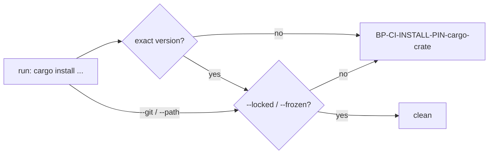

## Summary

The fleet `cargo-audit` and `cargo-upgrade` templates (and this repository's own
copies) now install their crate with
`cargo install --locked <crate> --version x.y.z`, and the `ci-install-pins`
scanner now polices `cargo install`: a registry install must carry an exact version
and every install must pass `--locked` (or `--frozen`). Version bump: `VERSION` is not touched by
this change. Closes #4683.

## Spec

### Intent and Rationale

- An unpinned, unlocked `cargo install` fetches the newest tool and re-resolves
  its whole dependency tree on every run, outside the 24h quarantine; the
  scanner behind the `ci-install-pins` label never looked at `cargo`, so the
  label overstated what was checked.
- The label was kept and the scanner widened to keep it honest, as the issue
  requires (narrowing the label alone does not satisfy it).

### Essential Design Decisions

- Versions live in `CARGO_AUDIT_VERSION` (0.22.2) and `CARGO_EDIT_VERSION`
  (0.13.14) in `workflow_definitions.ts`; both crates were published well over
  24h ago (crates.io API `created_at`: cargo-audit 0.22.2 on 2026-06-05,
  cargo-edit 0.13.14 on 2026-10-21).
- `--version x.y.z`, `--vers x.y.z` and `crate@x.y.z` count as exact because cargo treats a
  bare full version as `=x.y.z`; `--version 0.22` or `^0.22.2` do not.
- `--locked`/`--frozen` count wherever they appear, including before `install`,
  because cargo accepts them as global flags. `--git`/`--path` installs and
  cargo `$VAR` versions are exempt from version pinning, but still require locking.
  npm and gem variable versions are flagged.
- No Renovate manager is added for the cargo pins: touching `renovate.json`
  makes the local semgrep gate report its existing `"minimumReleaseAge": "0"`
  line (the stSoftwareAU exemption, Issue #2124), and the issue asks only for
  named constants so bumps are deliberate. A test keeps each template constant
  equal to this repo's workflow copy.

### Undiscoverable Facts

- #4692 (persisted checkout credentials) and #4693 (whether a Cargo workflow
  applies) own separate fixes per the issue's reconciliation; this PR changes
  neither the `if: hashFiles(...)` guards nor `persist-credentials`.

## Evidence

- Observed: `curl https://crates.io/api/v1/crates/cargo-edit/0.13.14` and
  `.../cargo-audit/0.22.2` return `created_at` dates above (the quarantine
  check); `cargo search` lists these as the current releases.
- Scanner and templates: `worker/deno/lib/ci_install_pin_scanner.ts`,
  `worker/deno/lib/workflow_definitions.ts`,
  `.github/workflows/cargo-audit.yml`, `.github/workflows/cargo-upgrade.yml`.
- Docs updated: `docs/GITHUB-ACTIONS-AUDIT-SCAN.md` (the pre-filer table row,
  the tool table, the id description, normalisation paragraph),
  `docs/DEPLOYMENT.md` (CI-installed CLIs blockquote), `prompts/issue/prompt.md`
  and `worker/deno/lib/workflow_file_checks.ts` (the twinned `ci-install-pins`
  label, now "...and every `cargo install` passes `--locked`"), and comments in
  `worker/deno/lib/idle_task_templates/github_actions_audit_template.ts`. No
  other copy of the old label exists outside `docs/archive` (grep).

## Test Plan

- Review follow-up: replacing or dropping text spliced into a nested script is
  obsolete. Shell variables and expressions remain intact, and a real
  unpinned install after a splice is still reported. Coverage:
  `worker/deno/tests/ci_install_pin_scanner_test.ts::nested script splices retain variables and expressions`.
  The npm variable case failed before the fix. No second command-normalisation
  implementation was found.

- Review follow-up: treating every later same-quoted word as a splice is
  obsolete. Adjacent quoted segments still form one shell word, while whitespace
  or an operator ends the capture and a later script is scanned independently.
  Pinned installs remain clean and unpinned installs retain their package names,
  covered by `worker/deno/tests/ci_install_pin_scanner_test.ts::separate quoted scripts and shell words retain their boundaries`.
  The test failed before the fix. No second command-normalisation implementation
  was found; the independent test helper noted below serves a different contract.

- Latest review: the old assumption that a closing quote ends a nested script
  line is obsolete; reopened segments remain part of the script. Unmatched
  arithmetic-like text no longer suppresses quote tracking on later lines.
  Detection of npm, gem and cargo installs and acceptance of pinned forms remain
  covered by `worker/deno/tests/ci_install_pin_scanner_test.ts::quoted script splices and unmatched arithmetic retain installs`.
  The test failed before the fix. The existing
  `worker/deno/tests/ci_install_pin_scanner_test.ts::heredoc delimiters and arithmetic preserve subsequent normalisation`
  now uses apostrophes in both quoted delimiter fixtures to exercise quote
  removal: replacing quote removal with the raw match made that test fail; the
  implementation was restored. No second command-normalisation implementation
  was found.

- Review follow-up: scanning script bodies as separate physical lines is
  obsolete because it loses continuations and quote state. Independent body
  normalisation retains detection of unpinned installs and accepts pinned
  continued installs. Full, quote-removed heredoc delimiters and arithmetic
  shifts preserve normalisation after the body. The red-before-fix coverage is
  `worker/deno/tests/ci_install_pin_scanner_test.ts::nested scripts normalise continuations and multiline strings`
  and `worker/deno/tests/ci_install_pin_scanner_test.ts::heredoc delimiters and arithmetic preserve subsequent normalisation`.
  The scanner and audit documentation describe the same normalisation; no
  second implementation was found.

- Review follow-up: the obsolete assumption that heredoc bodies cannot contain
  installs is replaced by scanning each body line. Multiline quoted script lines
  are also scanned while retaining the joined command; full heredoc delimiters
  and unfinished heredocs preserve later findings. The remaining quote-state
  isolation and npm, gem and cargo detection are covered by
  `worker/deno/tests/ci_install_pin_scanner_test.ts::heredoc bodies and unfinished quotes do not hide later installs`
  and `worker/deno/tests/ci_install_pin_scanner_test.ts::script bodies and full heredoc delimiters remain scanned`.
  Both failed before the fix. The scanner and audit documentation are the
  copies of the normalisation description; no second implementation was found.

- Review follow-up: heredoc bodies no longer contribute shell quote state;
  unfinished quotes and expressions fall back to scanning physical lines.
  npm, gem and cargo installs after heredocs remain detectable, covered by
  `worker/deno/tests/ci_install_pin_scanner_test.ts::heredoc bodies and unfinished quotes do not hide later installs`.
  The shared normalisation descriptions now match the scanner. The regression
  test failed before the fix; no second command-normalisation implementation was
  found.

- Review follow-up: shell quotes attached to cargo versions are removed, and
  background operators split commands without splitting redirections. Multiline
  quoted strings retain their state, and shell condition and timing prefixes
  are recognised. The formerly missed installs remain findings; valid quoted
  and parallel installs remain clean, covered by
  `worker/deno/tests/ci_install_pin_scanner_test.ts::cargo shell versions and command boundaries`.
  The shared command splitter and prefix stripper are the affected copies;
  `docs/EXTENDING.md` now includes cargo and its lock requirement.

- Added to `worker/deno/tests/ci_install_pin_scanner_test.ts`: cargo positives
  (unpinned, unlocked, pinned-but-unlocked, non-exact `--version 0.22` /
  `@^0.22.2` / `@0.22`), clean forms (`--locked` with `--version`,
  `crate@x.y.z`, `--version=`, `--frozen`, `=` prefix, `--locked` before
  `install`, `--locked` after the crate), exemptions (locked `--path`, `--git`, no
  spec, `$V`, `cargo build --locked`, comment), evasions (`sudo`,
  `env VAR=… cargo`, `cargo +stable install`, backslash continuations, chained
  commands, value flags `--features foo` / `--root` before the crate),
  consolidated-finding id/title/evidence/fix text, and a 5000-token hostile
  input.
- Added `worker/deno/tests/issue_4683_cargo_install_pins_test.ts`: templates and
  real workflows pass `findUnpinnedInstalls` (with a positive control that a
  `cargo install` step exists), and each template version equals the version in
  the repo's own workflow file.
- Existing `worker/deno/tests/workflow_template_audit_conformance_test.ts` runs
  `ci-install-pins` over every rendered template; it now covers the cargo
  templates.
- Red checks: reverting the `cargo-audit` template line to
  `cargo install cargo-audit` turned `issue_4683_cargo_install_pins_test.ts` and
  the conformance test red (3 failed); changing the scanner's
  `if (pinned && locked) continue;` to `if (pinned) continue;` turned
  `ci_install_pin_scanner_test.ts` red (3 failed). Both restored.
- Mutation follow-up: added a test that each cargo value flag (`--branch` …
  `-C`) consumes its value rather than leaking it as a crate, and a test that
  npm/npx/gem findings carry `unlocked: false` (kills the swapped
  `unlocked = false` default in `hit`). Red-checked: renaming `--color` in the
  set and flipping the default to `true` each turned the scanner test red (2
  failed). `--git` and `--path` now consume their values before checking locking.
- Type-check fix: the "flags cargo versions that are not exact" table is now
  `as const`, so `deno check` passes under `noUncheckedIndexedAccess`.
- Review follow-up red checks: the scanner test failed on `--vers` and unlocked
  external sources before the fix. The old expectation that unlocked git and
  path installs are clean is obsolete; locked external installs remain clean,
  while unlocked installs are covered by
  `worker/deno/tests/ci_install_pin_scanner_test.ts::findUnpinnedInstalls - external cargo sources still require a lock`.
  Exact and non-exact `--vers` forms are covered by the existing cargo tests.
- Review follow-up: the obsolete shared `cargo-install` placeholder and its
  pinning advice are replaced by source-specific IDs and lock-only guidance;
  unlocked external installs remain findings, covered by
  `worker/deno/tests/ci_install_pin_scanner_test.ts::cargo external findings identify sources and request locking only`.
  Quoted values and expression versions remain single cargo tokens, covered by
  `worker/deno/tests/ci_install_pin_scanner_test.ts::cargo quoted values and expressions do not become crates`.
  Both tests failed before the fix. The shared command splitter also serves
  npm and gem; the later follow-up covers its multiline quote handling.
- Review follow-up validation: repository-wide `deno fmt --check`, `deno lint`,
  and `deno check '**/*.ts'` passed; the scanner, 4683 and template conformance
  tests passed (67 tests). The archived-summary freshness check reads commit
  history and will verify this working-tree update after the babysitter commits.
- Latest review follow-up: command chains split outside quoted text and GitHub
  expressions, while cargo ignores unquoted shell comments and redirections.
  Real chained installs still produce findings. The regression tests
  `worker/deno/tests/ci_install_pin_scanner_test.ts::cargo expressions preserve logical operators and command boundaries`
  and `worker/deno/tests/ci_install_pin_scanner_test.ts::cargo ignores shell comments and redirections`
  both failed before the fix. No twinned command-splitting rule was found.
- Review follow-up: quoted scripts on their opening line are scanned, and
  unmatched arithmetic-like syntax no longer hides subsequent quoted lines.
  `worker/deno/tests/ci_install_pin_scanner_test.ts::quoted scripts on their opening line retain installs`
  and `worker/deno/tests/ci_install_pin_scanner_test.ts::unmatched arithmetic on the opening line retains installs`
  failed before the fix and cover the reported npm, gem and cargo cases, as well
  as pinned controls. The independent `joinContinuations` in
  `worker/deno/tests/checkov_workflow_test.ts` serves a different test contract.
- Targeted run: `deno task test:unit` over the scanner, 3642, 4683, conformance,
  file-checks, audit-template, definitions, auditor and changed-gate tests: 299
  passed, 0 failed.
- After the follow-up: `deno check` on the scanner and its test is clean, and
  the scanner, 4683 and conformance tests pass (66 passed, 0 failed).
- Full `./quality.sh`: killed by my 595s foreground timeout (exit 124) before
  its final stage reported, so there is no overall verdict. Every stage printed
  before the cut-off passed (including workflow hygiene, completeness checks,
  markdownlint, mermaid and semgrep); config integration and checkov were
  skipped. CI runs the same checks.

<!-- vibe-quality-gate-skipped reason="foreground gate exceeded the 595s tool timeout twice before completing; stages that reported all passed; CI runs the same checks" -->

## Not done

- No Renovate `customManagers` entry for cargo installs (see Essential Design
  Decisions); the cargo pins are bumped by hand.
- `cargo build/test/clippy --locked` policing is not added (the issue scopes
  this to `cargo install`).
- Floating git sources are not version-policed, even without `--rev`.
