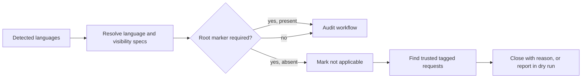

## Summary

Workflow auditing now requires root-project evidence for templates whose tools
run from the checkout root. Workflow sync also closes trusted generated issues
for root-project specs that no longer apply, with an explanatory comment, while
leaving workflow files untouched. Closes #4693.

Version bump: no version file was changed for this update.

## Spec

### Intent and Rationale

- GitHub's language byte counts can include nested fixtures, so they do not by
  themselves show that a root-level project tool can run.
- Applicability is declared on each workflow spec and resolved by the auditor;
  repository-wide scans keep their nested-project coverage.

### Essential Design Decisions

- Root-project templates require one of their declared root marker files in
  marker-based language detection; universal specs and repository-wide scans
  have no such requirement.
- Only known workflow-sync requests verified as fleet-authored are reconciled.
  Dry runs report the same candidates without closing them.
- Existing workflow files are not removed when a language stops qualifying.

### Undiscoverable Facts

- The issue identifies the VibeCoder Rust fixtures as the motivating case;
  its root has no `Cargo.toml`.
- Template contracts were checked in the workflow definitions: Cargo commands
  run at the checkout root, ShellCheck's `scandir: .` recursively scans, Java
  Dependency Check uses `path: .`, and Dependabot Java updates use root `/`.

## Evidence

Backend and CLI change; no visual surface changed.

Template contract evidence: `gh api repos/ludeeus/action-shellcheck/contents/action.yaml`
showed the `scandir` input and recursive file search. The Dependency Check
Action README documents `path` as its scan path and uses `.` in its example.
The Cargo templates invoke Cargo from the checkout root, and the Java update
template configures Dependabot directory `/`.

## Deno regression avoided

- Used the repository's `deno task`, `deno check`, and `deno lint`; no Node
  tooling or dependencies were added.

## Test Plan

- `worker/deno/tests/workflow_auditor_test.ts`: API-only Rust excludes Cargo
  specs; a root `Cargo.toml` retains all three; mixed languages retain universal
  and marker-backed specs; nested ShellCheck and Java Dependency Check remain
  eligible; `index.html` alone does not satisfy npm project templates.
- `worker/deno/tests/purge_stale_workflow_issues_test.ts`:
  trusted missing/partial requests are reconciled; unknown specs and untrusted
  authors remain open; root-marker projects retain their requests; dry-run and
  close-failure outcomes are covered.
- `worker/deno/tests/setup_workflow_sync_test.ts`: sync reconciles when there
  are no workflow gaps; listing/close failures surface; dry-run does not close.
- `worker/deno/tests/workflow_sync_actions_test.ts`: API-only Rust does not
  select Cargo toolchain actions, while a root Cargo project does.
- Regression red check: the API-only Rust Cargo assertion failed with the
  unfixed auditor and passed with the final implementation.
- `deno task test:unit tests/workflow_auditor_test.ts tests/purge_stale_workflow_issues_test.ts tests/setup_workflow_sync_test.ts tests/workflow_sync_actions_test.ts < /dev/null` — passed, 104 tests.
- Targeted `deno check --frozen --lock=deno.lock` and `deno lint` on the changed
  source and test files — passed.
- `timeout 900 ./quality.sh < /dev/null` — timed out with exit 124 while the
  full parallel Deno test suite was still running; the earlier gate stages
  reported passed.
- No existing test assertions were removed.
