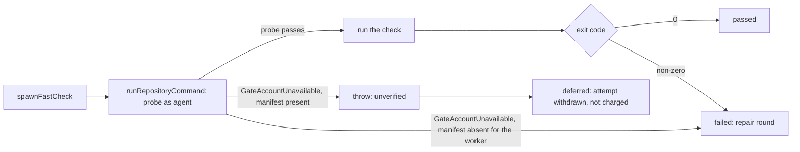

## Summary

The merge-conflict pre-push fast checks (Issue #4616) ran `cargo fmt` and the
other checks as the `agent` account without ever asking whether that account
could reach the clone. When it could not, cargo reported a missing `Cargo.toml`,
the result was classed `failed`, and both repair rounds plus the PR's
merge-conflict attempt were spent on an environment fault. `spawnFastCheck` now
runs each check through `runRepositoryCommand` (the access probe and per-account
cargo target of Issues #4659 / #4733), so an account that cannot use the
checkout makes the check `unverified`. `verifyMergeBeforePush` then returns
`deferred`, and the processor discards the local merge and withdraws the attempt
without charging it. A manifest the worker can see is genuinely absent from the
merged tree stays a failing check. Closes #4697.

Version bump: `VERSION` is not touched by this change; the merged commit records
the final version.

## Spec

### Intent and Rationale

- The probe is the existing owner of "can the dropped account use this
  checkout"; the fast checks were the one gate that bypassed it. Reusing it
  avoids a second spawn helper (issue point 2).
- Classifying by the probe, not by the text "could not find Cargo.toml", means a
  real check failure that happens to print that text is still `failed`.

### Essential Design Decisions

- There is still no worker-account fallback: the `agent` pre-check in
  `spawnFastCheck` is kept, and credentials still travel on the stdin channel
  (#4705) through `runRepositoryCommand`.
- Fast checks omit the write probe only for cargo fmt, locked clippy and test,
  Deno fmt and lint, and a direct Deno check that meets the milestone gate's
  read-only criteria, including a qualifying `check` task. Other commands
  require a writable checkout; resolution tasks refused by that probe are left
  to CI when another check ran. A stale Deno lockfile permission refusal also defers the check.
  The cargo target write check still runs, and a private target it asks for is
  placed under the clone root's `.vibe-fast-check-target` on the work volume:
  `/var/tmp` is a noexec scratch mount on Docker and Podman, while `agent`
  cannot create a directory under a sub-directory
  project, so the default `.vibe-cargo-target` there would fail the build and
  charge a repair round (verifier finding). `spawnFastCheck` takes an
  `environment` seam (`source`, `trimRefused`) so the test can reach that path
  regardless of the host's trim verdict. The fallback root is provisioned by
  the worker; a provisioning failure defers the check. Trim-refused placement
  retains its separate ephemeral root. Main uses the replacement
  `readOnlyCheckout` option for its milestone gate; the fast checks now use
  that same option.
- A probe failure is told apart from a removed manifest by asking the worker
  whether the planned manifest is a file: absent means a failing check, present
  means an access fault (thrown, so unverified).
- Existing deferral handling is reused unchanged: `unverified` becomes
  `deferred`, which the processor withdraws without charging the attempt, so the
  repair and abandon-and-redo budgets are untouched.

### Undiscoverable Facts

- The reported failure came from a private fleet repository's logs; the cause
  was not reproduced on that host. The probe is the layer that now catches it
  (traversal, read of the manifest, write of the target), and the main branch
  already carries the home-directory search grant for group `vibework`.

## Evidence

Backend change; no UI file is touched. The real-sudo test in
`worker/deno/tests/merge_fast_checks_access_4697_test.ts` ran against the real
`agent` account on this host (uid 1001): a readable checkout ran the command, a
`0700` checkout was refused before any command ran.

## Test Plan

- PR #4795 task follow-up: the obsolete rule deferred every Deno task in an
  unwritable project. A `check` task now uses the milestone gate's read-only
  classifier; resolution tasks refused by the write probe are left to CI when
  another check ran. Other access faults still defer. Coverage:
  `worker/deno/tests/merge_fast_checks_access_4697_test.ts::merge checks: nested read-only check task runs and unwritable resolution task is left to CI`.
  The regression failed before the fix. The milestone gate's existing classifier
  is reused; no other copy of this fast-check handling was found.

- New `worker/deno/tests/merge_fast_checks_access_4697_test.ts` (21 tests):
  blocked directory refused and the command never spawned; `runMergeFastChecks`
  gives `unverified` and `verifyMergeBeforePush` gives `deferred` with the
  repair agent never called; a genuinely missing `Cargo.toml` is `{code: 1}`
  while a present one with a failing probe rejects; a passing probe followed by
  cargo's own "could not find `Cargo.toml`" output is still `failed`; probe exit
  2 runs with a private `CARGO_TARGET_DIR`; real `agent` readable versus
  inaccessible checkout; and (PR #4795 review, Issue #4782) a real-sudo test
  with a worker-owned 0755 sub-directory project that runs its fast check, plus
  a test that runs the real probe script on a 0555 directory and shows the fast
  check runs while the default probe still refuses with `probe 3`; and a
  real-sudo test where a cargo check in a worker-owned 0755 sub-directory writes
  its private `CARGO_TARGET_DIR` (stand-in `sh` creates it).
- Red checks: returning exit 1 directly for `GateAccountUnavailable` turned the
  `unverified`/`deferred` test red; always throwing for an absent manifest
  turned the missing-manifest test red. Setting the former
  `requireWritableCheckout` option to `true` in `spawnFastCheck` turned both
  sub-directory Deno tests red (`probe 3`).
  Dropping the clone-root target override made the cargo sub-directory
  real-sudo test fail with permission denied. The original fake-spawn fixture
  used the clone root as the project directory and did not distinguish the
  fallback; it now uses a nested project. All changes restored.
- Edited existing tests: `tests/merge_fast_checks_test.ts` gained `isProbeCall`
  and `probePassed` helpers and the "isolates credentials" test returns early
  for the probe call. `tests/merge_fast_checks_credentials_4705_test.ts`:
  `recordingSpawn` answers the probe with exit 0 without recording it, and the
  channel-fault test uses a temporary checkout holding a `Cargo.toml` instead of
  `/tmp`, because a checkout without one is now the missing-manifest case. No
  assertion was removed or weakened.
- Mutation check: it reported "baseline tests fail before mutation" because the
  real-sudo test made its checkouts under the runner's `TMPDIR`, a `0700`
  directory the `agent` account cannot traverse, so the readable checkout was
  refused. The test now makes both checkouts under `/tmp`. Run the way the
  mutation runner runs it (`deno test --no-check -A`, a fresh `0700` `TMPDIR`),
  the four covering test files pass (157 passed, 0 failed).
- Passed at the previous head (`deno task test:unit`, run per file):
  `worker/deno/tests/merge_fast_checks_access_4697_test.ts` (11 tests),
  `worker/deno/tests/merge_fast_checks_test.ts` (36 tests at head) and
  `worker/deno/tests/merge_fast_checks_credentials_4705_test.ts` (6 tests at
  head), 0 failed.
- Docs updated: `docs/workflows/merge-conflicts.md` (the Issue #4616 bullet) and
  `docs/CONFIGURATION.md` (the `agent` account checkout paragraph).
- Callers of `spawnFastCheck` checked: `verifyMergeBeforePush` default runner
  and `runMergeFastChecks` default runner; both pass through unchanged and
  handle the thrown error as `unverified`.
- PR #4795 review: the obsolete `/var/tmp` private target could not execute
  Cargo binaries on Docker and Podman. The replacement lives under the clone
  root on the work volume, retaining per-account isolation and support for
  unwritable nested projects. `worker/deno/tests/merge_fast_checks_access_4697_test.ts::merge checks: the private target on the work volume is outside noexec scratch mounts`
  checks the configured scratch mounts; the private-target and real-sudo nested
  project tests cover selection and access. Both default runners pass the clone
  root through to the spawn. No other copy of this target-selection rule was found.
- PR #4795 follow-up: the obsolete shared root override also redirected
  trim-refused builds to the persistent clone. The separate private fallback
  keeps trim-refused builds on the ephemeral root and provisions the clone-root
  fallback, deferring if provisioning fails. Coverage:
  `worker/deno/tests/merge_fast_checks_access_4697_test.ts::merge checks: trim refusal retains the ephemeral cargo target`,
  `worker/deno/tests/merge_fast_checks_access_4697_test.ts::merge checks: a cargo target the account cannot write is built in a private target (Issue #4697)`,
  `worker/deno/tests/merge_fast_checks_access_4697_test.ts::merge checks: an unprovisionable private target defers the check`,
  the real-sudo nested-project test with a 0755 clone root, and
  `worker/deno/tests/merge_fast_checks_access_4697_test.ts::merge checks: a symlinked private target is refused`,
  which protects the provisioning step from a repository-controlled symlink.
- PR #4795 security follow-up: the obsolete link-following, memoised root
  provisioning is replaced by non-recursive creation and a worker-ownership
  check before chmod. The private root remains writable by the agent, while an
  unsafe or unprovisionable root defers the check. Coverage includes
  `worker/deno/tests/merge_fast_checks_access_4697_test.ts::merge checks: a private target owned by another uid is refused`,
  `worker/deno/tests/merge_fast_checks_access_4697_test.ts::merge checks: an unprovisionable private target defers the check`,
  and the private-target selection test, which verifies the provisioned mode.
  The ownership regression failed before the fix. No other copy of this
  clone-root provisioning rule was found.
- PR #4795 access follow-up: the obsolete assumption that every check reads
  only is replaced by per-command write probes; safe read-only checks still run
  in unwritable projects. The fast target no longer shares the milestone target
  that an agent can own. Coverage:
  `worker/deno/tests/merge_fast_checks_access_4697_test.ts::merge checks: write requirements follow each command`,
  `worker/deno/tests/merge_fast_checks_access_4697_test.ts::merge checks: unwritable project defers a writing check without repair`,
  `worker/deno/tests/merge_fast_checks_access_4697_test.ts::merge checks: a stale Deno lockfile permission refusal is unverified`,
  and `worker/deno/tests/merge_fast_checks_access_4697_test.ts::merge checks: milestone cargo target does not block fast target`.
  The milestone gate is the other copy of the Deno read-only rule; its helper
  and lockfile refusal classifier are reused. The three access and target
  regressions failed before the fix. The real-sudo nested-project fixtures now
  exercise Deno lint and cargo fmt instead of arbitrary eval and cargo check:
  those old commands are not guaranteed read-only. The remaining contract, that
  read-only checks run in a readable project and use a writable private cargo
  target, is covered by
  `worker/deno/tests/merge_fast_checks_access_4697_test.ts::real sudo: a project the agent can read but not write runs its fast check instead of being deferred (Issue #4782)`
  and `worker/deno/tests/merge_fast_checks_access_4697_test.ts::merge checks: a cargo check in a readable, unwritable sub-directory project gets a private target the account can write (Issue #4782)`.

## Not done

- The failing host was not re-run; the fix is verified against the probe and a
  real `agent` account on this host only.
- A Deno repository's checks run as `agent` through the same probe; no real Deno
  repository was exercised beyond the unit tests.
