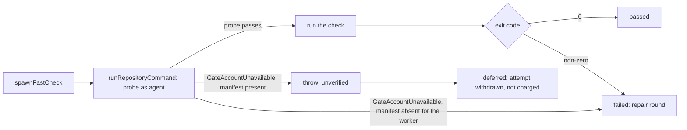

## Summary

The merge-conflict pre-push fast checks (Issue #4616) ran `cargo fmt` and the
other checks as the `agent` account without ever asking whether that account
could reach the clone. When it could not, cargo reported a missing `Cargo.toml`,
the result was classed `failed`, and both repair rounds plus the PR's
merge-conflict attempt were spent on an environment fault. `spawnFastCheck` now
runs each check through `runRepositoryCommand` (the access probe and per-account
cargo target of Issues #4659 / #4733), so an account that cannot use the checkout
makes the check `unverified`. `verifyMergeBeforePush` then returns `deferred`, and
the processor discards the local merge and withdraws the attempt without charging
it. A manifest the worker can see is genuinely absent from the merged tree stays
a failing check. Closes #4697.

Version bump: `VERSION` is not touched by this change; the merged commit records
the final version.

## Spec

### Intent and Rationale

- The probe is the existing owner of "can the dropped account use this
  checkout"; the fast checks were the one gate that bypassed it. Reusing it
  avoids a second spawn helper (issue point 2).
- Classifying by the probe, not by the text "could not find Cargo.toml", means a
  real check failure that happens to print that text is still `failed`.

### Essential Design Decisions

- There is still no worker-account fallback: the `agent` pre-check in
  `spawnFastCheck` is kept, and credentials still travel on the stdin channel
  (#4705) through `runRepositoryCommand`.
- A probe failure is told apart from a removed manifest by asking the worker
  whether the planned manifest is a file: absent means a failing check, present
  means an access fault (thrown, so unverified).
- Existing deferral handling is reused unchanged: `unverified` becomes
  `deferred`, which the processor withdraws without charging the attempt, so the
  repair and abandon-and-redo budgets are untouched.

### Undiscoverable Facts

- The reported failure came from a private fleet repository's logs; the cause
  was not reproduced on that host. The probe is the layer that now catches it
  (traversal, read of the manifest, write of the target), and the main branch
  already carries the home-directory search grant for group `vibework`.

## Evidence

Backend change; no UI file is touched. The real-sudo test in
`worker/deno/tests/merge_fast_checks_access_4697_test.ts` ran against the real
`agent` account on this host (uid 1001): a readable checkout ran the command, a
`0700` checkout was refused before any command ran.

## Test Plan

- New `worker/deno/tests/merge_fast_checks_access_4697_test.ts` (7 tests):
  blocked directory refused and the command never spawned; `runMergeFastChecks`
  gives `unverified` and `verifyMergeBeforePush` gives `deferred` with the repair
  agent never called; a genuinely missing `Cargo.toml` is `{code: 1}` while a
  present one with a failing probe rejects; a passing probe followed by cargo's
  own "could not find `Cargo.toml`" output is still `failed`; probe exit 2 runs
  with a private `CARGO_TARGET_DIR`; real `agent` readable versus inaccessible
  checkout.
- Red checks: returning exit 1 directly for `GateAccountUnavailable` turned the
  `unverified`/`deferred` test red (5 of 7 failed); always throwing for an absent
  manifest turned the missing-manifest test red. Both restored.
- Edited existing tests: `tests/merge_fast_checks_test.ts` gained `isProbeCall`
  and `probePassed` helpers and the "isolates credentials" test returns early for
  the probe call. `tests/merge_fast_checks_credentials_4705_test.ts`:
  `recordingSpawn` answers the probe with exit 0 without recording it, and the
  channel-fault test uses a temporary checkout holding a `Cargo.toml` instead of
  `/tmp`, because a checkout without one is now the missing-manifest case. No
  assertion was removed or weakened.
- Passed: `deno task test:unit` over those three files plus
  `tests/untrusted_gate_spawn_test.ts` and `tests/pr_merge_conflict_processor_test.ts`
  (191 passed, 0 failed).
- Docs updated: `docs/workflows/merge-conflicts.md` (the Issue #4616 bullet) and
  `docs/CONFIGURATION.md` (the `agent` account checkout paragraph).
- Callers of `spawnFastCheck` checked: `verifyMergeBeforePush` default runner and
  `runMergeFastChecks` default runner; both pass through unchanged and handle the
  thrown error as `unverified`.

## Not done

- The failing host was not re-run; the fix is verified against the probe and a
  real `agent` account on this host only.
- A Deno repository's checks run as `agent` through the same probe; no real Deno
  repository was exercised beyond the unit tests.
