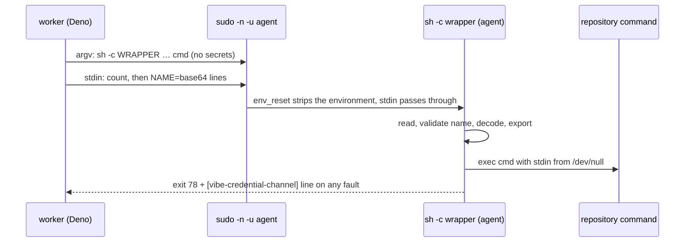

## Summary

A repository's declared `quality_credentials` now reach the command that the
worker drops to the `agent` account. Before, they were only in the environment
handed to `sudo -n -u agent -- …`, which sudo's `env_reset` strips (the sudo
rule has no `SETENV`). One shared channel now serves every caller that runs a
repository command as `agent`: the quality gate (`spawnRepositoryCommand`), the
merge fast checks (`spawnFastCheck`) and the milestone merge/resolution gates
(`runRepositoryCommand`). The temporary "declared credential → run as the
worker" fallback in `untrusted_gate_spawn.ts` is removed. Version bump: no
`VERSION` change in this diff; the merged commit records the final version.
Closes #4705.

## Spec

### Intent and Rationale

- `env_reset` discards the environment, argv is visible to `ps` and the sudo
  log, and a file would need an agent-readable path. A stdin pipe is the one
  channel that survives sudo, stays private and needs no new sudo grant.
- One module (`credential_channel.ts`) is called by all three callers, so there
  is a single transport and a single fault contract.

### Essential Design Decisions

- Only the repository's declared credentials are carried. The allowlist and
  `clearEnv` are unchanged; no `SETENV`/`env_keep` is granted; nothing of the
  worker's ambient GitHub/App credentials is added; no value is in argv, the
  wrapper text or any message (errors name the variable only).
- Values travel base64 encoded, so multi-line values, trailing newlines and
  shell metacharacters survive. The wrapper uses no `eval`, validates every
  name, and `exec`s the command with stdin from `/dev/null`. The quality gate
  refuses `stdin: "inherit"` together with declared credentials (nothing in
  `lib` does that today).
- A wrapper fault (exit 78 plus the marker line) is never a pass: the quality
  gate returns exit 1 with the fault line, classified
  `failed_credential_delivery` (infrastructure, not a code fault, so no repair
  round); the fast check throws, which the caller already maps to `unverified`;
  the milestone gates return `GateAccountUnavailable` (left to CI). A malformed
  or wrapper-reserved declared name (`IFS`, `_vibe_cc_*`) or a value with a NUL
  byte is refused before anything is spawned (the quality gate reports it the
  same way).
- With an available `agent` account a command always runs as `agent`. The worker
  account runs it only where the image has no `agent` account.

### Undiscoverable Facts

- A repository command that prints the marker and exits 78 itself is read as a
  channel fault. The effect is only "failed" (quality gate), "unverified" (fast
  check) or "left to CI" (milestone gates): it cannot turn a failure into a
  pass, and CI still runs the repository's own checks.
- This host has an `agent` account and a working `sudo -n -u agent`, so the
  real-sudo tests ran here; they return early on a host without one.

## Evidence

Backend change, no UI. The real `sudo -n -u agent` drop was exercised with
synthetic credentials:

- `sudo -n -u agent -- true` exits 0 on this host.
- Without the channel the declared variable is gone: the same command prints
  `|unset`. With it the command prints `synthetic-4705|unset` while an ambient
  `GH_TOKEN` handed to sudo is stripped.

The production implementation the sudo tests stand in for is the real sudo; the
property relied on (stdin passes through, the environment is reset) was
observed, not assumed. The wrapper's own fault contract is tested through a real
`sh`.

Docs: `docs/CONTAINER.md` ("The placement travels in argv…" bullet),
`docs/CONFIGURATION.md` (`quality_credentials` section), `SECURITY.md` (6b and
the R6 row), `docs/THREAT-MODEL.md` R6, `docs/mutation-check.md` ("Child
environment"; the mutation check runs as the worker and keeps the env route),
`docs/audits/security-sweep-1214-subprocess-argv.md` (the #4659 fallback prose).
Sibling names grepped: `carryEnvThroughSudo`, `untrustedQualityCommandEnv`,
`CARGO_TARGET_DIR`, `GateAccountUnavailable`.

## Acceptance Criteria

<!-- vibe-spec-review inputs="diff+issue-body" -->

- **met** — Include the milestone gate callers as well as the quality gate and
  fast checks — evidence: `worker/deno/lib/untrusted_gate_spawn.ts`,
  `tests/untrusted_gate_spawn_test.ts::declared credentials cross sudo on the stdin channel and the account stays agent (Issue #4705)`
  — reviewer: met
- **met** — One safe credential channel — evidence:
  `worker/deno/lib/credential_channel.ts`,
  `tests/credential_channel_4705_test.ts::credential channel 4705 - no declared value appears anywhere in argv`
  — reviewer: met
- **met** — Remove the credential-triggered fallback on hosts with an available
  untrusted account — evidence:
  `tests/untrusted_gate_spawn_test.ts::declared credentials cross sudo on the stdin channel and the account stays agent (Issue #4705)`
  — reviewer: met
- **met** — Repository-declared credentials only; allowlist and `clearEnv`
  preserved; no blanket SETENV; nothing in argv or logs; no ambient GitHub/App
  credentials — evidence:
  `tests/credential_channel_4705_test.ts::credential channel 4705 - real sudo delivers the declared value and strips the ambient environment`
  — reviewer: met
- **met** — Missing transport, mint failure or unavailable isolation is never a
  pass — evidence:
  `tests/quality_gate_phase_test.ts::runQualityGateCheck - a credential delivery fault is infrastructure, not a fixable failure (Issue #4705)`,
  `tests/merge_fast_checks_credentials_4705_test.ts::spawnFastCheck: a channel fault throws the fault line and never a value, so the check is unverified (Issue #4705)`,
  `tests/untrusted_gate_spawn_test.ts` (wrapper fault leaves the command to CI)
  — reviewer: partial on the first pass (the quality gate reported a wrapper
  fault as a fixable code failure); fixed in this diff with a
  `failed_credential_delivery` action that sends no repair round, then covered
  by the test above. A mint failure already fails the quality-gate phase
  (`runQualityGateCheck` Step 0) and parks the merge, unchanged. The re-dispatch
  after the fix was not run, so this is recorded as the first-pass verdict plus
  the fix.
- **met** — Synthetic credentials through a real dropped process plus negative
  checks for undeclared names — evidence:
  `tests/quality_gate_credentials_4705_test.ts::a declared credential reaches the agent-run command through the stdin channel (Issue #4705)`,
  `tests/merge_fast_checks_credentials_4705_test.ts` real-sudo test — reviewer:
  met
- **unrequested** — refusing `stdin: "inherit"` with declared credentials,
  refusing non-identifier/reserved names and NUL values — reviewer: unrequested
  — reason: hardening the channel needs so a declaration cannot be silently
  dropped

## Standards Review

<!-- vibe-standards-review inputs="diff+CODING-STANDARDS.md" -->

- **violation** — a declared name colliding with the wrapper's own shell
  variables (`count`, `i`, `line`…) silently dropped later credentials —
  evidence: `worker/deno/lib/credential_channel.ts:61` — reason: fixed in this
  diff (wrapper variables prefixed `_vibe_cc_`, `IFS` and that prefix refused,
  byte-exact test now declares the old names)
- **violation** — `docs/CONFIGURATION.md` said the worker account runs commands
  only where no `agent` exists — evidence: `docs/CONFIGURATION.md:123` — reason:
  fixed in this diff (scoped to gate commands; formatters, mutation check and
  coverage keep the worker account)
- **violation** — a wrapper fault was returned as an ordinary exit 1, so the
  agent was sent to fix it — evidence:
  `worker/deno/lib/quality_gate_phase.ts:403` — reason: fixed in this diff
  (`failed_credential_delivery`)
- **clean** — Australian English, no fixed `/tmp` paths, no `Deno.env` mutation,
  no test-only exports, every caller reached, call-site red checks, no value in
  argv or messages; review-enforced rules checked:
  nothing-exists-only-for-a-test, TMPDIR, new-argument-reaches-every-caller,
  branch-outcome-needs-a-test, new-precondition-must-not-stop-tests. The
  real-sudo tests return early on a host without `agent`, as the existing
  real-sudo tests do (noted, not changed).

## Test Plan

- `worker/deno/tests/credential_channel_4705_test.ts` (module: argv shape, name
  and NUL refusals, byte-exact round trip through a real `sh`, wrapper faults,
  the `stdin` option of `runWithTimeout`/`commandOutputWithTimeout`, real sudo).
- `worker/deno/tests/quality_gate_credentials_4705_test.ts` (real sudo through
  `createDefaultDeps`, bad name, channel fault, no-marker and no-channel twins).
- `worker/deno/tests/merge_fast_checks_credentials_4705_test.ts` (argv and
  stdin, fault throws, no-marker twin, no credentials, real sudo).
- `worker/deno/tests/untrusted_gate_spawn_test.ts` (replaces the fallback test;
  agent account kept, decoded payload holds exactly the declared names, fault →
  `GateAccountUnavailable`, no-marker twin, invalid name, no credentials, two
  real-sudo tests).
- Ran from `worker/deno`: `deno task test:unit` over those files plus
  `quality_gate_phase_test.ts`, `untrusted_command_env_test.ts`,
  `merge_fast_checks_test.ts` (re-run after the final change: 117 passed, 0
  failed over the credential, gate and spawn files);
  `deno task
  check:manifests` passed; `deno fmt`, `deno lint`, `deno check`
  clean.
- Full `./quality.sh`: every stage passed except `deno tests` (parallel pass:
  32014 passed, 2 failed). The two failures are host-related and not from this
  diff: `babysitter default heartbeat resolves its checkout revision` (JSR
  download of `@std/crypto`) and
  `verifyResolvedTree - the repository's own task
  sees only the allowlisted environment (Issue #4659)`
  (the test's temp checkout is mode 700, so the `agent` probe cannot read it; it
  fails identically on the unmodified `0a4d803a`). The serial pass did not run
  after the parallel failure; CI runs it. The first gate run also needed a
  sweep-ledger entry (`docs/audits/lib-sweep-coverage/top-up-4705.json`) and no
  `Deno.env` mutation in the new tests (fixed; second run is clean for both).
- Red checks (break, run, restore): removing the `carryCredentialsThroughSudo`
  call in `quality_gate_phase.ts` → the real-sudo test and the bad-name test
  red; in `merge_fast_checks.ts` → the argv/stdin test and real-sudo test red;
  in `untrusted_gate_spawn.ts` → 4 tests red; making a declared credential
  return the un-dropped argv (the old fallback) → 5 tests red (the "account
  stays agent" test is the one that catches it); disabling the fault branch in
  `spawnRepositoryCommand` → the fault test red; dropping the wrapper's `export`
  line → the byte-exact and real-sudo tests red.
- Removed from `worker/deno/tests/untrusted_gate_spawn_test.ts` (test "declared
  credentials survive an available agent account", replaced):
  - Removed: `assertEquals(calls.length, 1)`;
    `assertEquals(final.executable, "/bin/sh")`;
    `assertEquals(result.value.stdout, "declared")`;
    `assertEquals(final.options.env?.NPM_TOKEN, "declared")`. Required by:
    "remove the credential-triggered fallback on hosts with an available
    untrusted account" (these asserted that the declared credential made the
    command run as the worker). Replaced by: `untrustedAccountOf` is `agent` for
    the final spawn; the decoded stdin payload holds the declared names; the
    real-sudo test prints `synthetic-4705|unset`.
  - Kept (moved into the new tests): `GH_TOKEN` absent from env, `clearEnv`
    true, no declared value in args, `result.ok` and exit code 0.
- Callers checked for the shared `untrustedSpawn`/`carryEnvThroughSudo` change:
  `spawnRepositoryCommand` (formatters stay un-dropped and keep the env route),
  `spawnFastCheck`, `runRepositoryCommand`; the mutation check and coverage
  carry-over run as the worker with no sudo (`docs/mutation-check.md`) and are
  unchanged.
- Rule applied to this PR's own diff: docs claims "never in argv", "only the
  declared credentials" were checked against `credential_channel.ts` and the
  three callers; nothing found.

## Pre-PR verifier and mutation check

- Verifier finding (`worker/deno/lib/merge_fast_checks.ts:422`,
  `untrusted_gate_spawn.ts:354`): fixed. Both now read a channel fault only when
  `channelled.stdin !== undefined`; the no-credentials marker tests are
  `tests/merge_fast_checks_credentials_4705_test.ts::spawnFastCheck: the channel marker with nothing declared is the check's own failure, not a fault (Issue #4705)`
  and
  `tests/untrusted_gate_spawn_test.ts::the channel marker with no declared credentials is the command's own result, not a fault (Issue #4705)`;
  both went red with the guard removed.
- Mutation check "baseline tests fail": not reproduced here. The seven named
  files (`fence_coverage_verifier_test`, `quality_gate_credentials_4705_test`,
  `quality_gate_phase_test`, `repo_formatters_4113_test`,
  `tool_output_treat_as_data_3046_test`, `untrusted_command_env_test`,
  `untrusted_gate_spawn_test`) pass at the head (118 passed, 0 failed) with
  stdin from `/dev/null`. The failure is an environment property of the mutation
  runner's sandbox, not a test defect.

- The Gitleaks PR-range scan includes earlier commits containing synthetic
  credential fixtures. Its configuration exempts only those exact fixture lines,
  retaining scanning for other values.

## Known gaps

- `PROCESS_STATE_MUTATOR_TEST_FILES` is unchanged (still empty): the `Deno.env`
  mutation was removed from the new tests instead. As a result the quality-gate
  real-sudo test can no longer plant an ambient `GH_TOKEN` and asserts only the
  declared prefix; the merge fast-check and module tests do plant it through
  their spawn seam.
- The values are also in the environment handed to `sudo` itself (as they were);
  `env_reset` discards them there.
- Stdin `"inherit"` with declared credentials on the dropped quality-gate path
  is refused rather than supported.
