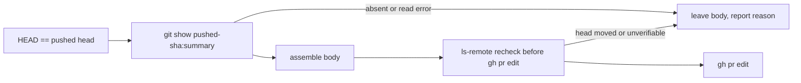

## Summary

Adopting an agent-raised PR now builds its body from the PR summary as
**committed** at the verified pushed head, not from the working tree, and
rechecks that head just before publishing. Uncommitted recovery edits on a
checkout whose HEAD equals the pushed head can no longer be described as
delivered. Version bump: `VERSION` is not changed by this PR. Closes #4712.

## Spec

### Intent and Rationale

- `HEAD == git ls-remote` proves nothing is committed-but-unpushed; it does not
  prove the working tree is clean. `loadPrSummary` reads the working tree, so a
  recovery turn's uncommitted summary reached the PR body.
- The fix reads the summary with `git ls-tree` / `git show <sha>:<path>` at the
  sha adoption already verifies, as the issue proposes.

### Essential Design Decisions

- `SyncPrBodyInput.committedHeadSha` is opt-in. Only `adoptAgentRaisedPrBody`
  sets it. The fix-run callers (feedback, CI, merge-conflict, reconcile) and the
  review-fix verifier (`verifyFeedbackFix`, which deliberately builds a
  candidate from the pre-push tree) keep the working-tree read. #4637 (open)
  consumes this contract for babysitter publication; nothing here duplicates it.
- A missing summary at the commit, a failed object read, a moved head, an
  unverifiable head or a moved checkout never fall back to the working tree: the
  live body is left as it is and the sync result names the reason (`skipped`
  with a reason, or `ok: false`), which `runPrBodySync` logs.
- The head recheck is a fresh `git ls-remote` immediately before `gh pr edit`,
  not GitHub's `headRefOid` (which lags after a push).

### Undiscoverable Facts

- The worker log of the NEAT-AI-Discovery#2505 run is on the fleet host that ran
  it, so which step left the edits uncommitted (recovered-summary commit or the
  disk-floor-stopped gate) was not checked. The fix does not depend on it.

## Evidence

Backend change, no UI. The sha is passed to git, so `loadCommittedPrSummary`
validates it against `/^[0-9a-f]{40,64}$/` first.

Doc comment on `commitRecoveredSummary`
(`worker/deno/lib/summary_rule_gate_retry.ts`) corrected: it claimed an
uncommitted summary was "still enough for the PR body, which is read from disk".
Docs updated: `docs/USAGE.md` (adoption paragraph), `docs/INTERNALS.md`
(`pr_body_sync.ts` and `agent_pr_adoption.ts` rows). Grepped `README.md`,
`docs/` (excluding archive) for `Issue #3804` and `agent-raised`; the other hit,
`docs/workflows/milestones.md:193`, is about titles and stays true.

## Test Plan

- `worker/deno/tests/pr_summary_loader_test.ts`: seven new
  `loadCommittedPrSummary` tests on a real temp git repo (committed text wins
  over uncommitted edits; working-tree-only summary is `not_found`; precedence
  and legacy fallback; deleted working file; unknown well-formed sha is an
  error; malformed sha refused; version-bump normalisation). Pointing the
  function at the working tree turned five red.
- `worker/deno/tests/pr_body_sync_test.ts`: six new Issue #4712 tests. The main
  one has HEAD equal to the pushed head and an uncommitted summary with a
  distinctive marker, and asserts the `gh pr edit` body has the committed text
  and not the marker. The others cover the omitted field (working-tree read
  kept, compatibility for the existing callers), a moved head, an unverifiable
  head, a commit with no summary, and a failed object read. Forcing the
  working-tree read turned three red; dropping the `ls-remote` recheck turned
  the moved and unverifiable tests red.
- `worker/deno/tests/agent_pr_adoption_test.ts`: one new call-site test that the
  sync input carries `committedHeadSha === SHA`. Dropping
  `committedHeadSha: pushed` from `agent_pr_adoption.ts` turned it red.
- Existing callers checked for compatibility: `tests/pr_body_reconcile_test.ts`
  and the rest of `pr_body_sync_test.ts` pass unchanged, since they omit the
  field.
- Ran
  `deno task test:unit tests/pr_body_sync_test.ts tests/agent_pr_adoption_test.ts tests/pr_body_reconcile_test.ts tests/pr_summary_loader_test.ts`
  from `worker/deno`: passed.

- `./quality.sh` was started in the foreground but stopped by the 590 s tool cap
  partway through (the earlier stages up to the release-tag ruleset check
  passed; the remaining stages did not run). `deno fmt --check`, `deno lint` and
  `deno check` on the seven changed TypeScript files and
  `deno task pr-summary-check` passed.

<!-- vibe-quality-gate-skipped reason="full gate exceeded the tool's 590 s foreground cap and was cut off; CI runs the same checks" -->

## Not done

- Fix-run syncs (feedback, CI, merge-conflict, reconcile) still read the working
  tree; an uncommitted summary there is not addressed and is left to #4637.
- Not run on a real fleet PR.
