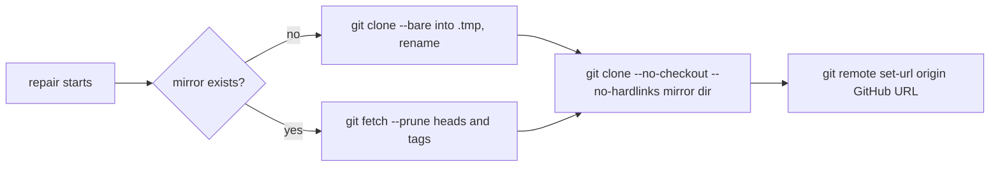

## Summary

The fleet PR babysitter cloned the target repository from scratch
(`gh repo clone … -- --no-checkout`) for every repair, so a large repository
such as GRQ could cross gh's 600 s limit. `cloneForRepair` now keeps one bare
mirror per repository under the babysitter state directory, fetches into it, and
clones the repair's checkout from it locally. Closes #4727.

Version bump: no `VERSION` change in this diff; the merged commit records the
final version.

## Spec

### Intent and Rationale

- Only the first download of a repository is network-heavy; later repairs fetch
  new objects and copy locally, so the 600 s gh limit no longer decides the
  outcome. The bare mirror is built with git directly (30-minute bound) because
  gh's timeout is fixed.

### Essential Design Decisions

- The repair's clone is a full local clone with `--no-hardlinks`: the agent's
  checkout holds complete history (merge bases, `git diff` against the base)
  with no lazy fetch, and no object file is shared with the mirror, so nothing
  the agent does in its checkout can reach the mirror.
  `--reference`/`--dissociate` was not used because it contacts GitHub on every
  repair.
- `origin` is reset to the GitHub URL after the local clone (ssh when
  `gh config get git_protocol -h github.com` says `ssh`, otherwise https), so the existing
  fetch and push steps in `fix` are unchanged.
- Each mirror refresh fetches from that currently resolved URL, so a mirror
  created with an older protocol picks up a host configuration change.
- The mirror fetches `refs/heads/*` and `refs/tags/*` only, not the thousands of
  `refs/pull/*` refs a `--mirror` would carry.
- Fetch disables automatic maintenance and runs it in the foreground inside the
  mirror lock before copying, so detached maintenance cannot race the clone.
- Serialisation is in-process per mirror (`SIMPLE-ON-PURPOSE` marker in the
  code); two babysitter processes sharing one state directory rely on git's own
  ref locks, and a failed fetch is retried next pass.

### Undiscoverable Facts

- The issue's "sandbox denies the host SSH key" constraint is why partial clones
  were not used; the mirror lives under
  `$XDG_STATE_HOME/vibe-coder/fleet-pr-babysitter/mirrors`, outside the agent's
  only write grants (clone and scratch directory, `buildBabysitterSandboxArgs`).

## Evidence

Backend-only change; no UI file is touched. The mirror integration tests run
real git in temporary directories against a local bare upstream, substituting
that local path for the GitHub remote URL. The tests
`failed clone is attempted once and preserves its original error` and
`a repository name that is not owner/name is refused before any git runs`
stub git. The tests `defaultRemoteUrl follows gh's git_protocol, falling back
to https with a warning` and
`host-specific gh protocol takes precedence over the global protocol` stub gh.
The application test
`production repair forwards CONFIG_PATH and denies canonical credential targets`
runs the real CLI with git and gh calls faked by
`worker/deno/tests/fixtures/fleet_babysitter_repair_preload.ts`.

- `worker/deno/tests/fleet_pr_babysitter_test.ts`:
  - `failed clone is attempted once and preserves its original error`
  - `first repair clones full history from a local mirror, with origin reset to GitHub`
  - `a later repair fetches into the mirror and clones from it, without a second bare clone`
  - `a clone keeps its full history after the mirror is deleted`
  - `the clone copies its objects, so no object file is hardlinked to the mirror`
  - `a failed fetch keeps git's cause and leaves the mirror in place`
  - `a repository name that is not owner/name is refused before any git runs`
  - `concurrent repairs of one repo never mutate its mirror at the same time`
  - `defaultRemoteUrl follows gh's git_protocol, falling back to https with a warning`
  - `host-specific gh protocol takes precedence over the global protocol`
  - `an existing mirror fetches from the newly resolved URL`
  - `a later repair prunes deleted branches and fetches new tags into the clone`
  - `a stale partial download is cleared before the first download`
  - `the mirror root exists before the bare clone starts`
  - `every network git call is bounded by the 30-minute clone timeout`
  - `a call that arrives while another is queued still waits for the running work`
- `worker/deno/tests/fleet_babysitter_app_test.ts`
  (`production repair forwards CONFIG_PATH and denies canonical credential targets`)
  now asserts the real CLI clones `--bare` then `--no-checkout --no-hardlinks`
  and resets `origin` to `git@github.com:owner/repo.git` when gh reports `ssh`.
- Docs: `docs/workflows/fleet-pr-babysitter.md` gains a mirror paragraph beside
  the temporary-clone paragraph and a line in the state-directory paragraph.
  Sections read: temporary clones, sandbox profile, attempt records. The clone
  mentions outside the mirror paragraph were checked and still hold.
- Callers of `cloneForRepair`: only `fix` (`fleet_pr_babysitter.ts`), unchanged;
  it takes the default seams.
- Siblings checked: the other two `owner/repo` validators in the file
  (`withBabysitterWriteScope`, the repository-list check) keep the older
  dotted-owner pattern; they are not touched.

## Test Plan

- `deno task test:unit tests/fleet_pr_babysitter_test.ts
  tests/fleet_babysitter_app_test.ts` (from `worker/deno`): 66 passed,
  0 failed (49 and 17 respectively). The host-specific protocol and stale
  mirror origin tests failed before the fix; the latter uses real git to check
  fetched history and the repair clone's origin. The application fixture
  requires the host-qualified gh arguments. No duplicate protocol resolver or
  mirror fetch rule was found among the babysitter's callers.
- The real-git fetch test pins the foreground maintenance commands and their
  order before the clone. Deferred work tests the mirror queue without sleeps;
  the concurrent real-git test records the order through each origin reset.
- Edited test `failed clone is attempted once and preserves its original error`:
  rewritten for the new `deps` argument (the old third argument was a gh
  runner). Removed from `worker/deno/tests/fleet_pr_babysitter_test.ts`:
  `assertEquals(attempts, 1)`
  - Replaced by:
    `assertEquals(calls.filter((args) => args.includes("clone")).length, 1)` in
    the same test; the rejection still asserts the original `clone timed out`
    message.
  - Required by: "downloading the whole history of the target repository each
    time" — the clone is no longer a gh call, so the count is of the git clone
    calls. Red check: retrying the bare clone gave two clone calls and the test
    failed.
- Red checks (each break applied, test run, then restored):
  - dropping `set-url` → first-repair test red;
  - skipping the fetch → later-repair test red (the failed-fetch test also red);
  - replacing `--no-hardlinks` with `--shared` → deleted-mirror test and
    first-repair test red; removing `--no-hardlinks` → the hardlink test red
    ("is hardlinked");
  - swallowing fetch errors → failed-fetch test red;
  - old `[\w.-]+` owner pattern → repository-name test red (`../x` passed it);
  - serialiser replaced by `Promise.resolve()` → concurrency test red.
- Mutation follow-up (each break applied, test run, restored): removing
  `--prune`, removing the tag refspec, `recursive: true` → `false` in
  `removeIfPresent`, deleting `removeIfPresent(partial)`, deleting the
  `Deno.mkdir(mirrorRoot)`, negating the `mirrorTails` clean-up condition, and
  dropping `timeoutSeconds` from the bare clone or the local clone each turned a
  test red. `defaultRemoteUrl` now takes a gh seam (default `runGhCommand`) and
  is exported for its test.
- Fixture mutations: the `gh config get git_protocol -h github.com` branch answers `ssh`
  and the `clone` branch records its argv (`clone-calls.log`) and the `set-url`
  branch records the URL it is given (`origin-url`), which the app test asserts,
  so replacing the return value or the matcher goes red. Mutation-check
  follow-up (PR #4730): the fixture's `mkdirSync` no longer passes
  `{ recursive: true }` (the code under test creates the mirror root first, so
  the flag was inert) and the `set-url` branch is one comparison,
  `args.slice(0, 3).join(" ") === "remote set-url origin"`, so no operand is
  droppable without turning the app test red (it reads `origin-url`). The
  `args.includes("--bare")` → true mutant remains exempt (untestable): it only
  makes the fake also create the already-existing local clone directory, which
  no observable behaviour distinguishes.
- Failure-reason test: the failed-fetch test asserts git's real stderr text
  (observed from real git) appears in the error.
- `./quality.sh < /dev/null`: formatter, linter, whole-tree type check,
  Markdown lint, Mermaid and completeness checks passed. The unit-test stage
  failed locally; a standalone `deno task test:unit` reproduced a Deno 2.9.5
  runtime panic at `cli/ops/testing.rs:94:5`:
  `pledge test permissions called before restoring previous pledge`.
  The release-tag ruleset check passed. Config integration, Semgrep and Checkov
  were skipped because the local configuration or pinned tools were unavailable.
  CI is green for
  PR #4730 and for PR #4718, which produced the current base commit
  `9afa408d5a30e545831964d2b7563eab2a1c2417`.
- `deno task check:manifests`: 847 passed, 0 failed, 1 ignored.
- `deno task pr-summary-check --base origin/main
  ../../docs/archive/pr-summaries/pr-summary-4727.md`: 0 blocked; acceptance
  closure, independent review and reproduction status were not checked because
  issue-body and label inputs were not supplied.

<!-- vibe-quality-gate-skipped: local unit runner panics in Deno 2.9.5; config integration, Semgrep and Checkov unavailable; touched suites, fmt, lint and type check pass; CI runs the full gate -->

Fixture edit: `tests/fixtures/fleet_babysitter_repair_preload.ts` — removed the
`gh repo clone` branch (no longer called by the code); no assertion removed.

## Known gaps

- Two babysitter processes sharing one state directory are not serialised across
  processes (git's ref locks decide; the next pass retries).
- A `.tmp` sibling left by an interrupted first download is removed before the
  next first download of that repository; it is not cleaned by
  `recoverTemporaryClones`.
