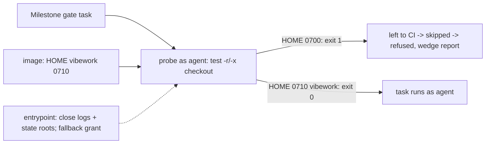

## Summary

The milestone resolution gate kept refusing GRQ-AutoTrader's resolution because
the dropped `agent` account could not reach the checkout: the fleet image
creates `/home/vibe` mode `0700`, and nothing gave the `vibework` group a way
through it. Every `runRepositoryCommand` probe exited 1, every task was "left to
CI", nothing ran, and the gate refused the resolution as unverifiable. This
change fixes that cause and makes the refusal name it. Closes #4733.

## Reproduction

- **symptom** —
  `untrusted account cannot use '/home/vibe/auto-issue-work/GRQ-AutoTrader' (probe 1) — left to CI`,
  then "the Issue #974 type check did not run", then the resolution is refused
  (the two 2026-11-02/03 comments on #4733).
- **status** — `verified` — the regression test was observed failing against the
  unfixed code and passing after the fix: against the base-branch
  `container/entrypoint.sh` (no HOME grant, no closing of the state roots) the
  HOME-traverse test is red, and on the head all 10 tests in the file pass. The
  access fault itself was also checked on this host: with `/home/vibe` at
  `700 vibe:vibe`, `sudo -n -u agent -- test -x /home/vibe` exits 1 and
  `sudo -n -u agent -- test -r …/GRQ-AutoTrader/Cargo.toml` exits 1. In a
  scratch tree of the same shape (parent `0700`), `chgrp vibework` + `chmod g+x`
  on the parent made the same read, traverse and write checks exit 0 for
  `agent`, and `ls` of the parent still gave "Permission denied". Not reproduced
  (`partial`) for the first, historic refusal in the issue body, a
  `cargo test --workspace` exit 101 in `grq-lambda`'s integration suite: reason:
  the log is truncated before the failing assertion and the tips named there
  have moved, so it cannot be diagnosed from this repository.
- **regression test** —
  `worker/deno/tests/work_root_group_grant_test.ts::entrypoint - the untrusted account can traverse HOME to reach the work root (Issue #4733)`;
  it is red against the base-branch entrypoint, which makes no HOME grant (on
  the head the grant is made in the image, with the entrypoint as a fallback;
  see the Test Plan for the red checks on the final entrypoint).

## Spec

### Intent and Rationale

- The refusals are a host-layout fault, not a bad resolution: the probe asks the
  real `agent` account, and it cannot enter `/home/vibe`. Granting the group
  traverse-only on HOME (in the image, with an entrypoint fallback) fixes the
  cause for every repository, the merge fast checks of #4697 included, without
  moving the clones.
- Traverse-only (`g+x`, `0710`) keeps HOME unlistable. Credentials under
  `~/.vibe-coder/credentials` keep their own `0700`/`0600` modes (checked on
  this host with `find`); the staged `run-config` is a `0700` read-only mount.
- Opening HOME lets `agent` open any fixed-name child by path, so the worker
  state children are closed first (PR #4753 review): the host log mount `~/logs`
  and the volume roots `~/auto-issue-work-agent-state` and
  `~/auto-issue-work-approval-state` get `chmod go-rwx`, verified with
  `find -perm /077`. The remaining HOME children (`.cache`, `.semgrep`,
  dotfiles) are image-layer files holding no worker state.

### Essential Design Decisions

- The grant is made in the **image** (`container/Containerfile`:
  `chgrp vibework /home/vibe`, then `chmod 710 /home/vibe`, after the recursive
  `chown`), because HOME is an image layer and Docker/Podman launch with
  `--read-only` (`container_launch.ts`, Issue #516), where an entrypoint `chgrp`
  fails. The entrypoint keeps the same grant as a fallback for an older image on
  a writable root, only once the state children are closed, and now warns
  instead of failing silently when the grant is absent or a child stays open.
- Clone-root hardening from #4737 keeps the sticky bit on each clone root and
  strips group and other write from `.git`, so the opened path does not reach
  trusted git metadata. The merge with main also retains quarantine of clones
  whose git metadata is not worker-owned, including its warning and fallback.
- The probe is not loosened and the worker account is never selected on an
  access fault (#4659/#4705 unchanged). The probe only gains a read-only
  top-down walk of `$1`, and a code-1 refusal now reads
  `(probe 1; cannot traverse '<dir>')`. The name is accepted only as one
  absolute path of at most 300 characters with no control characters.
- The merge with main retains #4705's stdin credential channel: declared
  credentials do not select the worker account, and access refusals still report
  the first directory the untrusted account cannot traverse.
- Test fixtures that run the real drop (`withTempDir`, `tree()`) are made with
  `makeAgentReachableTempDir` (`worker/deno/tests/support/gate_child_env.ts`): a
  unique directory under `/tmp`, mode `0777`, so the account can use it even
  when `TMPDIR` is a `0700` directory (the mutation runner sets it so); they
  previously failed on any host with an `agent` account.
- The allowlist assertion `assertOnlyAllowlistedNames` stays strict. `sudo` adds
  `MAIL` and `SUDO_*` to a dropped child, so those names are permitted only when
  the child's own report (a `SUDO <invoker uid> <uid> <account>` line printed by
  `NAMES_PROBE`) shows it ran as `agent`, with `agent`'s uid, and `sudo`
  recorded this process's uid as the invoker. Without that evidence the names
  are reported as a leak, as are credential names in every case.

### Undiscoverable Facts

- The 2026-11-02 and 2026-11-03 refusals in the issue are `probe 1`; the first
  one in the issue body (cargo exit 101) is a different, test-level failure.
- #4697 (open) tracks the same access cause for the merge fast checks. The HOME
  grant (image, with the entrypoint fallback) fixes that cause for it too; its
  own classification and budget work is not in this change. #4705 and #4680 are
  not touched.
- The image grant takes effect once the new image is built and launched; the
  state-root closing and the fallback take effect at the next launch. Neither
  has been observed in a real container launch from this repository's tests.

## Evidence

Backend and container only. Call sites: `runRepositoryCommand` (the single
helper `spawnTask` in `milestone_resolution_gate.ts` and `spawnTypeCheck` in
`milestone_merge_gate.ts` both use). Message consumers (`GateAccountUnavailable`
in both gates) only forward the message text. Docs: `docs/CONTAINER.md` (new
bullet beside the argv-placement bullet, rewritten after the PR #4753 review for
the image grant, the closed state roots and the clone-root hardening). Sibling
grep for the work-root grant (`vibework`, `setgid`) found no other doc
describing it.

## Test Plan

- The merge with main combines the HOME fixture with the existing quarantine
  and linked-worktree fixtures in `worker/deno/tests/work_root_group_grant_test.ts`;
  both sets of assertions remain in place.
- `worker/deno/tests/container_entrypoint_test.ts::entrypoint - a launch completes with the image layer read-only (Issue #515)`:
  the read-only-image fixture now stubs `getent` and `chgrp` to succeed, so
  the HOME fallback does not depend on the host user's group membership. The
  existing launch and warning assertions remain in place; the work-root grant
  tests separately cover the grant. The previous CI-fix run reported all 43
  tests in this file passing.
- `worker/deno/tests/work_root_group_grant_test.ts` (10 tests at head): six new.
  HOME gains group traverse; the grant is traverse only; the three worker-state
  children carry no group or other access; HOME stays shut, with a warning
  naming the path, when `chmod` cannot close the log mount root (sibling roots
  closed as the positive control); a clone root is sticky and its `.git` takes
  no group or other write (#4737); the Containerfile runs `chgrp vibework` and
  `chmod 710` on HOME after the recursive `chown`. Red checks, each run on the
  final entrypoint: closing `chmod` removed → the closing, withheld-grant and
  traverse tests red; grant no longer conditional on closure → withheld-grant
  test red; `+t` removed alone → clone test red; `.git` strip removed alone →
  clone test red; `chgrp` line removed from the Containerfile → Containerfile
  test red. Not covered: a real read-only root or a real `agent` uid; the tests
  run the script against a writable temp HOME with a stub `chgrp`.
- `worker/deno/tests/untrusted_gate_spawn_test.ts`: two new tests (a real probe
  run names `outer`, not `outer/inner`, when `outer` is `0000`; the message
  names the directory only for a code-1 verdict and one plausible path). Red
  checks: walk removed → red; walk prints `$1` → red; message suffix dropped →
  red; absolute-path check removed → red; code-1 guard removed → red.
- `worker/deno/tests/milestone_merge_gate_test.ts` and
  `milestone_resolution_gate_test.ts`: fixture directories come from
  `makeAgentReachableTempDir` (under `/tmp`, `0777`); no assertion removed or
  changed. `worker/deno/tests/support/gate_child_env.ts`: the allowlist
  assertion keeps its strict set and admits sudo's own names only when the probe
  line proves the sudo drop to `agent` (see Spec). Red check: fixtures back to
  `0700` under `TMPDIR` → the real-runner tests fail; with the drop evidence
  withheld the sudo names are reported as leaked.
- Mutation check: it reported "baseline tests fail before mutation" for these
  two files. Reproduced by running them with `TMPDIR` set to a fresh `0700`
  directory, as the mutation runner does: four tests failed because the fixture
  directories sat under that `0700` parent. With the fixtures under `/tmp` the
  same run passes (75 passed, 0 failed), as does `deno task test:unit`.
- The three `milestone_merge_gate_test.ts` failures and the resolution-gate
  allowlist failure were reproduced on the base commit (a detached worktree of
  `HEAD` before these edits): the real drop hit a `0700` temp directory.

Results on the final head, `deno task test:unit`:
`worker/deno/tests/untrusted_gate_spawn_test.ts` (34 tests at head),
`worker/deno/tests/milestone_resolution_gate_test.ts` (34 tests at head) and
`worker/deno/tests/milestone_merge_gate_test.ts` (41 tests at head), all
passing; `worker/deno/tests/work_root_group_grant_test.ts` (10 tests at head) is
an integration suite and was run with `deno test -A`, all passing. `deno fmt`,
`deno lint`, `deno check` pass on the touched files.

After the completion-check fixes: the two milestone gate files pass under
`deno task test:unit` (41 and 34 passed) and under `deno test -A` with a `0700`
`TMPDIR` (75 passed); `deno fmt`, `deno lint` and `deno check` pass.

`./quality.sh` (run before those fixes): every stage passes except `deno tests`
(parallel pass: 31980 passed, 1 failed). The one failure is
`fleet_pr_babysitter_test.ts` "babysitter default heartbeat resolves its
checkout revision", which cannot fetch `jsr.io/@std/crypto` in the sandbox and
fails the same way on the base commit; it is not touched here. The serial pass
did not run because the parallel pass failed. The milestone allowlist test that
failed in earlier gate runs on this host now passes. Not run: the Spec and
Standards reviewers (the issue states no acceptance-criteria heading) and
`deno task pr-summary-check`.
