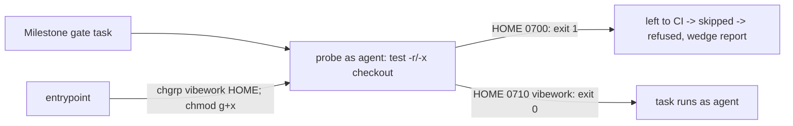

## Summary

The milestone resolution gate kept refusing GRQ-AutoTrader's resolution because
the dropped `agent` account could not reach the checkout: the fleet image
creates `/home/vibe` mode `0700`, and nothing gave the `vibework` group a way
through it. Every `runRepositoryCommand` probe exited 1, every task was "left to
CI", nothing ran, and the gate refused the resolution as unverifiable. This
change fixes that cause and makes the refusal name it. Closes #4733.

## Reproduction

- **symptom** — `untrusted account cannot use '/home/vibe/auto-issue-work/GRQ-AutoTrader' (probe 1) — left to CI`, then "the Issue #974 type check did not run", then the resolution is refused (the two 2026-11-02/03 comments on #4733).
- **status** — `verified` for the access fault on this host: with `/home/vibe` at `700 vibe:vibe`, `sudo -n -u agent -- test -x /home/vibe` exits 1 and `sudo -n -u agent -- test -r …/GRQ-AutoTrader/Cargo.toml` exits 1. In a scratch tree of the same shape (parent `0700`), `chgrp vibework` + `chmod g+x` on the parent made the same read, traverse and write checks exit 0 for `agent`, and `ls` of the parent still gave "Permission denied". `partial` for the first (historic) refusal in the issue body, a `cargo test --workspace` exit 101 in `grq-lambda`'s integration suite: the log is truncated before the failing assertion and the tips named there have moved, so it cannot be diagnosed from this repository.
- **regression test** — `worker/deno/tests/work_root_group_grant_test.ts::entrypoint - the untrusted account can traverse HOME to reach the work root (Issue #4733)`; it is red with the `chmod g+x "${HOME}"` line removed (the base-branch entrypoint).

## Spec

### Intent and Rationale

- The refusals are a host-layout fault, not a bad resolution: the probe asks the
  real `agent` account, and it cannot enter `/home/vibe`. Granting the group
  traverse-only on HOME at launch fixes the cause for every repository, the
  merge fast checks of #4697 included, without moving the clones.
- Traverse-only (`g+x`, `0710`) keeps HOME unlistable. Credentials under
  `~/.vibe-coder/credentials` keep their own `0700`/`0600` modes (checked on this
  host with `find`).

### Essential Design Decisions

- The grant lives in `container/entrypoint.sh`, inside the existing `vibework`
  work-root block, so it applies to an existing volume at the next launch. It
  touches only a HOME the entrypoint's user owns and fails silently, like its
  neighbours.
- The probe is not loosened and the worker account is never selected on an
  access fault (#4659/#4705 unchanged). The probe only gains a read-only
  top-down walk of `$1`, and a code-1 refusal now reads
  `(probe 1; cannot traverse '<dir>')`. The name is accepted only as one
  absolute path of at most 300 characters with no control characters.
- Test fixtures that run the real drop (`withTempDir`, `tree()`) are made `0777`
  so the account can use them; they previously failed on any host with an
  `agent` account. `SUDO_*`/`MAIL`, which `sudo` itself adds to a dropped child,
  are permitted in the allowlist assertion; a credential name is still reported.

### Undiscoverable Facts

- The 2026-11-02 and 2026-11-03 refusals in the issue are `probe 1`; the first
  one in the issue body (cargo exit 101) is a different, test-level failure.
- #4697 (open) tracks the same access cause for the merge fast checks. The
  entrypoint grant fixes that cause for it too; its own classification and
  budget work is not in this change. #4705 and #4680 are not touched.
- The grant takes effect at the next container launch; it cannot be proven from
  inside a running container other than by the scratch-tree experiment above.

## Evidence

Backend and container only. Call sites: `runRepositoryCommand` (the single
helper `spawnTask` in `milestone_resolution_gate.ts` and `spawnTypeCheck` in
`milestone_merge_gate.ts` both use). Message consumers (`GateAccountUnavailable`
in both gates) only forward the message text. Docs: `docs/CONTAINER.md` (new
bullet beside the argv-placement bullet). Sibling grep for the work-root grant
(`vibework`, `setgid`) found no other doc describing it.

## Test Plan

- `worker/deno/tests/work_root_group_grant_test.ts`: two new tests (HOME gains
  group traverse; the grant is traverse only: no group read/write, nothing for
  others, owner `0700`). Red checks: `chmod g+x` neutralised → first test red;
  `chmod g+rx` → second test red.
- `worker/deno/tests/untrusted_gate_spawn_test.ts`: two new tests (a real probe
  run names `outer`, not `outer/inner`, when `outer` is `0000`; the message
  names the directory only for a code-1 verdict and one plausible path).
  Red checks: walk removed → red; walk prints `$1` → red; message suffix dropped
  → red; absolute-path check removed → red; code-1 guard removed → red.
- `worker/deno/tests/milestone_merge_gate_test.ts` and
  `milestone_resolution_gate_test.ts`: fixture directories are `0777`; no
  assertion removed or changed. `worker/deno/tests/support/gate_child_env.ts`:
  sudo's own variables are permitted in `assertOnlyAllowlistedNames`. Red check:
  fixtures back to `0700` → the real-runner tests fail again.
- The three `milestone_merge_gate_test.ts` failures and the resolution-gate
  allowlist failure were reproduced on the base commit (a detached worktree of
  `HEAD` before these edits): the real drop hit a `0700` temp directory.

Results on the final head:
`deno task test:unit` for `untrusted_gate_spawn_test.ts` (26 passed),
`milestone_resolution_gate_test.ts` (34 passed, parallel pass) and
`milestone_merge_gate_test.ts` (41 passed, serial pass); `work_root_group_grant_test.ts`
is an integration suite and was run with `deno test` (6 passed). `deno fmt`,
`deno lint`, `deno check` pass on the touched files.

`./quality.sh` on the final head: every stage passes except `deno tests`
(parallel pass: 31980 passed, 1 failed). The one failure is
`fleet_pr_babysitter_test.ts` "babysitter default heartbeat resolves its
checkout revision", which cannot fetch `jsr.io/@std/crypto` in the sandbox and
fails the same way on the base commit; it is not touched here. The serial pass
did not run because the parallel pass failed. The milestone allowlist test that
failed in earlier gate runs on this host now passes. Not run: the Spec and
Standards reviewers (the issue states no acceptance-criteria heading) and
`deno task pr-summary-check`.
