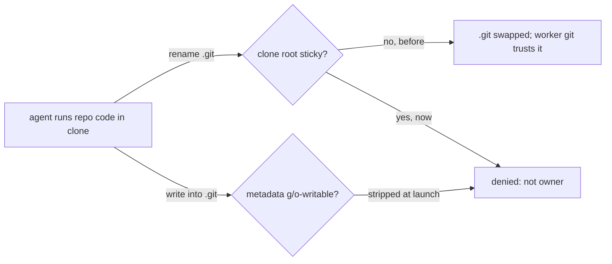

## Summary

The entrypoint now gives each shared repository clone root the sticky bit
(`g+rwxs,+t`) and strips group/other write from the clone's git metadata at
every launch, then checks that the worker owns each clone's git directory and
quarantines any clone where it does not. Closes #4737.

Version bump: `VERSION` is not edited by this change; the merged commit records
the final version.

## Spec

### Intent and Rationale

- Directory write lets the `agent` account (uid 1001) rename or unlink
  vibe-owned entries, including `.git`. The worker's git, under
  `safe.directory '*'`, would then read config and hooks from a substitute git
  directory. `+t` limits rename and unlink to the entry's owner, as the work
  root already does (Issue #1442).
- The sticky bit does not stop writes into `.git`, so the entrypoint also
  removes group/other write bits from `.git` and a linked worktree's `.git`
  pointer file.
- That chmod fails silently on files `agent` already owns (a `.git` swapped on a
  persistent volume before this fix). So the entrypoint also looks for any path
  within two levels of `.git` (so `.git` itself, `config`, `hooks` and its
  entries) not owned by the worker's uid. If it finds one it warns and moves the
  clone to `.untrusted-<name>-<epoch>` in the work root with group and other
  access removed. The worker re-clones it. Skipped when run as root.

### Essential Design Decisions

- `safe.directory '*'` is kept. The worker's git needs it for mounted clones;
  the control is that the untrusted account can neither replace nor write the
  git directory.
- No broad chmod grants, and the untrusted-account drop is untouched. Group
  write on the clone stays, so quality-gate output (#4697, #4705 paths) still
  works.
- Cost accepted: `agent` cannot rename over a vibe-owned top-level file such as
  a lockfile.

### Undiscoverable Facts

- The entrypoint is the only place these modes are set, so a clone created after
  launch is covered only from the next launch (documented in
  `docs/CONTAINMENT.md`).

## Evidence

Backend/container change only; no UI files. Tests assert the mode bits that
produce the kernel's sticky-directory denial. They do not switch uid, so no real
rename denial was exercised.

## Test Plan

- Integration CI repair for PR #4754: derive the quarantine fixture's foreign
  uid from `Deno.stat(dir).uid` instead of `Deno.uid()`. The integration runner
  grants file read access but no sys access to uid; no permission grants or
  assertions changed. The same test failed locally with `NotCapable` before
  the fix and passes afterwards with `deno task test
  tests/work_root_group_grant_test.ts --filter 'does not own'`.
  The exact workflow command, `setsid --wait deno task test:integration`, was
  attempted before and after the fix but cannot start on this macOS host
  because `setsid` is missing. The full file now has six passes and two
  host-specific setgid failures; both cases passed in this PR's Linux CI
  run 41584237838. Base-producing PR #4715 also passed all unit shards and
  integration tests in run 41555343824 (confirmed with `gh`).
  Local gate: type checking, lint, formatting, Markdown lint, Mermaid and
  completeness checks passed; `deno task check:manifests` also passed
  (847 tests). The full gate's parallel test pass panicked in Deno with
  `pledge test permissions called before restoring previous pledge`, so its
  serial pass did not run. Semgrep and Checkov were unavailable, and config
  integration was skipped because no local configuration was present.
  No twin of the fixture's `Deno.uid()` call needs changing.
- CI repair for PR #4754: kept the egress-proxy footprint phrase
  `opens no files and keeps no cache` on one line in `docs/CONTAINMENT.md`.
  Rewrapping had split the phrase and broken the existing documentation
  contract test; no runtime behaviour or tests changed. Reproduced with
  `deno task test tests/containment_docs_test.ts` (11 passed, 1 failed), then
  reran the same command after the fix (12 passed, 0 failed).
  The exact CI command, `.github/scripts/deno-test-shard.sh 2 4`, cannot start
  on this macOS host because `setsid` is unavailable; CI runs that shard on
  Linux after the babysitter commits the fix and this summary together.
  Local Markdown lint, Mermaid validation, manifest checks, type checking,
  lint and formatting passed. The full local gate's parallel test process
  panicked inside Deno 2.9.5 on macOS with `pledge test permissions called
  before restoring previous pledge`; its serial pass did not run. All four
  unit shards and integration tests passed on base-producing PR #4715
  (Actions run 41555343824). Semgrep and Checkov were unavailable locally;
  config integration had no local configuration and was skipped.
- `worker/deno/tests/work_root_group_grant_test.ts`: added tests for clone roots
  (sticky, group write, setgid, including a linked-worktree clone), for git
  metadata having no group/other write while staying readable, and for reserved
  names taking no sticky bit. The four existing tests are unchanged.
- Red checks: removing `,+t` fails the clone-root test; removing the
  `find`/`chmod` block fails the metadata test; removing only the `elif` file
  arm fails the metadata test on the linked clone; adding `+t` to the reserved
  branch fails the reserved-names test.
- `deno test` on this file and `container_entrypoint_test.ts`: 50 passed, 0
  failed.
- New test
  `a clone whose git directory the worker does not own is
  quarantined`: stubs
  `id` to report a uid that owns nothing in the fixture, and asserts both the
  `.git`-directory clone and the linked-worktree clone leave their place in the
  work root as mode-0 `.untrusted-*` entries, while a clone with no `.git` is
  untouched. Run after the fix: 51 passed, 0 failed on this file plus
  `container_entrypoint_test.ts`.
- `./quality.sh`: FAILED on the parallel deno-test pass with 4 failures
  unrelated to this diff: two Rust-formatter tests
  (`formatter should commit the Rust fix`), one test needing a JSR download
  (`@std/crypto/meta.json`, no network) and
  `tests/milestone_resolution_gate_test.ts`
  (`untrusted account cannot use ...`). The last also fails on the unmodified
  base (33 passed, 1 failed). All other stages passed, including markdownlint,
  semgrep, lint, type check and fmt.
- Callers and twins: grep found `g+rwxs` and `vibework` only in
  `container/entrypoint.sh` and `container/Containerfile`.

## Not done

- No real uid-switch test of the rename denial (needs root and a second
  account).
- Ownership is checked to two levels below `.git`; deeper foreign-owned files
  (for example under `objects/`) do not trigger quarantine, and are non-writable
  to `agent` only if the chmod could reach them.
- A clone whose `.git` is a symlink is not hardened.
- `find` over `.git` runs on each launch and can be slow on very large object
  stores.
