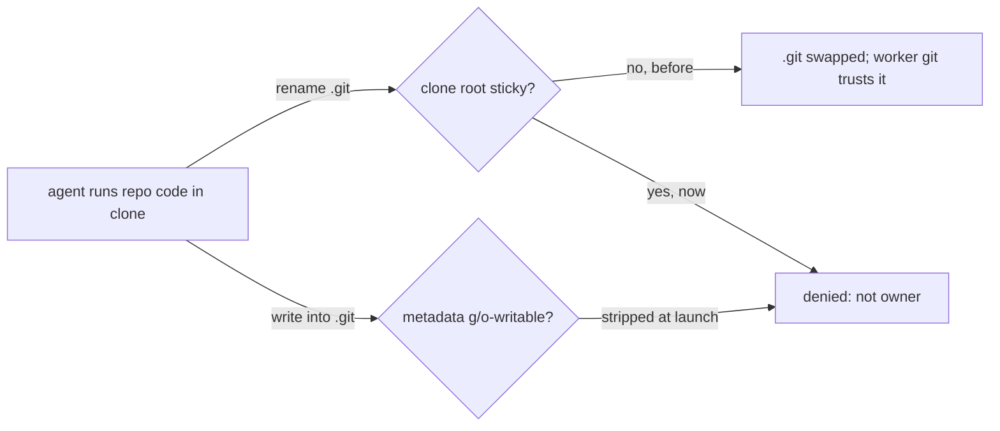

## Summary

The entrypoint now gives each shared repository clone root the sticky bit (`g+rwxs,+t`) and strips group/other write from the clone's git metadata at every launch. Closes #4737.

Version bump: `VERSION` is not edited by this change; the merged commit records the final version.

## Spec

### Intent and Rationale

- Directory write lets the `agent` account (uid 1001) rename or unlink vibe-owned entries, including `.git`. The worker's git, under `safe.directory '*'`, would then read config and hooks from a substitute git directory. `+t` limits rename and unlink to the entry's owner, as the work root already does (Issue #1442).
- The sticky bit does not stop writes into `.git`, so the entrypoint also removes group/other write bits from `.git` and a linked worktree's `.git` pointer file.

### Essential Design Decisions

- `safe.directory '*'` is kept. The worker's git needs it for mounted clones; the control is that the untrusted account can neither replace nor write the git directory.
- No broad chmod grants, and the untrusted-account drop is untouched. Group write on the clone stays, so quality-gate output (#4697, #4705 paths) still works.
- Cost accepted: `agent` cannot rename over a vibe-owned top-level file such as a lockfile.

### Undiscoverable Facts

- The entrypoint is the only place these modes are set, so a clone created after launch is covered only from the next launch (documented in `docs/CONTAINMENT.md`).

## Evidence

Backend/container change only; no UI files. Tests assert the mode bits that produce the kernel's sticky-directory denial. They do not switch uid, so no real rename denial was exercised.

## Test Plan

- `worker/deno/tests/work_root_group_grant_test.ts`: added tests for clone roots (sticky, group write, setgid, including a linked-worktree clone), for git metadata having no group/other write while staying readable, and for reserved names taking no sticky bit. The four existing tests are unchanged.
- Red checks: removing `,+t` fails the clone-root test; removing the `find`/`chmod` block fails the metadata test; removing only the `elif` file arm fails the metadata test on the linked clone; adding `+t` to the reserved branch fails the reserved-names test.
- `deno test` on this file and `container_entrypoint_test.ts`: 50 passed, 0 failed.
- `./quality.sh`: FAILED on the parallel deno-test pass with 4 failures unrelated to this diff: two Rust-formatter tests (`formatter should commit the Rust fix`), one test needing a JSR download (`@std/crypto/meta.json`, no network) and `tests/milestone_resolution_gate_test.ts` (`untrusted account cannot use ...`). The last also fails on the unmodified base (33 passed, 1 failed). All other stages passed, including markdownlint, semgrep, lint, type check and fmt.
- Callers and twins: grep found `g+rwxs` and `vibework` only in `container/entrypoint.sh` and `container/Containerfile`.

## Not done

- No real uid-switch test of the rename denial (needs root and a second account).
- A clone whose `.git` is a symlink is not hardened.
- `find` over `.git` runs on each launch and can be slow on very large object stores.
