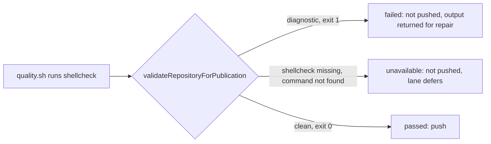

## Summary

No production code changes. Issue #4625 (merged as #4826, commit `2350b1956`) put one runner-owned gate in front of every lane that publishes agent-authored work, so the paths this issue names (a disk-budget deferral that leaves checks to CI, a targeted subset, a babysitter push with no local gate) can no longer publish without the repository's own `./quality.sh` passing. This PR pins that behaviour for ShellCheck with two real-gate tests. Closes #4741.

Version bump: `VERSION` is not touched by this change.

## Spec

### Intent and Rationale

- The issue asks the fleet to run `shellcheck` as CI does before a PR is raised or a fix is pushed. The shared runner from #4625 already does that by running the repository's own gate, so a second ShellCheck-only runner would be the per-tool duplicate #4625 and #4631 rule out. What was missing was proof that a real ShellCheck diagnostic and a missing ShellCheck both stop publication.

### Essential Design Decisions

- The tests drive the real `runQualityGateCheck` through `validateRepositoryForPublication` against a committed `quality.sh`, not a stubbed gate outcome.
- The "ShellCheck missing" test removes `shellcheck` from `PATH` inside the script, so it does not depend on the host; the diagnostic test is skipped where the `shellcheck` binary is absent (the worker image installs it).
- `detectMissingQualityTools` is left unchanged: matching the word `shellcheck` there would also fire on `# shellcheck disable=` comments in a gate script.

### Undiscoverable Facts

- The failing PRs are in a private repository, so which path skipped the gate there was not inspectable; the evidence is the merged #4625 code and the tests below.
- ShellCheck 0.11.0 reports SC2086 at `info` severity, so a `--severity=warning` invocation passes it; the test uses the default severity.

## Evidence

Backend-only change, no UI. Observed with the real tool: `shellcheck bad.sh` on `echo $name` exits 1 and prints `SC2086 (info)`; with `--severity=warning` it exits 0. The gate maps an exit-1 `quality.sh` to `failed` and a `command not found` exit to `unavailable` (`failed_missing_command`), per `classify` in `worker/deno/lib/publication_validation.ts`.

## Acceptance Criteria

The issue states no acceptance-criteria heading and nothing it asks is left undone, so no block is needed.

## Test Plan

- Added to `worker/deno/tests/publication_validation_test.ts`:
  - `the real quality gate: a ShellCheck diagnostic from quality.sh is a failed verdict (Issue #4741)`, step `a script with SC2086 fails, naming the diagnostic` (failed, output names SC2086) and step `the same gate passes once the script is clean` (positive control: same gate, only the script differs, passes as `ran`).
  - `the real quality gate: a gate whose ShellCheck is not installed is unavailable, never a pass (Issue #4741)` (`unavailable`, reason names `failed_missing_command`).
- Both tests pin current behaviour, so they are green on the base production code by design. Each was shown able to go red:
  - quoting `$name` in the script → the diagnostic step went red (`expected failed, got passed`);
  - removing `PATH=/nonexistent` from the gate script → the missing-tool test went red (`expected unavailable, got passed`).
- `deno task test:unit tests/publication_validation_test.ts < /dev/null`: passed (46 passed, 0 failed). `deno fmt --check` and `deno lint` on the file: clean.
- `./quality.sh < /dev/null`: every stage passed except `deno tests`, whose only 2 failures are `worker/deno/tests/completion_phase_repo_formatters_test.ts` lines 480 and 567 (a Rust formatter case this change does not touch; not compared against `main`).
- No existing test was edited or had assertions removed. No twinned rule found.

Not checked: the private repository's own `quality.sh` and CI ShellCheck configuration, and the babysitter and repair lanes end to end for ShellCheck (they share the same `validateRepositoryForPublication` and are covered by #4625's own tests).
