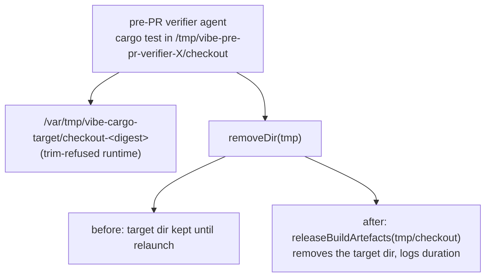

## Summary

The pre-PR verifier ran its agent in a fresh random `vibe-pre-pr-verifier-*`
checkout. On a runtime that refuses to trim the work volume, that agent's
`cargo test` writes to a per-checkout `/var/tmp/vibe-cargo-target/<key>`
directory. The key comes from the random checkout path, so every verifier pass
cold-built into a new multi-GB directory that nothing removed. The verifier
deleted only the checkout itself. This change removes that target directory when
the verifier finishes. Logs bracket the whole cleanup, with the duration covering
only the target-directory release; they do not distinguish a stall in checkout
removal from one in target-directory release. It does not claim to have proven
why the guest froze. Closes #4743.

Version bump: `VERSION` is not touched by this change.

## Spec

### Intent and Rationale

- Both recorded hard kills (runs `vibe-mvzlnl5o-40feb4` and
  `vibe-mw011ned-c6f0d4`, host GRQ-3, phase `completion`) are GRQ-AutoTrader
  runs whose agent session log (`runs/GRQ-3/…session.jsonl` in the logs
  repository) ends with the pre-PR verifier's successful `result`, after
  `cargo test` runs in `/tmp/vibe-pre-pr-verifier-*/checkout`.
- Releasing the verifier's target directory ends one unbounded writer to the
  container's ephemeral layer. Nothing else ever removed it.

### Essential Design Decisions

- The release reuses `releaseCheckoutTargetDirs` (the maintenance passes'
  cleanup) rather than a second remover. It is given
  `unmeasuredEphemeralRootDeps`, which lists names only, because the measured
  lister runs `du` (up to two minutes each) on every directory under the shared
  root, which would be a new heavy step after every pass.
- `releaseVerifierBuildArtefacts` owns that production wiring and accepts an
  optional root for isolated tests; the default dependency is that function.
- `releaseBuildArtefacts` is a required member of `PrePrVerifierDeps`, so every
  deps literal states what it does. `pr_feedback_verifier.ts` spreads
  `defaultPrePrVerifierDeps` and gets the release with no change.
- A failed or throwing release is logged with its cause and never loses the
  verifier result. It runs even when the checkout removal failed.

### Undiscoverable Facts

- The hard-kill evidence archive (`~/logs/hard-kill-archive/` on GRQ-3) was not
  readable from this container. The two session logs in the logs repository were
  the only evidence. They show where the agent's work ended, not what the worker
  did afterwards.
- GRQ-3 runs Apple `container`, where `/tmp` and `/var/tmp` are on the
  container's own layer and the launcher reports `workVolumeTrimRefused`; this
  is what puts the verifier's build in `/var/tmp/vibe-cargo-target`.

## Evidence

Backend change, no UI.

- `worker/deno/tests/pre_pr_verifier_release_4743_test.ts`,
  `pre_pr_verifier_3395_test.ts` and `capability_security_review_4366_test.ts`
  — 88 passed together after the review fix.
- `worker/deno/tests/pre_pr_verifier_3395_test.ts` and
  `worker/deno/tests/heavy_build_gate_3178_test.ts` — passed with the new test
  file after the review fix (119 passed, 0 failed).
- Premise checked against base: `git grep -n releaseCheckoutTargetDirs` finds
  one production caller, `worker/deno/lib/run_core_production_deps.ts` (the
  maintenance pass). The verifier never called it. `claude_runner.ts`
  (`buildCacheEnvForCheckout(cwd, …)`) keys the target dir to the agent's cwd.
- Issues cited: #4225: Worker container locks up during agent cargo/deno test
  builds: guest-wide stall, no OOM, reaped only by the 11400s watchdog (8× in
  32h on GRQ-3); #4349: Hard kill: container wedged in merge-conflict
  (watchdog); #4385: Hard kill: container wedged in merge-conflict (watchdog).

## Reproduction

- **symptom** — the container wedged in `completion` right after the pre-PR
  verifier finished and was reaped by the 11400 s launcher watchdog.
- **status** — `partial` — the leak is reproduced: with the release removed, the
  new test finds the verifier's target directory still present. The wedge itself
  was not reproduced, and this change is not shown to prevent it.
- **regression test** —
  `worker/deno/tests/pre_pr_verifier_release_4743_test.ts::runPrePrVerifier removes the cargo target dir its checkout built into, and keeps a sibling (Issue #4743)`
- reason: no in-guest evidence of the stall exists on this host; the worker log
  tail and boot logs are in GRQ-3's archive only.

## Test Plan

- Added `worker/deno/tests/pre_pr_verifier_release_4743_test.ts` (7 tests):
  - the default dependency is the production release function, which removes a
    private-root target and reports zero measured bytes; replacing the lister
    with the measured lister changes that result.
  - removes the target dir its checkout built into, keeps a sibling — red-check:
    replaced the `releaseBuildArtefacts` call with an empty result → red.
  - release runs when `removeDir` throws — same break → red.
  - release throws / release returns errors, result kept, warning carries the
    cause text — same break → red.
  - `unmeasuredEphemeralRootDeps` lists names only; missing root rejects with
    NotFound — pins the lister; stayed green under the break above, as expected.
- `ReleasedTargetDirs` and
  `releaseCheckoutTargetDirs` keep their shape, so
  `worker/deno/tests/heavy_build_gate_3178_test.ts` is unchanged.
- Callers of `releaseCheckoutTargetDirs` checked:
  `worker/deno/lib/run_core_production_deps.ts` is unchanged and still gets
  `{ bytes, errors }`.
- Callers of `PrePrVerifierDeps` checked: `pr_feedback_verifier.ts` spreads
  `defaultPrePrVerifierDeps`. The 3395 and 4366 test fixtures use a private
  root rather than inheriting the host's shared root. The old test wiring that
  duplicated the release call is obsolete; the required cleanup and sibling
  preservation remain covered by
  `worker/deno/tests/pre_pr_verifier_release_4743_test.ts::runPrePrVerifier removes the cargo target dir its checkout built into, and keeps a sibling (Issue #4743)`.

- `./quality.sh` before the review fix: every stage passed except `deno tests` — the
  parallel pass ran 32132 passed, 4 failed. The four failures are in code this
  change does not touch, and I did not fix them: two
  `formatter should commit the Rust fix` assertions, one test that needs a
  download of `https://jsr.io/@std/crypto/meta.json` (no network in the
  sandbox), and one in `worker/deno/tests/milestone_resolution_gate_test.ts`
  ("untrusted account cannot use /tmp/issue-1559-gate-…"; it was seen failing on
  an unmodified base checkout in a separate run; not re-run on base here). The
  serial pass did not run because the parallel pass failed.

**Mutation check:** the gate could not judge mutants, because its baseline run
of 15 test files failed before any mutation. It listed no unpinned mutation. I
re-ran those 15 files together (`deno test -A --parallel`): 348 passed, 4
failed, and the failures are not in code this change touches: three in
`tests/milestone_merge_gate_test.ts` (the real `deno check` tests, which report
`skipped` here; the same three fail on an unmodified `main` checkout) and one in
`tests/run_ps1_launcher_test.ts` ("short of the cargo build headroom", which
passes alone on both `main` and this branch, so it is a parallel-load flake).
Before the review fix, `tests/pre_pr_verifier_release_4743_test.ts` passed
(6 of 6) in that run and alone. After the review fix, the file passed alone
(7 of 7) on the merged working tree. The mutations that matter here were
checked by hand: removing the
`releaseBuildArtefacts` call turns three of the new tests red (see Branch
outcomes). `skip_mutation_check` is a repo setting and was not changed by this
branch.

**Branch outcomes:**

- `worker/deno/lib/pre_pr_verifier.ts` release `errors.length > 0` — warn and
  carry on —
  `worker/deno/tests/pre_pr_verifier_release_4743_test.ts::runPrePrVerifier keeps the result when the release reports errors, and warns with them (Issue #4743)`
  — release call removed, test went red
- `worker/deno/lib/pre_pr_verifier.ts` release throws — warn and carry on —
  `worker/deno/tests/pre_pr_verifier_release_4743_test.ts::runPrePrVerifier keeps the result when the release throws, and warns with the cause (Issue #4743)`
  — release call removed, test went red
- `worker/deno/lib/pre_pr_verifier.ts` `removeDir` throws — release still runs —
  `worker/deno/tests/pre_pr_verifier_release_4743_test.ts::runPrePrVerifier releases its checkout even when removeDir throws (Issue #4743)`
  — release call removed, test went red
- `worker/deno/lib/heavy_build_gate.ts`
  `unmeasuredEphemeralRootDeps.listTargetDirs` — directories only, missing root
  rejects —
  `worker/deno/tests/pre_pr_verifier_release_4743_test.ts::unmeasuredEphemeralRootDeps lists directory names only, with no bytes and no last write (Issue #4743)`
  and
  `…::unmeasuredEphemeralRootDeps rejects with NotFound for a missing root (Issue #4743)`

**Docs sweep** — grep: `releaseCheckoutTargetDirs`, `vibe-cargo-target`,
"released at the next relaunch", "A pass releases what it built"; section:
`docs/CONTAINER.md` (the ephemeral build-cache section and its diagram) and
`docs/CONTAINMENT.md` (the cargo build artefacts row); siblings: the milestone
merge gate and resolution gate that the same section lists; updated:
`docs/CONTAINER.md`, `docs/CONTAINMENT.md`

## Not done

- The wedge's mechanism is not proven. The two session logs show the verifier
  finishing normally; what the worker did in the following 15 minutes is only in
  GRQ-3's archive.
- Agent worktrees and maintenance clones still keep their target dirs until
  relaunch, by design (`docs/CONTAINER.md`).
- Recursive removal is unbounded in time (`Deno.remove`) and has no timeout.
  The cleanup has a start and an end log, but only the target-directory release
  is timed.
