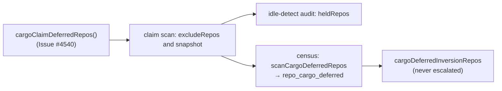

## Summary

The idle-decision census and the idle-detect audit now treat a cargo repository
the host cannot build yet as "never shown to the claim scan", not as "scanned
and refused". That removes the false idle-inversion alert on
`stSoftwareAU/GRQ-AutoTrader` (and on `stSoftwareAU/GRQ` and
`stSoftwareAU/NEAT-AI-Discovery`, which alerted in the same census line).
Version bump: no `VERSION` change in this diff; the merged commit records the
final version. Closes #4751.

## Spec

### Intent and Rationale

- Since #4540 the claim scan drops a cargo repository while the host has the
  disk floor but not the cargo headroom (`cargoClaimDeferredRepos` unioned into
  `excludeRepos`). No collector runs, so no per-issue reason exists, yet the
  census read `scanned=true` and counted 39 `work-on` issues as refused. That is
  the same gap #2085 closed for fast-failure back-offs; the filed issue had no
  "what the claim scan did with them" section, which is how the gap shows.
- The census gets its own reason rather than reusing `repo_backed_off`: a
  back-off needs a fix to the repository, a cargo deferral clears when disk is
  freed, and the note text must say which.

### Essential Design Decisions

- The scan snapshots its cargo set for the census and audit, so disk changes
  after the scan cannot change their verdict. The reader is injectable
  (`cargoClaimDeferredReposFn`, production default `cargoClaimDeferredRepos`)
  because the real function reads the host disk.
- Order in `resolveRepoScanState`: back-off, then cargo deferral, then lease. A
  back-off is the durable fault an operator must act on.
- The claimable counts are untouched, so the idle-task filer stays suppressed
  while the backlog waits (Issue #2813), exactly as for a back-off.

### Undiscoverable Facts

- The incident's worker log is not on this host. The cause is inferred from code
  and from the evidence in the issue: no scan-skip section, all three alerting
  repos hold a `Cargo.toml` (checked with `gh api`), and
  `GRQ-AutoTraderBackTesting` had no `work-on` work to show.
- A local `findOldestIssue` run against the live repo (fresh approval store)
  selected a candidate, so the 39 issues are not refused by any per-issue gate
  on GitHub state.

## Evidence

Backend-only change; no UI file touched. Verified by tests below.

## Test Plan

- Added `worker/deno/tests/idle_census_repo_cargo_deferred_4751_test.ts`:
  resolver ordering, buckets, formatter note, predicate.
- Added `worker/deno/tests/idle_census_cargo_deferred_wiring_4751_test.ts`:
  drives the real `createProductionRunCoreDeps`, calls the real
  `runIdleDetectAudit` and `runIdleDecisionCensus`, with an injected cargo set.
- Red checks (each break restored): dropped the cargo check in
  `resolveRepoScanState` → 2 resolver tests red; dropped
  `!isRepoCargoDeferredSkipReason` from `deferredInversionRepos` → 2 red;
  removed the formatter note → 1 red; removed the census
  `scanCargoDeferredRepos` argument → the wiring `scanned=false` test red;
  removed the audit `...scanCargoDeferred.keys()` union → the
  `mis_classification` test red.
- Mutation check on `idle_decision_census.ts:1628` (the
  `cargoDeferredInversionRepos` filter): added
  `census - the cargo bucket needs
  both an unscanned repo and the cargo reason`.
  Dropping `!r.scannedThisCycle` (a scanned repo carrying the cargo reason) and
  dropping `isRepoCargoDeferredSkipReason(...)` (an unscanned repo with
  `cycle_deadline`) each turn that test red.
- Callers of `resolveRepoScanState` checked: `run_core_production_deps.ts` (now
  passes the new set; the only production caller) and the 2085, 898 and 1091
  tests, which omit the optional set and keep their behaviour.
- The scan reads `cargoDeferredNow()` once; the audit and census use its
  snapshot.
  `idle_census_cargo_deferred_wiring_4751_test.ts::production deps -
  the census reads a cargo-deferred repo as not scanned`
  and
  `::production deps -
  a cargo-deferred repo raises no mis_classification ALERT`
  cover a gate that changes after the scan. The obsolete live reread is replaced
  by the scan's verdict; the remaining behaviour reports the actual exclusion in
  both hooks.
- Docs: `docs/IDLE-TASK-FRAMEWORK.md` (decision flowchart, new section).
  Siblings grepped: `repo_backed_off`, `repo_held_in_flight`,
  `backedOffInversionRepos`, `inversion_repo_held`.
- `./quality.sh` on the final head: every stage passed except `deno tests`
  (32207 passed, 2 failed, parallel pass):
  `babysitter default heartbeat
  resolves its checkout revision` (the host
  cannot download `@std/crypto` from JSR) and
  `verifyResolvedTree - the repository's own task sees only the
  allowlisted environment (Issue #4659)`
  (the temp checkout is not readable by the `agent` account here). Neither
  touches the census. The serial pass did not run after the parallel failure, so
  CI covers it.
