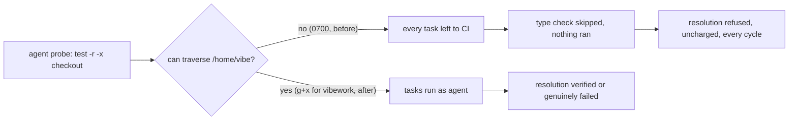

## Summary

The milestone resolution gate could never verify a resolved tree on a container
host, because the `agent` account it runs the repository's commands as could not
reach any checkout. The worker's home (`/home/vibe`) is created `0700` by the
image (Debian's `useradd` default), and `container/entrypoint.sh` granted the
`vibework` group access to the work root beneath it but never to the home
itself. Every probe in `runRepositoryCommand` therefore exited 1, every type
check and unit suite was left to CI, nothing ran, and `verifyResolvedTree`
returned `skipped`, which the sync refuses (Issue #1559). The refusal is
uncharged, so the identical resolution was rebuilt and refused every cycle.

The image now gives `vibework` search-only permission on `/home/vibe` at build
time, including on read-only container roots. Closes #4761.

Version bump: `VERSION` is not touched by this change; the merged commit records
the final version.

## Spec

### Intent and Rationale

- The gate is working as designed: a resolution that nothing verified is not a
  resolution. The fault is the host layout that makes verification impossible,
  so the fix grants the access the entrypoint's own comment already assumes
  ("the gate reaches its own lane worktree through `worktrees/`").
- Alternatives rejected: landing the resolution unverified (breaks "unverified
  is not passed" for agent-resolved conflicts), or falling back to the worker
  account (Issue #4659 forbids it).

### Essential Design Decisions

- Search only (`g+x`), never `g+r` or `g+w`: the group cannot list the home. The
  credential directories under it are `0700` and the files `0600`, so they stay
  unreachable. This does expose by known path any home entry whose own mode is
  already permissive (for example `.vibe-coder/` and the agent-state volume are
  `0755`); that is the same exposure the work root's group grant already
  accepts.
- The grant follows the recursive `chown` in the image build, which otherwise
  resets the group. A separately mounted home needs its own suitable access.
- The change takes effect when a container is launched from the rebuilt image;
  an already-running container retains its existing home mode.

### Undiscoverable Facts

- On the host where this was worked, `/home/vibe` is `0700 vibe:vibe`, the work
  root is `3775` (so the entrypoint's grant ran), and
  `sudo -n -u agent -- test -r -a -x <path>` exits 1 for `/home/vibe`, the work
  root, `GRQ-AutoTrader` and `GRQ-AutoTrader/Cargo.toml` alike.

## Evidence

Backend/shell change; no UI file is touched.

Command run on the host, quoted:
`sudo -n -u agent -- sh -c 'test -r "$1" -a -x "$1"; echo "$1 -> $?"' sh <path>`
printed `-> 1` for `/home/vibe`, `/home/vibe/auto-issue-work`,
`/home/vibe/auto-issue-work/GRQ-AutoTrader` and its `Cargo.toml`. That is the
same `test -r "$1" -a -x "$1"` probe `probeScript` builds in
`worker/deno/lib/untrusted_gate_spawn.ts`, whose exit 1 is the `(probe 1)` in
the issue's gate message.

## Reproduction

- **symptom** — every command of the milestone resolution gate was left to CI
  with `untrusted account cannot use '<checkout>' (probe 1)`, so the resolution
  was refused as unverified every cycle.
- **status** — `partial` — reason: the probe failure and its cause (home mode
  `0700`) were reproduced on the host and the image grant test was observed
  failing without the grant, but the full GRQ-AutoTrader milestone sync was
  not run.
- **regression test** —
  `worker/deno/tests/work_root_group_grant_test.ts::Containerfile - worker home is searchable by vibework on a read-only root (Issue #4761)`

## Test Plan

- The obsolete entrypoint grant could not change a read-only image layer, so
  its writable temporary-home test was replaced. The required group search-only
  access remains: `worker/deno/tests/work_root_group_grant_test.ts::Containerfile - worker home is searchable by vibework on a read-only root (Issue #4761)`
  pins the build commands, their order after `chown`, and mode `0710`. It failed
  before the image grant was added. The existing work-root tests still exercise
  the entrypoint with a home matching the image mode.
- `deno fmt --check`, `deno lint`, `deno task check`, `bash -n` and
  `shellcheck` pass. Container manifest and containment tests pass (163 passed,
  one ignored). The home grant regression passes.
- The work-root suite has one host limitation: the existing clone setgid test
  fails because this host does not retain the setgid bit even on a freshly
  chmodded directory. The other four tests pass.
- Twinned rules: searched for other copies of the work-root grant; the
  reserved-name list is pinned by the existing test in the same file. The
  obsolete entrypoint home grant was removed.

## Not done

- The full milestone sync on GRQ-AutoTrader was not run; the original failure
  was reproduced at the probe and the image grant is covered by a source pin.
