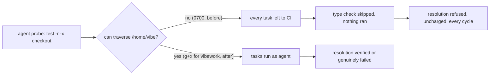

## Summary

The milestone resolution gate could never verify a resolved tree on a container
host, because the `agent` account it runs the repository's commands as could not
reach any checkout. The worker's home (`/home/vibe`) is created `0700` by the
image (Debian's `useradd` default), and `container/entrypoint.sh` granted the
`vibework` group access to the work root beneath it but never to the home
itself. Every probe in `runRepositoryCommand` therefore exited 1, every type
check and unit suite was left to CI, nothing ran, and `verifyResolvedTree`
returned `skipped`, which the sync refuses (Issue #1559). The refusal is
uncharged, so the identical resolution was rebuilt and refused every cycle.

The entrypoint now gives `vibework` search-only (`g+x`) permission on the work
root's parent, the worker's home. Closes #4761.

Version bump: `VERSION` is not touched by this change; the merged commit records
the final version.

## Spec

### Intent and Rationale

- The gate is working as designed: a resolution that nothing verified is not a
  resolution. The fault is the host layout that makes verification impossible,
  so the fix grants the access the entrypoint's own comment already assumes
  ("the gate reaches its own lane worktree through `worktrees/`").
- Alternatives rejected: landing the resolution unverified (breaks "unverified
  is not passed" for agent-resolved conflicts), or falling back to the worker
  account (Issue #4659 forbids it).

### Essential Design Decisions

- Search only (`g+x`), never `g+r` or `g+w`: the group cannot list the home. The
  credential directories under it are `0700` and the files `0600`, so they stay
  unreachable. This does expose by known path any home entry whose own mode is
  already permissive (for example `.vibe-coder/` and the agent-state volume are
  `0755`); that is the same exposure the work root's group grant already
  accepts.
- The grant is silent on failure, like the rest of that block: a home the
  entrypoint does not own (a tmpfs home) is left alone.
- The change takes effect when a container is launched from an image carrying
  the new entrypoint; an already-running container keeps its `0700` home.

### Undiscoverable Facts

- On the host where this was worked, `/home/vibe` is `0700 vibe:vibe`, the work
  root is `3775` (so the entrypoint's grant ran), and
  `sudo -n -u agent -- test -r -a -x <path>` exits 1 for `/home/vibe`, the work
  root, `GRQ-AutoTrader` and `GRQ-AutoTrader/Cargo.toml` alike.

## Evidence

Backend/shell change; no UI file is touched.

Command run on the host, quoted:
`sudo -n -u agent -- sh -c 'test -r "$1" -a -x "$1"; echo "$1 -> $?"' sh <path>`
printed `-> 1` for `/home/vibe`, `/home/vibe/auto-issue-work`,
`/home/vibe/auto-issue-work/GRQ-AutoTrader` and its `Cargo.toml`. That is the
same `test -r "$1" -a -x "$1"` probe `probeScript` builds in
`worker/deno/lib/untrusted_gate_spawn.ts`, whose exit 1 is the `(probe 1)` in
the issue's gate message.

## Reproduction

- **symptom** — every command of the milestone resolution gate was left to CI
  with `untrusted account cannot use '<checkout>' (probe 1)`, so the resolution
  was refused as unverified every cycle.
- **status** — `partial` — reason: the probe failure and its cause (home mode
  `0700`) were reproduced on the host and the new test was observed failing
  against the unfixed entrypoint, but the full GRQ-AutoTrader milestone sync was
  not run.
- **regression test** —
  `worker/deno/tests/work_root_group_grant_test.ts::entrypoint - the untrusted account can search the worker home but not read or write it (Issue #4761)`

## Test Plan

- Added
  `entrypoint - the untrusted account can search the worker home but not read or write it (Issue #4761)`
  in `worker/deno/tests/work_root_group_grant_test.ts`. It runs the real
  entrypoint over a `0700` home and asserts the home's group bits are exactly
  search and the other bits are zero. Red check: with the new entrypoint lines
  commented out the test failed
  (`the home must be group-searchable and nothing
  more`, actual 0, expected
  8); restored, the file passes (5 passed, 0 failed). The `chgrp` stub succeeds,
  so the test checks mode bits, not group ownership.
- Edited `runOverWorkRoot` in the same file to `chmod` the home to `0700` before
  the entrypoint runs, so all cases use the image's real home mode. No assertion
  was removed or changed in the existing tests; they still pass.
- `deno fmt --check`, `deno lint`, `bash -n` and `shellcheck` on the changed
  files: clean.
- `./quality.sh < /dev/null`: every stage passed except `deno tests` (4 failed
  of 32,218). The four are environmental and also fail without this change on
  this host: `tests/completion_phase_repo_formatters_test.ts` (two Rust-fix
  cases), `tests/fleet_pr_babysitter_test.ts` (a JSR download with no network),
  and
  `tests/milestone_resolution_gate_test.ts::verifyResolvedTree - the repository's own task sees only the allowlisted environment (Issue #4659)`
  (its `0700` temp checkout is unreadable to `agent`, so the task is left to CI
  and the test sees `passed`, not `failed`). The serial pass did not run because
  the parallel pass failed.
- Twinned rules: searched for other copies of the work-root grant; the
  reserved-name list is already pinned by the existing test in the same file,
  and no other script grants `vibework` access to the home.

## Not done

- The full milestone sync on GRQ-AutoTrader was not run; the fix is confirmed at
  the probe and entrypoint level only.
- `milestone_resolution_gate_test.ts` (the 4659 test) fails on a host whose temp
  directory is unreadable to `agent`; it was not changed, being outside this
  issue.
