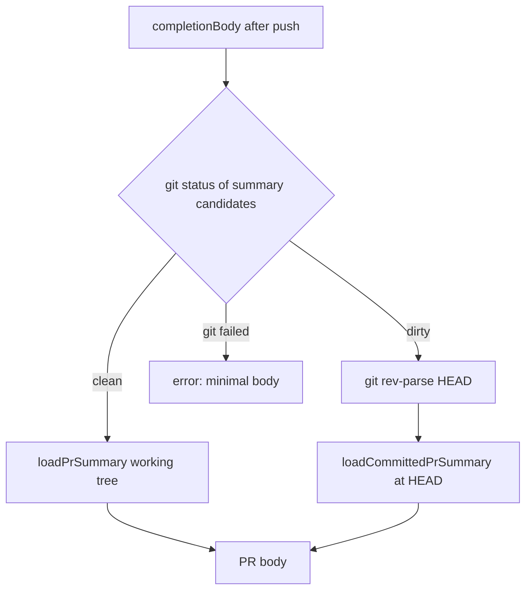

## Summary

Completion no longer publishes uncommitted PR-summary text. When any PR-summary
candidate file has uncommitted changes, the PR body (new PR via `gh pr create`,
or existing PR via `recoverExistingPr` / `gh pr edit --body`) is built from the
summary committed at `HEAD`, the pushed branch head. Closes #4764.

## Spec

### Intent and Rationale

- `completionBody` read the summary with `loadPrSummary` (working tree), so a
  recovery-turn rewrite that `commitRecoveredSummary` failed to commit reached
  the PR body, with the worker marker, and exit-time adoption then skipped it.
- Every publication path (create, REST fallback, `recoverAndFinaliseExistingPr`
  at both call sites) uses the one `prBody` built in `completionBody`, so fixing
  the single read covers them all.
- Chose "read the committed copy when dirty" over "refuse to publish": the PR
  still gets a body that matches the branch, and no new failure category or
  retry loop is added.

### Essential Design Decisions

- A clean summary tree still goes through `loadPrSummary`, so existing behaviour
  is unchanged; only a dirty tree switches to `loadCommittedPrSummary` at
  `git rev-parse HEAD`.
- Dirty detection is `git status --porcelain -z --untracked-files=all` over
  `prSummaryCandidatePaths`. It does not pass `--ignored`, so a gitignored
  legacy `.pr_summary` is still read from the working tree as before.
- A failed `git status` or `rev-parse` is an error result (the caller's existing
  "Error reading PR summary file" path gives the minimal body); the working tree
  is never the fallback.
- HEAD is the pushed head here: `reconcileHeadToBranch` ran and
  `pushUnpushedCommits` succeeded earlier in `completionBody`.

### Undiscoverable Facts

- The issue's comment about `pr_feedback_processor.ts` (`holdUnverifiedReview`)
  is a sibling instance of the same defect class, outside this issue's title and
  scope; it is not changed here.
- `pr_summary_check.ts` is the twin of the completion gates but reads a summary
  file it is handed, so it needs no matching change.

## Evidence

Backend-only change; no UI files. Tests in
`worker/deno/tests/completion_phase_committed_summary_4764_test.ts` drive the
live `workOnIssueCompletion` with a fake git that reports a dirty summary, a
committed copy at `HEAD`, and capture the `gh pr create --body` and
`recoverExistingPr` body.

## Test Plan

- Added `worker/deno/tests/completion_phase_committed_summary_4764_test.ts` (10
  tests, 10 passed):
  - new PR body carries the committed text and never the uncommitted edit;
  - existing-PR recovery body carries the committed text and never the
    uncommitted edit;
  - positive control: clean tree publishes the working-tree text;
  - failed `git status` gives a body with neither marker;
  - direct `loadSummaryForPublication` tests pin the exact `git status` argv
    (`--porcelain`, `-z`, `--untracked-files=all`, `--`, every candidate path)
    and `cwd`, and the `rev-parse HEAD` argv and `cwd`;
  - direct tests assert an error result (`ok: false`) for a failed `git status`
    process, a non-zero `git status` exit, a failed `rev-parse` process and a
    non-zero `rev-parse` exit, with the exit code and stderr in the message.
- Red check: forcing the helper's dirty branch to always call `loadPrSummary`
  made the first two tests fail (body held `UNCOMMITTED-EDIT-4764`); restored
  afterwards. The direct tests kill the surviving mutants the mutation check
  listed for the `status` argv, the `cwd` options and the four `ok: false` error
  returns.
- Existing completion-phase tests (`completion_phase_summary_rule_retry`,
  `acceptance_closure`, `pre_pr_verifier_3395`, `rest_pr_fallback`,
  `pr_body_limit_4359`, `branch_evidence`, `head_reconcile`,
  `summary_incomplete`): 66 passed, no edits. Their fake git returns an empty
  `status`, so they take the clean branch.
- Callers of the changed read checked: `completionBody` is the only caller of
  `loadPrSummary` in the completion phase; the create and both
  `recoverAndFinaliseExistingPr` call sites receive its `prBody`.
- Docs: `docs/USAGE.md` gains a paragraph on the committed-copy rule;
  `docs/workflows/fleet-pr-babysitter.md` already describes the committed loader
  for a different path and is unchanged.
- Doc fix: the `commitRecoveredSummary` comment in `summary_rule_gate_retry.ts`
  now says a completion re-run publishes the summary committed at HEAD, never an
  uncommitted one.

## Merge verification

Pending CI and review.

<!-- vibe-quality-gate-skipped reason="./quality.sh passed every stage through release-tag ruleset (timeout 280 s), then the next stage did not finish before the timeout; the worker reruns the gate before the PR is raised" -->
