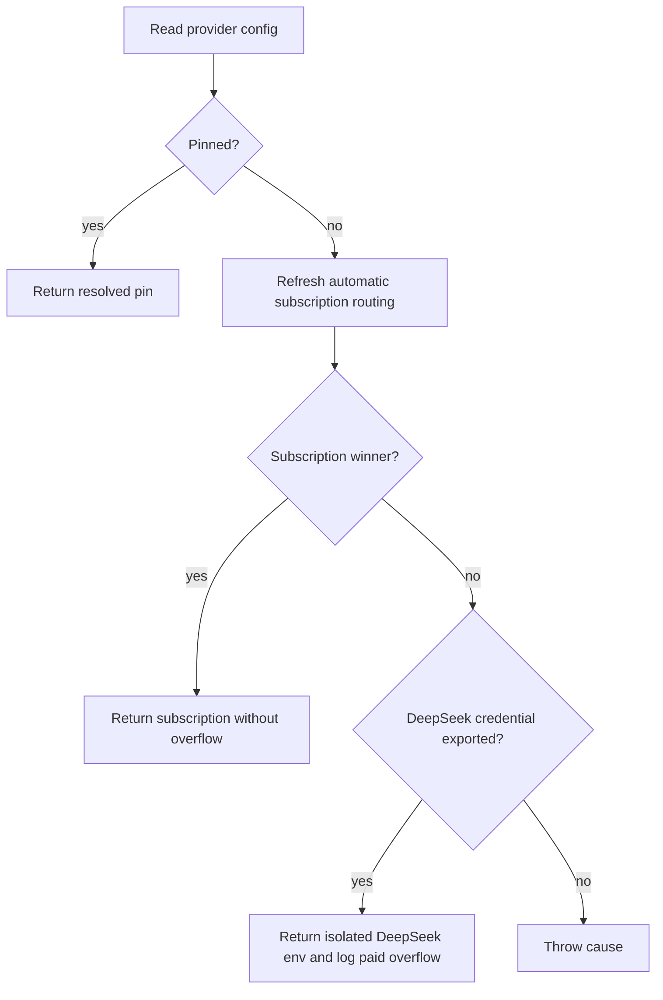

## Summary

Added a subscription-first babysitter provider chooser with logged DeepSeek
paid overflow and spending-policy documentation. Existing provider-less configs
now honour `VIBE_AGENT_PROVIDER`; configured providers keep precedence in
pinned mode.

Shared-harness launcher suites are now correctly classified as script-driving
suites and remain in the required gate with their assertions and serial
placement preserved. `./quality.sh` passes with the unavailable config
integration and Checkov stages reported as skipped. Closes #4766.

## Spec

### Intent and Rationale

- Spend available subscription quota before metered babysitter overflow while
  preserving the worker's separate auto-mode wait policy.
- Finish the retry's quality criterion without removing launcher safety
  coverage or changing the one-second unit-test threshold.

### Essential Design Decisions

- Reuse automatic routing, provider credential export and DeepSeek environment
  filtering; inject external inputs for deterministic tests.
- Resolve missing and existing provider-less configs uniformly. Environment
  pins win in auto mode or when the file names no provider; configured
  providers/provider lists win in pinned mode.
- Remove the explicit default token selector and redundant missing-file guard.
  The credential helper already defaults to that exact selector.
- Reuse the source lexer to distinguish executable harness imports/calls from
  comments and literal examples. Retain the two newly recognised Bash safety
  suites in `IN_GATE_SCRIPT_SUITES`, outside the integration ignore list.

### Undiscoverable Facts

- The babysitter-only overflow exception is stated in #4766, part of #4738.
  The public chooser API has no production orchestration caller yet; that
  integration is outside this module-only issue.
- The launcher mounts the staged config and supplies `CONFIG_PATH`; the
  babysitter argument adapter preserves those mount/environment arguments.
  The chooser test asserts the mounted config path is read.
- The reported launcher timing failure reproduced at the original head:
  1.46s and 1.41s, 2.87s total, for two real shell launches.
- The retry explicitly requires completing the quality criterion, which is
  why launcher classification and its accompanying documentation are included.



## Evidence

- Reproduction: existing `{}` plus `VIBE_AGENT_PROVIDER=codex` returned
  `claude`. The new regression failed before the fix and passes now, asserting
  Codex, preserved environment and zero status probes/credential exports.
- The unchanged `provider_auto_runtime` and `review_round` suites passed
  together: 32 tests. The final combined targeted run passed 137 tests across
  11 files, including the classifier and completeness regression suites.
- `deno task check:manifests < /dev/null`: 848 passed, 0 failed, 1 ignored,
  across 55 completeness files. Literal classifier examples live in a focused
  suite so the manifest test retains its completeness-family membership.
- Read README's “Choose your coding agent”, the subscription-spending design
  section, and the standards' test taxonomy/quality-gate sections. Updated
  `DESIGN-PRINCIPLES.md`, `CODING-STANDARDS.md`, `CONTRIBUTING.md` and
  `docs/CONTAINER.md` to describe delivered scope and named script suites.
- Issue provenance checked: #4766 — “Babysitter repairs choose their provider
  subscription-first, with DeepSeek as logged paid overflow”; #4738 — “Fleet
  PR babysitter repairs run in the worker container, like reviewer rounds”.
- Final `./quality.sh < /dev/null`: exit 0, `PASSED (with skipped checks)`.
  Parallel unit pass: 3m53s; serial unit pass: 2m59s. Lint, type check,
  formatting, Semgrep, Markdown, Mermaid and completeness checks passed.
  Config integration was skipped because no local config was available;
  Checkov was skipped because neither a pinned binary nor image was available.
- Final `pr-summary-check` with the issue body and current labels validates
  closure and review provenance. It reports one remaining finding: the
  outstanding Standards redaction violation below; no checks were unverified.

```text
Deno tests [parallel]: PASSED in 3m53s
Deno tests [serial]: PASSED in 2m59s
Deno tests: PASSED
Result: PASSED (with skipped checks)
```

## Test Plan

- All test commands use stdin from `/dev/null`. The final targeted suite passed
  137 tests; the manifest suite passed 848 tests with one ignored case.

```bash
cd worker/deno
deno task test:unit \
  tests/babysitter_provider_choice_4738_test.ts \
  tests/provider_auto_runtime_test.ts tests/review_round_test.ts \
  tests/integration_test_manifest_test.ts \
  tests/integration_source_classifier_test.ts \
  tests/pwsh_suites_in_the_gate_test.ts \
  tests/launcher_harness_reclaim_stub_test.ts \
  tests/unit_test_time_budget_test.ts \
  tests/parallel_unsafe_test_manifest_test.ts \
  tests/test_category_definitions_test.ts \
  tests/completeness_checks_test.ts < /dev/null
```

- Chooser coverage exercises ranking, restored quota, isolated/logged overflow,
  missing credentials, parse/read causes, null/primitive config rejection,
  provider-list precedence, environment pins, returned env and resolver context.
- Default credential-export coverage uses a private temporary directory and a
  child process with `clearEnv: true`; it checks the real DeepSeek export,
  returned child env and absence of parent-env credential writes.
- The chooser is public API explicitly requested by #4766 and currently has
  no production caller. Worker automatic-routing and reviewer-round code/tests
  remain unchanged. Its new lib module is claimed by
  `docs/audits/lib-sweep-coverage/top-up-4766.json`.
- Edited PowerShell expectation: the map now also names Bash suites, so compare
  PowerShell-driving map entries against independently discovered PowerShell
  suites. All placement/ignore assertions remain. Deleting the actual
  `run_ps1_launcher_test.ts` map entry makes the named exact-set assertion fail;
  new assertions separately retain both Bash safety suites in the gate.
- Edited taxonomy expectation: replace “unit suite only” with unit tests and
  script exceptions; preserve every other assertion. Replacing the new rule
  wording with unspecified scope makes the edited test fail.
- Classifier red-checks: treating literal calls as executable fails its negative
  case. A quoted import plus unrelated real call failed before lexer-based
  import recognition; real Bash/PowerShell import-and-call controls pass.
- Related rule copies checked: classifier/manifest, PowerShell conformance test,
  taxonomy pin, Coding Standards' Integration tests and Quality Gates sections,
  Contributing and the container manual. No matching scope wording occurs in
  the coding-guidelines prompt.

### Reported mutation checks

These are original locations in `worker/deno/lib/babysitter_provider_choice.ts`.
Each live mutation was separately applied in a disposable copy and caused a
runtime assertion failure. No untestable exemptions are claimed.

| Original line | Mutation | Test or resolution | Result |
| --- | --- | --- | --- |
| 55 | Delete parse error `cause` | Malformed config retains `SyntaxError` cause | Red |
| 58 | Drop null validation | Invalid config shape names the config path | Red |
| 58 | Drop object-type validation | Same test rejects string, number and boolean | Red |
| 87 | Delete export `providers` | Real default export with competing Claude credential | Red |
| 88 | Delete explicit `selectToken` | Callee already defaults to that exact selector; redundant property/import removed | Equivalent wiring removed |
| 89 | Delete export `setEnv` | Real export asserts returned key and no parent-env write | Red |
| 118 | Delete `configuredProviders` | Provider-list pin wins over environment | Red |
| 120 | Force `!config.missing` true | Missing-file flag/branch removed; missing config resolves as empty object | Redundant guard removed |
| 120 | Force auto-mode condition true | Configured provider/list pins retain precedence | Red |
| 130 | Delete pinned result `env` | Provider-less/configured pin preserves supplied env | Red |
| 135 | Delete runtime `workDir` | Status resolution receives the repair work directory | Red |
| 137 | Delete runtime `env` | Status resolution receives the repair environment marker | Red |

Not checked: config integration needs a real config; Checkov needs an available
pinned tool/image. Remaining risk: the independent Standards reviewer identified
the overflow-log redaction gap above.

## Acceptance Criteria

<!-- vibe-spec-review inputs="diff+issue-body" -->

- **met** — Test: in auto mode with one subscription that has quota, it selects that subscription, logs a line starting [quota] automatic provider selected= , and returns overflow: false . — evidence: `worker/deno/tests/babysitter provider choice 4738 test.ts::babysitter auto mode chooses a subscription with quota and logs runtime selection` — reviewer: met
- **met** — Test: in auto mode with two subscriptions, it selects the one with more quota remaining. — evidence: `worker/deno/tests/babysitter provider choice 4738 test.ts::babysitter auto mode ranks subscriptions by remaining quota` — reviewer: met
- **met** — Test: in auto mode with every subscription exhausted, it selects deepseek , returns overflow: true and the DeepSeek child env, and logs the babysitter paid overflow line naming each exclusion reason. — evidence: `worker/deno/tests/babysitter provider choice 4738 test.ts::babysitter auto mode uses isolated DeepSeek env only after all subscriptions exhaust` — reviewer: met
- **met** — Test: the same fixture with one subscription restored never selects DeepSeek. — evidence: `worker/deno/tests/babysitter provider choice 4738 test.ts::restored subscription quota keeps babysitter off DeepSeek` — reviewer: met
- **met** — Test: exhausted subscriptions with no DeepSeek credential throw with that cause. — evidence: `worker/deno/tests/babysitter provider choice 4738 test.ts::exhausted subscriptions without a DeepSeek credential fail with the cause` — reviewer: met
- **met** — Test: pinned mode returns the pinned provider and never calls the DeepSeek export. — evidence: `worker/deno/tests/babysitter provider choice 4738 test.ts::configured pinned mode returns the configured provider without probing or overflow` — reviewer: met
- **met** — The existing provider auto runtime and review round tests pass unchanged. — evidence: `worker/deno/tests/provider auto runtime test.ts and worker/deno/tests/review round test.ts are unchanged against origin/main; docs/archive/pr-summaries/pr-summary-4766.md records their 32-test passing run; /tmp/vibe-4766-quality-final.log records both unit passes passing.` — reviewer: met
- **met** — The DESIGN-PRINCIPLES.md section exists, links the README auto-mode policy, and states that the worker does not overflow. — evidence: `DESIGN-PRINCIPLES.md::Subscription quota first, metered API last` — reviewer: met
- **met** — ./quality.sh passes. — evidence: `/tmp/vibe-4766-quality-final.log::Result: PASSED (with skipped checks); config integration and Checkov were skipped. Existing execution evidence inspected; no tests rerun in this read-only turn.` — reviewer: met

## Standards Review

<!-- vibe-standards-review inputs="diff+CODING-STANDARDS.md" -->

- **violation** — Secret Redaction — Every Outbound Sink: the new overflow logger emits ranked credential labels and exclusion text without independently applying redactSecrets(). — evidence: `worker/deno/lib/babysitter provider choice.ts:169` — reason: The fix is absent from the inspected diff. Reporting 'fixed in this diff' would be false; this turn prohibits code changes, and a follow-up cannot discharge a breach on newly added lines.
- **clean** — Checked Australian English, KISS/DRY, existing routing and credential-helper reuse, contextual error propagation, behavioural test assertions, preserved launcher safety coverage and documentation consistency. No files changed.
