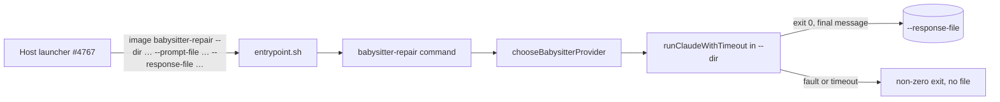

## Summary

Adds the worker container's `babysitter-repair` mode. `container/entrypoint.sh`
routes a first argument of `babysitter-repair` to a new `babysitter-repair`
command (`worker/deno/commands/babysitter_repair.ts`, registered in
`worker/deno/mod.ts`). The command takes `--dir`, `--prompt-file` and
`--response-file`. It calls the existing `chooseBabysitterProvider`, runs one
session through `runClaudeWithTimeout` (explicit `agentProvider`, `cwd` =
`--dir`, 90 minutes, the overflow env as `parentEnv` only for an overflow
choice) and writes the agent's final message to `--response-file`. Every failure
exits non-zero with the cause and leaves no response file. Closes #4768.

## Spec

### Intent and Rationale

- The repair agent must run in the container with the image's toolchains, so the
  worker image needs a mode that runs one headless session in a mounted clone
  and hands the answer back through a file.
- The provider policy already exists (`chooseBabysitterProvider`, #4766), so the
  command calls it rather than selecting a provider itself.

### Essential Design Decisions

- A response file is written only after a complete run (exit 0, no timeout,
  non-empty message). Any earlier failure removes the path, including a file the
  agent wrote itself in the clone, because the response path sits inside the
  clone the agent can write.
- Only an overflow choice passes `parentEnv` (the DeepSeek child env). A
  subscription choice returns the plain process env, which is the runner's
  default, so passing it adds nothing.
- Added beyond the issue's list of failures: a whitespace-only prompt and a
  missing, blank or bare flag also fail. The 90-minute limit is imported from
  `BABYSITTER_REPAIR_TIMEOUT_MS`, so it equals the host's container kill and the
  host kill will usually win a true hang.

### Undiscoverable Facts

- Assumption checked: `ClaudeExecutionResult.output` is the final message for
  every provider. `claude_output_adapter.ts` (Claude and DeepSeek) and
  `codex_output_adapter.ts` (Codex) set `textSource: "final"` from the final
  result. The command writes only on exit 0 with no timeout, so partial text is
  never written.
- Assumption checked, `--user` mapping: the run plan sets no `--user` for the
  repair container (the only `--user` in `container_launch.ts` is the
  volume-init step, as `0:0`), so the session runs as the image's `USER vibe`
  (uid 1000, `container/Containerfile`). Files it writes in the bind-mounted
  clone are owned by that uid. Whether the host user can read and commit them
  depends on the host uid matching 1000; that mapping is the host launcher's
  concern (#4767) and is not changed here.

## Evidence

Backend/CLI change only, no UI file touched. Evidence is the tests below, run on
the head.

- The issue's fixed command line (`BABYSITTER_REPAIR_COMMAND` in
  `worker/deno/lib/fleet_babysitter_container.ts`) is what the entrypoint test
  passes through.
- Stale comments in `fleet_babysitter_container.ts` and a sentence in
  `DESIGN-PRINCIPLES.md` said the in-container command was missing or uncalled;
  both now say it exists. They still say the host `fix()` does not launch the
  container (#4774); `grep` of `commands/fleet_pr_babysitter.ts` finds no
  reference to `runBabysitterRepairContainer`.
- Fake mirrored: `chooseProvider` and `runClaude` stand in for
  `chooseBabysitterProvider` and `runClaudeWithTimeout`; the properties relied
  on are `Result<ClaudeExecutionResult>` with `exitCode`, `output`, `stderr`,
  `timedOut` and `timeoutReason`, read from
  `worker/deno/lib/claude_executor.ts`.
- Issue numbers cited: #4768: Add the worker container's babysitter-repair mode;
  #4766: provider choice (named by the issue as delivered); #4767: host
  container launcher (named in `fleet_babysitter_container.ts`); #4774: wire the
  container into `fix()` (named in the same file, not viewed with
  `gh issue view` in this run).

## Acceptance Criteria

<!-- vibe-spec-review inputs="diff+issue-body" -->

- **met** — Test (in the style of
  `worker/deno/tests/container_entrypoint_test.ts`):
  `entrypoint.sh babysitter-repair …` runs the driver with `babysitter-repair`
  and passes the arguments through. — evidence:
  `worker/deno/tests/container_entrypoint_test.ts::entrypoint - babysitter-repair runs the driver with babysitter-repair and passes the arguments through (Issue #4768)`
  — reviewer: met
- **met** — Test: a successful session writes the runner's final message to
  `--response-file` and exits 0. — evidence:
  `worker/deno/tests/babysitter_repair_4738_test.ts::success writes the runner's final message and returns success`
  — reviewer: met
- **met** — Test: a provider-choice failure, a runner failure, a timeout and a
  missing prompt each exit non-zero with the cause and leave no response file. —
  evidence: `worker/deno/tests/babysitter_repair_4738_test.ts`
  (`provider-choice throw…`, `runner error result…`, `timed-out run…`,
  `missing prompt file…`) — reviewer: met
- **met** — Test: an overflow choice runs the session with provider `deepseek`
  and the DeepSeek child env; a subscription choice runs it with that provider.
  — evidence:
  `worker/deno/tests/babysitter_repair_4738_test.ts::DeepSeek overflow forwards the choice env as parentEnv`
  and
  `::subscription choice sends no parentEnv even when the choice carries an env`
  — reviewer: met
- **met** — `worker/deno/tests/mod_test.ts` includes `babysitter-repair` in the
  command registry. — evidence:
  `worker/deno/tests/mod_test.ts::mod - createDefaultRegistry has all built-in commands registered`
  — reviewer: met
- **met** — `./quality.sh` passes. — evidence: `./quality.sh` run on the head
  with the host's proxy variables unset, `Result: PASSED (with skipped checks)`
  — reviewer: missing — reason: the reviewer could not run the gate; it was run
  here. Semgrep was skipped (its registry was unreachable), and the CI gate runs
  it
- **unrequested** — `docs/audits/lib-sweep-coverage/top-up-4768.json` —
  reviewer: unrequested — reason: `lib_sweep_coverage_test.ts` refuses a new
  module under `worker/deno/commands/` that no sweep slice claims
- **unrequested** — wording fixes in
  `worker/deno/lib/fleet_babysitter_container.ts` and `DESIGN-PRINCIPLES.md` —
  reviewer: unrequested — reason: both said the in-container command was
  missing, which this change makes false; `docs/` and `DESIGN-PRINCIPLES.md` are
  in the issue's file area

## Standards Review

<!-- vibe-standards-review inputs="diff+CODING-STANDARDS.md" -->

- **violation** — a swallowed error on the response-file cleanup — evidence:
  `worker/deno/commands/babysitter_repair.ts:172` — reason: fixed in this diff
  (the cleanup returns its cause and the failure message names it)
- **violation** — "every failure leaves no response file" was false for a
  missing `--dir`/`--prompt-file`, and for a file the agent wrote — evidence:
  `worker/deno/commands/babysitter_repair.ts:83` — reason: fixed in this diff
  (stale clear first, every later failure clears the path)
- **violation** — two new branches had no test (stale removal failing, final
  write failing) — evidence: `worker/deno/commands/babysitter_repair.ts:101` —
  reason: fixed in this diff (tests added)
- **violation** — non-zero-exit reason quoted only the last 500 characters of
  stderr — evidence: `worker/deno/commands/babysitter_repair.ts:158` — reason:
  fixed in this diff (first and last 250 characters, redacted before cutting)
- **clean** — Australian English; no hidden paths staged; `Result` convention;
  the registry-count edit in `worker/deno/tests/mod_test.ts` goes red without
  the registration; no named test is absent; docs that said the command was
  missing are updated; the comment and `elif` insertions sit correctly against
  their neighbours

## Test Plan

- Added `worker/deno/tests/babysitter_repair_4738_test.ts` (success, overflow
  and subscription env, each failure cause, stale and agent-written response
  removal, failed write and failed cleanup, thrown runner, long stderr, flag
  refusals, command wiring) and a `babysitter-repair` case in
  `worker/deno/tests/container_entrypoint_test.ts`;
  `worker/deno/tests/mod_test.ts` count 161 → 162 with an `includes` check.
- Removed from `worker/deno/tests/mod_test.ts`: nothing. Edited expectation: the
  count `161` → `162`; red check: removing
  `registry.register(babysitterRepairCommand)` drops the count to 161, so both
  assertions fail.
- Red checks run: always passing `parentEnv` → the overflow and subscription
  tests failed; overflow reading the process env instead of the choice env →
  overflow test failed; removing the entrypoint `elif` → the new entrypoint test
  failed on the `run-entrypoint` assertion; skipping the failure clear → the
  agent-wrote-file and failed-write tests failed; reading only the last 500
  stderr characters → the long-stderr test failed; swallowing every remove error
  → the stale-remove and both-causes tests failed; removing the try/catch around
  the repair → the thrown-runner test failed.
- Branch outcomes: flags valid or refused; stale clear ok, NotFound or other
  error; prompt read ok, unreadable, blank; provider choice ok or throws; run
  result error, timed out, non-zero, empty, ok; write ok or throws; cleanup ok
  or fails. Each has a test above. Callers checked: `container/entrypoint.sh`
  routing (entrypoint test), registry (`mod_test.ts`),
  `babysitterRepairCommand.execute` (wiring test). Twinned rule: none found.
- Results on the final head:
  `deno task test:unit tests/babysitter_repair_4738_test.ts tests/mod_test.ts`
  passed (43 tests); `deno test --allow-all tests/container_entrypoint_test.ts`
  passed (44 tests). `./quality.sh` with the host's `HTTP(S)_PROXY`/`NO_PROXY`
  variables unset: `Result: PASSED (with skipped checks)` (config integration,
  semgrep and checkov skipped). With those variables set, the same gate fails
  only `worker/deno/tests/merge_fast_checks_credentials_4705_test.ts`, which
  expects no proxy variables in its argv and passes when they are unset; it is
  unrelated to this change and was not edited.
