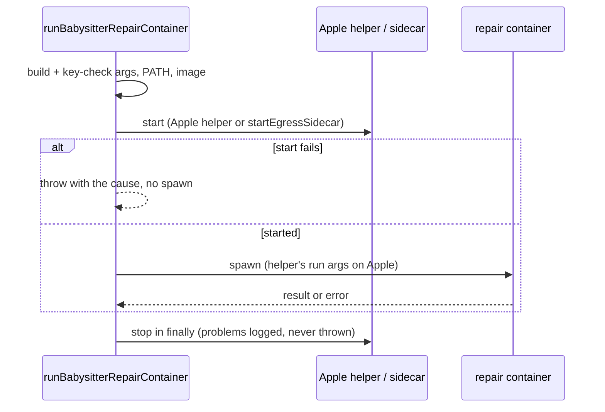

## Summary

A babysitter repair container now gets the same egress containment as the
worker. An Apple plan (a proxy name, no enforcement) runs
`worker/deno/apple_egress_launch_main.ts` for each repair, waits for its ready
file and launches with the run arguments it hands back. An enforced
docker/podman plan calls `startEgressSidecar` before the run. Both are stopped
in a `finally`. If egress set-up fails, the repair throws with the helper's or
the sidecar's cause and spawns nothing. A teardown failure is logged with its
cause and never replaces the repair's own result or error. The change is in
`worker/deno/lib/fleet_babysitter_container.ts`, replacing the refusal from
#4767. Closes #4769.

Version bump: `VERSION` is not changed by this PR.

## Spec

### Intent and Rationale

- The #4767 launcher refused any plan with a proxy, so no repair could run on a
  macOS or docker/podman host. The fix starts the proxy instead of refusing, as
  `round_egress` / `stop_egress` in
  `.claude/skills/review-fleet-prs/scripts/run.sh` do for review rounds.
- The Apple helper and the sidecar are the repo's own scripts and functions,
  called and not re-implemented.

### Essential Design Decisions

- Args are built and key-checked from the plan, then the runtime-on-PATH and
  image checks run, and only then does egress start, so a bad plan or a missing
  image never starts a proxy. The Apple run then uses the helper's returned
  arguments (rebuilt through `buildBabysitterRunArgs`, key guard re-run) in
  place of the plan's own `runArgs`.
- The sidecar teardown is armed before `startSidecar`, so a half-started sidecar
  (network created, proxy not listening) is still removed when the start throws.
- Apple mode can be `advisory` (`appleMode` in `apple_egress_launch.ts`); then
  host/LAN isolation is not promised. The docs say so and do not claim an
  enforced network.
- The Apple helper is started with the allow-listed environment plus
  `VIBE_APPLE_EGRESS_MODE` (run.sh lets it inherit everything), and with the
  worker's `Deno.pid` as owner.

### Undiscoverable Facts

- Reviewer rounds in `run.sh` still refuse enforced plans; that was out of scope
  per the issue and is unchanged.
- The module is still not wired into `fix()` (#4774) and the in-container
  `babysitter-repair` command is not in the image (#4768), so a real run still
  fails inside the container.

## Evidence

Backend only: no UI, no performance claim. The tests cover both egress kinds
with injected fakes, and run the real default Apple helper path against a stub
helper script that follows the real helper's contract (argv
`<plan> <ready> <log-dir> <owner-pid>`, atomic ready file of NUL-separated run
arguments, stderr log, SIGTERM stop). The stub mirrors
`apple_egress_launch_main.ts` (in this repository), whose usage line and
`run.sh` `round_egress` define that contract.

## Acceptance Criteria

<!-- vibe-spec-review inputs="diff+issue-body" -->

- **met** — Test: an Apple plan starts the helper, launches with the arguments
  it returns, and stops the helper after both a successful and a failed repair.
  — evidence:
  `worker/deno/tests/fleet_babysitter_container_egress_4738_test.ts::apple egress: the repair runs the helper's args, starts the helper once and stops it after the spawn`
  and
  `::apple egress: a failed repair stops the helper after the spawn and throws its own error`
  — reviewer: met
- **met** — Test: an enforced plan calls `startEgressSidecar` before the run and
  `stopEgressSidecar` after it, including when the run throws. — evidence:
  `worker/deno/tests/fleet_babysitter_container_egress_4738_test.ts::enforced egress: the sidecar starts before the spawn and stops after it, on success, a throw and a non-zero exit`
  and
  `::default sidecar stop reports cleanup failures after the repair`
  — reviewer: met
- **met** — Test: an egress set-up failure throws with its cause, and no repair
  container is spawned. — evidence:
  `worker/deno/tests/fleet_babysitter_container_egress_4738_test.ts::egress set-up failure: the repair rejects with the cause and spawns nothing`
  and
  `::default Apple helper: a failed start rejects with the last attempt's cause, not an earlier line or a trace`
  — reviewer: met
- **met** — Test: a plan needing neither launches with no egress step. —
  evidence:
  `worker/deno/tests/fleet_babysitter_container_egress_4738_test.ts::a plan that needs neither egress starts and stops nothing, and spawns once`
  — reviewer: met
- **met** — `./quality.sh` passes. — evidence: full `./quality.sh` run at the
  branch head, "Result: PASSED (with skipped checks)", exit 0; the skipped
  checks are config integration and checkov (environment-skipped) — reviewer:
  met
- **unrequested** — the key guard is re-run on the Apple helper's returned
  arguments — reviewer: unrequested — reason: the helper's arguments replace the
  plan's, so the existing #4767 mount guard must cover them too (test
  `::apple egress: helper args that mount the App key are refused...`).
- **unrequested** — a bounded SIGTERM-then-SIGKILL stop for the helper and
  redaction of the token in teardown log lines — reviewer: unrequested — reason:
  a stop that can hang, or a log line that carries the token, would break
  "removed when the repair ends" and the secrets rule.

## Standards Review

<!-- vibe-standards-review inputs="diff+CODING-STANDARDS.md" -->

- **violation** — module doc claimed a repair "never runs on an open network"
  although Apple advisory mode keeps the default network — evidence:
  `worker/deno/lib/fleet_babysitter_container.ts:13` — reason: fixed in this
  diff (reworded; advisory mode named)
- **violation** — Apple set-up failure path discarded the helper-stop and
  temp-dir removal results — evidence:
  `worker/deno/lib/fleet_babysitter_container.ts:676` — reason: fixed in this
  diff (`withCleanup` appends `; cleanup: …` to the thrown error)
- **violation** — default Apple helper path, ready-file success path, stop and
  cause selection were not reached by tests — evidence:
  `worker/deno/tests/fleet_babysitter_container_egress_4738_test.ts:746` —
  reason: fixed in this diff (stub-helper tests added)
- **violation** — the default-helper failure test asserted only the prefix, not
  the cause — evidence:
  `worker/deno/tests/fleet_babysitter_container_egress_4738_test.ts:821` —
  reason: fixed in this diff (asserts the last attempt line, and that an earlier
  line and a trace are absent)
- **violation** — default dependency wiring (`startEgressSidecar`,
  `stopEgressSidecar`, env threading, default log) untested, and a header claim
  that env readers are injected was untrue — evidence:
  `worker/deno/tests/fleet_babysitter_container_egress_4738_test.ts:872` —
  reason: fixed in this diff (default sidecar start, env threading and default
  log tested; env injected)
- **clean** — Australian English; named tests exist at the head; no hidden or
  secret path staged; no workflow files changed; `redactSecrets` used for logged
  text; no new dependency; reuse of `startEgressSidecar`, `stopEgressSidecar`,
  `renderContainerLaunchPlan`, `spawnCommandWithTimeout` and `redactSecrets`;
  review-enforced rules checked: avoid over-engineering, check where you insert,
  behaviour another issue delivers (#4768, #4774 described as planned)

## Test Plan

- Added `worker/deno/tests/fleet_babysitter_container_egress_4738_test.ts` (15
  tests, listed above and under Acceptance Criteria). It also covers: teardown
  problems and throws logged without hiding the result, preflight failures
  before any egress step, key-mounting helper args refused, the default Apple
  helper against a stub (env threaded, temp dir removed, non-zero stop exit
  logged).
- Removed from `worker/deno/tests/fleet_babysitter_container_4738_test.ts`:
  `repair refuses a plan that needs the egress proxy, and accepts neither flag set`
  - Obsolete: the egress refusal it pinned is replaced by starting egress
    (#4769).
  - Still covered by:
    `worker/deno/tests/fleet_babysitter_container_egress_4738_test.ts::a plan that needs neither egress starts and stops nothing, and spawns once`
    (the neither-flag case); the egress cases are in the other tests of that
    file.
- Red checks (one guard broken at a time in `lib/fleet_babysitter_container.ts`,
  new file run, each restored): no teardown call → red; Apple spawn uses the
  plan's args → red; sidecar teardown armed after the start → red; Apple branch
  disabled → red; teardown message without token redaction → red; cause = last
  line instead of the last attempt line → red; env not passed to the default
  helper → red; helper temp dir not removed → red; non-zero helper exit on stop
  ignored → red; default sidecar stop replaced by a no-op → red.
- Mutation survivors (#4769 retry): the unreadable-exit fallback is pinned by
  the test "a helper whose exit status cannot be read counts as a failed exit
  with code -1 and no signal", and the poll `pause` by "pause waits for the time
  given before it resolves". Both are in the egress test file, and
  `readExitStatus` and `pause` are exported for them.
- `exempt (untestable)`: the 60 s SIGKILL escalation of the Apple helper stop
  is untested: a real 60 s wait cannot run in a unit test
  and the grace is not injectable.
- Callers of `runBabysitterRepairContainer` checked: none outside its test files
  (`git grep -n runBabysitterRepairContainer`); not wired into `fix()` (#4774).
- Results:
  `deno task test:unit tests/fleet_babysitter_container_egress_4738_test.ts`
  passed (15 passed, 0 failed) after the review fix.
