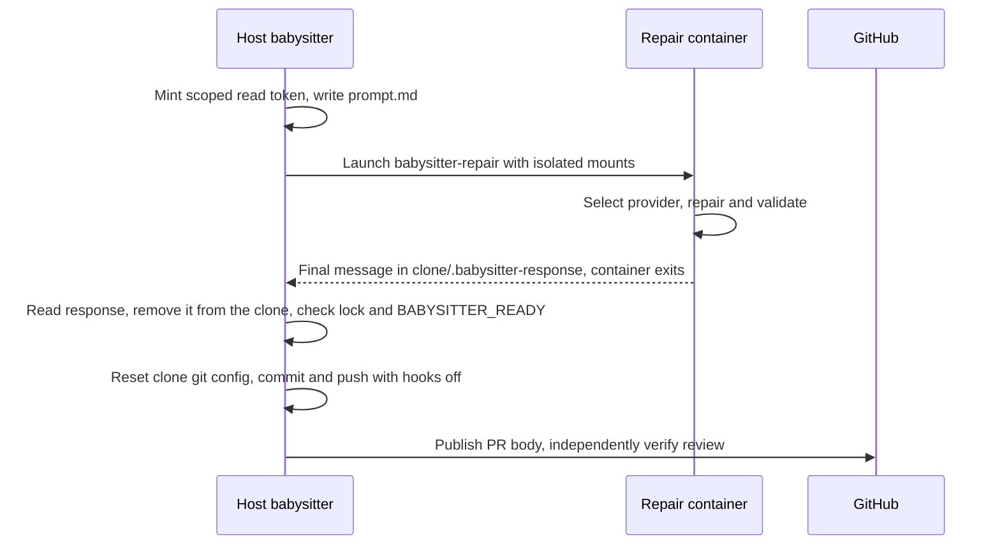

## Summary

Moved every fleet PR babysitter repair into the worker container and removed the
host Codex sandbox and installer. `fix()` mints the read-only token, writes
`<scratch>/prompt.md`, runs `runBabysitterRepairContainer` and reads the agent's
final message back through the clone; there is no host fallback. The host keeps
the App key, branch locks, attempt record, lock-renewal check, the
`BABYSITTER_READY` check, trusted git commit and push, PR-body publication and
review dismissal. Setup checks the container runtime and image instead of
installing Codex. Closes #4770.

Version bump: No version file was changed for this issue.

## Spec

### Intent and Rationale

- Host agent execution exposed host credentials and let agent-written git
  configuration influence publication. The existing launcher (#4767), egress
  (#4769) and provider chooser (#4766) are reused, not rebuilt; the neutral path
  helpers the launcher and the review verifier still use moved to
  `worker/deno/lib/fleet_babysitter_paths.ts`.

### Essential Design Decisions

- The container gets a copy of the tracked files of the worker checkout in
  `<scratch>/workspace` (removed after each session and before a restart) and a
  scrubbed config copy; the plan's `credentials/gh` mount, custom-prompt mounts,
  named work volumes and the host log mount are dropped. Enabled providers'
  credential directories stay. Secret-named config keys are scrubbed only when
  their value is a string, array or object, so numeric limits such as
  `max_issue_body_tokens` survive.
- The clone's `.git` is mounted read-only over the read-write clone
  (`<clone>/.git:/babysitter/clone/.git:ro`, after the clone mount in
  `buildBabysitterRunArgs`), so the agent cannot forge objects, refs or config
  that host git later reads; the prompt already tells it not to write `.git` and
  the host stages the files. The working tree stays writable, so as defence in
  depth the host runs publication git with hooks and fsmonitor disabled,
  submodule recursion off, submodule diffs ignored and replacement refs ignored
  (`core.useReplaceRefs=false`; the review verifier's git in the clone carries
  the same flags), and rewrites the clone's `.git/config` before publication,
  keeping only the probed `core.ignorecase` and `core.precomposeunicode` traits.
  The reset refuses to publish when `.git` is not a plain directory, or when
  `.git/commondir`, `.git/gitdir`, `.git/config.worktree` or
  `.git/objects/info/alternates` exist, because each would redirect git to
  config the reset does not control. The host's own global git config is left in
  place so its credential helper still works. Before host Git runs, nested
  `.git` entries (including case-variant, NFKC-folded and `git~1` names), index
  gitlinks absent from HEAD, `refs/replace` refs, `.git/info/grafts` and
  `.git/shallow` are refused. Checked-out existing submodules are also refused;
  the staged merge remains intact.
- Exit status 42 from `babysitter-repair` is a reported task failure and is a
  `code` failure; a missing runtime or image (including
  `ContainerRuntimeUnavailableError`) is `capability`; every other launcher
  failure is `infrastructure`. Codex stderr retry-after parsing is gone with the
  Codex spawn, so a quota reset time is no longer carried into the retry record;
  richer retry is the closed #4656's area.
- Lock-renewal failure aborts an `AbortSignal` that kills the container by name,
  replacing `child.kill`.

### Undiscoverable Facts

- The issue's Failure Detection names `fleet_pr_babysitter_test.ts` and
  `fleet_pr_babysitter_setup_test.ts`; the new host-agent, missing-runtime and
  non-zero-exit tests live in `babysitter_fix_orchestration_test.ts`, which
  `quality.sh` also runs.
- The unmodified gate inherits the host's proxy variables and then fails
  `merge_fast_checks_credentials_4705_test.ts`, whose fixture expects none. With
  those variables unset the gate passes; that test was not changed.

## Evidence

Backend and CLI change; no visual surface changed.

- `git grep -nE 'fleet_babysitter_sandbox|fleet_babysitter_codex|ensureBabysitterCodex|buildBabysitterSandboxArgs' -- ':!docs/archive/**' ':!docs/audits/**'`
  returned no hits on the head.
- No real container run was made: this environment has no docker, podman or
  Apple `container` binary, so the runtime behaviours (bind-mount ownership of
  files the agent writes, `kill <name>`, exit status travelling through
  `entrypoint.sh`) rest on the launcher's tests and the code, not on a run.
- Fakes: the container spawn and image fakes in
  `worker/deno/tests/fixtures/babysitter_container_fakes_4770.ts` stand in for
  `babysitterSpawn` and `babysitterImageExists`; the plan is built by the real
  `buildLaunchPlanForCommand` over a temp git checkout, so the snapshot, the
  config scrub and the fail-closed mount refusal run as in production.
- Issue numbers cited: #4767: Build and launch the babysitter repair container
  from the worker's launch plan; #4769: Start the egress proxy for babysitter
  repair containers on Apple and docker/podman hosts; #4766: Babysitter repairs
  choose their provider subscription-first, with DeepSeek as logged paid
  overflow; #4656: Babysitter: recover temporary failures and continue PR
  reconciliation after a repair push (closed); #4771: Prove headless Chromium
  launches in the babysitter repair container (open, not delivered here).
- The earlier quality gate passed static checks but the parallel Deno test pass
  panicked on macOS; CI passed on the previous PR head. On this repair working
  tree the whole Deno formatter, linter and type check passed, as did the Git
  hardening suite and the nested-repository orchestration test. The full
  orchestration suite needs an unavailable container runtime on this host.
- PR #4941 review round:
  `deno test -A tests/fleet_pr_babysitter_git_hardening_test.ts` passed all 16
  tests (six of them new in this round) and `tests/fleet_babysitter_app_test.ts`
  passed with the restored CLI test. Four
  `worker/deno/tests/fleet_pr_babysitter_test.ts` cases (the lcov.info edit, the
  mirror-fetch, the newly-resolved-URL and the prune cases) failed in this
  sandbox: their fixture repository's push hook needs `https://jsr.io`, which is
  unreachable here. They also fail at the previous head (`f51a742f`), before
  this round's code, and were not changed.
- `deno test --allow-all tests/fleet_pr_babysitter_git_timeout_test.ts` passed
  all three tests on this head. The push and fetch cases use the shared host Git
  hardening arguments and continue to check the 30-minute timeout.

## Acceptance Criteria

<!-- vibe-spec-review inputs="diff+issue-body" -->

- **met** — Test: a repair spawns the container runtime with
  `babysitter-repair`. It never spawns `codex`, any host agent, or `quality.sh`
  on the host. — evidence:
  `worker/deno/tests/babysitter_fix_orchestration_test.ts::a repair starts only the container runtime with babysitter-repair, never codex, an agent or quality.sh (Issue #4770)`
  and `::a successful repair runs no host quality.sh or codex (Issue #4770)` —
  reviewer: met
- **met** — Test: a missing runtime and a missing image each make `fix()` throw
  with the cause. No host agent runs and nothing is pushed. — evidence:
  `worker/deno/tests/babysitter_fix_orchestration_test.ts::a missing container runtime or worker image stops the repair before any spawn, as a capability gap (Issue #4770)`
  (includes the real `buildPlan` path failing with
  `ContainerRuntimeUnavailableError`, asserting `capability`, no spawn, no push)
  — reviewer: met
- **met** — Test: a non-zero container exit throws and nothing is pushed. —
  evidence:
  `worker/deno/tests/babysitter_fix_orchestration_test.ts::a non-zero container exit fails the repair with its code, stderr and the rebuild hint, and pushes nothing (Issue #4770)`
  — reviewer: met
- **met** — Setup test: setup runs the container preflight and installs no
  Codex. — evidence:
  `worker/deno/tests/fleet_pr_babysitter_setup_test.ts::setup entry point invokes the container preflight and does not install Codex`
  and
  `::setup runs the container preflight (runtime, then image) and installs no Codex`
  — reviewer: met
- **met** —
  `git grep -n "fleet_babysitter_sandbox\|fleet_babysitter_codex\|ensureBabysitterCodex\|buildBabysitterSandboxArgs"`
  finds no hit outside `docs/archive/` and `docs/audits/`. — evidence: the grep
  command in Evidence returned no hits — reviewer: met
- **met** — Tests show the GitHub App private key, host GitHub credential store,
  and other host credential paths are absent from the repair container's mounts
  and environment. Only the existing scoped short-lived agent token and the
  provider/declared quality credentials allowed by their existing transport
  contracts cross the boundary. — evidence:
  `worker/deno/tests/fleet_babysitter_container_4738_test.ts::the real repair plan mounts no gh credential, key or custom prompt path, and passes no GH_, GITHUB_ or SSH_ env (Issue #4770)`,
  `::repair mounts a tracked checkout snapshot and a scrubbed config while keeping declared quality credentials`
  and
  `worker/deno/tests/babysitter_fix_orchestration_test.ts::the repair container gets no App key, host credential mount or GitHub App env, only the base env and GH_TOKEN (Issue #4770)`
  — reviewer: met
- **met** — The agent-written clone's own hooks, fsmonitor and quality scripts
  are not run on the host: publication git, the review verifier's git and
  committed-summary reads run with hooks and fsmonitor off and replacement refs
  ignored, the clone's `.git` is read-only to the agent so it cannot forge
  objects (PR #4941 review), and the clone is refused before host git when it
  holds nested repositories, replacement refs, grafts or a shallow file. The
  host keeps locks, trusted git/commit/push and PR-body publication. — evidence:
  `worker/deno/tests/babysitter_fix_orchestration_test.ts::the repair container mounts the clone's .git read-only over the writable clone (PR #4941 review)`,
  `worker/deno/tests/fleet_babysitter_container_4738_test.ts::repair drops the named volumes and adds exactly the clone, its read-only .git and scratch mounts`,
  `worker/deno/tests/fleet_pr_babysitter_git_hardening_test.ts::validateAndCommit and push run no planted pre-commit, pre-push or fsmonitor`,
  `::repair resets agent-controlled filters, diff and SSH git config before host work`,
  `::the publication reset refuses a planted commondir that would redirect git's config to a filter`,
  `::the publication reset refuses every other git redirection file`,
  `::the publication reset refuses a .git that is not a plain directory`,
  `::the publication reset writes a complete trusted config`,
  `::the review verifier's host git runs no planted fsmonitor in the repair clone`,
  `::the committed-summary read ignores a planted replacement object`,
  `::publication refuses agent-written replacement refs, grafts and shallow files`,
  `::publication refuses a nested repository spelled with another case`,
  `::the publication reset carries the probed filesystem traits into the trusted config`
  and
  `worker/deno/tests/babysitter_fix_orchestration_test.ts::fix replaces agent-controlled git config before host publication (Issue #4770)`
  — reviewer: met
- **partial** — `./quality.sh` passes. — evidence: the repair working-tree run
  described in Evidence passed the static checks and focused tests, but the
  container runtime is unavailable on this host — reviewer: partial — reason: CI
  must confirm the full gate on the pushed head
- **unrequested** — exit status 42 for a reported task failure
  (`BABYSITTER_TASK_FAILURE_EXIT_CODE` in
  `worker/deno/commands/babysitter_repair.ts`) — reviewer: unrequested — reason:
  keeps the old code-versus-infrastructure attempt accounting that the deleted
  Codex stderr classifier provided
- **unrequested** — tracked-files workspace snapshot, config scrub and
  fail-closed mount refusal in `worker/deno/lib/fleet_babysitter_container.ts` —
  reviewer: unrequested — reason: needed so the worker checkout's untracked
  files and live config are not exposed, for the credential-absence criterion
- **unrequested** — host git hardening (`HOST_GIT_HARDENING_ARGS`,
  `runHardenedRepairGit`, `resetRepairCloneGitConfig`) — reviewer: unrequested —
  reason: the container writes the clone's working tree (nested repositories,
  index entries), so the host's trusted commit and push needed hooks and config
  neutralised; `.git` itself is read-only to the container
- **unrequested** — `AbortSignal` support, the `startLockRenewal` and
  `resetGitConfig` seams in `FixDeps`, and an injectable setup entry point —
  reviewer: unrequested — reason: replace `child.kill` on lock-renewal failure
  and make the setup preflight testable
- **unrequested** — sweep-ledger changes (`top-up-4593.json` and
  `top-up-4664.json` deleted, `top-up-4770.json` added), the replaced
  `worker/deno/tests/fixtures/fleet_babysitter_repair_preload.ts` (now
  `worker/deno/tests/fixtures/fleet_babysitter_container_preload.ts`), and docs
  edits in `docs/CONFIGURATION.md`,
  `docs/workflows/fleet-pr-babysitter-github-app.md` and `DESIGN-PRINCIPLES.md`
  — reviewer: unrequested — reason: the ledger gate treats a path with no file
  as stale, the old fixture drove the deleted Codex spawn, and the docs carried
  stale Codex wording

## Standards Review

<!-- vibe-standards-review inputs="diff+CODING-STANDARDS.md" -->

- **violation** — the config reset was bypassable through the agent-writable
  `.git/commondir`, and a missing container runtime was classed as
  infrastructure — evidence: `worker/deno/commands/fleet_pr_babysitter.ts`
  (`REPAIR_GIT_REDIRECT_FILES`, `repairFailureClass`) — reason: fixed in this
  diff (redirection files refuse publication; `ContainerRuntimeUnavailableError`
  is `capability`; tested)
- **violation** — every token restart failed because the snapshot directory
  already existed — evidence:
  `worker/deno/lib/fleet_babysitter_container.ts:555` — reason: fixed in this
  diff (leftover removed before creation and the snapshot removed after each
  session; tested through the real launcher)
- **violation** — the fake plan lacked `mounts`, so the orchestration tests
  skipped the snapshot and mount refusal — evidence:
  `worker/deno/tests/fixtures/babysitter_container_fakes_4770.ts:92` — reason:
  fixed in this diff (real plan from `buildLaunchPlanForCommand`)
- **violation** — `resetRepairCloneGitConfig` hard-coded an HTTPS URL and its
  own repo-name rule — evidence:
  `worker/deno/commands/fleet_pr_babysitter.ts:924` — reason: fixed in this diff
  (uses `defaultRemoteUrl` and the clone's shared `isValidRepoName`; tested)
- **violation** — `runHardenedRepairGit` nulled the host's global git config and
  so its credential helper — evidence:
  `worker/deno/commands/fleet_pr_babysitter.ts:901` — reason: fixed in this diff
  (hooks, fsmonitor and submodule hardening flags remain; tested that the global
  config is still honoured)
- **violation** — the task-failure test copied the classifier into the harness
  stub and stayed green without the production mapping — evidence:
  `worker/deno/tests/babysitter_fix_orchestration_test.ts:790` — reason: fixed
  in this diff (runs the real `startBabysitterAgent` with exit 42 and exit 1)
- **violation** — removed tests were not all recorded — evidence:
  `docs/archive/pr-summaries/pr-summary-4770.md:1` — reason: fixed in this diff
  (see Test Plan)
- **violation** — workflow doc said container exits never spend the budget and
  that retry-after parsing remained — evidence:
  `docs/workflows/fleet-pr-babysitter.md:449` — reason: fixed in this diff
- **violation** — workflow doc misplaced the snapshot mount, and the C36 row
  said "Only" for what crosses the boundary — evidence:
  `docs/THREAT-MODEL.md:213` — reason: fixed in this diff (lists what
  `buildBabysitterRunArgs` keeps)
- **violation** — stale doc comments about the key guard and the verifier
  boundary — evidence: `worker/deno/lib/fleet_babysitter_paths.ts:10` — reason:
  fixed in this diff
- **violation** — Evidence lacked the issue-number list — evidence:
  `docs/archive/pr-summaries/pr-summary-4770.md:1` — reason: fixed in this diff
- **clean** — Australian English; no hidden paths staged; no named test is
  absent; secrets are redacted before launcher errors are rethrown; the response
  file is always removed from the clone; moved path helpers keep their tests in
  `worker/deno/tests/fleet_babysitter_paths_test.ts`; every new export has a
  production reader or default; no `.github/workflows` change

## Test Plan

- Added or extended: `worker/deno/tests/fleet_babysitter_paths_test.ts`,
  `worker/deno/tests/fleet_pr_babysitter_git_hardening_test.ts`,
  `worker/deno/tests/fixtures/babysitter_container_fakes_4770.ts`,
  `worker/deno/tests/babysitter_fix_orchestration_test.ts`,
  `worker/deno/tests/fleet_babysitter_container_4738_test.ts`,
  `worker/deno/tests/fleet_babysitter_container_egress_4738_test.ts`,
  `worker/deno/tests/babysitter_repair_4738_test.ts` and
  `worker/deno/tests/fleet_pr_babysitter_setup_test.ts`. Updated
  `worker/deno/tests/fleet_pr_babysitter_git_timeout_test.ts` to expect the
  shared hardening arguments for both push and fetch.
- The timeout tests' old two-flag expectation became obsolete when submodule
  hardening was added. The remaining contract is that push and fetch pass all
  host hardening arguments through the Git chokepoint with a 30-minute timeout;
  `worker/deno/tests/fleet_pr_babysitter_git_timeout_test.ts::run sends git push through the chokepoint with a 30-minute timeout`
  and `::run sends git fetch through the chokepoint with a 30-minute timeout`
  cover it. The separate Git hardening suite checks the security effects.
- Removed from `worker/deno/tests/fleet_babysitter_sandbox_test.ts` (file
  deleted): the nine `buildBabysitterSandboxArgs` and Codex-floor cases. Removed
  functionality: `buildBabysitterSandboxArgs`, `codexVersionMeetsFloor`; their
  only caller was the host Codex spawn. The 18 path-helper cases moved to
  `worker/deno/tests/fleet_babysitter_paths_test.ts`.
- Removed from `worker/deno/tests/fleet_babysitter_codex_test.ts` (file
  deleted): all six cases (five `Deno.test` registrations, one of them in a
  two-label loop;
  `git show origin/main:worker/deno/tests/fleet_babysitter_codex_test.ts`).
  Removed functionality: `ensureBabysitterCodex`; setup no longer installs
  Codex. Verification:
  `git grep -n ensureBabysitterCodex -- . ':!docs/archive' ':!docs/audits'`
  printed no hits on the head, so no caller is left, and
  `worker/deno/tests/fleet_pr_babysitter_setup_test.ts::setup runs the container preflight (runtime, then image) and installs no Codex`
  covers the replacement setup behaviour.
- Removed from `worker/deno/tests/fleet_pr_babysitter_test.ts`: the five
  `spawnBabysitterAgent` cases. Removed functionality: `spawnBabysitterAgent`;
  response-file reading stays covered by the kept `readAgentResponse` cases and
  the orchestration symlink-response tests.
- Updated
  `worker/deno/tests/fleet_pr_babysitter_test.ts::repair caller passes the issue number parsed from the PR branch`:
  the host-agent requirement to reject a missing `HOME` is obsolete with the
  container launcher. The test still checks the issue-specific summary path and
  now verifies that the repair reaches the agent with that path without `HOME`.
- Removed from `worker/deno/tests/fleet_babysitter_app_test.ts`: the three
  `babysitterAgentEnv` cases and
  `production repair forwards CONFIG_PATH and denies canonical credential targets`.
  Removed functionality: `babysitterAgentEnv` and the Codex fixture
  (`worker/deno/tests/fixtures/fleet_babysitter_repair_preload.ts`, deleted);
  the container's environment is asserted in the orchestration credential test.
  That CLI test also covered the ssh origin and the pending-open exit; the
  origin URL now follows `defaultRemoteUrl` (tested). The non-watch exit
  (`Deno.exit(Deno.exitCode)` in `main`) is again covered at CLI level by
  `worker/deno/tests/fleet_babysitter_app_test.ts::the non-watch container repair exits non-zero after cleanup despite a pending special-file open`,
  which runs the real CLI with
  `worker/deno/tests/fixtures/fleet_babysitter_container_preload.ts` (fake `gh`,
  clone git and container runtime; real git and tar over the worker checkout).
  The preload requires the real checkout path and narrows it to a string before
  its command stubs use it, so the fixture type-checks. The container's fake
  agent leaves a FIFO as `.babysitter-pr-body`; the pass must exit non-zero with
  `timed out opening`, and the same pass without the FIFO must succeed and apply
  the description (positive control). Red check: replacing
  `Deno.exit(Deno.exitCode)` in `main` with a comment makes the test fail with
  `Timed out after 25000ms`. The exchange and `file_utils` tests only prove the
  reader's open times out, not that the process exits.
- Removed from `worker/deno/tests/fleet_pr_babysitter_audit_test.ts`:
  `babysitter agent disables the inherited host audit journal`. Removed
  functionality: the host Codex spawn's `VIBE_AUDIT_DISABLED` env; the
  container's env is asserted to carry no `VIBE_AUDIT_DIR`.
- Removed from `worker/deno/tests/babysitter_fix_orchestration_test.ts`: the two
  agent-stderr tests and the `>= before + 300_000` retry-after assertion of
  `an empty agent diagnostic retries and a reported retry-after is honoured`.
  Removed functionality: `forwardAgentStderr`, the Codex stderr scratch file and
  `CODEX_OUTPUT_ADAPTER` retry-after parsing.
- Edited expectations: `exited with code 1` replaces
  `agent exited unsuccessfully`; a plain non-zero exit moves from `code` to
  `infrastructure`, and exit 42 stays `code`. Red check: removing the exit-42
  mapping fails
  `container task failures spend substantive attempts while transient exits back off`
  and
  `a non-zero container exit keeps the retry record and the repair's real error`.
- Red checks (break, red, restore): runtime check skipped; image check skipped;
  abort does not kill; failed abort-kill not logged; already-aborted refusal
  removed; rebuild hint removed; stderr cause dropped; `gh` mount drop removed;
  custom-prompt mount and env drops removed; hook-hardening flags emptied
  (planted pre-commit, pre-push and fsmonitor markers appear);
  `signal: options.signal` dropped; Apple-egress abort check dropped; snapshot
  cleanup reverted (the token-restart tests fail); the global-config override
  restored
  (`publication git keeps the host's global config, while a planted pre-commit hook still does not run`
  fails); exit-42 mapping removed.
- PR #4941 review round red checks (break, red, restore): removing
  `core.useReplaceRefs=false` from `HOST_GIT_HARDENING_ARGS` fails
  `the committed-summary read ignores a planted replacement object` and the
  `run puts the hook and fsmonitor neutralising flags before the git subcommand`
  expectation; removing `verifierDeps: hardenedVerifierDeps` from
  `readOnlyReviewVerifier` fails
  `the review verifier's host git runs no planted fsmonitor in the repair clone`
  (the default deps run the planted fsmonitor, as its positive control shows);
  removing the `ignorecase`/`precomposeunicode` lines from the trusted config
  fails
  `the publication reset carries the probed filesystem traits into the trusted config`
  (the fixture plants the opposite `core.ignorecase` in the agent's config). The
  `refs/replace`, grafts, shallow and case-variant `.git` refusals are each
  tested with the same repository accepted first and again after the planted
  item is removed. The replacement ref is refused before the HEAD gitlink
  comparison reads HEAD, so that comparison cannot see a replacement.
- PR #4941 review round, read-only `.git` mount: removing the `.git:ro` volume
  from `buildBabysitterRunArgs` fails
  `the repair container mounts the clone's .git read-only over the writable clone (PR #4941 review)`
  (the `.git:ro` volume is missing next to the clone mount) and both exact-mount
  cases in `fleet_babysitter_container_4738_test.ts`
  (`repair spawns the plan's
  run args, the mounts, GH_TOKEN and the fixed command`,
  `repair drops the named
  volumes and adds exactly the clone, its read-only .git and scratch mounts`);
  restored, 162 tests in the five touched babysitter test files pass. The
  orchestration test also pins the order (the `.git` mount directly after the
  clone mount), because a runtime applies a nested mount only after its parent.
  No test overwrites a blob object from inside a container: the container
  runtime is unavailable on this host, so the proof that the agent cannot write
  `.git` is the mount flag the runtime enforces, not an in-container write. The
  host git hardening and nested-repository refusals stay for the writable
  working tree.
- Not red-checked: the `isValidRepoName` sharing and the numeric-limit config
  scrub (both have direct tests that exercise their inputs).
- Callers checked for the new `startBabysitterAgent` contract: `fix()` is the
  only production caller; `babysitter_fix_orchestration_test.ts` and
  `fleet_babysitter_app_test.ts` call it. Twinned rule: the runtime and image
  refusal is one helper (`checkRuntimeAndImage`) used by the repair and the
  setup preflight.
- Nested Git review:
  `worker/deno/tests/fleet_pr_babysitter_git_hardening_test.ts::publication refuses planted nested repositories and index gitlinks`
  covers both refusals;
  `worker/deno/tests/babysitter_fix_orchestration_test.ts::fix refuses a nested repository before finish runs host Git`
  verifies refusal before status, commit or push. The hardening flags are shared
  by `run()` and `runHardenedRepairGit`; the orchestration fixture supplies a
  guard seam for its simulated clone. Results and host limitations are in
  Evidence. Review-round additions: `assertRepairTreeSafe` also refuses
  `refs/replace`, `.git/info/grafts`, `.git/shallow` and case-variant or `git~1`
  nested repository names; the verifier's git carries `HOST_GIT_HARDENING_ARGS`
  (`hardenedVerifierDeps`); the reset probes the filesystem on the host for
  `core.ignorecase` and `core.precomposeunicode` (`probeRepairFilesystem`).
  `readOnlyReviewVerifier` gained an `overrides` argument that production never
  passes; it is the seam the verifier-git test uses to receive the deps the
  production wiring builds. Callers checked for `HOST_GIT_HARDENING_ARGS`:
  `run()` and `runHardenedRepairGit` (every publication, body-sync and
  committed-summary read) and the verifier; the untouched `git`/`gh` calls
  elsewhere in the file are not hardened: `baseAlreadyMerged` and
  `mergeBaseForRepair` run plain git in the clone, but only before the agent
  starts, so the agent has not yet written its `.git`; the others run outside
  the clone.
- Docs read and updated: the container repair, credential-boundary and failure
  sections of `docs/workflows/fleet-pr-babysitter.md`, control C36 in
  `docs/THREAT-MODEL.md`, the key section of `docs/CONFIGURATION.md`,
  `docs/workflows/fleet-pr-babysitter-github-app.md` and the design principle in
  `DESIGN-PRINCIPLES.md`.

### Deno regression avoided

- Used Deno tasks and tooling for tests, lint, type checks and formatting; no
  Node tooling or manifest was added.

## Mutation and coverage follow-up

- `fleet_pr_babysitter.ts` `.git` shape check: the redundant `isSymlink` operand
  was removed (lstat reports a link as not a directory); tests cover a symlinked
  and a gitfile `.git`. The `[core]` header is pinned by
  `::the publication reset writes a complete trusted config`.
- `codex_output_adapter.ts:451-458` and `:475-477` are reached by
  `codex_output_adapter_1695_test.ts::a transport failure in prose is network, never a rate limit`
  and `::an unrecognised non-zero exit is a task failure`.
