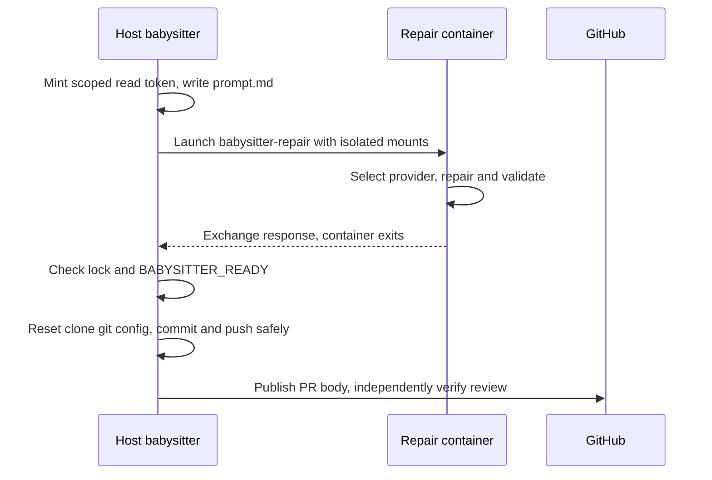

## Summary

Moved every babysitter repair into the worker container and removed the host
Codex sandbox and installer. The host retains the App key, locks, attempt
tracking, trusted git publication, PR-body updates and review verification.
Setup now checks the container runtime and image. Closes #4770.

Version bump: No version file was changed for this issue.

## Spec

### Intent and Rationale

- Host agent execution exposed host credentials and allowed agent-controlled git
  configuration to influence publication. The existing worker container launcher
  is now the sole repair execution path.

### Essential Design Decisions

- The container gets a fresh workspace containing only paths tracked at `HEAD`,
  copied as regular files from the worker checkout. A scrubbed config copy keeps
  the declared quality credential rules used by their existing transport.
- The read-only agent token, enabled provider credential directories and fixed
  runtime environment are the allowed transports. Host GitHub credentials, App
  key, logs, staged config, custom prompts and named work volumes stay out of
  the repair container.
- The host replaces the agent-writable clone's `.git/config` before publication
  and hardens direct publication Git calls as well as `run()` calls. Structured
  task-failure status preserves substantive attempt accounting; other launcher
  failures retain infrastructure handling. Retry policy remains in the existing
  path.
- Independent Spec and Standards sub-agent reviews were not run because this
  invocation explicitly prohibited Agent tools. No independent reviewer verdict
  is claimed here.

### Undiscoverable Facts

- The previous `merge_fallback_issue_test.ts` failure could not be reproduced:
  the focused test passed on this head and on `origin/main`. The available
  evidence does not establish why the earlier full run reported it.
- The unmodified full gate inherited six proxy variables and failed
  `merge_fast_checks_credentials_4705_test.ts` because the fixture expected no
  proxy values in the wrapper argv. Running the gate with those ambient proxy
  variables unset passed; the test file itself was not changed.

## Evidence

Backend and CLI change; no visual surface changed. Production entry points and
behavior are covered by
`worker/deno/tests/babysitter_fix_orchestration_test.ts`,
`worker/deno/tests/fleet_babysitter_container_4738_test.ts`,
`worker/deno/tests/fleet_pr_babysitter_git_hardening_test.ts` and
`worker/deno/tests/fleet_pr_babysitter_setup_test.ts`.

- The repair reuses the existing `runBabysitterRepairContainer`,
  `babysitter-repair` command, egress launcher and provider chooser; it does not
  add a second launcher or selector.
- `git grep -nE 'fleet_babysitter_sandbox|fleet_babysitter_codex|ensureBabysitterCodex|buildBabysitterSandboxArgs' -- ':!docs/archive/**' ':!docs/audits/**'`
  returned no hits.
- `merge_fallback_issue_test.ts` passed on both the issue branch and
  `origin/main`; the earlier failure remains unexplained.
- Full quality gate returned `PASSED (with skipped checks)` using
  `env -u HTTP_PROXY -u HTTPS_PROXY -u NO_PROXY -u http_proxy -u https_proxy -u no_proxy timeout 1800 ./quality.sh < /dev/null`.
  Semgrep was skipped because the registry could not be fetched, Checkov was
  unavailable, config integration lacked `.config.json`, and the GitHub
  release-tag ruleset check could not reach `api.github.com`. The unit test,
  lint, type check, format and local static checks passed.

## Acceptance Criteria

Independent Spec review was not run because Agent tools were prohibited; entries
below record local evidence only and do not claim reviewer provenance.

- **met** — Test: a repair spawns the container runtime with
  `babysitter-repair`. It never spawns `codex`, any host agent, or `quality.sh`
  on the host. — evidence:
  `worker/deno/tests/babysitter_fix_orchestration_test.ts::a repair starts only the container runtime with babysitter-repair, never codex, an agent or quality.sh (Issue #4770)`;
  `::a successful repair runs no host quality.sh or codex (Issue #4770)`
- **met** — Test: a missing runtime and a missing image each make `fix()` throw
  with the cause. No host agent runs and nothing is pushed. — evidence:
  `worker/deno/tests/babysitter_fix_orchestration_test.ts::a missing container runtime or worker image stops the repair before any spawn, as a capability gap (Issue #4770)`
- **met** — Test: a non-zero container exit throws and nothing is pushed. —
  evidence:
  `worker/deno/tests/babysitter_fix_orchestration_test.ts::a non-zero container exit fails the repair with its code, stderr and the rebuild hint, and pushes nothing (Issue #4770)`
- **met** — Setup test: setup runs the container preflight and installs no
  Codex. — evidence:
  `worker/deno/tests/fleet_pr_babysitter_setup_test.ts::setup entry point invokes the container preflight and does not install Codex`
- **met** —
  `git grep -n "fleet_babysitter_sandbox\\|fleet_babysitter_codex\\|ensureBabysitterCodex\\|buildBabysitterSandboxArgs"`
  finds no hit outside `docs/archive/` and `docs/audits/`. — evidence: the grep
  command in Evidence returned no hits
- **met** — Tests show the GitHub App private key, host GitHub credential store,
  and other host credential paths are absent from the repair container's mounts
  and environment. Only the existing scoped short-lived agent token and the
  provider/declared quality credentials allowed by their existing transport
  contracts cross the boundary. — evidence:
  `worker/deno/tests/fleet_babysitter_container_4738_test.ts::the real repair plan mounts no gh credential, key or custom prompt path, and passes no GH_, GITHUB_ or SSH_ env (Issue #4770)`;
  `::repair mounts a tracked checkout snapshot and a scrubbed config while keeping declared quality credentials`;
  orchestration credential test above
- **met** — No repository-controlled quality command is launched on the host,
  including checks added to `validateAndCommit` or pre-push hooks. Host
  orchestration retains locks, trusted git/commit/push and PR-body publication.
  — evidence:
  `worker/deno/tests/fleet_pr_babysitter_git_hardening_test.ts::validateAndCommit and push run no planted pre-commit, pre-push or fsmonitor`;
  `::repair resets agent-controlled filters, diff and SSH git config before host work`;
  repair tests above
- **met** — `./quality.sh` passes. — evidence: full quality command passed with
  the skipped checks and environmental limitation listed above

## Standards Review

Independent Standards review was not run because Agent tools were prohibited.
The repository quality gate, targeted checks and focused guard mutations are
recorded below; no independent clean verdict is claimed.

## Test Plan

- `deno task test:unit tests/babysitter_fix_orchestration_test.ts tests/babysitter_repair_4738_test.ts tests/fleet_babysitter_container_4738_test.ts tests/fleet_babysitter_container_egress_4738_test.ts tests/fleet_pr_babysitter_git_hardening_test.ts tests/fleet_pr_babysitter_setup_test.ts tests/fleet_pr_babysitter_test.ts tests/fleet_babysitter_app_test.ts tests/fleet_babysitter_paths_test.ts`
  — passed, 314 tests.
- `deno lint` on the nine touched TypeScript files — passed.
- `deno check` on the repair, setup and container modules — passed.
- `deno fmt --check` on the nine touched TypeScript files — passed.
- Planted Git guard mutation (`HOST_GIT_HARDENING_ARGS = []`) —
  `fleet_pr_babysitter_git_hardening_test.ts` failed on the planted `hook`
  marker as expected; restored afterward.
- Task-failure classification mutation (removed the `BabysitterTaskFailure`
  mapping) — `babysitter_fix_orchestration_test.ts` failed with `infrastructure`
  instead of expected `code`; restored afterward.
- Untracked-workspace mutation (added the untracked credential fixture to the
  snapshot allowlist) — `fleet_babysitter_container_4738_test.ts` failed because
  the secret file appeared in the snapshot; restored afterward.
- Full `./quality.sh` — passed with skips: config integration (no
  `.config.json`), Semgrep registry unavailable, Checkov unavailable, and GitHub
  release-tag ruleset API unreachable. Full Deno tests: 33,257 parallel tests
  and 39 serial tests passed.
- Previously removed tests: `fleet_babysitter_sandbox_test.ts`'s host sandbox
  argument and Codex floor cases, and `fleet_babysitter_codex_test.ts`'s
  installer cases cover removed functionality; 18 path-helper cases moved to
  `worker/deno/tests/fleet_babysitter_paths_test.ts`. The removed
  `spawnBabysitterAgent` and `babysitterAgentEnv` cases cover deleted
  host-launch behavior; the container path and environment tests above cover the
  replacement. `forwardAgentStderr` tests were removed with that deleted host
  helper.
- Docs read and updated: the container repair and credential-boundary sections
  in `docs/workflows/fleet-pr-babysitter.md`, control C36 in
  `docs/THREAT-MODEL.md`, the babysitter key section in `docs/CONFIGURATION.md`
  and the fleet babysitter design principle in `DESIGN-PRINCIPLES.md`.

### Deno regression avoided

- Used Deno tasks and tooling for tests, lint, type checks and formatting; no
  Node tooling or manifest was added.
