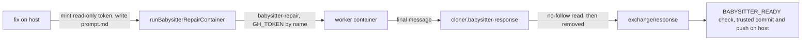

## Summary

`fix()` now runs every fleet PR babysitter repair through the container launcher
(`runBabysitterRepairContainer`) with no host fallback. The host Codex
permissions-profile sandbox, the host Codex installer and `babysitterAgentEnv`
are deleted with their tests. The App key, branch locks, attempt record,
lock-renewal check, `BABYSITTER_READY` check, commit, push, PR-body publication
and review dismissal stay on the host. Setup runs the launcher's runtime and
image preflight instead of installing Codex. Part of #4770: the `./quality.sh`
criterion is not fully met (see below), so this PR does not close it.

## Spec

### Intent and Rationale

- The repair agent must not share the host's credentials or filesystem, so it
  runs in the worker image (#4768) through the launcher (#4767) with egress
  (#4769) and provider choice (#4766) reused, not rebuilt.
- Neutral path helpers the launcher and the Claude review verifier still use moved
  to `worker/deno/lib/fleet_babysitter_paths.ts`, so the host sandbox could go.

### Essential Design Decisions

- Every launcher failure is thrown as a `BabysitterFailure`: a missing runtime or
  image is `capability`, everything else (timeout, egress, non-zero exit) is
  `infrastructure`. This drops the old split where an agent task failure was a
  `code` failure and quota text set a retry-after time; richer retry policy
  stays with #4656 (closed). A non-zero exit names the `./run.sh` rebuild hint.
- The response comes back through the clone (`.babysitter-response`), is read with
  the no-follow reader, is always removed from the clone, and is written to the
  exchange directory, so the later host steps are unchanged.
- Lock-renewal failure now aborts an `AbortSignal` that makes the launcher kill the
  container by name (replacing `child.kill`).
- Beyond the issue, because the agent now has `.git` read-write: every host git
  command runs with `core.hooksPath=/dev/null` and `core.fsmonitor=false`
  (`HOST_GIT_HARDENING_ARGS` in `run()`), and the launcher also drops the plan's
  `credentials/gh` mount, the custom-prompt mounts and `VIBE_CUSTOM_PROMPT_PATHS`.

### Undiscoverable Facts

- The deleted end-to-end CLI test (`production repair forwards CONFIG_PATH …`)
  drove a Codex fixture; it has no container equivalent here.
- A real run needs the worker image built with `babysitter-repair` mode; an older
  image fails with the rebuild hint.

## Evidence

Backend/CLI change; no UI file. Evidence is the tests below and the commands run.

- `git grep -n "fleet_babysitter_sandbox\|fleet_babysitter_codex\|ensureBabysitterCodex\|buildBabysitterSandboxArgs"`
  outside `docs/archive/` and `docs/audits/` prints nothing (run on the head).
- Fakes: the container spawn/plan/image fakes in
  `worker/deno/tests/fixtures/babysitter_container_fakes_4770.ts` stand in for
  `babysitterSpawn`, `buildLaunchPlanForCommand` and `babysitterImageExists`; the
  properties relied on are the argv the launcher builds and the env allowlist. The
  real-plan test in `worker/deno/tests/fleet_babysitter_container_4738_test.ts`
  builds a real plan with `buildLaunchPlanForCommand`.
- Issue numbers cited: #4768: babysitter-repair mode (merged); #4767: container
  launcher; #4769: egress; #4766: provider choice; #4656: durable retries (closed);
  #4771: real container Chromium check (open, not delivered here).
- Residual exposure, stated in `docs/workflows/fleet-pr-babysitter.md` and the C36
  row of `docs/THREAT-MODEL.md`: the container still mounts the worker checkout
  (ro, so a gitignored `.config.json` inside it is readable), the staged config
  copy (ro) and the log directory (rw), and the enabled providers' credential
  directories. The host git hardening covers `run()` only; some post-agent git
  calls go through `runGitCommand` and are not hardened.

## Acceptance Criteria

<!-- vibe-spec-review inputs="diff+issue-body" -->

- **met** — Test: a repair spawns the container runtime with `babysitter-repair`. It never spawns `codex`, any host agent, or `quality.sh` on the host. — evidence: `worker/deno/tests/babysitter_fix_orchestration_test.ts::a repair starts only the container runtime with babysitter-repair, never codex, an agent or quality.sh (Issue #4770)` and `::a successful repair runs no host quality.sh or codex (Issue #4770)` — reviewer: met
- **met** — Test: a missing runtime and a missing image each make `fix()` throw with the cause. No host agent runs and nothing is pushed. — evidence: `worker/deno/tests/babysitter_fix_orchestration_test.ts::a missing container runtime or worker image stops the repair before any spawn, as a capability gap (Issue #4770)` — reviewer: met
- **met** — Test: a non-zero container exit throws and nothing is pushed. — evidence: `worker/deno/tests/babysitter_fix_orchestration_test.ts::a non-zero container exit fails the repair with its code, stderr and the rebuild hint, and pushes nothing (Issue #4770)` — reviewer: met
- **met** — Setup test: setup runs the container preflight and installs no Codex. — evidence: `worker/deno/tests/fleet_pr_babysitter_setup_test.ts::setup runs the container preflight (runtime, then image) and installs no Codex` (the test drives `runContainerPreflight`, which `main()` calls) — reviewer: met
- **met** — `git grep -n "fleet_babysitter_sandbox\|fleet_babysitter_codex\|ensureBabysitterCodex\|buildBabysitterSandboxArgs"` finds no hit outside `docs/archive/` and `docs/audits/`. — evidence: the command above — reviewer: met
- **partial** — Tests show the GitHub App private key, host GitHub credential store, and other host credential paths are absent from the repair container's mounts and environment. Only the existing scoped short-lived agent token and the provider/declared quality credentials allowed by their existing transport contracts cross the boundary. — evidence: `worker/deno/tests/babysitter_fix_orchestration_test.ts::the repair container gets no App key, host credential mount or GitHub App env, only the base env and GH_TOKEN (Issue #4770)` and the real-plan and gh/custom-prompt tests in `worker/deno/tests/fleet_babysitter_container_4738_test.ts` — reviewer: partial — reason: the App key, `credentials/gh` store, custom-prompt dirs and GH/SSH env are shown absent, but the worker checkout, staged config copy and log directory are still mounted and may hold credentials (a gitignored `.config.json`, transcripts); trimming them changes the launcher's plan and is not done here
- **partial** — No repository-controlled quality command is launched on the host, including checks added to `validateAndCommit` or pre-push hooks. Host orchestration retains locks, trusted git/commit/push and PR-body publication. — evidence: `worker/deno/tests/fleet_pr_babysitter_git_hardening_test.ts` (planted pre-commit, pre-push and fsmonitor hooks do not run through `validateAndCommit` and push) and the no-`quality.sh` test above — reviewer: partial — reason: the reviewer found the clone's `.git` is writable by the agent; hooks and fsmonitor are neutralised in `run()`, but git calls made through `runGitCommand` directly (for example in the publication steps) are not hardened, and `core.sshCommand`/filter drivers are not neutralised
- **partial** — `./quality.sh` passes. — evidence: `./quality.sh` on the head with the host proxy variables unset: lint, type check, fmt and all static checks PASSED; the parallel deno test pass ran 33251 passed, 1 failed — reviewer: missing — reason: the single failure, `worker/deno/tests/merge_fallback_issue_test.ts` (`createFallbackFlagFiler - routes the label creation through the caller's gh`), also fails on the base commit 978fe051 in this environment, and the serial test pass did not run because of it; semgrep, checkov and config integration were skipped
- **unrequested** — host git hardening (`HOST_GIT_HARDENING_ARGS`) and its tests — reviewer: unrequested — reason: the container gives the agent `.git` read-write, so the host's trusted commit and push needed hooks neutralised to meet the host-orchestration criterion
- **unrequested** — the launcher drops the `credentials/gh` mount, custom-prompt mounts and `VIBE_CUSTOM_PROMPT_PATHS` — reviewer: unrequested — reason: needed for the credential-store-absent criterion
- **unrequested** — new `AbortSignal` support and the `startLockRenewal` seam — reviewer: unrequested — reason: replaces `child.kill` on lock-renewal failure, which no longer has a child process
- **unrequested** — failure classification now `capability`/`infrastructure` only — reviewer: unrequested — reason: the CODEX stderr classifier was deleted with the host spawn; retry policy beyond this was left alone
- **unrequested** — deleted `docs/audits/lib-sweep-coverage/top-up-4593.json` and `top-up-4664.json`, added `top-up-4770.json`, deleted `tests/fixtures/fleet_babysitter_repair_preload.ts` — reviewer: unrequested — reason: the sweep-coverage gate treats a ledger path with no file as stale; the fixture served only the deleted Codex CLI test

## Standards Review

<!-- vibe-standards-review inputs="diff+CODING-STANDARDS.md" -->

- **violation** — docs and a code comment said the repair container sees only the clone and scratch directory — evidence: `docs/workflows/fleet-pr-babysitter.md:149` — reason: fixed in this diff
- **violation** — docs still described retry-after delay and code failures spending the substantive budget — evidence: `docs/workflows/fleet-pr-babysitter.md:473` — reason: fixed in this diff
- **violation** — stale "Codex" doc comments on the response file and agent boundary — evidence: `worker/deno/commands/fleet_pr_babysitter.ts:1827` — reason: fixed in this diff
- **violation** — heading stuck onto the end of a paragraph — evidence: `docs/workflows/fleet-pr-babysitter.md:337` — reason: fixed in this diff
- **violation** — the failed-marker-write guard test lost its reach after the stub change — evidence: `worker/deno/tests/babysitter_fix_orchestration_test.ts:688` — reason: fixed in this diff (restored with a code-class stub failure, red-checked)
- **violation** — journalling test duplicated the infrastructure test — evidence: `worker/deno/tests/babysitter_fix_orchestration_test.ts:1488` — reason: fixed in this diff
- **violation** — messages asserted only text the stub writes — evidence: `worker/deno/tests/babysitter_fix_orchestration_test.ts:436` — reason: fixed in this diff (production text is asserted through the real `startBabysitterAgent` test; dead fixtures removed)
- **violation** — end-to-end CLI test deleted without a replacement — evidence: `worker/deno/tests/fleet_babysitter_app_test.ts:1` — reason: required by #4770 (the Codex fixture it drove is deleted); the pieces that persist are covered by `fleet_pr_babysitter_test.ts` and `fleet_babysitter_exchange_test.ts`
- **violation** — `signal: options.signal` had no test — evidence: `worker/deno/commands/fleet_pr_babysitter.ts:2019` — reason: fixed in this diff (lock-renewal test through the real `startBabysitterAgent`, red-checked)
- **violation** — `refuseIfAborted` in `runRepairProcess` and the `-e` and bare-name custom-prompt operands had no test — evidence: `worker/deno/lib/fleet_babysitter_container.ts:948` — reason: fixed in this diff (tests added, red-checked)
- **violation** — `preflightBabysitterContainer` returned a plan only a test read — evidence: `worker/deno/lib/fleet_babysitter_container.ts:1045` — reason: fixed in this diff (returns `void`)
- **clean** — the call to `runContainerPreflight` inside `main()` in `worker/deno/commands/fleet_pr_babysitter_setup.ts` is not driven by a test (`main()` is not exported and reads stdin and the real HOME); the harness search `git grep -l fleet_pr_babysitter_setup worker/deno/tests` finds only `fleet_pr_babysitter_setup_test.ts`, whose tests drive the exported `runContainerPreflight`. Recorded here as exempt (untestable), not as a breach
- **clean** — Australian English; no hidden paths staged; the moved path helpers keep their tests in `worker/deno/tests/fleet_babysitter_paths_test.ts`; secrets are redacted before the launcher's error is rethrown; the response file is always removed from the clone; no named test is absent

## Test Plan

- Added: `worker/deno/tests/fleet_babysitter_paths_test.ts` (18 cases moved from the deleted sandbox test),
  `worker/deno/tests/fleet_pr_babysitter_git_hardening_test.ts`,
  `worker/deno/tests/fixtures/babysitter_container_fakes_4770.ts`, new cases in
  `worker/deno/tests/babysitter_fix_orchestration_test.ts`,
  `worker/deno/tests/fleet_babysitter_container_4738_test.ts`,
  `worker/deno/tests/fleet_babysitter_container_egress_4738_test.ts` and
  `worker/deno/tests/fleet_pr_babysitter_setup_test.ts`.
- Removed from `worker/deno/tests/fleet_babysitter_sandbox_test.ts` (file deleted): 9 cases for
  `buildBabysitterSandboxArgs` and the Codex floor.
  Removed functionality: `buildBabysitterSandboxArgs`, `codexVersionMeetsFloor`; their only callers were the host Codex spawn.
  The 18 cases for the moved path helpers moved to `worker/deno/tests/fleet_babysitter_paths_test.ts`.
- Removed from `worker/deno/tests/fleet_babysitter_codex_test.ts` (file deleted): all 6 cases.
  Removed functionality: `ensureBabysitterCodex`; setup no longer installs Codex.
- Removed from `worker/deno/tests/fleet_pr_babysitter_test.ts`: the five `spawnBabysitterAgent` tests.
  Removed functionality: `spawnBabysitterAgent`; response-file hardening is still covered by the
  kept `readAgentResponse` tests and the new symlink-response orchestration tests.
- Removed from `worker/deno/tests/fleet_babysitter_app_test.ts`: the three `babysitterAgentEnv` tests and the
  CLI test `production repair forwards CONFIG_PATH …`. Removed functionality: `babysitterAgentEnv`
  and the Codex fixture; the container's env allowlist is asserted in the orchestration env test.
- Removed from `worker/deno/tests/babysitter_fix_orchestration_test.ts`: the two stderr tests.
  Removed functionality: `forwardAgentStderr` and the Codex stderr scratch file.
- Edited expectations: `exited with code 1` replaces `agent exited unsuccessfully`; the
  non-zero-exit blocker class moves from `code` to `infrastructure`. Red check: the new
  `non-zero container exit fails the repair …` test goes red if the launcher failure is swallowed;
  the restored marker-write test goes red if the marker failure replaces the error.
- Red checks run (break, red, restore): skip the runtime check; skip the image check; abort does not
  kill; failed abort-kill not logged; abort listener not removed; already-aborted refusal removed;
  rebuild hint removed; stderr cause dropped; gh mount drop removed; custom-prompt mount and env
  drops removed (each spelling); hook-hardening flags emptied (the planted pre-commit, pre-push and
  fsmonitor markers appear); `signal: options.signal` dropped; Apple-egress abort check dropped.
- Callers and siblings checked for the new `startBabysitterAgent` contract: `fix()` (the only production
  caller), `babysitter_fix_orchestration_test.ts` and `fleet_babysitter_app_test.ts`.
- Twinned rules: the runtime/image refusal is one shared helper (`checkRuntimeAndImage`) for the repair and
  the preflight; no other copy found.
- Results on the head: container 4738 and egress tests `ok | 64 passed`; the eight touched babysitter test files
  `ok | 265 passed`; orchestration `ok | 58 passed`. `./quality.sh` (proxy variables unset): static checks,
  lint, type check and fmt PASSED; the parallel deno test pass `33251 passed | 1 failed`, the failure being
  `merge_fallback_issue_test.ts`, which also fails on base commit 978fe051 here. The serial pass did not run.
- Docs: read `docs/workflows/fleet-pr-babysitter.md` and the C36 row; updated
  `docs/workflows/fleet-pr-babysitter.md`, `docs/workflows/fleet-pr-babysitter-github-app.md`,
  `docs/THREAT-MODEL.md`, `docs/CONFIGURATION.md` and `DESIGN-PRINCIPLES.md`. markdownlint, check-mermaid and
  `threat_model_docs_test.ts` pass.
