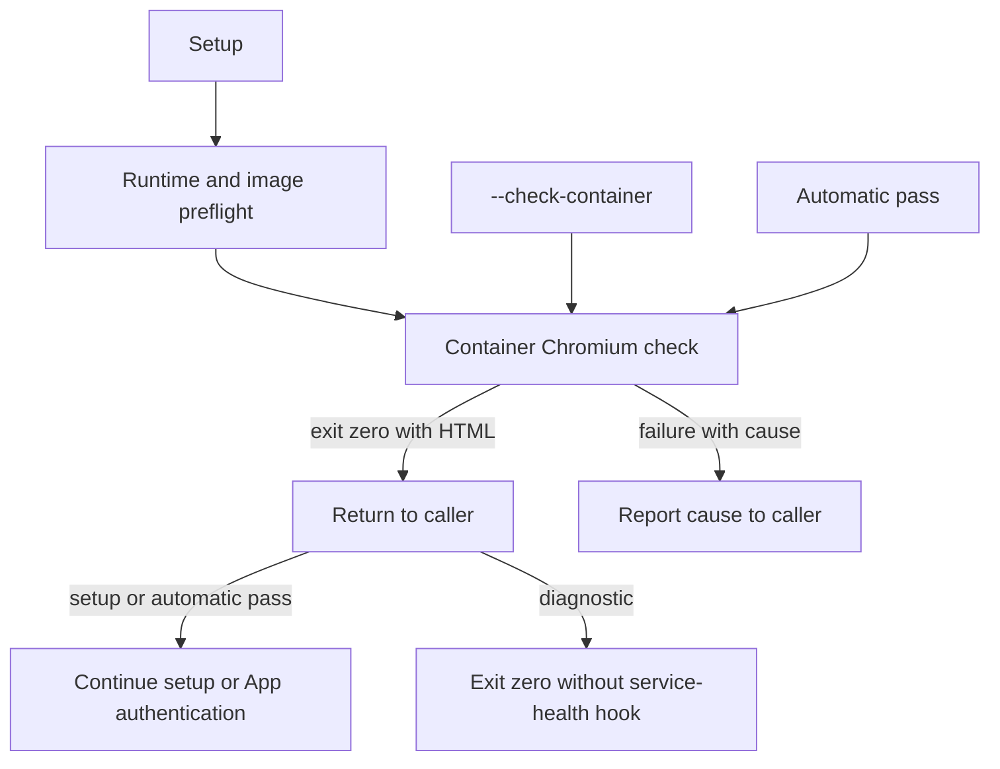

## Summary

Added a bounded headless Chromium launch check using the babysitter container
plan and egress controls. Setup runs it after preflight, the CLI exposes
`--check-container`, and automatic passes run it before PR discovery or App
authentication. HTML validation searches complete stdout; diagnostic output
remains bounded and failure causes keep the tail of the redacted output, so a
trailing cause survives startup noise. Diagnostic runs never publish
service-health heartbeats.

Closes #4771.

To satisfy the explicit quality-gate criterion, generated pre-push hooks now use
their trusted worker configuration and frozen lock. Nested hook/posting fixtures
share the resolved dependency cache while isolating HOME and settings; the
credential fixture supplies explicit proxy inputs. These changes repair the nine
failures reproduced by the first full gate without removing assertions, skipping
tests or weakening checks. `VERSION` is unchanged.

## Spec

### Intent and Rationale

- Prove the image's baked Chromium command launches before browser support is
  used, and surface runtime, image, timeout, exit and output causes.
- Reuse the existing runtime/image checks, launch plan and egress helpers.
- Keep diagnostics separate from service health: checking a browser does not
  prove that an authenticated babysitter pass succeeded.

### Essential Design Decisions

- Override the image entrypoint with `bash`; the image's normal entrypoint
  routes arguments to Deno. Use the image's `--no-sandbox` Chromium flag.
- Remove host mounts and non-egress environment values, retain egress controls,
  enforce a 60-second default deadline and kill the named container on timeout.
- Accept only exit zero with `<html` anywhere in stdout. Redact diagnostic
  text and keep its tail separately (headless Chromium prints D-Bus startup
  noise before the fatal line), including failed container-cleanup causes.
- Resolve the pre-push hook's configuration and frozen lock beside its trusted
  worker module, independently of the target checkout's configuration.

### Undiscoverable Facts

- The first gate reproduced three nested pre-push JSR-resolution failures, five
  posting-fixture JSR-resolution failures and one ambient-proxy assertion
  failure. The `osascript` message was informational; PowerShell is installed.
- The final `./quality.sh < /dev/null` exited zero: 21 checks passed and two
  optional checks were skipped. Both parallel and serial test passes succeeded.
- Real Docker/Podman image execution remains unavailable on this host. Earlier
  host Chromium execution returned HTML with the selected flags; that is not
  evidence of a real image launch. Runtime/image fixtures test the container
  invocation and the failure boundaries.
- Independent Spec and Standards reviewers received separate inputs: the diff
  plus issue body, and the diff plus `CODING-STANDARDS.md`, respectively.

## Evidence



- Backend/CLI change; executable tests provide the evidence. No visual surface
  changed.
- `Chromium check accepts HTML beyond the diagnostic cap` reproduced the
  truncated-output defect before the full-stdout guard was fixed.
- `Chromium check keeps the trailing cause after startup noise` reproduced the
  head-truncated cause defect — a non-zero exit with more than 500 characters
  of D-Bus noise before a FATAL line reported only the noise and dropped the
  cause — then passed once the code kept the tail. Obsolete behaviour: the
  first 500 characters were kept, so the trailing cause was lost. Remaining
  behaviour: the last 500 characters are kept, so the fatal line survives.
  Covering path:
  `worker/deno/tests/fleet_babysitter_chromium_check_4738_test.ts::Chromium check keeps the trailing cause after startup noise`.
- `successful and failed container diagnostics suppress service health`
  reproduced the heartbeat defect, then passed for successful HTML and failed
  browser launches. Its successful path has no App configuration; deleting the
  diagnostic branch, probe or early exit makes it fail.
- The independent Chromium command expectation fails when the implementation
  launches `printf` instead of Chromium. Watch coverage checks two browser
  probes and exactly one App-identity announcement.
- Read the babysitter setup/run manual and pre-push-hook manual. Updated
  `docs/workflows/fleet-pr-babysitter.md`, `DESIGN-PRINCIPLES.md` and
  `docs/CONFIGURATION.md` to describe the final behaviour.
- #4738: Fleet PR babysitter repairs run in the worker container, like reviewer
  rounds.
- #4770: Switch babysitter repairs to the worker container and delete the host
  Codex sandbox and installer.

## Acceptance Criteria

<!-- vibe-spec-review inputs="diff+issue-body" -->

- **met** — Test: the check's command line runs the container image with the
  Chromium command, and no host browser is spawned. — evidence:
  `worker/deno/tests/fleet_babysitter_chromium_check_4738_test.ts::Chromium check runs the image command with no host mounts or browser`
  — reviewer: met
- **met** — Test: exit 0 with `<html` in the output passes. A non-zero exit,
  empty output, a missing runtime and a missing image each fail with the cause.
  — evidence:
  `worker/deno/tests/fleet_babysitter_chromium_check_4738_test.ts::Chromium check passes only on exit zero with HTML stdout`,
  `::Chromium check keeps the trailing cause after startup noise`,
  `::Chromium check accepts HTML beyond the diagnostic cap` and
  `::Chromium check names missing runtime and image causes before egress` —
  reviewer: met
- **met** — Test: setup fails when the check fails. — evidence:
  `worker/deno/tests/fleet_babysitter_chromium_check_4738_test.ts::setup runs the Chromium check after preflight and propagates failure`
  — reviewer: met
- **met** — `./quality.sh` passes. — evidence: captured final gate output in
  Test Plan records exit zero, both test passes and all required checks passing
  — reviewer: met

## Standards Review

<!-- vibe-standards-review inputs="diff+CODING-STANDARDS.md" -->

- **violation** — Hermetic test environments, independently expected commands,
  changed-line regression coverage and failure-cause diagnostics. — evidence:
  `worker/deno/tests/fleet_babysitter_chromium_check_4738_test.ts` and
  `worker/deno/lib/fleet_babysitter_container.ts` — reason: fixed in this diff;
  the independent reviewer confirmed all earlier code/test findings resolved.
- **violation** — Use standard path helpers and protect frozen-lock behaviour. —
  evidence: `worker/deno/lib/pre_push_hook.ts` and
  `worker/deno/tests/pre_push_hook_test.ts` — reason: fixed in this diff with
  `dirname` and a real Deno lock-precedence/refusal fixture.
- **clean** — The final independent Standards review found no remaining code,
  test or summary violations. It checked assertion preservation, meaningful
  boundary tests, subprocess isolation, bounded causes, deadline and
  environment/mount coverage, shared helpers, Deno TypeScript, documentation,
  dependencies and persisted formats. No dependency or persisted-format change
  was introduced.

## Test Plan

The two Deno task commands below run from `worker/deno`; the quality command
runs from the repository root. Suite paths from the repository root are:

- Babysitter: `worker/deno/tests/fleet_babysitter_app_test.ts`,
  `worker/deno/tests/fleet_babysitter_chromium_check_4738_test.ts`,
  `worker/deno/tests/fleet_pr_babysitter_supervisor_test.ts`,
  `worker/deno/tests/fleet_pr_babysitter_setup_test.ts`,
  `worker/deno/tests/fleet_babysitter_container_4738_test.ts` and
  `worker/deno/tests/fleet_babysitter_container_egress_4738_test.ts`.
- Quality regressions: `worker/deno/tests/claude_runner_pre_push_3394_test.ts`,
  `worker/deno/tests/pre_push_hook_test.ts`,
  `worker/deno/tests/merge_fast_checks_credentials_4705_test.ts` and
  `worker/deno/tests/review_fleet_prs_post_claim_4398_test.ts`.

Executed commands:

- `deno task test:unit tests/fleet_babysitter_app_test.ts tests/fleet_babysitter_chromium_check_4738_test.ts tests/fleet_pr_babysitter_supervisor_test.ts tests/fleet_pr_babysitter_setup_test.ts tests/fleet_babysitter_container_4738_test.ts tests/fleet_babysitter_container_egress_4738_test.ts < /dev/null`
  — 111 passed, zero failed.
- `deno task test:unit tests/claude_runner_pre_push_3394_test.ts tests/pre_push_hook_test.ts tests/merge_fast_checks_credentials_4705_test.ts tests/review_fleet_prs_post_claim_4398_test.ts < /dev/null`
  — 25 passed, zero failed.
- `./quality.sh < /dev/null` — exit zero; parallel tests passed in 4m03s, serial
  tests passed in 3m01s; lint, type checking, formatting, manifests, Markdown,
  Mermaid, Semgrep and other required checks passed. Config integration lacked
  local configuration; Checkov lacked its binary/runtime. The normal gate
  reported `Result: PASSED (with skipped checks)`.
- `deno task pr-summary-check --base main --issue-body-file /tmp/issue-4771-body.md --labels enhancement,top-priority,work-on ../../docs/archive/pr-summaries/pr-summary-4771.md < /dev/null`
  — zero blocked gates and zero unchecked gates.
- All nine surviving listed mutations are now killed: diagnostic early exit;
  initial identity state, identity condition, announcement and recorded state;
  setup's real check wrapper; the final-image guard; short volume and mount
  stripping. The tenth listed mutation removed a redundant empty-length operand:
  that operand is now deleted, and both empty and wrong-image plans are rejected
  by the tested image guard. No untestable exemption is claimed.
- Twenty applied Chromium/diagnostic/guard mutations failed their intended
  tests, including replacement with `printf`, whole diagnostic-branch removal,
  truncated HTML validation, heartbeat reporting, deadline removal/override,
  private environment stripping, inline mounts and spawn-error redaction. This
  is targeted mutation evidence, not a claim that every possible mutant was
  tested. All temporary mutations were restored.
- Disposable hook red checks failed when `--frozen`, the explicit `--lock`,
  either missing-config/lock guard or the whole fix was removed. Omitting
  explicit `--config` is equivalent here: Deno discovers the same trusted
  configuration beside the absolute worker entrypoint.
- Existing assertions preserved or strengthened: Chromium's shared-constant
  expectation is now an independent literal; setup coverage invokes the real
  wrapper; cleanup's exit-code assertion now also requires its cause. Setup's
  existing `gh version` expectation moved after the required Chromium check,
  while retaining the git/rtk, preflight and no-Codex assertions. The credential
  fixture retains exact argv, stdin-only credentials and allowlisted-env checks
  with deterministic proxy inputs. Posting checks retain all their assertions.
- No twinned production rule needed a separate edit: runtime/image and egress
  validation remain shared; the supervisor's existing partial/dry-run health
  exclusion now also covers diagnostics, with success and failure tests.

Captured stdout from the final `./quality.sh < /dev/null` run (process exit
status: 0):

```text
Deno tests [parallel]: PASSED in 4m03s — every unit test except 39 that race or measure under --parallel (#880, #940) and 42 integration suites (#907)
Deno tests [serial]: PASSED in 3m01s — 39 tests that mutate shared process state or assert on a real clock, run one at a time
=== Quality Check Summary ===

  benchmark audit                PASSED
  hardcoded branch names         PASSED
  needs-human chokepoint         PASSED
  gh spawn chokepoint            PASSED
  git spawn chokepoint           PASSED
  spawn timeout                  PASSED
  redact before truncate         PASSED
  host work-dir guard            PASSED
  git ref chokepoint             PASSED
  tmp state dir chokepoint       PASSED
  workflow hygiene               PASSED
  completeness checks            PASSED
  config integration             SKIPPED
  source targets                 PASSED
  mermaid                        PASSED
  markdownlint                   PASSED
  semgrep                        PASSED
  checkov                        SKIPPED
  release-tag ruleset            PASSED
  deno tests                     PASSED
  deno lint                      PASSED
  deno type check                PASSED
  deno fmt                       PASSED

Result: PASSED (with skipped checks)
```
