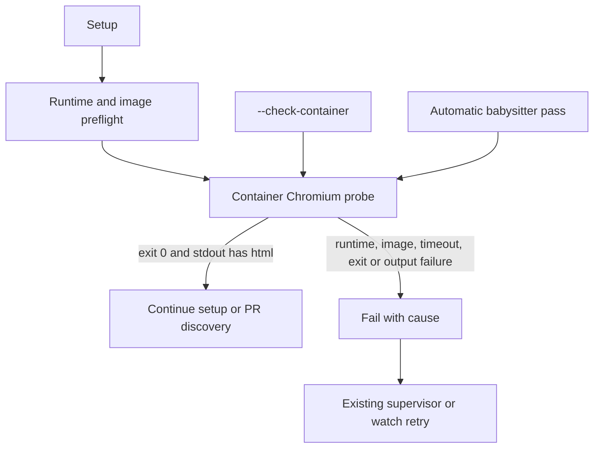

## Summary

Added a bounded headless Chromium launch check using the babysitter container
plan and egress controls. Setup runs it after preflight, the CLI exposes
`--check-container`, and automatic passes run it before PR discovery or App
authentication. The check fails with runtime, image, timeout, exit or output
causes. `./quality.sh` remains red on this host because unrelated tests require
unavailable network/tooling. Part of #4771.

Version bump: none; `VERSION` is unchanged for this change.

## Spec

### Intent and Rationale

- Prove the image's baked Chromium executable launches before the babysitter
  relies on browser support.
- Reuse the existing launch plan, runtime/image validation and egress helpers
  so the probe follows the repair container's configured authority.

### Essential Design Decisions

- Override the image entrypoint with `bash`, because `container/entrypoint.sh`
  routes normal arguments to Deno.
- Keep the probe free of host mounts and non-egress environment values, bound it
  to 60 seconds, and kill its named container on timeout.
- Accept success only when exit code is zero and stdout contains `<html`.
- The Containerfile's baked-browser launch uses `--no-sandbox`; the probe uses
  that same Chromium flag.

### Undiscoverable Facts

- The host Chromium command produced `<html><head></head><body></body></html>`.
  This verifies the flags against the host binary, not the container image.
- The real container probe could not run: Docker and Podman were both absent
  from `PATH`. The command failed with `ContainerRuntimeUnavailableError` and
  names both missing runtimes.
- Independent spec and standards reviews were not run because this task
  prohibited delegation; no reviewer verdict is claimed.

## Evidence

- Backend/CLI change; tests and command output provide the evidence. No visual
  surface changed.
- `container/Containerfile` runs Playwright Chromium with `args: ['--no-sandbox']`
  during image build. The host command
  `timeout 30 "$CHROMIUM_PATH" --headless --no-sandbox --dump-dom about:blank`
  exited zero and printed HTML.
- `deno run --allow-all worker/deno/commands/fleet_pr_babysitter.ts --check-container`
  exited 1 with `No supported container runtime is available on linux`; its
  diagnostic lists Docker and Podman as not found on `PATH`.
- `#4770`: Switch babysitter repairs to the worker container and delete the host
  Codex sandbox and installer.
- `#4738`: Fleet PR babysitter repairs run in the worker container, like
  reviewer rounds.

## Acceptance Criteria

- **met** — Test: the check's command line runs the container image with the
  Chromium command, and no host browser is spawned. — evidence:
  `worker/deno/tests/fleet_babysitter_chromium_check_4738_test.ts::Chromium check runs the image command with no host mounts or browser`
- **met** — Test: exit 0 with `<html` in the output passes. A non-zero exit,
  empty output, a missing runtime and a missing image each fail with the cause.
  — evidence:
  `worker/deno/tests/fleet_babysitter_chromium_check_4738_test.ts::Chromium check passes only on exit zero with HTML stdout`
  and `::Chromium check names missing runtime and image causes before egress`
- **met** — Test: setup fails when the check fails. — evidence:
  `worker/deno/tests/fleet_babysitter_chromium_check_4738_test.ts::setup runs the Chromium check after preflight and propagates failure`
- **missing** — `./quality.sh` passes. — reason: the final gate's Deno test
  phase failed 10 tests unrelated to this change: three nested pre-push tests
  could not fetch JSR metadata, one test expected proxy variables absent from
  this host, one requires PowerShell 7, and five posting-safety cases require
  macOS `osascript`. The changed babysitter app test passed after its runtime
  fixture was updated for the new probe.

## Standards Review

Independent standards review was not run because delegation was explicitly
prohibited for this task. Manual checks covered Australian English, scoped
changes, secret-safe staging, bounded diagnostics, egress teardown and Deno
native tooling.

## Test Plan

- `deno task test:unit tests/fleet_babysitter_app_test.ts tests/fleet_babysitter_chromium_check_4738_test.ts tests/fleet_pr_babysitter_setup_test.ts tests/fleet_babysitter_container_4738_test.ts tests/fleet_babysitter_container_egress_4738_test.ts < /dev/null` — passed: 100 tests, 0 failed.
- `deno fmt --check`, `deno lint` and `deno check --frozen --lock=deno.lock` on the seven changed TypeScript files — all passed.
- `timeout 900 ./quality.sh < /dev/null` — failed: all non-test checks passed except config integration and Checkov, which were skipped; the parallel Deno suite reported 33,477 passed, 10 failed and 10 ignored. The failures are listed under Acceptance Criteria.
- Host Chromium flags — `--headless --no-sandbox --dump-dom about:blank` returned HTML with exit zero; the real image launch remains unverified because no container runtime is installed.
- Runtime/image failure tests went red when their corresponding validation was removed. The exit-code and HTML-output test went red when either result guard was removed. Timeout cleanup and egress tests went red when container kill or teardown handling was removed; the cleanup-error test went red when its failure check was removed.
- Setup failure propagation went red when the setup call was removed. The `run.sh` test went red when either `--check-container` forwarding or the automatic-pass probe was removed; both paths fail before App configuration or authentication.
- Existing assertion changed in `worker/deno/tests/fleet_pr_babysitter_setup_test.ts`: `assertEquals(calls[3], "gh version");`
  - Required by: "run it from `worker/deno/commands/fleet_pr_babysitter_setup.ts` after the preflight."
  - Replaced by: `assertEquals(calls[3], "chromium check");` and `assertEquals(calls[4], "gh version");`
- Changed entry points checked: setup `main`, the CLI `--check-container` path, the automatic babysitter pass, and `fleet-pr-babysitter/run.sh` forwarding.
- Deno regression avoided: used Deno tasks, lint, formatter and type checker; no Node tooling or dependency was added.
- Test files named above exist at the repository root. The full gate also skipped config integration because its required configuration was unavailable and Checkov because no supported Checkov installation was present.
