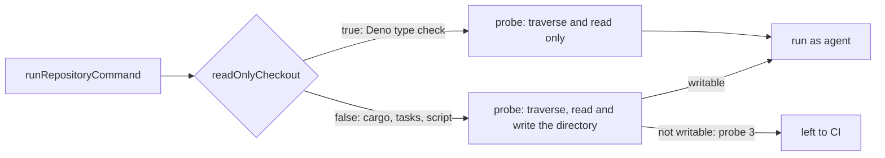

## Summary

The untrusted gate probe required the `agent` account to be able to write the
directory a command runs in (`test -w "$1" || exit 3`, "probe 3"). Directories
git creates inside a clone are group read-only, so every Deno project in a
sub-directory (for example `worker/deno/deno.json`) was left to CI, and a tree
whose only projects live in sub-directories came back `skipped` and was refused
as unverified. `runRepositoryCommand` now takes `readOnlyCheckout`; when true
the probe does not require the directory to be writable. `spawnTypeCheck` sets
it for Deno projects, which cache in `DENO_DIR` and not in the project.
Everything else keeps the requirement. Closes #4782.

Version bump: `VERSION` is not touched by this change; the merged commit records
the final version.

## Spec

### Intent and Rationale

- This takes the issue's first suggested fix ("require write only where the
  command really writes"). The second (granting group write on project
  directories) would widen what the untrusted account can modify in a tree it
  runs code from.
- Verified on this host (Deno 2.9.8): `deno check` and `deno task check` exit 0
  in a `0555` project directory holding `deno.json` and no lockfile.

### Essential Design Decisions

- The option is opt-in and defaults to the old behaviour, so a caller that does
  not know its command is read-only fails closed to CI as before.
- Cargo keeps the requirement (it writes `Cargo.lock`), which an existing test
  pins (`a nested read-only agent checkout without Cargo.lock is left to CI`).
  `spawnTask` (resolution tasks and `quality.sh`) is not changed: those commands
  may write into the project.
- `spawnTypeCheck` sets the option for every Deno project, which includes a
  repository-defined `deno task check`. A task that writes into its own
  directory now fails as a check instead of being left to CI; the issue states
  such tasks write to `DENO_DIR`, not the project.

### Undiscoverable Facts

- The `agent` account dropped to in the real-sudo test is reachable on this
  host; the test is skipped where it is not.

## Evidence

Backend change; no UI file is touched. The real-sudo test
`a worker-owned sub-directory Deno project at 0755 is not left to CI for a read-only check (Issue #4782)`
in `worker/deno/tests/untrusted_gate_spawn_test.ts` ran against the real `agent`
account: with `readOnlyCheckout` the command ran (exit 0); without it the same
directory was refused with `probe 3`.

## Test Plan

- Added to `worker/deno/tests/untrusted_gate_spawn_test.ts`: a unit test of the
  probe text (no `test -w` / `exit 3` with the option, present without it, cargo
  keeps its `exit 2` target tail); a real-`sh` probe test (a `0555` Deno project
  gives probe exit 0 with the option, 3 without); the real-sudo end-to-end test
  above.
- Added to `worker/deno/tests/milestone_merge_gate_test.ts`: `spawnTypeCheck`
  passes `readOnlyCheckout: true` for a Deno project and false for a cargo
  project.
- Red checks: making `runRepositoryCommand` always require write turned the
  three untrusted_gate_spawn tests red; making `spawnTypeCheck` stop passing the
  option turned the merge-gate test red. Both restored.
- Existing tests are unchanged, none edited; callers of `runRepositoryCommand`
  checked: `spawnTypeCheck` (passes it for Deno) and `spawnTask` (not passed,
  keeps the requirement).
- Passed: `deno task test:unit` over `tests/untrusted_gate_spawn_test.ts`,
  `tests/milestone_merge_gate_test.ts`,
  `tests/milestone_resolution_gate_test.ts` (77 passed, 0 failed in parallel; 55
  passed serially).
- `./quality.sh`: every stage passed except `deno tests`, whose only failures
  are the two Rust-formatter cases in
  `tests/completion_phase_repo_formatters_test.ts` (lines 480 and 567, files
  this change does not touch; not compared against `main`), and `markdownlint`,
  which flagged a wrapped `#4659` in `docs/CONFIGURATION.md`; that was
  re-wrapped and the pre-push markdownlint check then passed.
- Docs updated: `docs/CONFIGURATION.md` (the `agent` account checkout
  paragraph).

## Not done

- A Deno project that needs a lockfile written (a remote import with no
  `deno.lock`) was not exercised in a read-only directory: no network here.
- No fleet host was re-run.
