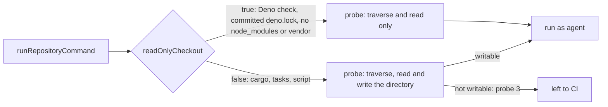

## Summary

The untrusted gate probe required the `agent` account to be able to write the
directory a command runs in (`test -w "$1" || exit 3`, "probe 3"). Directories
git creates inside a clone are group read-only, so every Deno project in a
sub-directory (for example `worker/deno/deno.json`) was left to CI, and a tree
whose only projects live in sub-directories came back `skipped` and was refused
as unverified. `runRepositoryCommand` now takes `readOnlyCheckout`; when true
the probe does not require the directory to be writable. `spawnTypeCheck` sets
it for a Deno project that can attempt a read-only check: one with a
committed `deno.lock`, no `package.json`, and no `nodeModulesDir` other than
`none`/`manual` and no enabled `vendor` (`denoCheckLeavesDirUntouched`). A
Deno project without a lockfile or that may write `node_modules` or `vendor`,
and everything else, keeps the requirement. A stale lockfile can still need an
update; a permission refusal writing it leaves the check to CI.
Closes #4782.

Version bump: `VERSION` is not touched by this change; the merged commit records
the final version.

## Spec

### Intent and Rationale

- This takes the issue's first suggested fix ("require write only where the
  command really writes"). The second (granting group write on project
  directories) would widen what the untrusted account can modify in a tree it
  runs code from.
- Verified on this host (Deno 2.9.8): `deno check` and `deno task check` exit 0
  in a `0555` project directory holding `deno.json` and no lockfile.

### Essential Design Decisions

- The option is opt-in and defaults to the old behaviour, so a caller that does
  not know its command is read-only fails closed to CI as before.
- Cargo keeps the requirement (it writes `Cargo.lock`), which an existing test
  pins (`a nested read-only agent checkout without Cargo.lock is left to CI`).
  `spawnTask` (resolution tasks and `quality.sh`) is not changed: those commands
  may write into the project.
- `spawnTypeCheck` sets the option only when `denoCheckLeavesDirUntouched` says
  so. Deno writes `deno.lock` when it must create or update one (reproduced by
  the pre-PR verifier: exit 1, `Failed writing lockfile ... Permission denied`
  in a `0555` directory with an npm import and no lockfile) and writes
  `node_modules` for `nodeModulesDir: auto` or beside a `package.json`. A
  project without a committed `deno.lock`, with a `package.json`, with such a
  `nodeModulesDir`, enabled `vendor`, or with a manifest that cannot be parsed
  keeps the write requirement and is left to CI, as before this change. Deno resolving a
  lockfile from a parent workspace root is not recognised, so such a member is
  conservatively left to CI.

### Undiscoverable Facts

- The `agent` account dropped to in the real-sudo test is reachable on this
  host; the test is skipped where it is not.

## Evidence

Backend change; no UI file is touched. The real-sudo test
`a worker-owned sub-directory Deno project at 0755 is not left to CI for a read-only check (Issue #4782)`
in `worker/deno/tests/untrusted_gate_spawn_test.ts` ran against the real `agent`
account: with `readOnlyCheckout` the command ran (exit 0); without it the same
directory was refused with `probe 3`.

## Test Plan

- Added to `worker/deno/tests/untrusted_gate_spawn_test.ts`: a unit test of the
  probe text (no `test -w` / `exit 3` with the option, present without it, cargo
  keeps its `exit 2` target tail); a real-`sh` probe test (a `0555` Deno project
  gives probe exit 0 with the option, 3 without); the real-sudo end-to-end test
  above.
- Added to `worker/deno/tests/milestone_merge_gate_test.ts`: `spawnTypeCheck`
  passes `readOnlyCheckout: true` for a Deno project with a committed
  `deno.lock`, and false for: no lockfile (the verifier's finding),
  `nodeModulesDir: "auto"`, enabled `vendor`, a `package.json`, an unparseable
  manifest, and a cargo project.
- Review fix: treating a vendoring project as read-only is obsolete because Deno
  may write `vendor/`. Such projects retain the write probe and are left to CI
  when unwritable; other eligible Deno projects remain read-only. Coverage:
  `worker/deno/tests/milestone_merge_gate_test.ts::spawnTypeCheck - a Deno check is read-only only when it writes nothing into its directory, a cargo check keeps the write requirement (Issue #4782)`.
  A direct `spawnTypeCheck` exercise passed for enabled and disabled vendoring;
  this sandbox denies the test fixture's `/tmp` directory creation.
- Review fix: treating a stale lockfile write refusal as a failed merge is
  obsolete. A refusal for the project's lockfile on the read-only path is left
  to CI; unrelated errors still fail. Coverage:
  `worker/deno/tests/milestone_merge_gate_test.ts::spawnTypeCheck - a read-only lockfile write refusal is left to CI`.
  The test also checks the merged-tree outcome and unrelated failures.
- Review fix: the lockfile-refusal fixture no longer writes inside the source
  checkout, which the dropped agent may not write. The same refusal, skipped
  outcome and unrelated-error assertions remain covered by
  `worker/deno/tests/milestone_merge_gate_test.ts::spawnTypeCheck - a read-only lockfile write refusal is left to CI`.
  The `untrusted_gate_spawn.ts` comments now describe the caller handling a
  possible lockfile write refusal.
- Red check for the verifier fix: forcing `readOnlyCheckout` true for every Deno
  project turned the `spawnTypeCheck` test red; restored.
- Red checks: making `runRepositoryCommand` always require write turned the
  three untrusted_gate_spawn tests red; making `spawnTypeCheck` stop passing the
  option turned the merge-gate test red. Both restored.
- Callers of `runRepositoryCommand`
  checked: `spawnTypeCheck` (passes it for Deno) and `spawnTask` (not passed,
  keeps the requirement).
- Mutation check: its report said the baseline tests failed before any mutation
  (a list of 20 test files). They pass at the head here: `deno test -A` over
  `tests/untrusted_gate_spawn_test.ts` and `tests/milestone_merge_gate_test.ts`
  (92 passed, 0 failed) and `deno task test:unit` over
  `tests/project_manifests_4413_test.ts`, `tests/heavy_build_gate_3178_test.ts`,
  `tests/milestone_sync_gate_repair_test.ts` (58 passed). The failure did not
  reproduce, so it is an environment fault of the mutation run, not a surviving
  mutant; no mutant was judged.
- Passed: `deno task test:unit` over `tests/untrusted_gate_spawn_test.ts`,
  `tests/milestone_merge_gate_test.ts`,
  `tests/milestone_resolution_gate_test.ts` (77 passed, 0 failed in parallel; 55
  passed serially).
- `./quality.sh`: every stage passed except `deno tests`, whose only failures
  are the two Rust-formatter cases in
  `tests/completion_phase_repo_formatters_test.ts` (lines 480 and 567, files
  this change does not touch; not compared against `main`), and `markdownlint`,
  which flagged a wrapped `#4659` in `docs/CONFIGURATION.md`; that was
  re-wrapped and the pre-push markdownlint check then passed.
- Docs updated: `docs/CONFIGURATION.md` (the `agent` account checkout
  paragraph).

## Not done

- The no-lockfile case is pinned at the option boundary (`spawnTypeCheck` passes
  `false`) and the probe text/real-`sh` tests cover that `false` keeps
  `test -w`; no remote-import Deno run was made here (no network).
- No fleet host was re-run.
