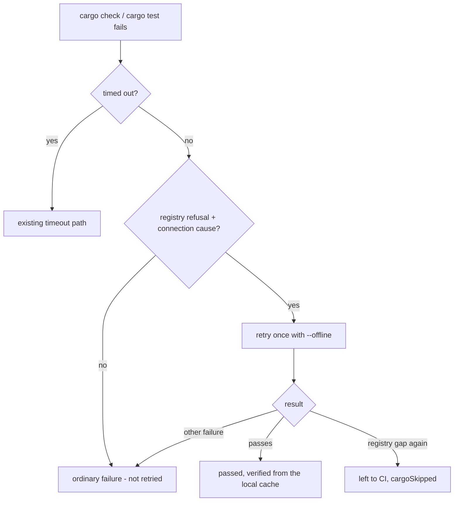

## Summary

The milestone-sync verification gate refused a resolution because the host could
not reach the crates registry: `cargo check --workspace --all-targets --locked`
exited 101 with `unable to update registry` and
`Could not resolve host:
index.crates.io` (the second report on this issue; the
first, a cargo timeout, was handled by the earlier #4786 change). No resolution
change can answer that, yet the gate reported `failed`, so the refusal repeated
every cycle.

A cargo check (`checkMergedTree`) or cargo test (`verifyResolvedTree`) that
fails with a registry refusal plus a connection-class cause is now retried once
with `--offline`, because the local cargo cache may hold every locked crate:

- the offline run passes: the step counts as passed and the detail says it was
  verified offline from the local cargo cache;
- the offline run still cannot reach the registry: the step is left to the
  milestone PR's CI exactly as a cargo timeout is (`cargoSkipped`, detail names
  the unreachable registry and the cause line from the first attempt);
- the offline run fails for any other reason: an ordinary failure, with the
  retry's output.

A failure that is not a registry gap is not retried, and a Deno project is never
retried or classified. The report prose now says cargo "timed out or could not
reach the crate registry". A cargo-only tree whose every cargo check is left to
CI that way (cold cache, unreachable registry, or a double timeout) is marked
`landUnverified`, so it lands with the `UNGATED:` note instead of being refused
every cycle. Part of #4786.

Version bump: no `VERSION` change in this diff; the merged commit records the
final version.

## Spec

### Intent and Rationale

- The refusal named a host network fault as if it were a bad merge. Retrying
  offline can still verify the tree where the cache is warm; where it is not,
  the cause is named and the step is left to CI as the timeout case already is.

### Essential Design Decisions

- A gap needs both a registry-refusal line and a connection-class line, so a
  compile error, a `--locked` lockfile refusal or a manifest error is never
  retried or hidden.
- Left-to-CI reuses `cargoSkipped`. A cargo-only tree whose every cargo check
  was left to CI by a timeout or an unreachable registry (cold cache) is
  `skipped` with `landUnverified` set by `checkMergedTree` and carried through
  `verifyResolvedTree`, so `judgeResolutionVerdict` lets it land with the
  `UNGATED:` note and the milestone PR's CI builds it, as a merge-only
  cargo-only tree already does (Issue #4326). The host stopped the check, not
  the resolution, so refusing it only repeated every cycle. A Deno project, a
  compile error, a budget skip outside a merge-only cycle and a repaired tree
  keep the refusal.
- The offline retry is bounded by the existing limits: the merge gate runs it
  under its own cargo limit, the resolution gate inside the remaining budget.

### Undiscoverable Facts

- The second report's cause line is in the issue comment: exit 101 with
  `Could not resolve host: index.crates.io`; the issue body shows the earlier
  exit 124.

## Evidence

Backend-only change; no UI file is touched. Observed on the base branch with a
probe script (a temporary worktree of the base `HEAD`, the verbatim cargo output
shape from the issue, `checkMergedTree` with a stubbed runner returning exit
101): the result was
`{"status":"failed","calls":1,"detail":"cargo check
--workspace --all-targets in … failed (exit 101)"}`,
the refusal the issue reports. Docs read and updated: `docs/INTERNALS.md` (the
merge-down exceptions paragraph and the "Nothing unverified is published" list)
and `docs/CONTAINER.md` (the merge-only cargo passage). Code comments updated in
`worker/deno/lib/milestone_merge_gate.ts`, `milestone_resolution_gate.ts`,
`milestone_sync_conflict.ts` and `milestone_conflict_triage.ts`.

## Reproduction

- **symptom** — a cargo check that cannot reach `index.crates.io` is refused as
  a failed resolution with exit 101 and 50 lines of cargo retry noise.
- **status** — `verified` — the probe above returned `failed` on the base
  branch's `checkMergedTree`; the regression tests below fail with the retry or
  the detector broken and pass on this head.
- **regression test** —
  `worker/deno/tests/milestone_merge_gate_test.ts::checkMergedTree - a cargo check that cannot reach its registry twice is left to CI, naming the first cause (Issue #4786)`

## Acceptance Criteria

<!-- vibe-spec-review inputs="diff+issue-body" -->

- **met** — "Fix the **gate**, not the conflict: work out why
  `milestone_resolution_gate.ts` cannot verify this repository's merged tree,
  and teach it to" for a cargo-only tree whose registry is unreachable and whose
  local cargo cache is cold — evidence:
  `worker/deno/tests/milestone_gate_repair_land_unverified_4326_test.ts::judgeResolutionVerdict - a cargo-only tree stopped by an unreachable registry lands unverified end to end (Issue #4786)`
  — reviewer: met

## Standards Review

<!-- vibe-standards-review inputs="diff+CODING-STANDARDS.md" -->

- **clean** — Australian English, comments explain why, tests added with the
  change, docs updated in `docs/INTERNALS.md`.

## Test Plan

- Added in `worker/deno/tests/milestone_merge_gate_test.ts`: the detector on the
  verbatim fixture (cause asserted), its negatives (compile error, `--locked`
  refusal, manifest parse error, non-network `failed to get`, rustc-version gap,
  registry line with no connection line, a 200,000-character hostile line),
  `withCargoOffline` placement and idempotence, and `checkMergedTree` cases:
  offline retry passes, gap twice is left to CI, gap then a compile error fails,
  a non-gap failure is not retried, a mixed tree passes with `cargoSkipped`, a
  Deno check with registry-gap output fails once and is never retried.
- Added in `worker/deno/tests/milestone_resolution_gate_test.ts`: `cargo test`
  offline pass, gap twice (passed with `cargoSkipped` and the cause), a non-gap
  failure is not retried, and an exhausted budget is not retried.
- Added for the unmet criterion: `checkMergedTree` marks `landUnverified` on a
  cargo-only double timeout and double registry gap, and not on a budget skip, a
  compile error, a Deno project left to CI, or a mixed tree;
  `verifyResolvedTree` carries the marker (and does not invent it);
  `judgeResolutionVerdict` lets the end-to-end registry-gap verdict through. Ran
  with stdin from `/dev/null`:
  `deno task test:unit tests/milestone_merge_gate_test.ts tests/milestone_resolution_gate_test.ts tests/milestone_gate_repair_land_unverified_4326_test.ts tests/milestone_merge_only_4326_test.ts`
  — 76 passed. The mutation check's baseline failed to run in its sandbox for 20
  listed files, all of which pass here (`deno test --no-check -A` and the unit
  task); that is the harness environment, not a failing test.
- Edited `worker/deno/tests/milestone_gate_repair_land_unverified_4326_test.ts`:
  the report-prose assertion now pins "a cargo check or cargo test timed out or
  could not reach the crate registry".
  - Removed from
    `worker/deno/tests/milestone_gate_repair_land_unverified_4326_test.ts`: the
    substring `a cargo check or cargo test timed out`.
    - Obsolete: the sentence now continues "or could not reach the crate
      registry".
    - Still covered by:
      `worker/deno/tests/milestone_gate_repair_land_unverified_4326_test.ts`
      (same test, now asserting the longer sentence).
- Red checks (one break at a time, then restored): retry disabled in the merge
  gate, in the resolution gate; detector always `undefined`; detector matching
  every line; connection-class requirement dropped; spurious-warning fallback
  removed; spurious warning preferred as the cause; `--offline` appended at the
  end; idempotence guard removed; cause dropped from either note; retry on any
  cargo failure (both gates); Deno retried; resolution retry given the full
  budget. Each turned its named tests red.
- Ran, with stdin from `/dev/null`:
  `deno task test:unit tests/milestone_merge_gate_test.ts tests/milestone_resolution_gate_test.ts tests/milestone_sync_conflict_test.ts tests/milestone_conflict_triage_test.ts tests/milestone_gate_repair_land_unverified_4326_test.ts`
  — passed (95 parallel, 72 serial); `deno fmt --check`, `deno lint` and
  `deno check` on the touched files passed.
- Callers of the changed gates (`checkMergedTree` through `verifyResolvedTree`
  and the merge-only gate) use the returned outcome only; the tests above run
  through both entry points.
- `./quality.sh`: every stage passed except `deno tests`, where 32,690 passed
  and 2 failed:
  `completion - an unformatted Rust change is formatted and committed,
  then passes the gate`
  and
  `completion - cargo fmt stages only the branch's .rs
  files, not an unrelated uncommitted edit`,
  both in `worker/deno/tests/completion_phase_repo_formatters_test.ts`, a file
  this change does not touch (the same two fail on earlier runs of other
  issues). Because the parallel pass failed, the serial pass of 39 tests did not
  run in the gate; the serial tests of the touched files were run separately (72
  passed). Config integration and Checkov were skipped by the environment.
