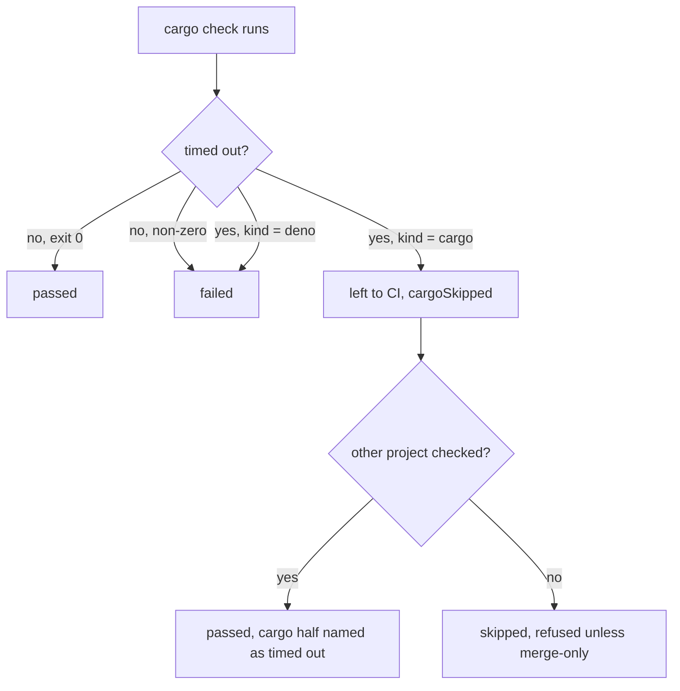

## Summary

Part of #4326

The trusted parent issue requires: "With free space between the floor and floor +
headroom, and nothing prunable, a milestone sync still lands within one cycle
(stubbed disk figures)." Its existing cargo budget reporting must remain accurate
when the timeout path also leaves cargo to CI.

The milestone sync's merged-tree gate (`checkMergedTree`) and resolution gate
(`verifyResolvedTree`) now leave a **cargo step that hits its time limit** to
the milestone PR's CI instead of refusing the resolution. Before, a cold
`cargo check --workspace --all-targets --locked` that ran past
`MERGE_GATE_TIMEOUT_MS` (300000ms) came back as `failed (exit 124)`. The repair
round had nothing to change, and the identical resolution was rebuilt and
refused every cycle (the wedge reported on `stSoftwareAU/GRQ-AutoTrader`,
`milestone/3595-…`).

For #4786 (the criterion is partial, see Acceptance Criteria), `checkMergedTree`
first runs a timed-out cargo check once more, which resumes from the crates the
first run compiled, so a tree whose only check is cargo can now be verified.
Only a second timeout is left to CI; the GRQ-AutoTrader tree also holds a Deno
project (`web/deno.json`), so it lands even then.

## Spec

### Intent and Rationale

- A timeout says nothing about whether the resolution compiles; on a cold
  ephemeral cargo target it is the build that ran out of time. Refusing it is a
  capacity fault charged to the resolution.
- Chosen over raising the timeout: any fixed limit is still beaten by a colder
  or bigger workspace, and the gate already has a "left to CI" path for the same
  kind of environmental fault (`cargoSkipped`, Issue #4326).

### Essential Design Decisions

- Resolution tasks run Deno projects before cargo, so a cargo test timeout
  cannot consume the budget for a later Deno task.
- Only a **cargo** timeout is left to CI, and only when the runner sets the new
  `timedOut` flag. A bare exit 124, a cargo compile failure (exit 101) and any
  Deno timeout stay failures, so a hung Deno check or test is still caught.
- The type check's `cargoSkipped` is honoured by the resolution gate
  (`typed.cargoSkipped === true || skipCargoBuild()`), so a timed-out
  `cargo check` also skips `cargo test`, which fills the same cold target.
- Reuses the `cargoSkipped` outcome field and report path rather than adding a
  new one; the report prose now says cargo "did not complete" (skipped for
  budget or timed out) instead of "was not run".

### Undiscoverable Facts

- A cargo-only tree whose only check timed out returns `skipped`, which
  `judgeResolutionVerdict` refuses outside a merge-only cycle (fail closed,
  Issue #1559). That is unchanged and documented in `docs/INTERNALS.md`.

## Evidence

Backend only; no UI files changed.

Files: `worker/deno/lib/milestone_merge_gate.ts`,
`worker/deno/lib/milestone_resolution_gate.ts`, report prose in
`worker/deno/lib/milestone_sync_conflict.ts` and
`worker/deno/lib/milestone_conflict_triage.ts`, docs in `docs/INTERNALS.md` and
`docs/CONTAINER.md`.

## Reproduction

- **symptom** — `cargo check … failed (exit 124)` /
  `Type check timed out after 300000ms` refused the resolution every cycle
- **status** — `verified` — with `milestone_merge_gate.ts` and
  `milestone_resolution_gate.ts` restored to the base commit, the four new tests
  that drive a runner reporting a timed-out cargo step failed
  (`failed (exit 124)`); they pass with the fix
- **regression test** —
  `worker/deno/tests/milestone_merge_gate_test.ts::checkMergedTree - a cargo check that times out is left to CI, not failed (Issue #4786)`

## Acceptance Criteria

<!-- vibe-spec-review inputs="diff+issue-body" -->

- **met** — "With free space between the floor and floor + headroom, and nothing
  prunable, a milestone sync still lands within one cycle (stubbed disk figures)."
  — evidence: `worker/deno/tests/milestone_gate_repair_land_unverified_4326_test.ts::judgeResolutionVerdict - a skipped verdict marked landUnverified passes through unchanged (Issue #4326)`
  — reviewer: met; the existing disk-budget path remains in place.
- **partial** — "work out why `milestone_resolution_gate.ts` cannot verify this
  repository's merged tree, and teach it to" — evidence:
  `worker/deno/tests/milestone_merge_gate_test.ts::checkMergedTree - a cargo-only tree whose cargo check finishes on the retry is passed, not skipped (Issue #4786)`,
  `worker/deno/tests/milestone_merge_gate_test.ts::checkMergedTree - a mixed tree whose cargo check times out passes its Deno half and names the timeout (Issue #4786)`
  — reviewer: partial — reason: a cargo-only tree that times out twice is still
  `skipped` and refused outside a merge-only cycle (Issue #1559 fail-closed
  rule), and `verifyResolvedTree`'s own cargo steps (`cargo test`) are not
  retried; landing such a tree unverified is an owner policy change.

## Test Plan

- The obsolete report wording assumed Deno passed and only cargo check could
  time out. The remaining contract says which checks ran passed and leaves an
  incomplete cargo check or test to CI. Coverage:
  `worker/deno/tests/milestone_gate_repair_land_unverified_4326_test.ts::buildConflictEscalationComment - an unverified auto resolution says the tree was not checked, a verified one says it was (Issue #4326)`
  and the existing Deno-left-to-CI cases in that file retain their negative
  assertions. Both the escalation comment and commit legend were updated.
- `worker/deno/tests/milestone_resolution_gate_test.ts::verifyResolvedTree - Deno runs before a cargo timeout exhausts the budget (Issue #4786)`
  covers a root Cargo project and nested Deno test with an advancing clock.
- Added to `worker/deno/tests/milestone_merge_gate_test.ts` (ten tests): a
  cargo-only tree whose check finishes on the retry is `passed`; a retry that
  fails to compile is `failed`; two timeouts are retried once then `skipped`; a
  Deno timeout is not retried. Earlier six tests: cargo timeout is `skipped`
  with `cargoSkipped`; mixed tree with a cargo timeout is `passed` and names the
  timeout; negative controls: exit 124 without the flag, cargo exit 101, a Deno
  timeout, and a failing Deno check beside a cargo timeout all stay `failed`.
- Added to `worker/deno/tests/milestone_resolution_gate_test.ts` (three tests):
  a typed `cargoSkipped` starts no cargo step even when the disk budget is fine;
  a `cargo test` timeout is `passed` with `cargoSkipped`; a Deno task timeout is
  `failed`.
- Edited `worker/deno/tests/milestone_gate_repair_land_unverified_4326_test.ts`:
  three assertions on the report prose changed from "Cargo was not run either
  (Issue #4326)." to "Cargo did not complete either (Issues #4326, #4786)". The
  reports still say the cargo half was left to CI, which the tests still assert.
- Red check: the four positive tests (two in the merge-gate file, two in the
  resolution-gate file) fail against the base lib files; the five negative
  controls pass there, as they pin behaviour that is unchanged.
- Twinned rules: the `cargoSkipped` report prose lives in
  `milestone_sync_conflict.ts` and `milestone_conflict_triage.ts`; both updated.
- Callers of the changed `checkMergedTree`/`verifyResolvedTree` outcome shapes
  are unchanged (no new field); `git_pull.ts` consumes `cargoSkipped` as before.
- `deno task test:unit` over the milestone gate, sync, conflict and triage test
  files: passed. Full gate result below.
- `./quality.sh < /dev/null` on the final code head: passed (config integration
  and checkov skipped by the gate itself). `deno task pr-summary-check`: 0
  blocked, 0 not checked.
- Review push (main merge with #4793 and the 2026-11-04 review): the merge
  keeps #4793's per-toolchain limits and this PR's cargo retry. `spawnTask`
  gained an injectable command runner, as `spawnTypeCheck` has (#4787).
  Coverage of the production runners' `timedOut` flag:
  `worker/deno/tests/milestone_resolution_gate_test.ts::spawnTask - a task that hits its limit comes back with timedOut set, and one that finishes does not (Issue #4786)`,
  `worker/deno/tests/milestone_merge_gate_test.ts::checkMergedTree - a cargo check the real runner reports as timed out is retried once, then left to CI (Issue #4786)`,
  and `timedOut` assertions added to
  `worker/deno/tests/milestone_merge_gate_test.ts::spawnTypeCheck - each toolchain's check gets its own limit, and a timeout names that limit (Issue #4787)`.
  Red check: with `timedOut: true` removed from either runner these three
  fail; restored, the three milestone gate test files pass (100 tests). Run
  with deno 2.9.8 and a local stand-in for `@std/assert`, because jsr.io was
  unreachable from that host; CI runs the real module. `docs/INTERNALS.md` is
  main's text plus the #4786 paragraphs, without the earlier whole-file reflow.
