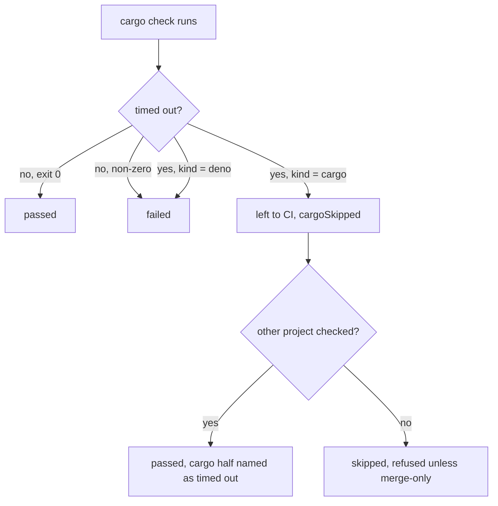

## Summary

The milestone sync's merged-tree gate (`checkMergedTree`) and resolution gate
(`verifyResolvedTree`) now leave a **cargo step that hits its time limit** to
the milestone PR's CI instead of refusing the resolution. Before, a cold
`cargo check --workspace --all-targets --locked` that ran past
`MERGE_GATE_TIMEOUT_MS` (300000ms) came back as `failed (exit 124)`. The repair
round had nothing to change, and the identical resolution was rebuilt and
refused every cycle (the wedge reported on `stSoftwareAU/GRQ-AutoTrader`,
`milestone/3595-…`).

Part of #4786. A tree whose only check is cargo is still refused when that check
times out (see Acceptance Criteria); the GRQ-AutoTrader tree also holds a Deno
project (`web/deno.json`), so it lands.

## Spec

### Intent and Rationale

- A timeout says nothing about whether the resolution compiles; on a cold
  ephemeral cargo target it is the build that ran out of time. Refusing it is a
  capacity fault charged to the resolution.
- Chosen over raising the timeout: any fixed limit is still beaten by a colder
  or bigger workspace, and the gate already has a "left to CI" path for the same
  kind of environmental fault (`cargoSkipped`, Issue #4326).

### Essential Design Decisions

- Only a **cargo** timeout is left to CI, and only when the runner sets the new
  `timedOut` flag. A bare exit 124, a cargo compile failure (exit 101) and any
  Deno timeout stay failures, so a hung Deno check or test is still caught.
- The type check's `cargoSkipped` is honoured by the resolution gate
  (`typed.cargoSkipped === true || skipCargoBuild()`), so a timed-out
  `cargo check` also skips `cargo test`, which fills the same cold target.
- Reuses the `cargoSkipped` outcome field and report path rather than adding a
  new one; the report prose now says cargo "did not complete" (skipped for
  budget or timed out) instead of "was not run".

### Undiscoverable Facts

- A cargo-only tree whose only check timed out returns `skipped`, which
  `judgeResolutionVerdict` refuses outside a merge-only cycle (fail closed,
  Issue #1559). That is unchanged and documented in `docs/INTERNALS.md`.

## Evidence

Backend only; no UI files changed.

Files: `worker/deno/lib/milestone_merge_gate.ts`,
`worker/deno/lib/milestone_resolution_gate.ts`, report prose in
`worker/deno/lib/milestone_sync_conflict.ts` and
`worker/deno/lib/milestone_conflict_triage.ts`, docs in `docs/INTERNALS.md` and
`docs/CONTAINER.md`.

## Reproduction

- **symptom** — `cargo check … failed (exit 124)` /
  `Type check timed out after 300000ms` refused the resolution every cycle
- **status** — `verified` — with `milestone_merge_gate.ts` and
  `milestone_resolution_gate.ts` restored to the base commit, the four new tests
  that drive a runner reporting a timed-out cargo step failed
  (`failed (exit 124)`); they pass with the fix
- **regression test** —
  `worker/deno/tests/milestone_merge_gate_test.ts::checkMergedTree - a cargo check that times out is left to CI, not failed (Issue #4786)`

## Acceptance Criteria

The issue states no acceptance-criteria heading. Its "What to fix" asks to teach
the gate to verify this repository's merged tree. One part is left undone:

- **missing** — "work out why `milestone_resolution_gate.ts` cannot verify this
  repository's merged tree, and teach it to" for a tree whose only check is
  cargo — reason: such a tree still returns `skipped` and is refused outside a
  merge-only cycle, by the Issue #1559 fail-closed rule. Landing it unverified
  is an owner policy change; GRQ-AutoTrader itself is mixed and is fixed.

## Test Plan

- Added to `worker/deno/tests/milestone_merge_gate_test.ts` (six tests): cargo
  timeout is `skipped` with `cargoSkipped`; mixed tree with a cargo timeout is
  `passed` and names the timeout; negative controls: exit 124 without the flag,
  cargo exit 101, a Deno timeout, and a failing Deno check beside a cargo
  timeout all stay `failed`.
- Added to `worker/deno/tests/milestone_resolution_gate_test.ts` (three tests):
  a typed `cargoSkipped` starts no cargo step even when the disk budget is fine;
  a `cargo test` timeout is `passed` with `cargoSkipped`; a Deno task timeout is
  `failed`.
- Edited `worker/deno/tests/milestone_gate_repair_land_unverified_4326_test.ts`:
  three assertions on the report prose changed from "Cargo was not run either
  (Issue #4326)." to "Cargo did not complete either (Issues #4326, #4786)". The
  reports still say the cargo half was left to CI, which the tests still assert.
- Red check: the four positive tests (two in the merge-gate file, two in the
  resolution-gate file) fail against the base lib files; the five negative
  controls pass there, as they pin behaviour that is unchanged.
- Twinned rules: the `cargoSkipped` report prose lives in
  `milestone_sync_conflict.ts` and `milestone_conflict_triage.ts`; both updated.
- Callers of the changed `checkMergedTree`/`verifyResolvedTree` outcome shapes
  are unchanged (no new field); `git_pull.ts` consumes `cargoSkipped` as before.
- `deno task test:unit` over the milestone gate, sync, conflict and triage test
  files: passed. Full gate result below.
- `./quality.sh < /dev/null` on the final code head: passed (config integration
  and checkov skipped by the gate itself). `deno task pr-summary-check`: 0
  blocked, 0 not checked.
