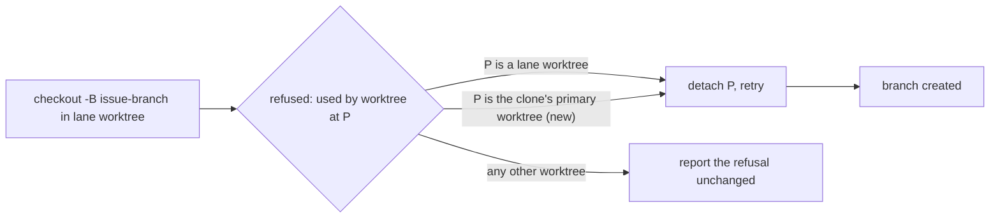

## Summary

A run died in phase `setup` after 47s because `createFeatureBranchFromBase`
could not move the issue branch: the branch was still checked out in the host's
shared clone (its primary worktree, `<work root>/<repo>`), and the run works in
a lane worktree. The Issue #1564 repair (detach the holder, retry) only
recognised holders shaped `<work root>/worktrees/<lane>/<repo>`, so the refusal
went unrepaired and recurred on every re-claim. Closes #4789.

`attemptCreateFeatureBranch` now also asks `primaryCloneHoldingBranch` whether
the holder is this clone's primary worktree, and releases it through the same
`detachLaneWorktreeHead` plus retry.

Version bump: `VERSION` is not touched by this change; the merged commit records
the final version.

## Spec

### Intent and Rationale

- The failure is host contention, not an issue property, and it repeated
  deterministically (12 attempts on GRQ-AutoTrader#3837, most dying in `setup`).
  The existing repair already releases a lane worktree's hold; the primary clone
  is the same kind of holder.
- Rejected: widening `laneWorktreeHoldingBranch`, which the PR passes share
  (`preparePrBranch`, `checkoutPrBranchAtRemoteHead`, `pr_ci_processor`); their
  behaviour stays as it was.

### Essential Design Decisions

- Only this clone's own primary worktree (first entry of
  `git worktree list --porcelain`, compared by real path) is admitted. A
  developer's own linked worktree is still reported, never detached.
- `git checkout --detach` keeps the working tree and index, so nothing in the
  primary is discarded; the claim guarantees no other run owns this issue's
  branch.

### Undiscoverable Facts

- The source run's release comment on stSoftwareAU/GRQ-AutoTrader#3837 quoted
  `fatal: '<branch>' is already used by worktree at
  '/home/vibe/auto-issue-work/GRQ-AutoTrader'`.
  This issue's own body omits the failure message because the source repository
  is private.
- On this host the primary clone `~/auto-issue-work/GRQ-AutoTrader` is still on
  `issue-3837-…-redo-1`, with `worktrees/s2/GRQ-AutoTrader` detached. This is
  how the fault was confirmed. How the primary came to hold the branch was not
  determined.

## Evidence

Backend change; no UI file is touched.

Observed with the real tool on this host:
`git -C ~/auto-issue-work/GRQ-AutoTrader worktree list` printed the primary on
`[issue-3837-policy-knob-for-how-long-before-the-open-a-resting-redo-1]`, the
branch the failed run needed. `primaryCloneHoldingBranch` relies on the first
`worktree` line of `git worktree list --porcelain` being the primary.

## Reproduction

- **symptom** —
  `Failed to create feature branch 'issue-3837-…' from 'Develop':
  git checkout -B … exited 128: fatal: '…' is already used by worktree at
  '/home/vibe/auto-issue-work/GRQ-AutoTrader'`,
  phase `setup`, 47s.
- **status** — `verified` — the new test, run from a lane worktree with the
  primary holding the branch, went red with the new call in `git_branch.ts`
  disabled (`ok: false`) and passes with it. The base-branch production code has
  no such call, so it is the unfixed code. The real-host fleet run was not
  repeated.
- **regression test** —
  `worker/deno/tests/git_branch_primary_clone_held_test.ts::createFeatureBranchFromBase - frees a branch the shared clone's primary worktree holds (Issue #4789)`

## Test Plan

- Added `worker/deno/tests/git_branch_primary_clone_held_test.ts` (11 tests,
  real git in temporary directories plus mocked git runners): release of a
  primary-held branch from a lane worktree; a developer's linked worktree is
  still not detached; and direct cases for `primaryCloneHoldingBranch` (primary,
  non-primary, stderr with no held path, not a git repository, a listing that
  cannot run, a listing that exits non-zero, and the first listed worktree being
  the primary), and a repair of a broken ref named only by a refused `checkout`
  (a `git` shim on `PATH` fails `checkout` until the ref is removed).
- Red checks: disabling the `primaryCloneHoldingBranch` call in
  `attemptCreateFeatureBranch` turned the release test red (1 failed, 6 passed).
  Making `primaryCloneHoldingBranch` return the held path unconditionally turned
  the developer-worktree test and the two negative direct cases red (3 failed, 4
  passed). Both restored.
- Mutation check (all three survivors now kill a test): deleting the
  `stderrTexts.push(checkout.value.stderr)` call at `git_branch.ts:190` turns
  the broken-ref-from-checkout test red; dropping `!listing.ok` at
  `lane_worktree.ts:508` fails the run (the mocked failed listing reaches
  `listing.value`); dropping `listing.value.code !== 0` turns the non-zero
  listing test red. All restored.
- Existing tests: `deno task test:unit` over `tests/git_branch_test.ts`,
  `tests/lane_worktree_test.ts`, `tests/pr_branch_preparation_test.ts`,
  `tests/pr_branch_checkout_test.ts` and the new file: 99 passed, 0 failed. No
  existing assertion was changed or removed.
- Callers of the changed helper checked: `laneWorktreeHoldingBranch` keeps its
  behaviour (only its regex moved into `heldWorktreePath`); its callers
  `pr_branch_checkout.ts`, `pr_branch_preparation.ts` and `pr_ci_processor.ts`
  are untouched.
- Twinned rules: searched docs and `worker/deno/lib` for "lane worktrees only"
  statements. The comment at `worker/deno/tests/git_branch_test.ts` L887
  ("confined to this host's own lane worktrees") is now incomplete, but that
  file contains NUL bytes and could not be edited here.

## Not done

- `./quality.sh`: every stage passed except `deno tests`, whose only failures
  are the two Rust-formatter cases in
  `tests/completion_phase_repo_formatters_test.ts`, unrelated to this change (no
  cargo-fmt fixture access on this host); the new and touched git tests pass.
- How the primary clone came to hold the issue branch was not found, so a path
  that re-creates the state is not closed; this change only stops it wedging the
  setup.
