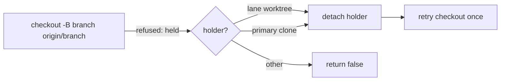

## Summary

`resumeFeatureBranchFromRemote` now releases a pushed checkpoint branch held by a sibling lane worktree, detaching the holder and retrying the checkout once, so a re-claim resumes the checkpoint instead of recreating the branch from base. Closes #4794.

Version bump: not touched by this change.

## Spec

### Intent and Rationale

- The resume checkout is refused with `is already used by worktree at '<path>'` when a dead sibling lane still holds the branch; the resume then reported "no resumable work" and `createFeatureBranchFromBase` restarted from base, discarding pushed commits.
- Reusing `heldByLaneWorktree` and `detachLaneWorktreeHead` (as `createFeatureBranchFromBase` does, Issue #1564) was chosen over a pre-lookup release of every lane hold: it acts only on a real refusal.

### Essential Design Decisions

- A lane holder is preferred; the primary clone (Issue #4789) is the fallback. A holder outside the lane root (a developer's worktree) is left alone and the function returns `ok: true, value: false`, as before.

### Undiscoverable Facts

- None.

## Evidence

Backend-only change; no UI. Real-git tests in `worker/deno/tests/git_branch_resume_lane_held_test.ts`.

## Test Plan

- Added `worker/deno/tests/git_branch_resume_lane_held_test.ts`:
  - sibling lane holds an issue branch with a pushed commit ahead of base; resume returns `true`, checks out the checkpoint SHA and detaches the sibling.
  - developer's worktree outside the lane root holds the branch; resume returns `false` and that worktree stays on its branch.
- Red check: with the holder line reverted to `primaryCloneHoldingBranch` only, the sibling-lane test failed (`value: false`, expected `true`); restored, it passes.
- Existing resume callers: `worker/deno/tests/git_branch_primary_clone_held_test.ts` (primary holder) and `worker/deno/tests/git_branch_test.ts` still pass; `resumeFeatureBranchFromRemote` callers (`issue_branch_resume.ts`, `issue_worker_wiring.ts`) pass the function through unchanged.
- `deno task test:unit` on the three test files: 48 passed, 0 failed. `deno fmt --check`, `deno lint`, `deno check`: clean.
- Docs: grepped `README.md` and `docs/` (excluding archive) for the function name and the held-branch wording; no hits. Doc comments on `resumeFeatureBranchFromRemote` and `laneWorktreeHoldingBranch` updated.
- `./quality.sh`: every stage passed except `deno tests`, whose parallel pass had one failure, `worker/deno/tests/merge_fast_checks_credentials_4705_test.ts:101` (33251 passed, 1 failed). It expects no `HTTPS_PROXY` entries in the spawned env, and this sandbox sets proxy variables; with them unset the file passes (6 passed). It does not touch the changed code. The serial pass did not run because the parallel pass failed.
