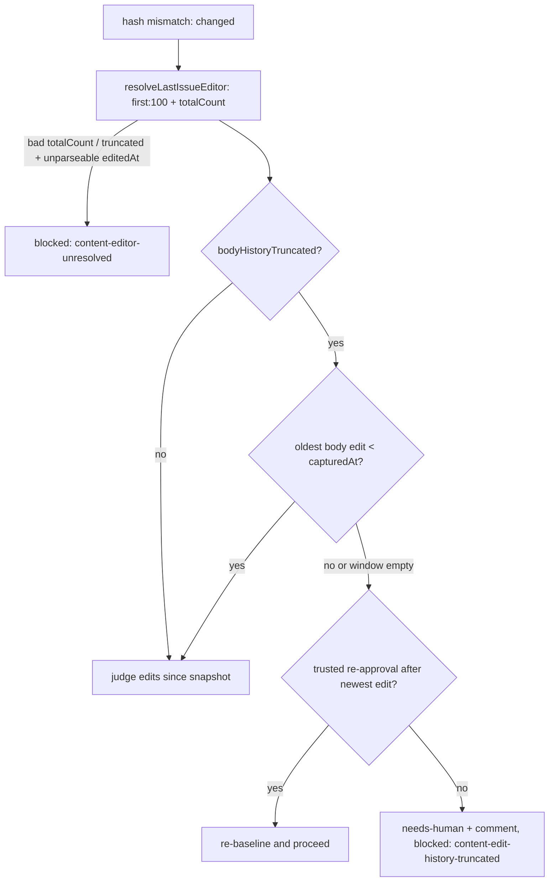

## Summary

The content-integrity gate's edit-actor lookup asked for
`userContentEdits(last:100)`. GitHub lists that connection newest first, so
`last:100` returned the **oldest** 100 body edits; on an issue with more than
100 edits the newest were never judged, `sinceSnapshot` came back empty and the
gate re-baselined on the live (possibly untrusted) content as
`SNAPSHOT_SELF_MISMATCH`. The lookup now asks for `first:100` (the newest 100)
plus `totalCount`, reports `bodyHistoryTruncated`, and the gate fails closed
when a truncated window cannot place the snapshot. Closes #4804.

Version bump: not touched by this change.

## Spec

### Intent and Rationale

- `first:100` returns the newest edits, which are the ones that can post-date an
  approval snapshot; `totalCount` is what distinguishes a complete window from a
  truncated one.
- The issue's suggested fix was followed: fail closed when the oldest returned
  edit is at or after the snapshot time and history was truncated.

### Essential Design Decisions

- `totalCount` is now required in every mode (it was only checked with
  `includeDiff`). A response without a usable count is rejected, per the
  "missing key is malformed" rule, rather than assumed complete.
- A truncated window whose body edits include an unparseable `editedAt` fails
  the lookup itself (`ok: false`), since such an edit cannot be placed against
  the snapshot.
- Truncation blocks through its own `content-edit-history-truncated` skip reason
  (PR #4944 review), classed `human` in `SKIP_REASON_CLEARING` so it does not
  hold the repo's lower tiers, and `run-local` in the census coverage map. It is
  not transient, so before blocking the gate checks `findTrustedReapproval` (a
  trusted `work-on` re-add or `needs-human` removal after the newest edit,
  including one uncached re-read) and re-baselines on a hit. Otherwise it
  applies `needs-human` and posts one deduplicated comment via `escalateToHuman`
  and leaves `work-on` in place. An empty window leaves the newest edit unknown,
  so no re-approval clears it. The distinct log marker is
  `[SECURITY] [CONTENT_EDIT_HISTORY_TRUNCATED]`. If the oldest returned body
  edit predates the snapshot, every post-snapshot edit is in the window and the
  gate proceeds as before.

### Undiscoverable Facts

- `timelineItems(last:100, …)` for renames is chronological, so `last:100` there
  is already the newest 100; renames are not covered by `bodyHistoryTruncated`
  and were left alone (out of this issue's scope).

## Evidence

Backend only; no UI files touched. Behaviour demonstrated by the tests below,
whose fake GitHub applies `first`/`last` windowing to 150 newest-first edits.

Docs updated: `SECURITY.md` section 2 (TOCTOU protection: edit-history
description and a new "Truncated body history" bullet); doc comments in
`worker/deno/lib/issue_edit_actor.ts` and
`worker/deno/lib/work_on_content_integrity.ts`. `docs/GH-API-OPTIMISATION.md`
advises `last:N` for timelines, which stays true; not edited.

## Test Plan

- Added
  `worker/deno/tests/work_on_content_integrity_truncated_history_4804_test.ts`
  (13 tests at head, gate level): all-post-snapshot truncated window blocks and
  escalates; window covering the snapshot with an untrusted editor among the
  newest three is judged and blocked (the bug's reproduction: under `last:100`
  it was invisible); same window all trusted proceeds; complete 3-edit history
  proceeds (control); `totalCount` 150 with an empty window blocks and
  escalates; a trusted `work-on` re-add after the newest edit clears a truncated
  history; a re-add before the newest edit, an untrusted re-add and any re-add
  over an empty window do not; a stale cached timeline gets one live re-read;
  the new reason does not suppress lower tiers (`suppressesLowerTiers`); a stale
  approval is reported once, not again by the uncached re-read; an unattributable
  edit blocks even when the trusted list holds an empty login.
- Added to `worker/deno/tests/issue_edit_actor_test.ts`: default query asks for
  `first:100`; 150 edits give the newest 100 with
  `bodyHistoryTruncated === true`; 3 edits give `false`; missing `totalCount`
  and `totalCount` below node count are rejected; truncated window with garbage
  `editedAt` is rejected; a `totalCount` of 5 with an empty window returns no
  actor yet `bodyHistoryTruncated === true` (kills the mutation deleting the
  `bodyHistoryTruncated` property in the no-candidates return,
  `issue_edit_actor.ts:321`); an empty history gives `false`.
- Edited fakes only (added `totalCount`; no assertion removed or changed) in
  `issue_finder_test.ts`, `pickup_content_integrity_test.ts` and
  `work_on_content_integrity_{depends_on,editor,escalation_dedup,multi_editor,needs_human_reapproval,reapproval_edit_order,reapproval,self_mismatch}_test.ts`,
  because the lookup now rejects a response without `totalCount`.
- Red checks (each restored afterwards): `newestEditAt !== null` guard forced
  true → empty-window re-approval test red; re-approval result ignored → re-add
  test red; uncached re-read result ignored → stale-cache test red; truncation
  block disabled → truncated-window test red; `oldestBodyEditAt >= capturedAt`
  forced true → untrusted-editor and trusted-proceed tests red;
  `oldestBodyEditAt === null ||` replaced by `false ||` → empty-window test red;
  `first:100` changed back to `last:100` → untrusted-editor test red.
- Callers of `resolveLastIssueEditor` checked: only
  `work_on_content_integrity.ts` (the gate) in production.
- Results (final head): `deno task test:unit` on the changed test files
  `work_on_content_integrity_*_test.ts`, `issue_edit_actor_test.ts`,
  `pickup_content_integrity_test.ts` and `issue_finder_test.ts`, plus
  `content_approval_*`, `idle_decision_census_test.ts` and
  `collect_work_on_candidates*_test.ts`: 391 passed, 0 failed;
  `work_on_content_integrity_truncated_history_4804_test.ts` (13 tests at head):
  13 passed, 0 failed.
- Mutation survivors (PR #4944 review), each killed then restored:
  `warnOnStale: true` → `false` in the truncated block → stale-approval test red
  (2 failed); `warnOnStale: false` → `true` on the uncached re-read → once-only
  stale-marker test red; `!e.login ||` → `false ||` → empty-login test red
  (config trusts `""`).
- `./quality.sh` (run on the earlier head, before the PR #4944 review fix; not
  re-run on the final head): every stage passed except `deno tests`, parallel
  pass 33286 passed, 1 failed:
  `tests/merge_fast_checks_credentials_4705_test.ts:101`, which expects no
  `NO_PROXY`/`no_proxy` entries in the spawned environment and fails because
  this sandbox sets them; it does not touch the changed code. Not confirmed on
  the base branch. The serial pass did not run because the parallel pass failed.

Not checked: the serial test pass, the base-branch behaviour of the 4705 test,
and rename-history truncation (`timelineItems(last:100)`).
