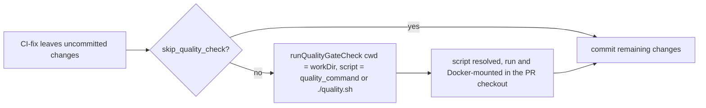

## Summary

The CI-fix post-agent quality check now runs in the PR checkout instead of the
worker's own directory, and honours the repository's `quality_command` and
`skip_quality_check`. Closes #4805.

Version bump: `VERSION` is not changed by this PR.

## Spec

### Intent and Rationale

- `_runPostClaudeQualityCheck` called `runQualityGateCheck` with no directory,
  so `fileExists("./quality.sh")`, the tool probe, the command's cwd and the
  Docker mount all resolved against the worker process's cwd (the VibeCoder
  install). The worker's own `quality.sh` was run or skipped in place of the
  target repo's.
- The fix binds the existing check to `workDir` rather than deleting it, as the
  issue's correction says.

### Essential Design Decisions

- `QualityGateParams.cwd` is optional; unset keeps the process cwd, so the
  shell-driven `commands/quality_gate_phase.ts` caller is unchanged.
  `bindQualityDepsToCheckout` wraps the deps (injected or default), so one place
  covers the file check, tool probe, command cwd and Docker mount.
- `skip_quality_check` and `quality_command` were not read by any gate code
  (only by prompt text). The issue asks for them to be honoured, so the CI-fix
  call site reads them through `getRepoConfig`; the shared gate does not, so the
  shell caller keeps its behaviour. A configured command naming no file
  (`deno task test`) must run, not be reported skipped, so the existence check
  tests only a first token containing `/` (`qualityCommandFile`). A blank
  command is still skipped.
- Build-cache placement in the gate's child environment follows the spawn cwd,
  so it now follows the checkout on this lane. This follows from the fix.

### Undiscoverable Facts

- None. #4907 (production CI/spelling quality-instruction wiring) is untouched.

## Evidence

Backend-only change. `worker/deno/lib/quality_gate_phase.ts`
(`runQualityGateCheck`, `bindQualityDepsToCheckout`, `qualityCommandFile`) and
`worker/deno/lib/pr_ci_processor.ts` (`_runPostClaudeQualityCheck`) changed;
`docs/workflows/ci-fix.md` step 7 now says the gate runs in the PR checkout and
that `skip_quality_check` skips it.

## Test Plan

New tests, all passing on the head via `deno task test:unit` from `worker/deno`:

- `worker/deno/tests/quality_gate_phase_test.ts`: checkout cwd resolves the
  script and runs the command in it; checkout cwd is the Docker mount; no cwd
  leaves paths unchanged (control); hermetic real-filesystem run: the checkout and the
  process cwd (`Deno.chdir` to a second temp dir, restored in `finally`) each
  hold a `quality.sh` printing a different marker, and only the checkout's
  marker appears; `qualityCommandFile` cases (`./`,
  `scripts/q.sh`, absolute, `deno task test`, `make test`, empty); a bare
  command is not skipped; a configured command naming a file checks that file.
- `worker/deno/tests/pr_ci_processor_test.ts`: the gate receives `cwd` equal to
  the run's workDir and `./quality.sh`; a configured `qualityCommand` is passed;
  `skipQualityCheck` never calls the gate and the change is still committed.
- Result: `quality_gate_phase_test.ts`, `pr_ci_processor_test.ts`,
  `pr_ci_processor_state_file_4394_test.ts`: 150 passed; other gate-related test
  files: 106 passed.
- Red checks (production change broken on purpose, then restored): dropping the
  `cwd` wrap reddens the three checkout tests; dropping `cwd` at the call site
  reddens the two call-site tests; ignoring `qualityCommand` reddens its test;
  disabling the skip branch reddens the skip test; reverting
  `qualityCommandFile` or restoring the old `fileExists(qualityScript)` check
  reddens the command/file tests; the old `./`-only regex reddens the
  `scripts/q.sh` case.
- Callers of `runQualityGateCheck` checked: `commands/quality_gate_phase.ts`
  (passes no `cwd`, covered by the no-cwd control test) and `pr_ci_processor.ts`
  (covered above). Existing tests through `createDefaultDeps` still pass.
- No assertion was removed from an existing test.
- Limits: the real-filesystem test overrides `runCommand` with a direct spawn,
  so the `agent` sudo path is not exercised. The test no longer depends on the
  ambient cwd: it passes from both the repo root and `worker/deno`.
- The eight test files the mutation check named as failing its baseline
  (`fence_coverage_verifier`, `pr_ci_processor`, `quality_gate_credentials_4705`,
  `quality_gate_phase`, `repo_formatters_4113`, `tool_output_treat_as_data_3046`,
  `untrusted_command_env`, `untrusted_gate_spawn`) pass together from the repo
  root on the head: 221 passed, 0 failed.
- `./quality.sh` on the head (proxy variables unset): every stage passed except
  `deno tests` (10 failed, 33487 passed), and the serial pass did not run. All
  10 failures are in files this change does not touch and trace to the sandbox:
  the pre-push hook tests in `claude_runner_pre_push_3394_test.ts` and
  `pre_push_hook_test.ts` hit
  `JSR package manifest for '@std/yaml' failed to
  load` (jsr.io unreachable),
  and `review_fleet_prs_post_claim_4398_test.ts` fails with
  `Failed to resolve 'osascript' for allow-run`. Config integration, semgrep,
  Checkov and the release-tag ruleset check were skipped.
