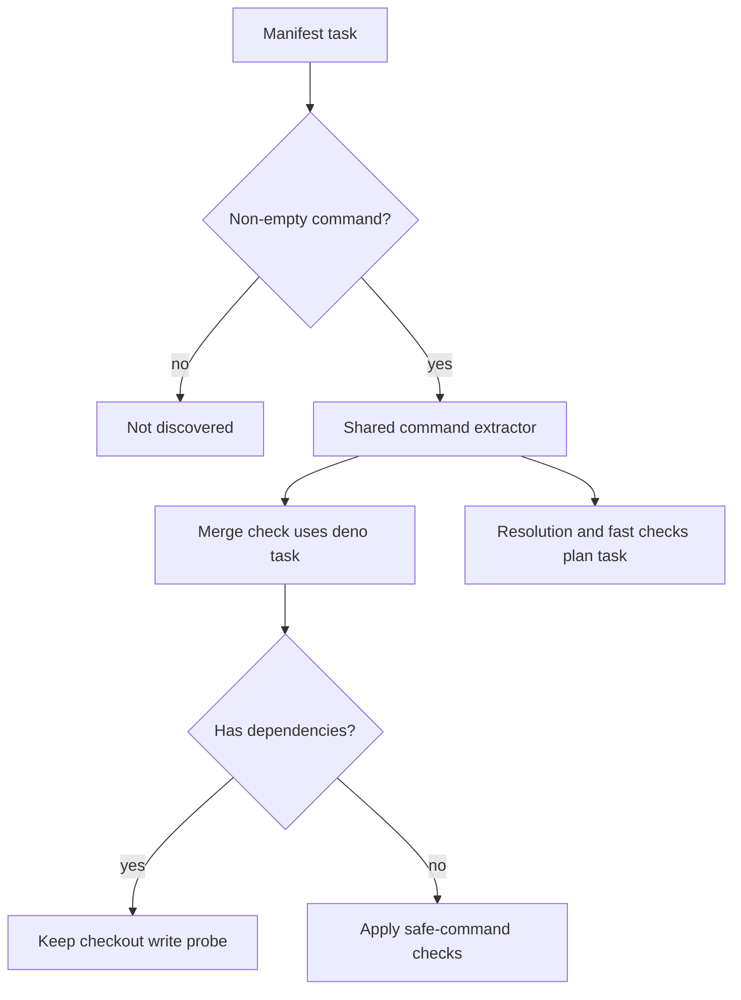

## Summary

Milestone merge and resolution gates now recognise Deno string tasks and
object-form tasks with a non-empty `command`. Object-form checks use the
repository's `deno task check`, and object-form test tasks are planned by both
resolution and fast-merge checks. Dependencies-only tasks remain excluded;
object-form checks with dependencies keep the checkout write probe. Real-agent
test fixtures use the shared reachable-directory helper so mutation baselines
work under a private `TMPDIR`. Closes #4811. Version bump: none in this change.

## Spec

### Intent and Rationale

- Preserve the repository's own check and test commands when its Deno manifest
  uses Deno 2 object-form tasks.
- Use one command extractor for task discovery and the read-only check decision
  so both interpret the manifest the same way.

### Essential Design Decisions

- A task is discoverable only when its string value or object `command` is a
  non-empty string. A dependencies-only task is not itself a check or suite.
- A check task with a `dependencies` property retains the write probe because a
  dependency may create or update project files.
- Descriptions do not affect task discovery or command safety checks.

### Undiscoverable Facts

- Deno 2.9.8 was exercised with temporary manifests. Command-plus-description
  and command-plus-dependency tasks exited 0; the dependency ran before its
  parent command. A dependencies-only task also exited 0, ran its dependency,
  and reported `(no command)`.

## Evidence

Backend-only change; verification evidence is in the Test Plan. Deno behaviour
was observed with `deno --version` and a temporary fixture run through
`deno eval --no-config --no-lock --allow-all`.

## Deno regression avoided

Task parsing, tests and validation use Deno tooling; no Node tooling or
dependencies were added.

## Test Plan

- `deno task test:unit tests/milestone_merge_gate_test.ts tests/milestone_resolution_gate_test.ts tests/merge_fast_checks_test.ts tests/untrusted_gate_spawn_test.ts`
  — passed: 128 parallel and 94 serial tests.
- `deno task check:manifests` — passed through the full quality gate's
  completeness checks.
- Targeted `deno lint` — passed for the six changed TypeScript files.
- Targeted `deno check --frozen --lock=deno.lock` — passed for the two changed
  modules, `merge_fast_checks.ts`, and the four touched test files.
- `deno fmt` — passed for the six changed TypeScript files.
- `timeout 900 ./quality.sh < /dev/null` — passed, including the full unit suite
  (494.9 seconds), lint, type check and formatting. Config integration was
  skipped (`deno or .config.json not available`); Checkov was skipped because it
  was unavailable.
- Added
  `worker/deno/tests/milestone_merge_gate_test.ts::findTypeCheckProjects - object-form check task in deno.json is the repository check`
  and
  `worker/deno/tests/milestone_merge_gate_test.ts::findTypeCheckProjects - object-form check task in deno.jsonc is the repository check`.
- Added
  `worker/deno/tests/milestone_merge_gate_test.ts::readManifestTasks - empty, malformed and dependencies-only commands are excluded`.
- Added
  `worker/deno/tests/milestone_resolution_gate_test.ts::verifyResolvedTree - object-form unit tasks run without quality.sh`
  and
  `worker/deno/tests/milestone_resolution_gate_test.ts::verifyResolvedTree - object-form test:unit keeps precedence over object-form test`.
- Added
  `worker/deno/tests/merge_fast_checks_test.ts::planFastChecks: object-form manifest tasks are included in the plan`
  and
  `worker/deno/tests/merge_fast_checks_test.ts::spawnFastCheck keeps object-form check tasks read-only only when safe`.
- Extended
  `worker/deno/tests/milestone_merge_gate_test.ts::spawnTypeCheck - a Deno check is read-only only when it writes nothing into its directory, a cargo check keeps the write requirement`
  with safe-command, unsafe-command, malformed-task and dependency-bearing
  object-form cases.
- Base-implementation red checks: the two object-form check tests,
  task-discovery test and safe object-form read-only case failed against the
  original `milestone_merge_gate.ts` (4 failed, 90 passed). The two object-form
  resolution tests also failed against that implementation (2 failed, 48
  passed). The initial unfixed fast-check run failed its object-form plan and
  read-only tests too.
- Dependency write-probe red check: removing the dependency guard made
  `worker/deno/tests/merge_fast_checks_test.ts::spawnFastCheck keeps object-form check tasks read-only only when safe`
  fail at the dependency-bearing task (1 failed, 37 passed); restoring the guard
  made the targeted suite pass.
- Mutation baseline repair: the real-agent credential tests in
  `worker/deno/tests/untrusted_gate_spawn_test.ts` now use
  `makeAgentReachableTempDir`. The mutation runner's private `0700` `TMPDIR`
  previously made both fixtures inaccessible to `agent` (479 passed, 2 failed).
  The same runner now passes its complete 481-test baseline.
- Strengthened malformed-task coverage with null and primitive tasks, and direct
  read-only checks for null, primitive, empty and dependencies-only tasks.
  Removing the original null guard made the discovery test fail by discarding
  the valid task too (0 passed, 1 failed).
- Removed redundant task-shape guards whose mutations were equivalent for JSON
  manifest values. Optional command access handles absent values; a missing
  command becomes an empty string and fails the existing `deno check` invocation
  check before dependency inspection.
- Diff-scoped `runMutationCheck` with `defaultMutationRunnerSeams`, the complete
  diff against `origin/main`, and a 900-second budget — completed: 6 killed, 0
  survivors, 7 candidates (one syntactically invalid mutant). No exemption or
  mutation-check skip was added.
- No existing assertions were removed. The existing `spawnTypeCheck` read-only
  test gained safe-command, unsafe-command, malformed-task and
  dependency-bearing object-form cases.
- Callers checked: `resolveCheckArgs`, `verifyResolvedTree` through
  `resolutionTasksFor`, `planFastChecks` through the same task discovery helper,
  `spawnTypeCheck`, and `spawnFastCheck`.
- Documentation checked: the “Every automatic resolution is verified before it
  is pushed” section in `docs/workflows/milestones.md` and the merged-tree
  type-check section in `docs/INTERNALS.md`; the latter's generic manifest-task
  description remains accurate.
- Remaining unchecked: config integration and Checkov were skipped by the full
  quality gate; no other known risk remains.
