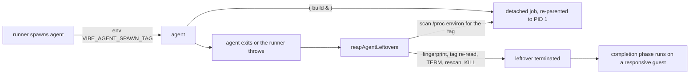

# PR Summary — Issue #4815

## Summary

Partial mitigation for #4815. An agent run now terminates the tagged processes
it leaves running once the agent has exited, within a bounded number of KILL
rounds; survivors and skipped pids are reported, not signalled. This stops a
verified leak: a detached `( … & )` job is re-parented to PID 1 at once, so it
never appears in the descendant snapshot (Issue #4382), and on a normal exit the
collector is not run at all. Nothing in the worker bounded such a job before.

It is not shown that this leak caused the completion wedge. The three archived
facts posted on the issue establish an unresponsive guest and the last logged
step, with guest memory and pressure unavailable. They do not establish that the
agent had exited, that anything was left running, or that the guest was starved.
The leftover build is a cause that fits those facts, no more. The diagnosis and
repair of the completion wedge stay outstanding, which is why this summary says
`Part of #4815` and does not close it.

Every agent spawn now carries a unique `VIBE_AGENT_SPAWN_TAG` in its
environment. After the agent exits, by any path, `reapAgentLeftovers` in
`worker/deno/lib/agent_leftover_reaper.ts` finds each same-user process whose
`/proc/<pid>/environ` still holds that tag, sends TERM, then KILL after the
runner's kill-after bound. `runClaudeWithTimeoutBody` in
`worker/deno/lib/claude_runner.ts` calls it after the descendant tracker settles
on the normal path, and again in the catch path, so a throw cannot abandon a
live agent or its leftovers.

Review round 4 closed two gaps in the first version: a pid reused by an untagged
process before the identity was captured could be signalled, and a tagged child
started during the pass was never considered.

## Spec

### Intent and Rationale

- The hard-kill facts posted on this issue name the completion phase, the
  `pre-PR verifier` or `agent turn` as the last step logged, an hour of silence
  before capture, and a guest probe that did not answer. They do not say whether
  the agent had exited or whether anything was left running
- PR #5312 showed the guest VM itself stopped answering and that the launcher's
  early silent-guest reap (#5161) only shortens such a hang. Guest memory read
  `not available`, so the cause was left open. A heavy build or watcher the
  agent left behind is one cause that fits the posted kills, and nothing in the
  worker bounded it. This PR removes that one leak and does not claim it was the
  cause; #5161 still bounds any other hang. On a recurrence, the
  `AGENT_LEFTOVERS_COLLECTED` and `AGENT_LEFTOVERS_UNCHECKED` events say whether
  a leftover was found, which is the evidence that would connect the leak to a
  wedge
- A detached job is the case nothing collected before: it leaves the agent's
  process tree at once. The environment is the one thing it keeps, so the tag is
  the only reliable way to find it again
- The tag is set on the child environment only (`baseEnv`), before the gh guard
  shim and the pre-push hook copy it. The worker's own later subprocesses, such
  as the completion phase's git and gh calls, never carry it and are never
  reaped

### Essential Design Decisions

- Linux only. The scan runs a small `sh` script that reads `/proc/<pid>/environ`
  through `grep -z -x -F`, because Deno refuses that file under `--allow-read`
  alone. The tag is passed as an argument, never interpolated, and only the UUID
  shape `newAgentSpawnTag` produces is accepted
- Each pid is fingerprinted (`captureProcessIdentity`), and then its tag is read
  again for that same pid (`hasTag`), so a pid reused between the scan and the
  fingerprint holds an untagged process and is skipped instead of being
  fingerprinted as ours. The fingerprint is re-checked (`isSameProcess`)
  immediately before every TERM and KILL. A pid with no fingerprint, no tag or a
  changed fingerprint is never signalled and is reported as skipped
- The pass rescans for tagged processes while it runs: every second of the TERM
  wait, then in KILL rounds until a rescan finds nothing new and nothing is left
  to KILL, at most four rounds. A child a leftover starts while it handles TERM
  is therefore terminated, each new pid going through the same fingerprint, tag
  and re-check steps. If new ones are still appearing at the bound, the newest
  are reported as survivors and the warning says cleanup is incomplete
- The worker's own pid is never signalled. Signals go to single pids, never
  groups
- The reaper never throws. A failed scan logs its cause and emits
  `AGENT_LEFTOVERS_UNCHECKED`. A signal, identity or probe that throws stops the
  pass and lists every pid not proven gone, a failed rescan included. A
  successful pass emits `AGENT_LEFTOVERS_COLLECTED`
- `VIBE_AGENT_SPAWN_TAG` is registered in `vibe_env_registry.ts` as launch
  plumbing

### Undiscoverable Facts

None. The raw evidence stays on the host in `~/logs/hard-kill-archive/`; this
fix rests only on the redacted facts already posted on the issue.

## Evidence

Backend-only change; verified by tests, including two that drive real processes
on Linux.

- Docs: `docs/INTERNALS.md` describes the spawn tag, the reaper, its identity
  checks and both events, next to the orphan collector it complements
- Coverage ledger: `docs/audits/lib-sweep-coverage/top-up-4815.json` lists the
  new module
- Issue numbers this diff cites: #4815 (this issue), #4382 (the descendant
  collector it complements), #5312 and #5161 (the earlier diagnosis and the
  silent-guest reap)

## Test Plan

- New `worker/deno/tests/agent_leftover_reaper_4815_test.ts`, 19 tests (run
  count at the head, below):
  - terminates tagged processes, spares its own pid, names them in the warning
  - KILLs a pid that ignores TERM after the wait, and names a survivor that
    outlives KILL
  - a scan failure logs its cause and signals nothing; nothing tagged means no
    signal and no warning; an unsupported platform never scans; a malformed tag
    is refused before any scan
  - a signal that throws stops the pass and names what was done
  - a pid replaced between TERM and KILL is never KILLed; a pid with no identity
    is never signalled
  - a tagged pid replaced by an untagged process before the identity is captured
    is never signalled and stays alive, beside a genuine leftover that is
    terminated; when every found pid was replaced, nothing is signalled and no
    leftover is claimed
  - a tagged child started while the parent handles TERM is terminated, an
    unrelated process survives; a child born during KILL is found by the next
    round; a tree that keeps spawning is bounded and reported as incomplete; a
    failed rescan stops the pass and lists what is unproven
  - Linux, real processes: the default tag read is true for a tagged process and
    false for another tag, an untagged process and a missing pid
  - Linux, real processes: a detached tagged `sleep` is terminated while an
    untagged control keeps running
  - Linux, real runner: a stub agent that leaves `( sleep … & )` behind has it
    terminated by `runClaudeWithRetry`
- `worker/deno/tests/claude_runner_killed_test.ts`: the drain-cap test (#325)
  disables the reaper, because it deliberately leaves a descendant holding
  stdout and asserts only the drain cap
- Branch outcomes: every arm the review round added is reached by a test above:
  tag read false (skipped, nothing signalled), tag read true (signalled); a
  rescan finding a new pid during the TERM wait or a KILL round; a clean rescan
  ending the pass; a rescan that fails; the KILL-round bound exhausted
- Red on the previous head: with `worker/deno/lib/agent_leftover_reaper.ts`
  restored from commit `6ebe94d2a` (before this round) and the new tests run
  without type checking, the six new fake-driven tests fail (the replacement is
  sent TERM; the child born during TERM, the child born during KILL and the
  respawning tree are never reaped; the rescan failure is not reported) and the
  other twelve pass. The default tag read test needs the new `hasTag` and is not
  part of that run
- At the head: `deno test` on `tests/agent_leftover_reaper_4815_test.ts`,
  `tests/claude_runner_killed_test.ts` and `tests/vibe_env_registry_test.ts`: 39
  passed, 0 failed; the reaper test file alone: 19 passed, 0 failed. `deno lint`
  and `deno check` on the changed files: clean. `deno fmt --check` on the
  changed TypeScript files: clean
- Not done or not checked: the full `./quality.sh` (not run, for run budget; CI
  runs it on this PR); a live fleet host, so no connection between the leak and
  the incident is shown. A recurrence on a fleet host would be that evidence

## Acceptance Criteria

The issue's remaining scope names no criteria heading, so each requirement is
quoted from its words.

- **partial** — "Complete the issue through an implemented fix and automated
  regression/recovery evidence" — reason: the detached-process leak is fixed and
  covered by automated tests, but no test or log connects it to the completion
  wedge, so it is a mitigation of a verified leak, not a shown fix of the
  incident
- **missing** — "use a bounded replay or the next applicable recurrence to
  diagnose and repair the completion failure" — reason: the cause of the guest
  that stopped answering is still undiagnosed; the new events would show a
  leftover on a recurrence, and no live fleet host has been checked for one

Part of #4815.

🤖 Generated with [Claude Code](https://claude.com/claude-code)
